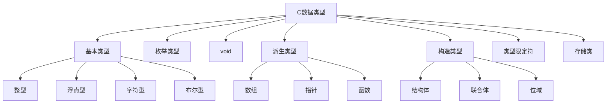

---
categories:
  - Software
tags:
  - course/clang
  - C语言/数据类型
  - C语言/整型
  - C语言/浮点
  - C语言/类型转换
  - 网络安全/整数溢出
  - 网络安全/安全编码
title: C语言数据类型
author: Found Not George
date_creation: 2026-09-23 09:30
date: 2026-09-23
time: 09:09:41
---

# C语言数据类型

> [!abstract] 一句话理解
> 数据类型决定：数据在内存中**占多少字节**、能表示**什么范围**、能进行**哪些运算**、内存中的 0/1 应该**如何解释**。

> [!info] 为什么网络安全要学
> 类型决定边界。整数溢出、符号转换、缓冲区大小计算、格式化输出不匹配，很多漏洞的根源都是“类型用错”或“边界没检查”。

## 0. 知识地图



---

## 1. 数据类型分类总览

| 类别 | 类型 | 说明 |
|---|---|---|
| 基本类型 | `char`、`int`、`float`、`double` | 最基础的数据表示 |
| 整型家族 | `short`、`int`、`long`、`long long` | 可带 `signed` / `unsigned` |
| 浮点家族 | `float`、`double`、`long double` | 表示实数，有精度限制 |
| 字符型 | `char`、`signed char`、`unsigned char` | 本质是小整数 |
| 布尔型 | `_Bool`、`bool` | C99 引入，需 `<stdbool.h>` |
| 枚举类型 | `enum` | 一组命名整数常量 |
| 无类型 | `void` | 表示“无类型” |
| 派生类型 | 数组、指针、函数 | 由基本类型派生 |
| 构造类型 | `struct`、`union`、位域 | 组合多个成员 |
| 类型限定符 | `const`、`volatile`、`restrict`、`_Atomic` | 修饰类型行为 |
| 存储类 | `auto`、`register`、`static`、`extern`、`_Thread_local` | 控制作用域、生命周期、链接 |

---

## 2. 基本数据类型

### 2.1 整型

| 类型 | 典型大小 | 典型范围 | `printf` 格式符 | 说明 |
|---|---:|---:|---|---|
| `char` | 1 字节 | -128~127 或 0~255 | `%c` | 是否有符号由实现定义 |
| `signed char` | 1 字节 | -128~127 | `%hhd` | 明确有符号 |
| `unsigned char` | 1 字节 | 0~255 | `%hhu` | 明确无符号，适合二进制 |
| `short` | 2 字节 | -32768~32767 | `%hd` | 短整型 |
| `unsigned short` | 2 字节 | 0~65535 | `%hu` | 无符号短整型 |
| `int` | 通常 4 字节 | -2^31 ~ 2^31-1 | `%d` | 最常用整型 |
| `unsigned int` | 通常 4 字节 | 0 ~ 2^32-1 | `%u` | 无符号整型 |
| `long` | 4 或 8 字节 | 平台相关 | `%ld` | 长整型 |
| `unsigned long` | 4 或 8 字节 | 平台相关 | `%lu` | 无符号长整型 |
| `long long` | 至少 8 字节 | 至少 64 位 | `%lld` | C99 |
| `unsigned long long` | 至少 8 字节 | 至少 64 位 | `%llu` | C99 |
| `size_t` | 平台相关 | 无符号 | `%zu` | `sizeof` 返回类型 |
| `ptrdiff_t` | 平台相关 | 有符号 | `%td` | 指针相减结果类型 |

> [!warning] 重要
> C 标准**没有规定** `int` 一定是 4 字节。只保证：
> `sizeof(char) == 1`，且 `short <= int <= long <= long long`。
> 具体范围看 `<limits.h>`：`INT_MAX`、`UINT_MAX`、`LLONG_MAX` 等。

#### 固定宽度整型 `<stdint.h>`

```c
#include <stdint.h>

int8_t   a;  // 8 位有符号
uint8_t  b;  // 8 位无符号
int16_t  c;
uint16_t d;
int32_t  e;
uint32_t f;
int64_t  g;
uint64_t h;

intptr_t  p; // 能存放指针的有符号整型
uintptr_t q; // 能存放指针的无符号整型
```

> [!tip] 安全场景建议
> 涉及协议、二进制、加密、长度计算时，优先使用 `<stdint.h>` 的固定宽度类型，避免平台差异。

### 2.2 浮点型

| 类型 | 典型大小 | 典型精度 | `printf` | `scanf` |
|---|---:|---:|---|---|
| `float` | 4 字节 | 约 6~7 位有效数字 | `%f` | `%f` |
| `double` | 8 字节 | 约 15~16 位有效数字 | `%f` | `%lf` |
| `long double` | 平台相关 | 更高 | `%Lf` | `%Lf` |

```c
float  f = 3.14f;
double d = 3.1415926535;
long double ld = 3.1415926535L;
```

> [!warning] 浮点比较
> 不要直接用 **==** 比较浮点数。
> ```c
> #include <math.h>
> if (fabs(a - b) < 1e-9) {
>     // 近似相等
> }
> ```

浮点范围与精度宏在 `<float.h>`：
- `FLT_MAX`、`DBL_MAX`
- `FLT_MIN`、`DBL_MIN`
- `FLT_EPSILON`、`DBL_EPSILON`

### 2.3 字符型

```c
char c = 'A';
char newline = '\n';
char zero = '\0';
```

常见转义字符：

| 转义 | 含义 |
|---|---|
| `\n` | 换行 |
| `\t` | 制表符 |
| `\0` | 空字符，字符串结束标志 |
| `\\` | 反斜杠 |
| `\'` | 单引号 |
| `\"` | 双引号 |
| `\x41` | 十六进制字符 |
| `\101` | 八进制字符 |

> [!danger] 字符串必须理解 `\0`
> C 字符串以 `'\0'` 结尾。
> ```c
> char s1[] = "abc";        // 大小 4：'a','b','c','\0'
> char s2[3] = {'a','b','c'}; // 没有 '\0'，不能当字符串安全使用
> ```

> [!warning] C语言字符常量只有**一字节**！
> C 中 `'a'` 占 4 字节，是因为它的类型是 `int`，而不是因为字符本身需要 4 字节。
> 真正存储一个字符时，用 `char` 仍然只占 1 字节。
> 在 C++ 等语言中，字符常量只占一字节。

### 2.4 布尔型

C99 引入 `_Bool`，使用 `<stdbool.h>` 后可用 `bool`、`true`、`false`。

```c
#include <stdbool.h>

bool flag = true;

if (flag) {
    // ...
}
```

规则：
- `0` 表示假。
- 非 `0` 表示真。
- 逻辑表达式的结果是 `int` 类型的 `0` 或 `1`。

### 2.5 枚举类型

```c
enum Color {
    RED,      // 0
    GREEN,    // 1
    BLUE      // 2
};

enum Color c = RED;
```

可以指定值：

```c
enum Status {
    OK = 200,
    NOT_FOUND = 404,
    ERROR = 500
};
```

> [!note] 枚举常量本质是 `int`
> 枚举变量的大小由实现决定，通常是 `int`。
> 不要假设用户输入一定是合法枚举值，外部输入必须校验。

### 2.6 `void`

`void` 表示“无类型”：

```c
void print_hello(void);   // 无参数、无返回值
void *p;                  // 通用指针
```

用途：
- 函数不返回值。
- 函数不接受参数。
- `void *` 可指向任意对象类型。

> [!warning] 不要解引用 `void *`
> `void *p; *p = 1;` 非法，因为编译器不知道要访问多少字节。
> 必须先转换成具体指针类型。

---

## 3. 常量与字面量

### 3.1 整型常量

```c
int a = 123;        // 十进制
int b = 0x1A;       // 十六进制
int c = 012;        // 八进制
int d = 0b1010;     // 二进制，C23 标准，部分编译器扩展支持

unsigned int u = 100U;
long l = 100L;
unsigned long ul = 100UL;
long long ll = 100LL;
unsigned long long ull = 100ULL;
```

### 3.2 浮点常量

```c
float f = 3.14f;
double d = 3.14;
long double ld = 3.14L;

double e = 1e-3;    // 0.001
```

### 3.3 字符常量与字符串字面量

```c
char c = 'A';
char *s = "hello";        // 字符串字面量，不可修改
const char *s2 = "hello"; // 推荐写法
```

> [!danger] 字符串字面量不可修改
> ```c
> char *s = "hello";
> s[0] = 'H'; // 未定义行为，可能崩溃
> ```
> 正确写法：
> ```c
> char s[] = "hello";
> s[0] = 'H'; // 可以修改
> ```

### 3.4 符号常量

```c
#define MAX 100
const int max = 100;
```

| 方式 | 特点 |
|---|---|
| `#define` | 预处理替换，无类型检查 |
| `const` | 有类型，只读变量 |
| `enum` | 整型常量集合 |

---

## 4. 变量声明、定义与初始化

### 4.1 声明与定义

```c
extern int global_var; // 声明：告诉编译器有这个变量
int global_var = 10;   // 定义：分配存储空间
```

| 概念 | 说明 |
|---|---|
| 声明 | 告诉编译器名字和类型 |
| 定义 | 分配内存，可能是初始化 |
| 初始化 | 定义时赋初值 |
| 赋值 | 定义后修改值 |

### 4.2 初始化

```c
int a = 1;
int b = {1};
int arr[5] = {1, 2, 3};     // 剩余元素为 0
int arr2[5] = {0};          // 全部为 0
char s[] = "hello";
```

C99 指定初始化器：

```c
struct Point {
    int x;
    int y;
};

struct Point p = { .x = 1, .y = 2 };
int a[5] = { [0] = 1, [4] = 5 };
```

> [!danger] 未初始化变量
> 局部变量未初始化时，值是垃圾值。
> 读取未初始化变量是未定义行为，可能泄露栈数据。
> 全局变量和 `static` 变量默认初始化为 0。

---

## 5. `sizeof` 与类型大小

`sizeof` 是运算符，不是函数。

```c
sizeof(int)
sizeof a
sizeof(a)
sizeof(int *)
```

返回类型是 `size_t`。

```c
printf("%zu\n", sizeof(int)); // 正确
// printf("%d\n", sizeof(int)); // 错误，类型不匹配
```

| 表达式 | 含义 |
|---|---|
| `sizeof(char)` | 一定为 1 |
| `sizeof(int)` | 通常 4，平台相关 |
| `sizeof(a)` | 数组总字节数 |
| `sizeof(ptr)` | 指针大小，通常 4 或 8 |
| `sizeof("abc")` | 4，包含 `'\0'` |
| `strlen("abc")` | 3，不包含 `'\0'` |

> [!warning] 数组作函数参数会退化为指针
> ```c
> void f(int a[10]) {
>     printf("%zu\n", sizeof(a)); // 输出指针大小，不是 40
> }
> ```

---

## 6. 类型转换

### 6.1 隐式转换

```c
int a = 3;
double b = a; // int -> double

double c = 3.14;
int d = c;    // double -> int，截断小数部分
```

整型提升：
- `char`、`short` 等小整型在运算中通常提升为 `int`。
- 不同类型混合运算时，会向“更大”的类型转换。

### 6.2 显式转换

```c
double x = 3.14;
int y = (int)x; // 3
```

### 6.3 危险转换

#### 有符号与无符号混合

```c
int a = -1;
unsigned int b = 1;

if (a < b) {
    // 可能不会执行！
}
```

原因：`a` 被转换为 `unsigned int`，变成很大的数。

#### 负数转 `size_t`

```c
int len = -1;
size_t n = len; // n 变成非常大的无符号数
```

安全写法：

```c
int len = get_len();
if (len < 0) {
    return -1;
}
size_t n = (size_t)len;
```

#### 整数溢出

```c
int x = INT_MAX;
x = x + 1; // 有符号溢出，未定义行为
```

```c
unsigned int u = UINT_MAX;
u = u + 1; // 回绕为 0，定义良好，但可能是逻辑错误
```

> [!danger] 安全重点
> - 有符号整数溢出是 **未定义行为**，可能被编译器优化掉。
> - 无符号整数溢出是 **模运算回绕**，但常导致分配大小错误。
> - 计算缓冲区大小时必须检查乘法溢出。

---

## 7. 派生类型与构造类型

### 7.1 数组

```c
int a[10];
a[0] = 1;

int matrix[3][4];
char name[20] = "Alice";
```

特点：
- 同类型元素连续存储。
- 下标从 0 开始。
- 数组名在大多数表达式中退化为首元素指针。
- 越界访问是未定义行为。

### 7.2 指针

```c
int x = 10;
int *p = &x;

printf("%d\n", *p); // 10
```

指针类型决定：
- 解引用时读取多少字节。
- 指针运算时移动多少字节。

```c
int *p;
char *q;

p + 1; // 前进 sizeof(int) 字节
q + 1; // 前进 sizeof(char) 字节
```

常见问题：
- 野指针：未初始化指针。
- 悬空指针：指向已释放内存。
- 空指针解引用。
- 指针越界。

### 7.3 函数类型

```c
int add(int a, int b);

int (*fp)(int, int) = add;
int result = fp(1, 2);
```

函数指针常用于回调、分发表。

### 7.4 结构体 `struct`

```c
struct Student {
    int id;
    char name[20];
    float score;
};

struct Student s = {1, "Alice", 95.5};
printf("%s\n", s.name);
```

内存对齐：

```c
struct A {
    char c;
    int i;
};
```

`sizeof(struct A)` 通常大于 `sizeof(char) + sizeof(int)`，因为存在填充字节。

> [!warning] 不要用 `memcmp` 直接比较结构体
> 结构体中的填充字节内容不确定，逐成员比较更安全。

### 7.5 联合体 `union`

```c
union Data {
    int i;
    float f;
    char str[20];
};
```

所有成员共享同一块内存，大小至少为最大成员大小。

用途：
- 节省内存。
- 变体类型。
- 类型双关，但可移植性差。

> [!danger] 读取非最后写入的成员
> 可能得到实现定义值或未定义行为。安全场景慎用。

### 7.6 位域

```c
struct Flags {
    unsigned int a : 1;
    unsigned int b : 3;
    unsigned int c : 4;
};
```

特点：
- 控制成员占多少位。
- 布局由实现定义。
- 不能取地址。
- 常用于协议、硬件寄存器，但可移植性差。

---

## 8. 类型限定符

| 限定符 | 含义 | 示例 |
|---|---|---|
| `const` | 只读 | `const int x = 1;` |
| `volatile` | 可能被外部改变，禁止优化 | `volatile int flag;` |
| `restrict` | 指针独占访问，C99 | `void f(int *restrict p);` |
| `_Atomic` | 原子类型，C11 | `_Atomic int counter;` |

`const` 位置：

```c
const int *p;        // 指向常量的指针，不能通过 p 改值
int * const p;       // 常指针，p 不能改指向
const int * const p; // 都不能改
```

> [!warning] `volatile` 不是线程同步
> `volatile` 只告诉编译器不要优化，不保证原子性，也不能替代互斥锁。

---

## 9. 存储类

| 存储类 | 作用域 | 生命周期 | 说明 |
|---|---|---|---|
| `auto` | 块内 | 块执行期间 | 局部变量默认 |
| `register` | 块内 | 块执行期间 | 建议放寄存器，不能取地址 |
| `static` 局部 | 块内 | 整个程序 | 只初始化一次 |
| `static` 全局 | 文件内 | 整个程序 | 内部链接 |
| `extern` | 全局 | 整个程序 | 声明外部变量/函数 |
| `_Thread_local` | 线程 | 线程期间 | C11 线程局部存储 |

示例：

```c
void counter(void) {
    static int count = 0;
    count++;
    printf("%d\n", count);
}
```

每次调用 `counter`，`count` 都保留上次的值。

---

## 10. 网络安全视角

> [!danger] 类型错误是漏洞温床

### 10.1 整数溢出导致分配过小

```c
size_t count = get_count();
size_t size = count * sizeof(int); // 可能溢出
int *buf = malloc(size);
```

安全写法：

```c
if (count > SIZE_MAX / sizeof(int)) {
    // 处理错误
    return -1;
}
size_t size = count * sizeof(int);
int *buf = malloc(size);
```

### 10.2 有符号转无符号

```c
int len = get_len();
size_t n = (size_t)len; // 如果 len 为负，n 巨大
```

正确顺序：

```c
int len = get_len();
if (len < 0) {
    return -1;
}
size_t n = (size_t)len;
```

### 10.3 格式化输出类型不匹配

```c
long x = 1;
printf("%d\n", x); // 错误，未定义行为

size_t s = sizeof(int);
printf("%zu\n", s); // 正确

double d = 1.0;
scanf("%lf", &d); // 正确
```

### 10.4 输入越界

```c
char buf[10];
scanf("%s", buf); // 危险

fgets(buf, sizeof(buf), stdin); // 较安全
scanf("%9s", buf);              // 限制宽度
```

### 10.5 格式化字符串漏洞

```c
char input[100];
fgets(input, sizeof(input), stdin);

printf(input);        // 危险：用户可输入 %x、%n
printf("%s", input);  // 安全
```

### 10.6 字符串缺少 `\0`

```c
char s[3] = {'a', 'b', 'c'};
printf("%s\n", s); // 越界读取，直到遇到 '\0'
```

### 10.7 指针类型与严格别名

```c
float f = 1.0f;
int *p = (int *)&f; // 可能违反严格别名规则
```

安全替代：

```c
int i;
memcpy(&i, &f, sizeof(i));
```

### 10.8 未初始化内存

```c
int x;
printf("%d\n", x); // 未定义行为，可能泄露栈数据
```

---

## 11. 常见错误速查

| 错误 | 示例 | 后果 | 修正 |
|---|---|---|---|
| 用 `%d` 打印 `sizeof` | `printf("%d", sizeof(int));` | 类型不匹配 | 用 `%zu` |
| 有符号溢出 | `int x = INT_MAX + 1;` | 未定义行为 | 检查边界或用更大类型 |
| 无符号下溢 | `unsigned u = 0; u--;` | 回绕为 `UINT_MAX` | 检查边界 |
| 混合比较 | `if (-1 < 1U)` | 结果可能为假 | 显式转换 |
| `scanf` 越界 | `scanf("%s", buf);` | 缓冲区溢出 | 用 `fgets` 或限制宽度 |
| 浮点相等 | `if (f == 0.1)` | 不可靠 | 用 epsilon |
| 数组越界 | `a[10]` 访问 `int a[10]` | 未定义行为 | 检查下标 |
| 字符串无终止 | `char s[3]={'a','b','c'};` | 越界读 | 留 `'\0'` |
| 结构体直接比较 | `memcmp(&s1,&s2,sizeof s1)` | 填充字节不确定 | 逐成员比较 |
| 野指针 | `int *p; *p = 1;` | 崩溃/漏洞 | 初始化指针 |

---

## 12. 格式符速查表

| 类型 | `printf` | `scanf` |
|---|---|---|
| `char` | `%c` | `%c` |
| `signed char` | `%hhd` | `%hhd` |
| `unsigned char` | `%hhu` | `%hhu` |
| `short` | `%hd` | `%hd` |
| `unsigned short` | `%hu` | `%hu` |
| `int` | `%d` | `%d` |
| `unsigned int` | `%u` | `%u` |
| `long` | `%ld` | `%ld` |
| `unsigned long` | `%lu` | `%lu` |
| `long long` | `%lld` | `%lld` |
| `unsigned long long` | `%llu` | `%llu` |
| `size_t` | `%zu` | `%zu` |
| `ptrdiff_t` | `%td` | `%td` |
| `float` | `%f` | `%f` |
| `double` | `%f` | `%lf` |
| `long double` | `%Lf` | `%Lf` |
| 字符串 | `%s` | `%s` |
| 指针 | `%p` | `%p` |
| 十六进制 | `%x` / `%X` | `%x` |
| 八进制 | `%o` | `%o` |

---

## 13. 自测题

1. `char` 一定有符号吗？如何明确表示有符号和无符号？
2. `int` 一定是 4 字节吗？如何查看本机范围？
3. `sizeof` 返回什么类型？应该用什么格式符打印？
4. `printf` 打印 `double` 用什么？`scanf` 读 `double` 用什么？
5. 为什么 `-1 < 1U` 可能为假？
6. 有符号整数溢出和无符号整数溢出有什么区别？
7. 为什么 `char s[3] = {'a','b','c'}; printf("%s", s);` 危险？
8. `struct` 的 `sizeof` 为什么可能大于成员大小之和？
9. 如何安全计算 `count * sizeof(int)` 避免溢出？
10. 为什么 `printf(user_input);` 是危险的？

---

## 14. Obsidian 整理建议

### 14.1 推荐标签

```markdown
#C语言/数据类型
#C语言/整型
#C语言/浮点
#C语言/类型转换
#网络安全/整数溢出
#网络安全/安全编码
```

### 14.2 推荐双链拆分

- [[C语言-程序结构]]
- [[C语言-数据类型]]
- [[C语言-运算符与表达式]]
- [[C语言-顺序结构]]
- [[C语言-选择结构]]
- [[C语言-循环结构]]
- [[C语言-函数]]
- [[C语言-数组与字符串]]
- [[C语言-指针]]
- [[C语言-结构体与联合体]]
- [[C语言-安全编码]]
- [[C语言-整数溢出]]
- [[C语言-格式化字符串漏洞]]

### 14.3 更新 MOC

在 [[C语言 MOC]] 中加入：

```markdown
## 基础
- [[C语言-程序结构]]
- [[C语言-数据类型]]
- [[C语言-运算符与表达式]]
```

### 14.4 Dataview 汇总

```dataview
list from #C语言/数据类型
```

### 14.5 Callout 模板

```markdown
> [!warning] 易错点
> 这里写易错内容。

> [!danger] 安全风险
> 这里写安全风险。

> [!tip] 记忆技巧
> 这里写技巧。
```

---

## 15. 下一步

- [[C语言-运算符与表达式]]
- [[C语言-顺序结构]]
- [[C语言-选择结构]]
- [[C语言-循环结构]]
- [[C语言-函数]]
- [[C语言-数组与字符串]]
- [[C语言-指针]]
- [[C语言-安全编码]]


