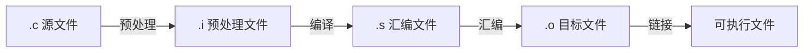

---
categories:
  - Software
tags:
  - course/clang
title: C语言程序结构
author: Found Not George
date_creation: 2026-09-23 09:05
date: 2026-09-23
time: 09:09:96
---

## 1. C 程序的组成结构

### 1.1 典型骨架

```c
#include <stdio.h>      // 预处理指令：包含标准输入输出头文件
#define PI 3.14         // 宏定义

int add(int a, int b);  // 函数声明

int global_var = 10;    // 全局变量

int main(void) {        // 主函数：程序入口
    int a = 1;          // 局部变量声明
    printf("Hello, C\n"); // 语句
    return 0;           // 返回状态码：0 通常表示成功
}

int add(int a, int b) { // 函数定义
    return a + b;
}
```

### 1.2 各部分组成

| 组成部分    | 作用        | 示例                                     | 注意                      |
| ------- | --------- | -------------------------------------- | ----------------------- |
| 预处理指令   | 编译前处理     | `#include <stdio.h>`、`#define MAX 100` | 以 `#` 开头，一般不加分号         |
| 函数      | C 程序的基本模块 | `int main(void) {}`                    | 程序由函数组成，`main` 是入口      |
| 变量声明/定义 | 存储数据      | `int a;`、`float x = 1.0;`              | 先声明后使用；区分声明与定义          |
| 语句      | 执行动作      | `a = 1;`、`printf(...);`                | 通常以分号结尾                 |
| 代码块     | 组织多条语句    | `{ ... }`                              | 影响作用域                   |
| 注释      | 说明代码      | `// 单行`、`/* 多行 */`                     | 编译时忽略                   |
| 头文件     | 声明接口      | `#include "my.h"`                      | 系统头文件用 `<>`，用户头文件用 `""` |

### 1.3 main 函数

```c
int main(void) {
    return 0;
}
```

或带命令行参数：

```c
int main(int argc, char *argv[]) {
    return 0;
}
```

> [!warning] 注意
> 标准 C 推荐 `int main(void)` 或 `int main(int argc, char *argv[])`，不推荐 `void main()`。
> `return 0;` 通常表示程序正常结束，非 0 表示异常或错误。

### 1.4 标识符与关键字

- 标识符：变量、函数、数组等名字。
- 规则：
  - 只能由字母、数字、下划线组成。
  - 不能以数字开头。
  - 区分大小写。
  - 不能是关键字。
- 关键字示例：`int`、`if`、`else`、`while`、`for`、`return`、`break`、`continue`、`switch`、`case`、`default`、`void`、`char`、`float`、`double`。

```c
int age;        // 合法
int _count;     // 合法
int 1age;       // 非法：数字开头
int if;         // 非法：if 是关键字
```

### 1.5 编译与执行过程



常用命令：

```bash
gcc hello.c -o hello      # 编译链接
./hello                   # 运行

gcc -E hello.c -o hello.i # 只预处理
gcc -S hello.i -o hello.s # 只编译成汇编
gcc -c hello.s -o hello.o # 只汇编成目标文件
gcc hello.o -o hello      # 链接
```

> [!tip] 安全编译习惯
> 建议加上警告选项：
> ```bash
> gcc -Wall -Wextra -Werror hello.c -o hello
> ```
> 很多安全漏洞最初只是编译器警告。

---

## 2. 三种基本程序控制结构

### 2.1 顺序结构

程序默认从上到下依次执行。

```c
#include <stdio.h>

int main(void) {
    int a, b, sum;

    scanf("%d%d", &a, &b);
    sum = a + b;
    printf("sum = %d\n", sum);

    return 0;
}
```

特点：
- 语句按书写顺序执行。
- 常见操作：输入、赋值、计算、输出。
- 是选择结构和循环结构的基础。

### 2.2 选择结构

#### if 语句

```c
if (条件) {
    // 条件为真时执行
}
```

```c
if (score >= 60) {
    printf("及格\n");
} else {
    printf("不及格\n");
}
```

```c
if (score >= 90) {
    printf("优秀\n");
} else if (score >= 60) {
    printf("及格\n");
} else {
    printf("不及格\n");
}
```

#### switch 语句

```c
switch (表达式) {
    case 常量1:
        // 语句
        break;
    case 常量2:
        // 语句
        break;
    default:
        // 默认语句
        break;
}
```

示例：

```c
switch (op) {
    case '+':
        result = a + b;
        break;
    case '-':
        result = a - b;
        break;
    default:
        printf("未知运算符\n");
        break;
}
```

> [!warning] 易错点
> - `=` 是赋值，`==` 才是判断相等。
> - `if (a = 0)` 会把 0 赋给 a，条件为假，通常不是本意。
> - `switch` 中忘记 `break` 会发生“贯穿”，继续执行后面的 `case`。
> - `switch` 的表达式通常是整型或字符型，`case` 后必须是常量。

### 2.3 循环结构

#### while

```c
while (条件) {
    // 循环体
}
```

#### do-while

```c
do {
    // 循环体
} while (条件);
```

特点：至少执行一次循环体。

#### for

```c
for (初始化; 条件; 更新) {
    // 循环体
}
```

示例：

```c
for (int i = 0; i < 10; i++) {
    printf("%d\n", i);
}
```

#### break 与 continue

| 关键字 | 作用 |
|---|---|
| `break` | 立即结束整个循环或 `switch` |
| `continue` | 跳过本次循环剩余语句，进入下一次循环 |

> [!tip] 循环三要素
> 1. 循环变量初始化。
> 2. 循环条件。
> 3. 循环变量更新。
> 缺少更新可能导致死循环。

### 2.4 控制结构对比

| 结构 | 关键字 | 适用场景 | 注意 |
|---|---|---|---|
| 顺序结构 | 无 | 依次执行 | 语句顺序决定结果 |
| 选择结构 | `if`、`else`、`switch` | 分支判断 | `==` 与 `=`；`break` |
| 循环结构 | `while`、`do-while`、`for` | 重复执行 | 避免死循环、越界 |

---

## 3. 函数与模块化结构

C 程序由一个或多个函数组成，`main` 是入口。

### 3.1 函数声明、定义、调用

```c
#include <stdio.h>

int add(int a, int b); // 函数声明

int main(void) {
    int result = add(3, 5); // 函数调用
    printf("%d\n", result);
    return 0;
}

int add(int a, int b) { // 函数定义
    return a + b;
}
```

| 概念 | 说明 |
|---|---|
| 函数声明 | 告诉编译器函数名、参数、返回类型 |
| 函数定义 | 给出函数具体实现 |
| 形参 | 函数定义中的参数 |
| 实参 | 函数调用时传入的值 |
| 返回值 | `return` 返回给调用者 |

> [!note] 值传递
> C 语言函数参数默认是值传递。形参是实参的副本，修改形参通常不影响实参。
> 如果需要在函数中修改外部变量，需要传指针。

### 3.2 作用域与存储类简表

| 名称 | 作用范围 | 生命周期 | 示例 |
|---|---|---|---|
| 局部变量 | 函数或代码块内 | 函数/块执行期间 | `int a;` |
| 全局变量 | 整个文件或跨文件 | 整个程序 | `int g;` |
| `static` 局部 | 块内可见 | 整个程序 | `static int cnt;` |
| `extern` | 声明外部变量/函数 | 取决于定义 | `extern int g;` |
| `register` | 建议寄存器存储 | 块内 | `register int i;` |

可继续整理：[[C语言-函数]]、[[C语言-作用域与存储类]]

---

## 4. 语句与代码块

常见语句类型：

| 类型 | 示例 |
|---|---|
| 表达式语句 | `a = b + c;` |
| 函数调用语句 | `printf("hello\n");` |
| 控制语句 | `if`、`while`、`for`、`return` |
| 复合语句 | `{ int a; a = 1; }` |
| 空语句 | `;` |
| 返回语句 | `return 0;` |

代码块 `{ ... }`：
- 组织多条语句。
- 形成作用域。
- 函数体、循环体、分支体都使用代码块。

---

## 5. 常见错误与网络安全视角

> [!danger] 安全编码重点
> 网络安全专业要特别注意 C 语言中的内存与输入问题。

### 5.1 缓冲区溢出

```c
char buf[10];
gets(buf); // 危险：不检查长度，已不推荐使用
```

安全写法：

```c
char buf[10];
if (fgets(buf, sizeof(buf), stdin) == NULL) {
    // 处理输入错误
}
```

### 5.2 格式化字符串漏洞

```c
char user_input[100];
scanf("%99s", user_input);

printf(user_input);        // 危险：用户输入可能包含 %
printf("%s", user_input);  // 安全
```

### 5.3 scanf 与数组边界

```c
char name[10];
scanf("%9s", name); // 限制最多读 9 个字符，留 1 个给 '\0'
```

### 5.4 其他常见问题

- 数组越界。
- 使用未初始化变量或指针。
- 整数溢出。
- 忘记检查 `scanf` 返回值。
- `switch` 忘记 `break`。
- `for` 括号后误加分号：`for (...);`。
- 头文件重复包含。

> [!tip] 安全习惯
> - 编译时开启 `-Wall -Wextra`。
> - 输入必须限制长度。
> - 不信任用户输入。
> - 指针使用前检查是否为空。
> - 数组访问前检查下标范围。

---

## 6. Obsidian 整理建议

### 6.1 推荐标签

```markdown
#C语言/程序结构
#C语言/控制结构
#C语言/函数
#网络安全/安全编码
```

### 6.2 推荐双链拆分

- [[C语言-程序结构]]
- [[C语言-顺序结构]]
- [[C语言-选择结构]]
- [[C语言-循环结构]]
- [[C语言-函数]]
- [[C语言-预处理与编译]]
- [[C语言-变量与作用域]]
- [[C语言-安全编码]]

### 6.3 建立 MOC

创建：[[C语言 MOC]]

```markdown
# C语言 MOC

## 基础
- [[C语言-程序结构]]
- [[C语言-数据类型]]
- [[C语言-运算符]]

## 控制结构
- [[C语言-顺序结构]]
- [[C语言-选择结构]]
- [[C语言-循环结构]]

## 进阶
- [[C语言-函数]]
- [[C语言-数组]]
- [[C语言-指针]]
- [[C语言-结构体]]

## 安全
- [[C语言-安全编码]]
- [[缓冲区溢出]]
- [[格式化字符串漏洞]]
```

### 6.4 Dataview 汇总

如果安装了 Dataview 插件，可以用：

```dataview
list from #C语言/程序结构
```

### 6.5 Callout 模板

```markdown
> [!warning] 易错点
> 这里写易错内容。

> [!danger] 安全风险
> 这里写安全风险。

> [!tip] 记忆技巧
> 这里写技巧。
```

---

## 7. 速查表

| 内容 | 语法/关键词 | 示例 |
|---|---|---|
| 头文件 | `#include` | `#include <stdio.h>` |
| 宏定义 | `#define` | `#define MAX 100` |
| 主函数 | `main` | `int main(void) {}` |
| 分支 | `if`、`else`、`switch` | `if (a > b) ...` |
| 循环 | `while`、`do-while`、`for` | `for (int i = 0; i < n; i++)` |
| 跳转 | `break`、`continue`、`return` | `break;` |
| 注释 | `//`、`/* */` | `// 注释` |
| 代码块 | `{ }` | `{ int a = 1; }` |

---

## 8. 自测题

1. C 程序的入口函数是什么？
2. 预处理指令在哪个阶段处理？
3. `if (a = 0)` 有什么问题？
4. `while` 和 `do-while` 的最大区别是什么？
5. `break` 和 `continue` 有什么区别？
6. 函数声明和函数定义有什么区别？
7. 为什么 `gets()` 不安全？应该用什么替代？
8. `printf(user_input);` 为什么危险？
9. `switch` 中忘记 `break` 会发生什么？
10. 局部变量和全局变量的作用域有什么区别？

---

## 9. 下一步

- [[C语言-数据类型]]
- [[C语言-运算符与表达式]]
- [[C语言-顺序结构]]
- [[C语言-选择结构]]
- [[C语言-循环结构]]
- [[C语言-函数]]
- [[C语言-数组与字符串]]
- [[C语言-指针]]
- [[C语言-安全编码]]
