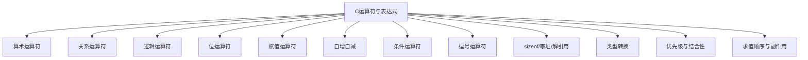

---
categories:
  - Software
tags:
  - course/clang
  - C语言/运算符
  - C语言/表达式
  - C语言/优先级
  - C语言/类型转换
  - 网络安全/整数溢出
  - 网络安全/安全编码
title: C语言-运算符与表达式
author: Found Not George
date_creation: 2026-09-30 07:24
date: 2026-09-30
time: 07:09:29
aliases:
  - C运算符
  - C语言运算符
  - C表达式
---

# C语言运算符与表达式

> [!abstract] 一句话理解
> 运算符是“动作”，操作数是“对象”，表达式是“有值的式子”。
> 运算符决定优先级、结合性、类型转换、求值顺序，这些都直接影响程序结果和安全性。

> [!info] 为什么网络安全要学
> 运算符优先级错误、短路求值误解、整数提升、位运算越界、副作用顺序未定义，是很多漏洞和逻辑错误的根源。

## 0. 知识地图



---

## 1. 表达式与语句

### 1.1 表达式

表达式是能产生一个值的式子。

```c
a + b
x = 1
i++
sizeof(int)
(a > b) ? a : b
```

表达式有：
- 值
- 类型
- 可能有的副作用

### 1.2 语句

以分号结尾，是程序执行的最小单位。

```c
int a = 1;        // 声明语句
a = a + 1;        // 表达式语句
if (a > 0) { }    // 控制语句
return 0;         // 返回语句
;                 // 空语句
```

> [!warning] 多加分号
> ```c
> if (a > 0);
>     printf("positive\n"); // 无条件执行
> ```
> 多一个 `;` 会让 `if` 变成空语句。

---

## 2. 运算符分类总览

| 类别   | 运算符                                                 | 结合性  |
| ---- | --------------------------------------------------- | ---- |
| 后缀   | `()`、`[]`、`->`、`.`、`++`、`--`                        | 从左到右 |
| 一元   | `!`、`~`、`+`、`-`、`*`、`&`、`sizeof`、`++`、`--`、`(type)` | 从右到左 |
| 乘除   | `*`、`/`、`%`                                         | 从左到右 |
| 加减   | `+`、`-`                                             | 从左到右 |
| 移位   | `<<`、`>>`                                           | 从左到右 |
| 关系   | `<`、`<=`、`>`、`>=`                                   | 从左到右 |
| 相等   | `==`、`!=`                                         | 从左到右 |
| 按位与  | `&`                                                 | 从左到右 |
| 按位异或 | `^`                                                 | 从左到右 |
| 按位或  | `\|`                                                | 从左到右 |
| 逻辑与  | `&&`                                                | 从左到右 |
| 逻辑或  | `\|\|`                                              | 从左到右 |
| 条件   | `?:`                                                | 从右到左 |
| 赋值   | `=`、`+=`、`-=` 等                                     | 从右到左 |
| 逗号   | `,`                                                 | 从左到右 |

> [!tip] 记忆顺序（高到低）
> 后缀 → 一元 → 乘除 → 加减 → 移位 → 关系 → 相等 → 位与 → 位异或 → 位或 → 逻辑与 → 逻辑或 → 条件 → 赋值 → 逗号

---

## 3. 算术运算符

| 运算符 | 含义 | 示例 |
|---|---|---|
| `+` | 加 | `a + b` |
| `-` | 减 | `a - b` |
| `*` | 乘 | `a * b` |
| `/` | 除 | `a / b` |
| `%` | 取模 | `a % b` |

### 3.1 整数除法

```c
int a = 7 / 2;   // 3，向 0 截断
int b = -7 / 2;  // -3
int c = 7 % 2;   // 1
int d = -7 % 2;  // -1
```

> [!warning] 除零
> 整数除零是未定义行为，通常会崩溃。
> 浮点除零得到 `inf` 或 `nan`。
> 任何时候除数都应先检查是否为 0。

### 3.2 浮点运算

```c
double x = 7.0 / 2; // 3.5
```

> [!tip] 至少让一个操作数为浮点
> `7 / 2` 是整数除法得 3；`7.0 / 2` 才是 3.5。

### 3.3 `%` 只能用于整数

```c
// double d = 7.0 % 2; // 错误
```

浮点取模使用 `<math.h>`：

```c
double r = fmod(7.0, 2.0); // 1.0
```

### 3.4 取模与负数

```c
-7 % 2  // 结果符号与被除数相同，通常为 -1
7 % -2  // 通常为 1
```

> [!note] 可移植性
> C99 起商向 0 截断，余数符号与被除数相同。
> C89 中负数取模结果实现定义。

---

## 4. 关系运算符与相等运算符

| 运算符 | 含义 |
|---|---|
| `<` | 小于 |
| `<=` | 小于等于 |
| `>` | 大于 |
| `>=` | 大于等于 |
| `==` | 等于 |
| `!=` | 不等于 |

结果类型是 `int`：真为 `1`，假为 `0`。

```c
int r = (3 > 2); // 1
```

> [!danger] 经典错误
> ```c
> if (a = 0) { }   // 赋值，条件为假
> if (a == 0) { }  // 判断相等
> ```
> 避免方式：把常量写左边
> ```c
> if (0 == a) { }
> ```

### 4.1 浮点比较

```c
#include <math.h>

if (fabs(a - b) < 1e-9) {
    // 近似相等
}
```

> [!warning] 不要用 `==` 比较浮点数
> 浮点有精度误差，`0.1 + 0.2 != 0.3`。

### 4.2 有符号与无符号比较

```c
int a = -1;
unsigned int b = 1;

if (a < b) {
    // 可能不成立！
}
```

原因：`a` 被转换为 `unsigned int`，变成很大的正数。

> [!danger] 安全建议
> 有符号和无符号变量比较前，先统一类型并检查范围。

---

## 5. 逻辑运算符

| 运算符 | 含义 | 结果 |
|---|---|---|
| `!` | 逻辑非 | 真变假，假变真 |
| `&&` | 逻辑与 | 两侧都真才真 |
| `\|\|` | 逻辑或 | 一侧真就真 |

真值表：

| a | b | `a && b` | `a \|\| b` | `!a` |
|---|---|---|---|---|
| 0 | 0 | 0 | 0 | 1 |
| 0 | 非0 | 0 | 1 | 1 |
| 非0 | 0 | 0 | 1 | 0 |
| 非0 | 非0 | 1 | 1 | 0 |

### 5.1 短路求值

```c
if (p != NULL && p->value > 0) {
    // p 为空时不会解引用 p
}
```

```c
if (x == 0 || 10 / x > 1) {
    // x 为 0 时不会执行除法
}
```

> [!tip] 安全利用短路
> - 先用 `&&` 检查指针非空，再解引用。
> - 先用 `||` 检查除数非零，再做除法。
> - 先用 `&&` 检查下标范围，再访问数组。

### 5.2 短路与副作用

```c
int i = 0;
if (i++ && i++) {
    // 第二个 i++ 不会执行
}
// 结果 i == 1
```

> [!warning] 副作用依赖短路是有风险的写法
> 代码可读性差，容易出 bug，慎用。

### 5.3 逻辑与按位

| 运算符 | 用途 |
|---|---|
| `&&`、`\|\|` | 逻辑真假 |
| `&`、`\|` | 位运算 |

```c
if (a & b) { } // 按位与，非零即真，但含义不同
if (a && b) { } // 逻辑与，推荐用于条件
```

---

## 6. 位运算符

| 运算符 | 含义 | 示例 |
|---|---|---|
| `&` | 按位与 | `a & b` |
| `\|` | 按位或 | `a \| b` |
| `^` | 按位异或 | `a ^ b` |
| `~` | 按位取反 | `~a` |
| `<<` | 左移 | `a << n` |
| `>>` | 右移 | `a >> n` |

> [!tip] 位运算只对整型有效
> `float`、`double` 不能直接做位运算。

### 6.1 真值表

| a | b | `a & b` | `a \| b` | `a ^ b` |
|---|---|---|---|---|
| 0 | 0 | 0 | 0 | 0 |
| 0 | 1 | 0 | 1 | 1 |
| 1 | 0 | 0 | 1 | 1 |
| 1 | 1 | 1 | 1 | 0 |

### 6.2 常见用法

```c
x & 1          // 判断奇偶：1 为奇
x | (1 << n)   // 置第 n 位为 1
x & ~(1 << n)  // 清第 n 位为 0
x ^ (1 << n)   // 翻转第 n 位
(x >> n) & 1   // 取第 n 位
x & (x - 1)    // 清除最低位的 1
```

### 6.3 移位

```c
unsigned int x = 1;
x << 1;   // 2
x << 31;  // 0x80000000

int y = -1;
y >> 1;   // 算术右移，通常仍为 -1（实现定义）
```

> [!danger] 移位未定义行为
> - 移位量 >= 类型位宽，未定义行为。
> - 左移负数或有符号溢出，未定义行为。
> - 有符号右移结果实现定义。
> - 安全做法：用无符号类型做位运算。

### 6.4 位运算优先级陷阱

```c
if (x & 0x0F == 0x0F) { } // 错！
// 因为 == 优先级高于 &
if ((x & 0x0F) == 0x0F) { } // 正确
```

> [!warning] 位运算加括号
> `&`、`|`、`^` 优先级低于 `==`、`<`，几乎总是需要加括号。

---

## 7. 赋值运算符

| 运算符 | 含义 |
|---|---|
| `=` | 赋值 |
| `+=` | `a = a + b` |
| `-=` | `a = a - b` |
| `*=` | `a = a * b` |
| `/=` | `a = a / b` |
| `%=` | `a = a % b` |
| `<<=` | `a = a << b` |
| `>>=` | `a = a >> b` |
| `&=` | `a = a & b` |
| `\|=` | `a = a \| b` |
| `^=` | `a = a ^ b` |

```c
int a = 1;
a += 2;  // a == 3
a <<= 1; // a == 6
```

### 7.1 赋值表达式的值

```c
int a, b, c;
a = b = c = 0;  // 从右到左
```

### 7.2 复合赋值与类型

```c
char c = 100;
c += 100; // 可能溢出，结果实现定义
```

> [!warning] 复合赋值隐含类型转换
> `a += b` 等价于 `a = a + b`，但结果会被截断回 `a` 的类型。
> 可能发生隐式截断或溢出。

---

## 8. 自增与自减

| 运算符 | 含义 |
|---|---|
| `++i` | 前置自增，先加 1，再返回新值 |
| `i++` | 后置自增，先返回旧值，再加 1 |
| `--i` | 前置自减 |
| `i--` | 后置自减 |

```c
int i = 1;
int a = ++i; // i = 2, a = 2
int b = i++; // b = 2, i = 3
```

> [!danger] 未定义行为
> ```c
> int i = 0;
> i = i++ + ++i;  // 未定义行为
> printf("%d %d", i++, i++); // 未定义行为
> ```
> 同一个表达式中对同一变量多次修改，结果未定义。

### 8.1 循环中优先使用前置

```c
for (int i = 0; i < n; i++) { }  // 常见
for (int i = 0; i < n; ++i) { }  // 对类类型更高效
```

对内置类型，`i++` 和 `++i` 效果相同；对自定义类型（C++），`++i` 更高效。

---

## 9. 条件运算符

```c
条件 ? 表达式1 : 表达式2
```

```c
int max = (a > b) ? a : b;
```

可嵌套：

```c
int grade = (score >= 90) ? 1 :
            (score >= 60) ? 2 : 3;
```

> [!warning] 类型不一致
> ```c
> int a = 1;
> double b = (a > 0) ? 1 : 1.5; // 结果为 1.0，类型提升
> ```

与 `if-else` 区别：

| 特点 | `?:` | `if-else` |
|---|---|---|
| 值 | 有返回值 | 无返回值 |
| 使用 | 表达式内 | 语句块 |
| 可读性 | 简单条件好 | 复杂逻辑好 |

---

## 10. 逗号运算符

```c
int a = (1, 2, 3); // a == 3
```

从左到右依次求值，整个表达式的值是最后一个表达式的值。

常见用途：

```c
for (int i = 0, j = 10; i < j; i++, j--) {
    // ...
}
```

> [!warning] 不要与函数参数逗号混淆
> ```c
> f(a, b);      // 函数参数分隔符
> f((a, b));    // 逗号运算符，只传一个参数
> ```

---

## 11. 取地址、解引用、`sizeof`

| 运算符 | 含义 | 示例 |
|---|---|---|
| `&` | 取地址 | `&x` |
| `*` | 解引用 | `*p` |
| `sizeof` | 求类型/对象大小 | `sizeof(int)` |

```c
int x = 10;
int *p = &x;
int y = *p;

printf("%zu\n", sizeof(int));
printf("%zu\n", sizeof x);
```

> [!warning] `&` 与 `&` 按位与
> ```c
> int y = a & b;   // 按位与
> int *p = &a;     // 取地址
> ```
> 根据上下文区分。

---

## 12. 类型转换

### 12.1 隐式转换

```c
int a = 3;
double b = a; // int -> double

double c = 3.9;
int d = c;    // 截断为 3
```

整型提升：

```c
char c = 'A';
int i = c + 1; // c 先提升为 int
```

### 12.2 显式转换

```c
double x = 3.14;
int y = (int)x; // 3
```

### 12.3 转换规则（简化）

1. `char`、`short` 先提升为 `int`。
2. 若类型不同，向“更大”的类型转换：
   `int → unsigned int → long → unsigned long → long long → float → double → long double`
3. 有符号与无符号混合，通常转为无符号。

> [!danger] 安全场景
> - 有符号转无符号可能变成巨大正数。
> - 大类型转小类型会截断。
> - 浮点转整数会截断小数，超出范围是未定义行为。

---

## 13. 优先级与结合性

### 13.1 优先级表（高 → 低）

| 优先级 | 运算符 | 结合性 |
|---:|---|---|
| 1 | `()` `[]` `->` `.` `++` `--`（后缀） | 左到右 |
| 2 | `!` `~` `+` `-` `*` `&` `sizeof` `++` `--` `(type)` | 右到左 |
| 3 | `*` `/` `%` | 左到右 |
| 4 | `+` `-` | 左到右 |
| 5 | `<<` `>>` | 左到右 |
| 6 | `<` `<=` `>` `>=` | 左到右 |
| 7 | `==` `!=` | 左到右 |
| 8 | `&` | 左到右 |
| 9 | `^` | 左到右 |
| 10 | `\|` | 左到右 |
| 11 | `&&` | 左到右 |
| 12 | `\|\|` | 左到右 |
| 13 | `?:` | 右到左 |
| 14 | `=` `+=` `-=` 等 | 右到左 |
| 15 | `,` | 左到右 |

> [!tip] 万能建议
> 不确定优先级就加括号。括号不改变性能，只提升可读性。

### 13.2 经典陷阱

```c
if (a & 1 == 0) { }        // 错：== 优先级高于 &
if ((a & 1) == 0) { }      // 正确

int x = 1 << 2 + 3;        // 错：+ 优先级高于 <<，得 1 << 5 = 32
int y = (1 << 2) + 3;      // 正确，得 7

if (a = b) { }             // 赋值
if (a == b) { }            // 比较

*p++;   // *(p++)，先取 *p，再 p++
(*p)++; // 先解引用，再自增所指对象
```

> [!danger] 指针与自增
> ```c
> *p++   // 移动指针
> (*p)++ // 修改所指值
> *++p   // 先移动，再取值
> ++*p   // 所指值加 1
> ```

---

## 14. 求值顺序与副作用

### 14.1 序列点

C 语言规定若干“序列点”，保证前后求值顺序：
- `&&`、`||`、`?:`、`,` 左侧求值先于右侧
- 完整表达式结束（分号处）
- 函数调用时，实参求值在函数体前

### 14.2 未定义行为

```c
int i = 0;
i = i++ + ++i;     // 未定义行为
printf("%d %d", i++, i++); // 未定义行为
f(i++, i++);       // 未定义行为
a[i] = i++;        // 未定义行为
```

> [!danger] 规则
> 同一表达式中不要对同一变量多次修改。
> 不要依赖函数实参求值顺序。

### 14.3 副作用

副作用是表达式求值之外对环境的改变：
- 赋值
- 自增自减
- 函数调用（可能改变全局/静态变量）
- I/O

```c
int a = 0;
int b = a++; // 副作用：a 变为 1，b 为 0
```

---

## 15. 网络安全视角

> [!danger] 运算符相关的安全漏洞

### 15.1 优先级错误导致逻辑绕过

```c
if (is_admin & 0x1 == 0x1) { } // 错
// 实际等价于 is_admin & (0x1 == 0x1) = is_admin & 1
```

### 15.2 赋值与比较混淆

```c
if (auth = check()) { } // 赋值，不是判断
if (auth == check()) { } // 正确
```

### 15.3 有符号与无符号混合

```c
int len = recv(...);
if (len < sizeof(buf)) {
    memcpy(buf, data, len); // len 可能为负转巨大
}
```

安全写法：

```c
if (len < 0 || (size_t)len > sizeof(buf)) {
    return -1;
}
memcpy(buf, data, (size_t)len);
```

### 15.4 整数溢出

```c
size_t total = count * size; // 可能溢出
```

安全写法：

```c
if (count > SIZE_MAX / size) {
    return -1;
}
size_t total = count * size;
```

### 15.5 短路求值缺失

```c
if (p->flag && p != NULL) { } // 错：p 可能为空时已解引用
if (p != NULL && p->flag) { } // 正确
```

### 15.6 位运算越界

```c
int x = 1 << 31;        // 有符号溢出，未定义行为
unsigned int y = 1u << 31; // 正确
```

### 15.7 类型转换截断

```c
size_t n = ...;
int m = (int)n; // 若 n > INT_MAX，截断为负
```

### 15.8 格式化字符串与运算符无关但常同现

```c
printf("%d", sizeof(x)); // 应用 %zu
```

---

## 16. 常见错误速查

| 错误 | 示例 | 后果 | 修正 |
|---|---|---|---|
| `=` 与 `==` | `if (a = 0)` | 逻辑错误 | 用 `==` |
| 位运算少括号 | `x & 0xF == 0xF` | 优先级错误 | 加括号 |
| 移位越界 | `1 << 32` | 未定义行为 | 检查移位量 |
| 有符号左移 | `1 << 31` | 未定义行为 | 用 `1u` |
| 负数取模 | `-7 % 2` | 结果符号不同 | 明确语义 |
| 整数除零 | `a / 0` | 崩溃 | 检查除数 |
| 浮点相等 | `f == 0.1` | 不可靠 | 用 epsilon |
| 混合比较 | `-1 < 1u` | 结果反直觉 | 显式转换 |
| 同一变量多次改 | `i = i++ + ++i` | 未定义行为 | 拆分语句 |
| 自增自减误用 | `*p++` 与 `(*p)++` | 语义不同 | 明确意图 |
| 逗号误用 | `f(a, b)` vs `f((a,b))` | 参数个数不同 | 加括号 |
| 类型截断 | `int m = (int)big` | 数据丢失 | 检查范围 |

---

## 17. 运算符速查表

| 运算符 | 名称 | 示例 | 结果 |
|---|---|---|---|
| `+` | 加 | `3 + 2` | 5 |
| `-` | 减 | `3 - 2` | 1 |
| `*` | 乘 | `3 * 2` | 6 |
| `/` | 除 | `7 / 2` | 3 |
| `%` | 取模 | `7 % 2` | 1 |
| `++` | 自增 | `i++` | 旧值 |
| `--` | 自减 | `--i` | 新值 |
| `==` | 等于 | `a == b` | 0/1 |
| `!=` | 不等于 | `a != b` | 0/1 |
| `<` `>` | 比较 | `a < b` | 0/1 |
| `&&` | 逻辑与 | `a && b` | 0/1 |
| `\|\|` | 逻辑或 | `a \|\| b` | 0/1 |
| `!` | 逻辑非 | `!a` | 0/1 |
| `&` | 按位与 | `a & b` | 整型 |
| `\|` | 按位或 | `a \| b` | 整型 |
| `^` | 按位异或 | `a ^ b` | 整型 |
| `~` | 按位取反 | `~a` | 整型 |
| `<<` | 左移 | `a << n` | 整型 |
| `>>` | 右移 | `a >> n` | 整型 |
| `=` | 赋值 | `a = b` | b 的值 |
| `+=` | 加赋值 | `a += b` | 新 a |
| `?:` | 条件 | `a ? b : c` | b 或 c |
| `,` | 逗号 | `a, b` | b |
| `sizeof` | 大小 | `sizeof(int)` | `size_t` |
| `&` | 取地址 | `&a` | 指针 |
| `*` | 解引用 | `*p` | 所指值 |

---

## 18. 自测题

1. `7 / 2` 和 `7.0 / 2` 的结果分别是什么？
2. `-7 % 2` 在 C99 中结果是多少？
3. `if (a = 0)` 和 `if (a == 0)` 有什么区别？
4. `&&` 和 `&` 有什么区别？各自适合什么场景？
5. 为什么 `x & 0xF == 0xF` 是错的？
6. `i++` 和 `++i` 的区别是什么？
7. `i = i++ + ++i;` 为什么危险？
8. 有符号整数左移 31 位为什么是未定义行为？
9. `*p++` 和 `(*p)++` 有什么区别？
10. 为什么 `-1 < 1u` 可能为假？
11. 如何安全计算 `count * size`？
12. `f(a, b)` 和 `f((a, b))` 有什么区别？
13. 为什么 `if (p->x && p != NULL)` 是错的？
14. `sizeof` 返回什么类型？应该用什么格式符打印？
15. 表达式 `(1, 2, 3)` 的值是多少？

---

## 19. Obsidian 整理建议

### 19.1 推荐标签

```markdown
#C语言/运算符
#C语言/表达式
#C语言/优先级
#C语言/类型转换
#网络安全/整数溢出
#网络安全/安全编码
```

### 19.2 推荐双链拆分

- [[C语言-程序结构]]
- [[C语言-数据类型]]
- [[C语言-运算符与表达式]]
- [[C语言-顺序结构]]
- [[C语言-选择结构]]
- [[C语言-循环结构]]
- [[C语言-函数]]
- [[C语言-数组与字符串]]
- [[C语言-指针]]
- [[C语言-安全编码]]
- [[C语言-整数溢出]]
- [[C语言-未定义行为]]

### 19.3 更新 MOC

在 [[C语言 MOC]] 中加入：

```markdown
## 基础
- [[C语言-程序结构]]
- [[C语言-数据类型]]
- [[C语言-运算符与表达式]]
```

### 19.4 Dataview 汇总

```dataview
list from #C语言/运算符 
```

### 19.5 常用 Callout

```markdown
> [!warning] 优先级陷阱
> 这里写内容。

> [!danger] 未定义行为
> 这里写内容。

> [!tip] 记忆技巧
> 这里写内容。
```

### 19.6 优先级口诀（可选）

```text
括号成员第一；      // () [] . ->
全体单目第二；      // ! ~ ++ -- * & sizeof (type)
乘除模第三；        // * / %
加减第四；          // + -
移位第五；          // << >>
关系第六；          // < <= > >=
相等第七；          // == !=
位与第八；          // &
位异或第九；        // ^
位或第十；          // |
逻辑与十一；        // &&
逻辑或十二；        // ||
条件十三；          // ?:
赋值十四；          // = += ...
逗号十五。          // ,
```

---

## 20. 下一步

- [[C语言-顺序结构]]
- [[C语言-选择结构]]
- [[C语言-循环结构]]
- [[C语言-函数]]
- [[C语言-数组与字符串]]
- [[C语言-指针]]
- [[C语言-安全编码]]
- [[C语言-未定义行为]]


