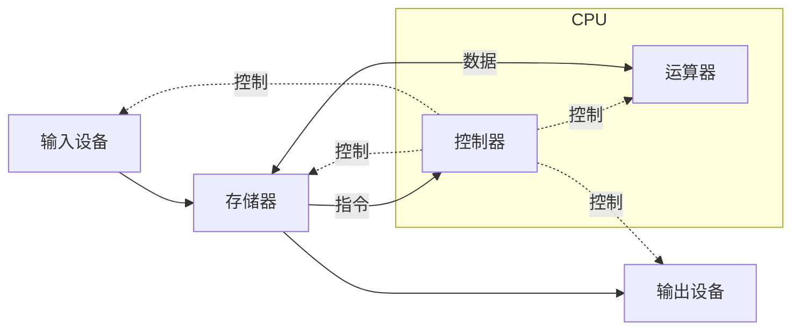
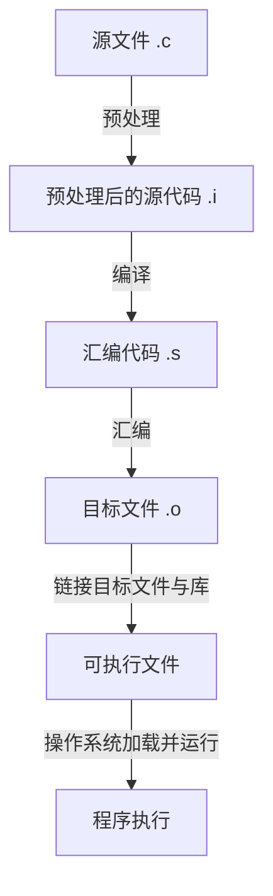

# C语言概论与程序设计基础

> [!abstract] 知识范围
> - 课程依据：吴俊军老师《第01章 概论S》，§1.1–1.4。
> - 重点：冯·诺依曼体系结构（3 个特点、5 大部件）、存储器、算法及其 5 个重要性质。
> - 次重点：程序设计语言分类、问题求解过程、C 语言特征、程序结构与编译过程。
> - 后续：[[02 字符集、词法元素与标识符]]、[[03 基本数据类型与数据表示]]、[[15 编译预处理与多文件程序]]。

## 1. 计算机基础知识

### 1.1 计算机的发展

计算机首先是一种计算工具，用于按照确定的规则对数据进行处理。现代计算机还能够承担通用的信息处理任务。

课件将计算工具的发展划分为古代计算工具、早期机械计算、电子计算机以及现代计算机的发展等阶段。

与本课程关系较密切的历史知识：

| 对象 | 课件介绍的关键意义 |
| --- | --- |
| 莱布尼茨与二进制 | 二进制数制是计算机数据表示的重要基础 |
| 巴贝奇的差分机、解析机 | 早期机械计算与通用计算思想 |
| 图灵机 | 抽象的计算模型，与可计算性有关 |
| ABC | 采用二进制，不可编程 |
| ENIAC（1946 年） | 十进制、通用电子计算机 |
| EDVAC | 与存储程序思想和冯·诺依曼体系结构密切相关 |

课件列举的现代计算机发展阶段为：电子管 → 晶体管 → 集成电路 → 大规模集成电路。

> [!note] 历史知识辨析
> 图灵机是抽象计算模型，并不等同于课件同一条目中出现的 Colossus 电子计算机。计算机发展史中一些“第一台”的认定也依赖对电子式、可编程、通用、存储程序等条件的限定，不宜一概而论。本章复习应优先掌握下文的体系结构。

### 1.2 冯·诺依曼体系结构

> [!important] 核心考点：三个特点、五大部件
> 1. 采用**存储程序**的工作方式。
> 2. 由**运算器、控制器、存储器、输入设备、输出设备**五大基本部件组成。
> 3. 使用二进制表示指令和数据。

#### 五大基本部件

| 部件 | 主要功能 |
| --- | --- |
| 运算器 | 完成算术运算、逻辑运算等 |
| 控制器 | 获取、解释指令，控制和协调各部件工作 |
| 存储器 | 保存程序指令、数据及中间结果 |
| 输入设备 | 将外部信息输入计算机 |
| 输出设备 | 将处理结果输出到外部 |

课件第 12 个 PDF 页面（幻灯片编号 13）的体系结构图将控制器和运算器归入 CPU，并区分数据流、指令流、控制流。



上图为根据课件抽象关系重绘的逻辑示意，并非现代处理器的实际连线图。

#### 存储程序的含义

程序指令与数据均以二进制形式存入存储器。CPU 按程序的控制流程获取指令、译码、执行，并在需要时读写数据。

简单理解其执行过程：取指 → 译码 → 执行 → 获取下一条指令。遇到分支、跳转等指令时，下一条指令不一定是存储位置紧随其后的指令。

> [!warning] 易错点
> - CPU 在课程的简化模型中由运算器、控制器构成；存储器不属于五大部件中的 CPU 本身。现代 CPU 内部还有寄存器、缓存等存储结构，不能据此说 CPU 内完全没有存储装置。
> - 存储程序不是只存储数据，而是将程序指令也存储起来。
> - 高级语言源代码通常不能直接由 CPU 执行，CPU 执行的是相应指令集的机器指令。
> - 存储程序不意味着程序的执行永远按照地址顺序进行。

### 1.3 计算机系统的组成

计算机系统由硬件和软件组成。

- 硬件：CPU、总线、内存、外存及 I/O 设备等。
- 软件：系统软件（如操作系统、编译器）和应用软件（如文字编辑软件）。

总线用于在部件之间传递信息；不要将现代计算机硬件的具体组成清单与冯·诺依曼的五大逻辑部件混淆。

### 1.4 存储器、位、字节和地址

| 概念 | 含义 |
| --- | --- |
| 位（bit，b） | 一个二进制位，取值为 0 或 1 |
| 字节（byte，B） | 课程中一个字节由 8 个二进制位组成 |
| 地址（address） | 用于标识存储单元位置的编号 |

课件采用按字节编址的内存模型：每个字节拥有自己的地址，相邻字节地址相差 1。

```text
地址（十六进制）    存储内容（一个字节）
0x1000              01000001
0x1001              01000010
0x1002              01000011
0x1003              00000000
```

左侧是地址，右侧是该地址处保存的内容。二者不能混淆。

例如，在 ASCII 兼容环境下，地址 `0x1000` 处的 `01000001` 可以解释为整数 65，也可以解释为字符 `'A'`；具体如何解释与数据类型及使用方式有关。多字节对象通常占据连续的若干字节，其内部字节排列在后续数据表示部分进一步讨论。

#### 容量单位换算

课件采用传统的二进制换算：

- 1 B = 8 b
- 1 KB = 1024 B
- 1 MB = 1024 KB
- 1 GB = 1024 MB
- 1 TB = 1024 GB

> [!note] 课程约定与严格术语
> 按现代 IEC/SI 单位区分，1024 B 应称为 1 KiB，而 1 kB 为 1000 B；MiB、GiB、TiB 同理。书面题若沿用课件约定，按题意计算。ISO C 中 `sizeof(char)` 恒等于 1，表示一个 C 字节，但一个 C 字节的位数 `CHAR_BIT` 不保证总是 8。课程及常见 x86-64 环境采用 8 位字节。

> [!example] 容量与地址计算
> 按课件约定，4 KB = 4096 B = 32768 bit。
>
> 若连续存储区从 `0x1000` 开始，大小为 4 B，则最后一个字节地址为 `0x1003`，而不是 `0x1004`。地址差再加 1 才是两端均包含的字节数。

关联：[[03 基本数据类型与数据表示]]、[[18 指针基础与指针运算]]。

## 2. 程序设计语言

### 2.1 三种主要语言层次

| 比较项目 | 机器语言 | 汇编语言 | 高级语言 |
| --- | --- | --- | --- |
| 表示方式 | 机器指令的二进制编码 | 指令助记符，如 `ADD`、`MOV` | 更接近问题描述的语言结构，如 C |
| CPU 能否直接执行 | 能（针对相应指令集的合法指令） | 不能 | 通常不能 |
| 翻译工具 | 无须语言翻译 | 汇编器 | 编译器、解释器等，视实现而定 |
| 与机器的关系 | 密切相关 | 密切相关 | 通常具有更高的抽象性与可移植性 |

课件以 `z = x + y` 为例，将高级语言表达式与加载、加法、存储等机器操作联系起来。可以用教学伪汇编理解：

```text
LOAD  A, x
ADD   A, y
STORE A, z
```

这只是说明数据读取、运算、写回的逻辑，并不意味着任何平台的 C 编译器一定生成这三条指令。优化可能消除读写或直接计算常量结果。

> [!warning] 常见判断题
> - 汇编语言使用的是助记符，不能直接由 CPU 执行。
> - C 语言具有访问底层数据的能力，但仍属于高级程序设计语言。“中级语言”是对其特征的描述，不是将 C 归类为汇编语言。
> - 可移植性指满足相应条件的源程序较容易移植，并不表示编译产生的机器代码可在任意平台运行。

## 3. 问题求解、算法和程序

### 3.1 问题求解的五个步骤

按照课件 §1.2.1：

1. **问题定义**：分析需求，确定输入、输出、数学模型及适用条件。
2. **算法设计**：设计准确、可执行的解题步骤。
3. **程序编码**：用程序设计语言描述数据及算法。
4. **调试程序**：发现和纠正错误，测试正常情况与异常情况。
5. **运行程序**：通过程序得到实际问题的解。

这是课程中的典型过程，而不是严格不可回退的工程流程。实践中测试可能促使重新设计算法或修改需求。

### 3.2 算法的定义

算法（Algorithm）是对解题方法准确、完整的描述，由一系列有明确含义、可执行的操作组成，规定需要进行的运算及其步骤。

> [!important] 算法的五个重要性质（按课件顺序）
> 1. **确定性**（definiteness）：每一步操作明确且无二义性。
> 2. **能行性**（effectiveness）：每个操作均可有效执行，并能在有限时间内完成。
> 3. **有输入**（input）：可以有零个或多个输入。
> 4. **有输出**（output）：应有一个或多个输出。
> 5. **有穷性**（finiteness）：对于符合要求的输入，经过有限步操作后必须终止。

| 容易混淆的性质 | 如何区分 |
| --- | --- |
| 确定性 vs 能行性 | 确定性强调规则清楚；能行性强调每一步确实能完成 |
| 能行性 vs 有穷性 | 能行性针对单步运算；有穷性针对整个算法的结束 |
| 输入 vs 输出 | 输入允许为零个，输出至少一个 |

> [!warning] 高频易错点
> - “算法至少有一个输入”是错误的。
> - “算法可以没有任何输出”不符合课件所列性质。
> - 一个算法有穷，不代表其效率一定很高。
> - 一个程序可以是持续运行的服务，但不能仅因为它是程序就认为它必然满足本节所定义的、有穷的问题求解算法的全部性质。
> - 确定性描述操作规则是否明确，不是说程序不能使用随机数；随机算法属于进一步讨论的内容。

### 3.3 算法的表示

课件列出的三种常见算法描述方式：自然语言、流程图、伪代码。

补充：书面考试常用流程图符号如下。

| 符号形状 | 含义 |
| --- | --- |
| 椭圆形或圆角矩形 | 开始、结束 |
| 平行四边形 | 输入、输出 |
| 矩形 | 处理、计算、赋值 |
| 菱形 | 条件判断 |
| 带箭头的线 | 控制流程方向 |

> [!example] 课件问题：求有限个自然数中的最大值
> 明确输入为至少一个数。先将第一个数作为当前最大值，再依次与其余数比较，遇到更大值就更新，最后输出最大值。
>
> 伪代码（补充）：
> ```text
> max ← 第一个数
> 对剩余的每一个数 x：
>     若 x > max：
>         max ← x
> 输出 max
> ```
>
> 课件中的数据 `30, 20, 80, 70, 10, 40, 90, 60, 50` 的最大值为 90，共需比较 8 次。不要仅写“看出最大值”，因为这没有给出计算机可执行的明确步骤。

### 3.4 算法与程序的联系

课件将程序看作对对象与规则的描述：

$$
\text{程序} \approx \text{数据结构} + \text{算法}
$$

- 数据结构回答：如何表示和组织数据？
- 算法回答：如何处理数据并解决问题？
- 程序回答：如何以某种程序设计语言实现上述内容？

这是理解程序设计的经典概括，不是严格的数学等式。一个算法可以使用多种语言实现；同一问题也可以设计不同算法。

## 4. C 语言的发展及特点

### 4.1 发展过程与标准化

课件给出的语言演化脉络主要包括 BCPL → B → C，随后形成 K&R C 并进入标准化阶段。C 语言与 UNIX 的发展密切相关，Dennis Ritchie 是 C 语言的主要设计者（参见谭浩强教材第 1 章 §1.2）。

| 标准 | 年份 | 说明 |
| --- | --- | --- |
| K&R C | 1978 | 早期有代表性的 C 语言描述，并非 ANSI/ISO 标准 |
| ANSI C（C89） | 1989 | 美国 ANSI 发布的标准 |
| C90 | 1990 | ISO 发布的相应 C 标准，与 C89 基本等同 |
| C99 | 1999 | C 标准的重要修订 |
| C11 | 2011 | 后续重要修订 |
| C18（也常称 C17） | 2018 | 课件采用 C18 的名称 |

该表按课件范围整理，不是截至目前的完整 C 标准发展史。考试具体标准版本尚待老师明确。

### 4.2 C 语言的八个特征

按照课件 §1.3.3：

1. 语言简洁紧凑。
2. 目标代码质量高。
3. 语言表达能力强。
4. 流程控制结构化。
5. 弱类型。
6. 具有“中级语言”特性。
7. 书写自由、使用灵活。
8. 可移植性好。

> [!note] 对“弱类型”的理解
> 这是课件采用的概括性术语，强调 C 允许较多隐式转换和底层操作。C 仍然具有静态类型系统，变量、表达式、函数等具有类型，编译器需要执行相应的类型规则检查。“弱类型”不等于没有类型，也不表示所有类型都可以任意互换。

C 的源码可移植性也不是无条件的；程序依赖特定类型宽度、平台接口或编译器扩展时，可能需要调整。目标代码质量则取决于实现、编译选项与程序本身。

## 5. C 语言编程初步

### 5.1 开发环境与编程过程

课件列举了编辑器、编译器、调试器等工具；IDE（集成开发环境）将相关开发功能组合起来。

按课件第 26 个 PDF 页面（幻灯片编号 29），典型过程为：

```text
编辑 → 预处理 → 编译 → 链接 → 执行
```

补充：在 GCC 的常见工具链中，可以进一步区分预处理、编译、汇编、链接四个构建阶段：



| 阶段 | 主要任务 |
| --- | --- |
| 预处理 | 处理文件包含、宏替换、条件编译等 |
| 编译（狭义） | 分析 C 源代码并生成汇编等中间形式 |
| 汇编 | 将汇编代码转换为目标文件 |
| 链接 | 组合目标文件和所需的库，解析符号引用等 |
| 运行 | 由操作系统加载程序，并在 CPU 上执行相应机器指令 |

> [!warning] 易错点
> - 预处理在正常的编译阶段之前，不是程序运行时执行。
> - 目标文件通常不等于最终可执行文件。
> - 编译成功不代表链接成功，也不代表程序运行结果正确。
> - 课件中的 `.obj`、`.exe` 是相关工具链的文件命名示例，不是所有平台的统一要求。Linux 常见目标文件扩展名为 `.o`，可执行文件不要求 `.exe` 扩展名。

关联：[[15 编译预处理与多文件程序]]。

### 5.2 典型 C 程序结构

以下示例用于说明基本结构，与谭浩强教材第 1 章例 1.1 的写法一致（将 `main()` 明确写为 `main(void)`）：

```c
#include <stdio.h>

int main(void)
{
    printf("This is a C program.\n");
    return 0;
}
```

| 代码 | 意义 |
| --- | --- |
| `#include <stdio.h>` | 包含标准输入输出头文件，使相关声明可用 |
| `int main(void)` | 定义无参数、返回 `int` 的主函数 |
| `{ ... }` | 函数体 |
| `printf(...)` | 调用标准库函数进行格式化输出 |
| `\n` | 字符串中的换行转义序列 |
| `return 0;` | 正常终止 `main`，表示程序成功结束 |

> [!important] 程序结构常考结论
> 在课程所讨论的宿主环境（hosted environment）中，C 程序具有一个 `main` 函数定义，程序以 `main` 作为 C 语言层面的入口；`main` 不必写在源文件的第一行，也不是每个源文件都需要定义 `main`。
>
> `printf`、`scanf`、`main` 是函数名或标识符，不是 C 语言关键字。`#include` 是预处理指令，不是普通 C 语句，不以分号结束。

补充：在实际 Linux 进程中，运行库还会执行启动代码，然后才调用 `main`。裸机等独立式环境（freestanding environment）的程序入口不一定是 `main`。

### 5.3 课程例题：求一元二次方程的实根

课件 PDF 第 18–20 页（幻灯片编号 19、22、23）通过该例把数学模型、算法、数据存储与程序代码联系起来。

数学模型：

$$
ax^2+bx+c=0,\quad a\neq 0
$$

$$
D=b^2-4ac,\qquad x_{1,2}=\frac{-b\pm\sqrt{D}}{2a}
$$

在 $a\ne 0$、$D\ge 0$ 的理想数学条件下，课件的顺序算法是：输入三个系数 → 计算判别式 → 分别计算两个根 → 输出结果。

课件版本（仅修正原幻灯片中 `scanf` 的多余逗号和排版引号，保留其算法与 `float` 类型）：

```c
#include <stdio.h>
#include <math.h>

int main(void)
{
    float a, b, c, D, x1, x2;
    scanf("%f%f%f", &a, &b, &c);
    D = b*b - 4*a*c;
    x1 = (-b + sqrt(D)) / (2*a);
    x2 = (-b - sqrt(D)) / (2*a);
    printf("x1=%f x2=%f\n", x1, x2);
    return 0;
}
```

例如输入 `1 -3 2`，在常见环境下输出：

```text
x1=2.000000 x2=1.000000
```

> [!warning] 例题边界与课件勘误
> - 原课件 `scanf("%f%f%f", &a, &b, &c,);` 中最后一个逗号是语法错误，应该删去。
> - 若 `a == 0`，问题不再是一元二次方程；若 `D < 0`，不存在实数根。原算法没有检查这些情况。
> - 实际程序还应检查 `scanf` 是否成功读入三个数据。浮点舍入、溢出及求根公式的数值稳定性暂不展开。
> - 数学中的乘方不能直接写成 C 的 `b^2`，因为 `^` 在 C 中表示按位异或。平方可写成 `b*b`。
>
> 完整的异常处理涉及 [[09 语句、复合语句与选择结构]]，后续结合相关课件讨论，不在本章提前替换课程算法。

### 5.4 Linux 下的可选实践

以 GCC、ISO C99 模式为例（不是课程指定编译选项），将求根程序保存为 `roots.c`：

```bash
gcc -std=c99 -Wall -Wextra -Wpedantic roots.c -o roots -lm
printf '1 -3 2\n' | ./roots
```

`-lm` 用于在 Linux 常见工具链中链接数学库；`-Wall -Wextra -Wpedantic` 用于增加编译诊断。该实践帮助理解编译与链接的区别，但不作为必须记忆的笔试命令。

## 6. 本章复习清单

课件倒数第二页（PDF 第 29 页，幻灯片编号 36）明确列出的重点是**冯·诺依曼体系结构、存储器、算法及其重要性质**。

- [ ] 能不看笔记写出冯·诺依曼体系结构的三个特征和五大部件。
- [ ] 能区分 CPU、运算器、控制器、内存、外存。
- [ ] 能进行位、字节、容量、连续地址的基本计算。
- [ ] 能区分机器语言、汇编语言、高级语言及相应翻译工具。
- [ ] 能写出问题求解的五个步骤及算法的五个性质。
- [ ] 能根据简单问题描述算法、绘制基本流程图。
- [ ] 能解释数据结构、算法、程序之间的关系。
- [ ] 能判断 C 程序构建阶段的顺序和各阶段的作用。
- [ ] 能识别简单 C 程序的组成，区分语言关键字、函数名与预处理指令。

## 7. 自测题

以下题目依据课件知识点编写，并非老师公布的历年试题。

1. 冯·诺依曼体系结构的三个主要特点是什么？五个基本部件分别是什么？
2. 按课件容量单位约定，2 KB 的存储容量等于多少字节和二进制位？
3. 一片连续的 16 字节存储区起始地址为 `0x2000`，最后一个字节的地址是多少？
4. 判断：汇编语言能够直接被 CPU 执行。
5. 判断：算法至少需要一个输入，并且可以没有输出。
6. 判断：算法的每一步均能在有限时间内完成，因此整个算法必定能够在有限时间内结束。
7. 解释算法与程序的区别，并写出常见的三种算法描述方式。
8. 写出 C 程序从编辑源代码到执行的典型过程，并说明目标文件是否一定可以直接运行。
9. 判断：C 程序的 `main` 函数必须出现在源文件的开头；`printf` 是 C 的关键字。
10. 课件求一元二次方程实根的顺序算法缺少哪些必要的输入条件检查？

> [!success]- 参考答案与解析
> 1. 存储程序；五大基本部件；二进制表示指令和数据。部件为运算器、控制器、存储器、输入设备、输出设备。
> 2. 2048 B，16384 bit。
> 3. `0x200F`。最后地址为起始地址加上长度减一。
> 4. 错。汇编语言需要转换为机器指令。
> 5. 错。输入允许零个或多个，输出至少一个。
> 6. 错。这混淆了能行性与有穷性；每一步有限不能保证有限步后结束。
> 7. 算法是明确的解题步骤；程序是用程序设计语言对数据和算法的实现。自然语言、流程图、伪代码。
> 8. 课件顺序：编辑、预处理、编译、链接、执行；细分时在编译与链接之间有汇编阶段。目标文件通常需要链接后才能得到可执行文件。
> 9. 两个判断均错误。`main` 的定义位置不必在文件开头；`printf` 是标准库函数名。
> 10. 检查输入转换成功、`a` 非零、判别式非负；另可考虑浮点数值范围等实现问题。

## 8. 资料索引

- 吴俊军：《第01章 概论S》，PDF 第 8–14 页（计算机基础）、第 15–20 页（问题求解、算法与程序）、第 21–26 页（C 语言发展及编程过程）、第 27–29 页（学习方法和章节重点）。
- 谭浩强：《C语言程序设计（第4版）》第 1 章，§1.1–1.4（补充程序设计语言、C 语言的发展、简单 C 程序及运行过程）。
- Stephen Prata：《C Primer Plus（第6版）》第 1–2 章（可作为编程机制与基本程序结构的延伸阅读）。

本笔记中的标准辨析、补充例题和 Linux 工具链实践是辅助说明，不代表老师已经讲授或规定为考试内容。
