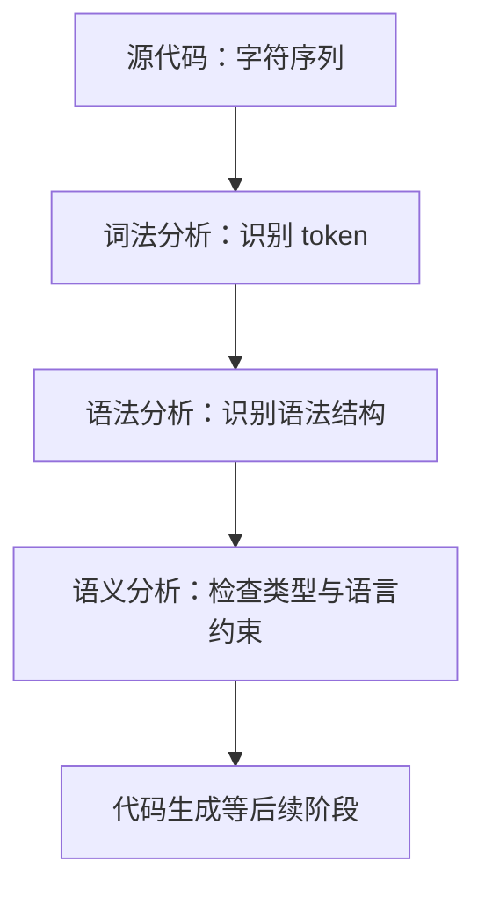

# 字符集、词法元素与标识符

> [!abstract] 知识范围
> - 课程依据：吴俊军老师《第02章 C语言的基本元素S》，§2.1–2.2，PDF 第 4–9 页。
> - 重点：字符集、token 的分类与计数、最长匹配原则、关键字和合法标识符判断。
> - 前置：[[01 C语言概论与程序设计基础]]。
> - 后续：[[03 基本数据类型与数据表示]]、[[04 常量、变量与初始化]]、[[05 运算符与表达式]]、[[15 编译预处理与多文件程序]]。

## 1. 从字符序列到 C 程序

C 源程序首先是一系列字符。编译系统需要根据词法规则将字符组织成词法元素，再依据语法和语义规则理解程序，最终生成目标代码。

课件第 4 页以一元二次方程求根程序和 GCC 示意源代码到机器代码的转换过程。



这是用于理解语言层次的简化模型，不是 ISO C 对全部翻译阶段的完整规定。预处理、编译、汇编与链接的关系见 [[01 C语言概论与程序设计基础]]、[[15 编译预处理与多文件程序]]。

例如：

```c
sum = x + y;
```

- 字符层：`s`、`u`、`m`、空格等。
- 词法层：`sum`、`=`、`x`、`+`、`y`、`;`。
- 语法层：一个以分号结束的赋值表达式语句。
- 语义层：读取 `x`、`y` 的值，进行加法运算，并将结果转换为适当类型后赋给 `sum`（假设相关声明、类型及运算均合法）。

> [!important] 三个层次不能混淆
> - 词法（lexical）：字符怎样组成 token？
> - 语法（syntax）：token 怎样组成合法的语言结构？
> - 语义（semantics）：该结构表示什么，是否满足语言规定的约束？
>
> 能分解为合法 token，不意味着表达式或程序合法。例如 `int = 3;` 的各个 token 都可以识别，但组合不符合 C 的语法。

## 2. 字符集（§2.1.1）

### 2.1 定义及组成

字符集（character set）是语言基本符号的集合。课件将 C 的基本字符集按以下四类介绍：

| 类别 | 内容 | 个数（C11 基本源字符集） |
| --- | --- | ---: |
| 大小写英文字母 | `a`–`z`、`A`–`Z` | 52 |
| 数字字符 | `0`–`9` | 10 |
| 特殊字符 | 见下表 | 29 |
| 空白字符 | 空格、换行、水平制表、垂直制表、换页 | 5 |

特殊字符如下：

```text
! " # % & ' ( ) * + , - . / : ;
< > = ? [ ] \ ^ _ { } | ~
```

常用空白字符：

| 名称 | 英文 | 转义表示（如适用） |
| --- | --- | --- |
| 空格 | space | `' '` |
| 换行 | new-line | `\n` |
| 水平制表 | horizontal tab（HT） | `\t` |
| 垂直制表 | vertical tab（VT） | `\v` |
| 换页 | form feed（FF） | `\f` |

> [!note] 标准辨析：字符集不等于 ASCII
> 课件称 C 字符集是 7 位 ASCII 的子集。这是常见 ASCII 兼容平台上对基本字符的描述。
>
> 严格而言，C11 区分基本源字符集、基本执行字符集及其扩展；标准规定必须提供的字符，并不要求所有实现采用 ASCII 编码。上表的 96 个字符指 C11 的基本源字符集，而不是所有可能出现在 C 源文件中的字符。C23 对相关字符集也有所扩展。
>
> 在现代 GCC/Clang 的 UTF-8 环境中，字符串、注释可以包含中文，符合相应标准和实现规则的非 ASCII 标识符也可能被接受。笔试判断普通标识符时，优先掌握老师给出的英文字母、数字与下划线规则。

### 2.2 空白字符的作用

空白通常用于分隔 token 或调整源代码排版。

```c
sum=x+y
sum = x + y
sum    =    x+y
```

以上三行的 token 序列完全相同：`sum`、`=`、`x`、`+`、`y`，均为 5 个 token（课件第 6 页示例）。

但是，空白并非可以任意删除或插入：

| 字符序列 | token | 区别 |
| --- | --- | --- |
| `int a;` | `int` `a` `;` | 声明 |
| `inta;` | `inta` `;` | 不再是原来的声明 |
| `sum` | `sum` | 一个标识符 |
| `su m` | `su` `m` | 两个标识符 |
| `a++` | `a` `++` | 自增表达式 |
| `a+ +b` | `a` `+` `+` `b` | 加法与一元正号 |

> [!warning] 空白字符的三个特殊情况
> 1. 字符常量和字符串字面量内部的空格是内容的一部分，例如 `' '`、`"a b"`，不能任意删去。
> 2. 预处理指令通常以逻辑行结束为边界；`#define F(x)` 与 `#define F (x)` 的含义不同。详见 [[15 编译预处理与多文件程序]]。
> 3. 注释在标准翻译阶段被替换为一个空格。因此 `int/**/a;` 等价于 `int a;`，而不是 `inta;`。

## 3. 词法元素（§2.1.2）

### 3.1 定义与五类 token

**Token（词法元素、记号）是由字符按词法规则组成的最小词法单元。**

课件采用以下五类划分：

| 课件分类 | 作用 | 例子 |
| --- | --- | --- |
| 标识符 | 为程序中的对象、函数等命名 | `sum`、`main`、`printf` |
| 关键字 | 表达语言预先定义的语法含义 | `int`、`if`、`return` |
| 常量 | 表示直接写出的固定数据 | `10`、`3.14`、`'A'` |
| 运算符 | 表达运算 | `+`、`=`、`++`、`>=` |
| 定界符（标点符号） | 划分或组织语法结构 | `;`、`{`、`}`、`(`、`)` |

> [!note] 标准辨析：ISO C 的五类 token
> C11/C17 标准采用关键字（keyword）、标识符（identifier）、常量（constant）、字符串字面量（string literal）、标点符号（punctuator）五类。
>
> 即标准将 `"hello"` 单列为字符串字面量，将 `+`、`=`、`;` 等归入标点符号；课件则按用途区分运算符与定界符。`sizeof` 在标准中是关键字，语法上也是运算符；逗号、星号和括号的语法作用也取决于上下文。
>
> 若题目明确要求按课件分类，采用课程术语；若要求 ISO C 的词法分类，则使用标准定义。课件第 7 页的中文提示字符串可进一步说明字符串字面量也是完整的词法单元。

### 3.2 典型例题：token 计数

#### 例 2.1（课件第 6 页）

```c
sum=x+y
```

| 序号 | token | 课件分类 |
| ---: | --- | --- |
| 1 | `sum` | 标识符 |
| 2 | `=` | 运算符 |
| 3 | `x` | 标识符 |
| 4 | `+` | 运算符 |
| 5 | `y` | 标识符 |

共 **5 个 token**。若添加结尾分号，则为 6 个。

#### 例 2.2（课件第 6 页）

```c
int a,b=10;
```

切分：

```text
int | a | , | b | = | 10 | ;
```

共 **7 个 token**。

注意 `10` 整体是一个整数常量 token，而不是 `1` 和 `0` 两个 token；逗号与分号均应计数。课件显示的全角标点应理解为对应的 ASCII 标点，实际 C 代码不能照写全角逗号、分号作为语法标点。

#### 例题：字符串与函数调用（课件第 7 页）

```c
scanf("%f%f", &x, &y);
```

切分：

```text
scanf | ( | "%f%f" | , | & | x | , | & | y | ) | ;
```

共 **11 个 token**。

- `scanf` 是标准库函数名，在词法层次是标识符，而不是关键字。
- `"%f%f"` 整体是一个字符串字面量，其中 `%` 不作为求余运算符参与词法切分。
- `&x` 包含两个 token：`&` 和 `x`。

### 3.3 最长匹配原则（maximal munch）

> [!important] 课件核心规则
> 从左到右扫描字符，每一次识别尽可能长的合法词法单元，即使这种切分会导致后续的语法或语义检查失败。
>
> 更严格地说，这是预处理 token 的识别规则（特殊的头文件名识别情形除外）。它不是运算符优先级，也不会为得到一个合法表达式而任意回退重新切分。

常见的多字符运算符需要整体识别：

| 字符序列 | 切分 | token 数 |
| --- | --- | ---: |
| `a==b` | `a` `==` `b` | 3 |
| `a>=b` | `a` `>=` `b` | 3 |
| `a+=b` | `a` `+=` `b` | 3 |
| `a<<=2` | `a` `<<=` `2` | 3 |
| `a&&b` | `a` `&&` `b` | 3 |
| `a+++b` | `a` `++` `+` `b` | 4 |
| `a---b` | `a` `--` `-` `b` | 4 |

#### 例 2.3：`x+++++y`（课件原题）

```c
x+++++y
```

从左向右扫描：

```text
x | ++ | ++ | + | y
```

共 **5 个 token**，而不是 `x | ++ | + | ++ | y`。

按照实际切分，两个连续的后缀自增相当于试图对 `(x++)` 的结果再次自增。后缀自增表达式的结果不是可修改左值，因此违反自增运算的约束。即使 `x` 和 `y` 都是普通 `int` 变量，该表达式仍然不合法，符合标准的实现必须给出诊断。

如果想表达两个不同变量分别自增后相加，必须显式分隔：

```c
x++ + ++y
```

假定 `int x = 2, y = 3;`，该表达式的值为 `6`；完整表达式结束后，`x` 为 `3`，`y` 为 `4`。这里修改的是两个不同对象，不会因两个加法操作数的求值顺序未指定而出现对同一对象的无序修改问题。

> [!warning] 最长匹配与运算符优先级
> `x+++++y` 的错误发生在按既定 token 切分进行语义检查时，不能用“自增优先级高于加法”来决定 token 的划分。
>
> 分析表达式应先确定 token，再依据语法结构、优先级、结合性与求值规则分析表达式。详见 [[05 运算符与表达式]]。

### 3.4 常见计数陷阱

| 片段 | token 数 | 理由 |
| --- | ---: | --- |
| `-123` | 2 | 一元 `-` 与整数常量 `123` |
| `3.14e-2` | 1 | 一个浮点常量，指数符号是常量的一部分 |
| `0xFF` | 1 | 一个十六进制整数常量 |
| `'\n'` | 1 | 一个字符常量 |
| `"hello world"` | 1 | 一个字符串字面量 |
| `"%d + %d"` | 1 | 格式字符串中的运算符外观不改变其词法分类 |
| `a[10]` | 4 | `a`、`[`、`10`、`]` |
| `sizeof(int)` | 4 | `sizeof`、`(`、`int`、`)` |
| `a/*注释*/+b;` | 4 | 注释不计数 |
| `int *p, q;` | 6 | `int`、`*`、`p`、`,`、`q`、`;` |

> [!tip] 书面题解题流程
> 1. 明确计数范围：表达式、语句还是完整代码段；有没有分号、括号。
> 2. 将字符常量和字符串字面量作为整体识别，注意转义引号。
> 3. 排除注释及 token 之间的空白。
> 4. 从左向右按最长匹配分解其余字符。
> 5. 写出 token 序列再计数，尤其留意多字符运算符。
> 6. 最后再判断语法和语义是否合法。

> [!note]- 拓展：预处理 token 不完全等于 C token
> 例如 `123abc` 不能作为合法标识符，也不是合法的整数常量；在预处理阶段它可以整体被识别为一个 pp-number，之后转换成正式 token 时失败。再如 `#include <stdio.h>` 的 `<stdio.h>` 在该指令中是一个头文件名预处理 token，而不是普通的比较表达式。若题目涉及预处理指令，必须先确定讨论的是源文件的预处理 token 还是预处理完成后的 C token。

## 4. 关键字（§2.2.1）

关键字（keyword，也称保留字）是 C 语言规定具有特定含义的词，不能用作普通变量名、函数名等。

### 4.1 C90 的 32 个关键字

课件的关键字表还列出了 C99、C11 的新增关键字。先掌握传统 C90 的 32 个，按功能辅助记忆：

| 功能 | 关键字 |
| --- | --- |
| 基础类型及修饰 | `char` `short` `int` `long` `float` `double` `signed` `unsigned` `void` |
| 用户定义类型相关 | `struct` `union` `enum` `typedef` |
| 类型限定 | `const` `volatile` |
| 存储类别说明 | `auto` `register` `static` `extern` |
| 分支与选择 | `if` `else` `switch` `case` `default` |
| 循环 | `for` `while` `do` |
| 跳转与返回 | `break` `continue` `goto` `return` |
| 大小运算 | `sizeof` |

各组数量：9 + 4 + 2 + 4 + 5 + 3 + 4 + 1 = 32。这里是便于记忆的功能分组，不是标准对语法类别的穷举。

### 4.2 不同 C 标准的关键字

| 版本 | 新增关键字 | 总数 |
| --- | --- | ---: |
| C89/C90 | 上述 32 个 | 32 |
| C99 | `inline` `restrict` `_Bool` `_Complex` `_Imaginary` | 37 |
| C11 | `_Alignas` `_Alignof` `_Atomic` `_Generic` `_Noreturn` `_Static_assert` `_Thread_local` | 44 |
| C17/C18 | 无新增 | 44 |

> [!warning] 课件勘误
> 第 8 页的 `Imaginary` 漏写了下划线，正确的 C99 关键字为 **`_Imaginary`**。它与 `Imaginary` 是不同的词。C23 又引入其他关键字，本笔记不展开，不能将上表的 44 个当成所有版本的固定数量。

### 4.3 容易误认为关键字的词

| 名称 | C11/C17 中的身份 |
| --- | --- |
| `main` | 程序的特殊函数名（宿主环境入口函数），不是关键字 |
| `printf`、`scanf` | 标准库函数名，不是关键字 |
| `getchar`、`putchar` | 标准库函数名，不是关键字 |
| `include`、`define` | 在相应预处理指令中的指令名，不是 C 关键字 |
| `NULL`、`EOF` | 标准库头文件提供的宏名，不是关键字 |
| `bool`、`true`、`false` | C99–C17 中 `<stdbool.h>` 提供的宏；C23 中为关键字 |
| `Int`、`Float`、`Return` | 与小写关键字拼写不同，不是关键字 |
| `string`、`class`、`namespace` | 不是 ISO C11/C17 关键字 |

`sizeof` 是关键字，也是一个运算符，不是函数；其具体语法和操作数规则见 [[05 运算符与表达式]]。

> [!important] 判断题常见设问
> “`main` 是 C 语言的关键字”“`printf` 是保留字”“C 语言所有关键字在任何标准中都由小写英文字母构成”均错误。第三个命题在 C99 和后续标准中存在带大写字母和下划线的反例。

## 5. 标识符（§2.2.2）

### 5.1 命名规则

标识符（identifier）用于命名变量、函数、宏、标号以及其他需要名称的实体。

课件规定的基础命名规则：

1. 首字符为字母或下划线。
2. 后续字符可以是字母、数字或下划线。
3. C 区分大小写。
4. 不得将关键字作为普通标识符使用，也不能侵占标准保留的名称。

普通 ASCII 标识符的拼写形式可以用正则表达式辅助理解：

```regex
^[A-Za-z_][A-Za-z0-9_]*$
```

这个正则表达式**只检查拼写形式**，不检查关键字、保留标识符、声明上下文，也不完整覆盖标准允许的非 ASCII 标识符。

### 5.2 课件示例及扩展

| 名称 | 拼写形式 | 说明 |
| --- | --- | --- |
| `K` | 合法 | 可以用大写字母开头 |
| `_id` | 合法 | 下划线可以开头，但要考虑保留规则 |
| `x_coord` | 合法 | 可以包含下划线 |
| `time1` | 合法 | 数字可以出现在非首位 |
| `20_sum` | 不合法 | 首字符是数字 |
| `not#me` | 不合法 | `#` 不能作为普通标识符字符 |
| `-3x` | 不合法 | `-` 与数字均不能作为标识符首字符 |
| `my-name` | 不合法 | 被切分为 `my`、`-`、`name` |
| `a.b` | 不合法 | 被切分为 `a`、`.`、`b` |
| `a b` | 不合法 | 空白会分隔两个标识符 |
| `int` | 不可命名 | 拼写符合上述形式，但属于关键字 |
| `Int` | 合法 | 大小写不同，不是 `int` |
| `__temp` | 拼写合法但保留 | 不可随意用作自定义名字 |

> [!warning] 大小写敏感
> `sum`、`Sum`、`SUM` 是三个不同的标识符。`Int x;` 也不能仅因为 `Int` 的拼写合法就认为这是合法的变量声明；它还需要在该位置表示有效的类型名称。

### 5.3 关键字与保留标识符的区别

《C Primer Plus》第 2 章 §2.8 特别指出：关键字不能用于普通命名；保留标识符虽然可能符合标识符的拼写规则，但已被语言或库保留，不能擅自使用。

以 C11/C17 为基准，常见的保留规则如下（完整规则还涉及标准库和未来库扩展）：

| 名称模式或来源 | 保留条件 | 示例 |
| --- | --- | --- |
| `__` 开头 | 始终保留 | `__count` |
| `_` 后紧跟大写字母 | 始终保留 | `_Count` |
| 任何 `_` 开头的标识符 | 文件作用域的普通标识符及标记（tag）名字空间中保留 | `_count` |
| 标准库外部链接标识符 | 保留作外部链接名称，不因未包含头文件而解除 | `printf` |
| 标准库宏名等 | 根据对应头文件及标准的保留规则 | `EOF`、`NULL` |

因此，课件中的 `_id` 并非在所有情况下都不可用：

```c
int _id;             // 文件作用域：该名字属于标准保留范围

int main(void)
{
    int _local = 0;  // 普通块作用域局部变量：此拼写本身不触发上述保留规则
    return _local;
}
```

> [!note] 标准辨析
> 以上第一行是反例，不应写进实际程序。违反保留标识符规则不一定会出现编译错误，在标准规定的情形下可能导致未定义行为。
>
> 标准库函数名不是关键字，也不能因此推导出“可以任意重定义标准库函数”。相反，在某些不冲突的内层作用域，名字遮蔽可能是合法的；需要结合声明、链接与头文件判断，详见 [[13 作用域、存储期与变量存储类型]]。
>
> 考试若仅要求判断是否具有标识符的拼写形式，`_id` 应按课件视为合法形式；若要求能否作为某个具体位置的自定义名字，需要额外检查保留规则。实践中建议避免自定义以 `_` 开头的名字。

### 5.4 命名规范（实践补充）

```c
int count;
int x_coord;
int gcd(int x, int y);
```

优先采用含义清晰、风格一致的名称。普通变量和函数可以使用 `snake_case`，宏常量通常使用大写形式，如 `MAX_SIZE`；这些是约定，不是语法强制规则。

## 6. 可选实践：观察 Clang 的词法分析结果

这一部分不是课件要求，旨在验证最长匹配原则。GCC/Clang 的诊断不是语言规则本身，标准才是依据。

在 Linux 下将示例保存为 `tokens.c`：

```c
int main(void)
{
    int x = 2, y = 3;
    int sum = x+++++y;
    return sum;
}
```

使用 Clang 查看 token（Clang 的内部前端选项，非 ISO C 接口）：

```bash
clang -std=c11 -Xclang -dump-tokens -fsyntax-only tokens.c 2>&1
```

预期在相应位置观察到类似的 token 种类与拼写：

```text
identifier 'x'
plusplus '++'
plusplus '++'
plus '+'
identifier 'y'
```

具体诊断输出还会包含位置和标志信息，随 Clang 版本变化。再执行常规语法和约束检查：

```bash
clang -std=c11 -Wall -Wextra -pedantic-errors -fsyntax-only tokens.c
```

此时应诊断第二次后缀自增的操作数不是可修改左值。将原行改为 `int sum = x++ + ++y;` 后，程序在正常实现上可通过该检查。

## 7. 本篇复习清单

- [ ] 能写出基本字符集的四类字符，区分字符与 token。
- [ ] 能按课件列举五类 token，了解与 ISO C 五类的不同。
- [ ] 能正确计数标识符、常量、多字符运算符、括号及分号。
- [ ] 理解 `x+++++y` 的切分结果及其错误原因。
- [ ] 能判断空白、注释和字符串对 token 切分的影响。
- [ ] 能区分关键字、标准库函数名、宏名和普通标识符。
- [ ] 能判断普通 ASCII 标识符的拼写是否合法，并识别保留名称。
- [ ] 了解 C90、C99、C11 的关键字数量和版本差异。

## 8. 自测题

以下是依据课件知识点编写的练习，不是历年真题。除特别说明，按 C11/C17 及普通 ASCII 代码讨论，不涉及宏展开、相邻字符串拼接等特殊情形。计数范围以代码中给出的字符片段为准。

### 8.1 Token 计数题

1. `int a=10,b=-5;` 有多少个 token？
2. `printf("a=%d, b=%d\n",a,b);` 有多少个 token？
3. `a+++b;` 与 `a++ + ++b;` 分别有多少个 token？
4. `float x=1.2e-3;` 有多少个 token？
5. `int/**/a = 0;` 有多少个 token？
6. `x+++++y` 有多少个 token？如何切分？它是否是合法的 C 表达式？
7. `char c='\t';` 有多少个 token？

### 8.2 选择与判断题

8. 下列哪些字符串可以作为普通 ASCII 标识符的拼写形式，且不属于 C11 关键字？（`sum_1`、`2sum`、`float`、`Float`、`_id`、`a-b`、`my__name`）
9. 判断：`main`、`printf`、`sizeof` 均为 C 关键字。
10. 判断：C 语言所有关键字都由小写英文字母组成。
11. 判断：在 C 中删除所有空白字符和注释不会改变程序含义。
12. 判断：`__sum` 不是合法的标识符拼写形式，因为标识符不能连续使用两个下划线。
13. 判断：`_id` 在文件作用域总是允许作为自定义变量名。
14. 判断：`"a+b"` 包含三个 token。
15. 判断：只要一段代码能按词法规则分解为 token，就一定能够通过编译。
16. 写出 C90、C99、C11 的关键字数量。`Imaginary` 和 `_Imaginary` 哪一个是标准关键字？

> [!success]- 参考答案与解析
> 1. 10 个：`int | a | = | 10 | , | b | = | - | 5 | ;`。负号单独计数。
> 2. 9 个：`printf | ( | "a=%d, b=%d\n" | , | a | , | b | ) | ;`。
> 3. 5 个和 6 个：`a | ++ | + | b | ;`；`a | ++ | + | ++ | b | ;`。
> 4. 5 个：`float | x | = | 1.2e-3 | ;`。指数中的负号属于整个浮点常量。
> 5. 5 个：`int | a | = | 0 | ;`。注释被当作空白处理。
> 6. 5 个：`x | ++ | ++ | + | y`。不合法，第二次后缀自增的操作数不是可修改左值。
> 7. 5 个：`char | c | = | '\t' | ;`。
> 8. `sum_1`、`Float`、`_id`、`my__name`。`_id` 的具体使用还需检查作用域；C 不像 C++ 那样将任意位置出现双下划线的名字一律保留。
> 9. 错。只有 `sizeof` 是关键字。
> 10. 错。例如 C99 的 `_Bool`。传统 C90 的 32 个关键字才均为小写英文字母组成。
> 11. 错。例如 `int a` 会变为 `inta`，而 `int/**/a` 不能直接删除注释变成 `inta`。
> 12. 错。拼写合法，但以双下划线开头的名字属于保留标识符。
> 13. 错。文件作用域的此类普通标识符属于保留范围。
> 14. 错。整个字符串字面量是一个 token。
> 15. 错。词法合法不等于满足语法和语义约束。
> 16. 32、37、44；`_Imaginary`。

## 9. 资料索引

- 吴俊军：《第02章 C语言的基本元素S》，PDF 第 4 页（字符到机器代码）、第 5 页（字符集）、第 6–7 页（词法元素与最长匹配）、第 8 页（关键字）、第 9 页（标识符）。
- Stephen Prata：《C Primer Plus（第6版）》§2.8 关键字和保留标识符（书内页码 100）。
- ISO C11 委员会草案 N1570：§5.1.1.2（翻译阶段）、§5.2.1（字符集）、§6.4（词法元素）、§6.4.1（关键字）、§6.4.2（标识符）、§7.1.3（保留标识符）；可结合以下技术参考核实。
- cppreference：[C keywords](https://en.cppreference.com/c/keyword)、[Identifiers](https://en.cppreference.com/c/language/identifiers)、[Phases of translation](https://en.cppreference.com/c/language/translation_phases)。

课件例题保留原有逻辑，其余标准辨析、计数练习和 Clang 实践均为辅助说明，不代表老师已经讲授或明确规定为考试内容。
