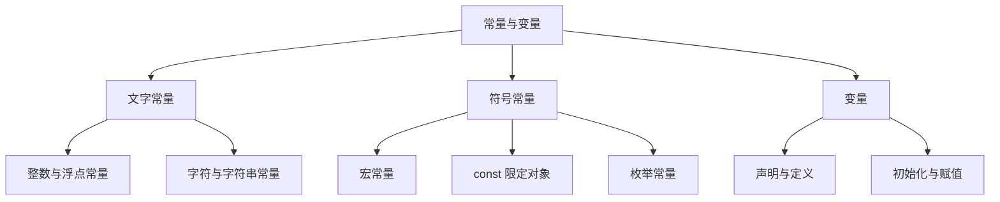

# 常量、变量与初始化

> [!abstract] 知识定位
> 对应吴俊军老师《C语言程序设计》第2章 §2.4（PDF 第21–32页）。
> 核心问题：怎样在源代码中表示固定值，怎样为数据命名、分配对象并设置初始值？
> 课件为主，补充 C99/C11/C17 的标准规则。课程未明确指定考试采用哪一版标准；C23及编译器扩展单独注明。课件第27页将符号常量标为课后自学，本篇仍保留该部分，但不推断其必考。

上篇：[[03 基本数据类型与数据表示]]  
下篇：[[05 运算符与表达式]]  
关联：[[02 字符集、词法元素与标识符]] · [[07 类型转换与混合运算]] · [[13 作用域、存储期与变量存储类型]] · [[15 编译预处理与多文件程序]] · [[17 字符数组、字符串与字符串函数]] · [[00 C语言程序设计 MOC]]

## 1. 常量与变量概述（§2.4）

课件将常量和变量称为 C 语言处理的数据对象：常量的值保持不变，变量的值可以改变。课件将常量分为两大类：

- **文字常量（字面量）**：在源代码中直接书写固定值，包括整型常量、浮点型常量、字符常量和字符串常量。
- **符号常量**：用标识符表示固定值，课件介绍 `#define`、`const`、枚举三种方式。



> [!note] 标准辨析
> 这是课件的教学分类。ISO C 中整数常量、浮点常量、字符常量与枚举常量属于常量类别，字符串字面量具有数组类型；`const` 对象仍然是对象，而宏名是预处理器名称。不能将三种符号常量视为完全相同的语言机制。
> 字面量具有类型，但不一定对应独立的内存存储单元。例如整数常量 `42` 可以直接成为机器指令的立即数。字符串字面量则对应具有静态存储期的字符数组。

## 2. 整型常量（§2.4.1，课件第22页）

### 2.1 书写形式与进制

课件形式：`[前缀] 整数部分 [后缀]`，方括号表示可选，而非实际写入代码。

| 进制 | 前缀 | 可用数字 | 示例 | 十进制值 |
| --- | --- | --- | --- | ---: |
| 十进制 | 无（非零数不以0开头） | 0–9 | `314` | 314 |
| 八进制 | `0` | 0–7 | `0114` | 76 |
| 十六进制 | `0x` 或 `0X` | 0–9、a–f、A–F | `0x4C` | 76 |

`0` 本身按整数常量的词法规则属于八进制形式，数值仍然为零。

课件例题：

- `0114` 合法：$1\times8^2+1\times8+4=76$。
- `314` 合法：十进制 314。
- `0678` 不合法：八进制常量不能包含数字 8。
- `0XFUL` 合法：十六进制 `F` 为 15，`UL` 为后缀，类型是 `unsigned long`。

> [!warning] 易错点：前导零不是排版
> `010` 是八进制 8，不是十进制 10；`09` 不是合法整数常量。`0x` 后必须有至少一个十六进制数字。
> C99/C11/C17 不支持标准的 `0b1010` 写法；GCC/Clang 可能作为扩展接受。C23 才正式引入二进制整数常量。

### 2.2 后缀

| 后缀 | 含义 | 示例 |
| --- | --- | --- |
| 无 | 按进制和值选择类型 | `123` |
| `u` 或 `U` | 从无符号候选类型选取 | `123U` |
| `l` 或 `L` | 从 long 等候选类型选取 | `123L` |
| `ul`、`UL` 等 | 从 unsigned long 等候选类型选取 | `123UL` |
| `ll` 或 `LL` | long long 相关类型（C99） | `123LL` |
| `ull`、`ULL` 等 | unsigned long long（C99） | `123ULL` |

`U` 与 `L` / `LL` 的先后顺序可颠倒，大小写通常可混合，如 `42Lu`。但 `ll` 和 `LL` 必须使用相同大小写，`42lL` 不合法。建议使用大写 `L`，避免与数字 `1` 混淆。

> [!note] 课件与标准的差异
> 第22页把无后缀写为 `int`，把后缀 `u` 写为 `unsigned`，这是常见小数值下的简化结论。严格来说，常量的类型还取决于数值能否被相应类型表示。课件的 `0XFUL` 占4字节是其32位模型的结果，在 LP64 Linux 上通常占8字节。

### 2.3 类型判定规则（标准补充，C99–C17）

从对应候选列中**自左向右选择第一个能够表示该常量值的类型**。表中省略 `int` 的可选拼写：`unsigned` 即 `unsigned int`。

| 后缀 | 十进制候选类型 | 八进制/十六进制候选类型 |
| --- | --- | --- |
| 无 | `int`, `long`, `long long` | `int`, `unsigned int`, `long`, `unsigned long`, `long long`, `unsigned long long` |
| `U` | `unsigned int`, `unsigned long`, `unsigned long long` | 同左 |
| `L` | `long`, `long long` | `long`, `unsigned long`, `long long`, `unsigned long long` |
| `UL` | `unsigned long`, `unsigned long long` | 同左 |
| `LL` | `long long` | `long long`, `unsigned long long` |
| `ULL` | `unsigned long long` | 同左 |

如果以上候选类型均无法表示该数值，标准允许某些扩展整数类型；不要认为一定能无条件使用任意大的整数。

> [!example] 典型易错题（32位 int，LP64 数据模型）
> `2147483647` → `int`；`2147483648` → `long`；`0x80000000` → `unsigned int`；`0xFFFFFFFF` → `unsigned int`；`2147483648U` → `unsigned int`。
> 数值相同，但进制形式可以改变候选类型和最终类型。在 LLP64 上，`2147483648` 通常是 `long long` 而不是 `long`。

### 2.4 负号与整数常量

严格说，`-123` 是一元负号运算符 `-` 与正整数常量 `123` 组成的表达式，而不是单个负整型 token。复习 [[02 字符集、词法元素与标识符]]。

在 32 位 `int` 的 LP64 模型中，`-2147483648` 的正数字面量先属于 `long`，然后再取负，因此整个表达式为 `long`。不能因为数学结果落在 int 范围内，就反过来判定其类型为 int。需要最小 `int` 值时可使用 `<limits.h>` 的 `INT_MIN`。

## 3. 浮点型常量（§2.4.2，课件第23页）

### 3.1 十进制小数形式与指数形式

| 形式 | 示例 | 数学值 |
| --- | --- | --- |
| 小数形式 | `3.14` | 3.14 |
| 小数点前省略整数 | `.5` | 0.5 |
| 小数点后省略小数 | `1.` | 1.0 |
| 指数形式 | `1.2e3` | $1.2\times10^3$ |
| 指数为负 | `1.2E-3` | $1.2\times10^{-3}$ |
| 指数形式省略小数点 | `10E10` | $10\times10^{10}$ |

规则：

- 小数形式必须有小数点；小数点两边至少有一侧包含数字。
- 指数形式可以没有小数点，但 `e/E` 前必须有有效的数字部分，后面必须有整数指数；指数的正负号可选。
- 如果既没有小数点，也没有指数部分，就是整数常量，单独添加 `f` 不会使其成为合法浮点常量。

### 3.2 浮点常量的类型

| 后缀 | 类型 | 示例 |
| --- | --- | --- |
| 无 | `double` | `1.0`, `1e-5` |
| `f` 或 `F` | `float` | `1.f`, `1.0F` |
| `l` 或 `L` | `long double` | `1.2e-123L`, `10E10L` |

课件例题：

| 常量 | 合法性 | 原因或类型 |
| --- | --- | --- |
| `1.f` | 合法 | float |
| `1.2e-123L` | 合法 | long double |
| `10E10L` | 合法 | long double |
| `E+10` | 非法（作为浮点常量） | 缺少有效数字部分；可被分成其他 token |
| `10e1.5` | 非法 | 指数必须是整数 |
| `1.2eF` | 非法 | 缺少指数数字 |
| `10f` | 非法 | 无小数点也无指数 |
| `.e1` | 非法 | 缺少有效数字部分 |

> [!warning] 易错点
> `float eps = 1.0e-5;` 中右侧字面量是 `double`，初始化时转换成 `float`；`float eps = 1.0e-5f;` 的字面量才是 `float`。对象类型由声明决定，字面量类型由其写法决定。
> `-3.14e-2` 有两个 token；只有开头的负号是独立运算符，指数负号属于同一个浮点常量。
> 小数的数学值与机器可表示的实际浮点值可能不同，例如 `0.1` 通常不能被二进制浮点数精确表示（见 [[03 基本数据类型与数据表示]]）。

### 3.3 十六进制浮点常量（拓展，C99）

`0x1.2p3` 表示十六进制有效数字 `1.2` 乘以 $2^3$，结果为 $1.125\times8=9.0$，类型为 `double`。`p/P` 指数必须出现，指数本身用十进制整数表达。此内容课件未展开，不作为本节核心考点。

## 4. 字符常量与转义序列（课件第24–25页）

课件第24页将字符常量小节误标为 §2.4.2（重复浮点常量编号），本篇按内容整理。

### 4.1 普通字符常量

一对单引号用于界定普通字符常量。课程常规写法：`'A'`、`'a'`、`'1'`、`'#'`、`'"'`、`'\n'`。

> [!important] 核心考点
> 在 C 中普通字符常量如 `'A'` 的类型是 `int`，而不是 `char`。在 ASCII 环境中其值是 65。`sizeof('A') == sizeof(int)`，而 `sizeof(char) == 1`（ISO C 保证）。字符常量的类型和存储其值的变量类型不能混淆。

| 表达式 | 含义 | 常见 ASCII 值/类型 |
| --- | --- | --- |
| `1` | 数字一 | int，1 |
| `'1'` | 数字字符一 | int，49 |
| `'A'` | 大写字符 A | int，65 |
| `'a'` | 小写字符 a | int，97 |
| `'\0'` | 空字符 | int，0 |
| `"A"` | 字符串字面量 | char[2] |

字符码依赖执行字符集，ISO C 不保证必须是 ASCII；但保证 `'0'` 到 `'9'` 的字符编码依次连续，因此 `c - '0'` 是将十进制数字字符转换为数值的可移植写法（前提是 `c` 为数字字符）。字母编码的连续性不是 ISO C 普遍保证。

> [!note] 标准辨析：多字符常量
> 课件要求单引号内只有一个字符或一个转义序列，并将 `'abc'` 列为不符合普通单字符常量写法。严格而言，C99–C17 支持多字符整数常量，其值由实现定义，不能当作字符串或可移植的普通字符常量使用。考试题问课件约定的单字符常量时，应明确其不是合法的单字符写法；问 ISO C 能否接受时，应区分两者。空字符常量 `''` 则确实不合法。

### 4.2 常用字符转义序列

转义序列以反斜线 `\` 开头，源码中的多个字符可以组成一个转义序列，表示一个字符。

| 写法 | ASCII 值 | 含义 |
| --- | ---: | --- |
| `\0` | 0 | 空字符 NUL（八进制转义） |
| `\a` | 7 | 响铃 |
| `\b` | 8 | 退格 |
| `\t` | 9 | 水平制表 |
| `\n` | 10 | 换行 |
| `\v` | 11 | 垂直制表 |
| `\f` | 12 | 换页 |
| `\r` | 13 | 回车 |
| `\"` | 34 | 双引号 |
| `\'` | 39 | 单引号 |
| `\?` | 63 | 问号 |
| `\\` | 92 | 反斜线 |

这些数值按课程使用的 ASCII 环境记忆；控制字符的实际显示效果取决于终端或设备。

> [!warning] 易错点：`\n`、`\r`、`\0`
> `\n` 是换行符，`\r` 是回车符，`\0` 是值为零的空字符。`\0` 不等于 `'0'`，也不是字符 `\` 与 `0` 的组合。`'\\'` 表示一个反斜线字符。
> Linux 终端中文本换行通常使用 LF；Windows 文本流可能在读写时转换 CRLF。这属于平台 I/O 行为，不是 C 的转义语法变化。

### 4.3 数字转义序列

| 种类 | 形式 | 规则（C99–C17） | 例子 |
| --- | --- | --- | --- |
| 八进制 | `\ooo` | 1–3 个八进制数字 | `'\101'` |
| 十六进制 | `\xhh...` | 至少一个十六进制数字，尽可能多地读取 | `'\x41'` |

课件例题（ASCII）：

```c
'A' == '\101'   // 65
'A' == '\x41'   // 65
'\t' == '\11'   // 9
'\t' == '\011'  // 9
'\t' == '\x9'   // 9
'\t' == '\x09'  // 9
```

以上比较表达式的值均为真（1）。

> [!note] 标准辨析：十六进制转义的长度
> 第25页称十六进制转义有 1–2 个十六进制数字，这是常见8位字符值写法的简化；ISO C 没有这个固定长度限制，十六进制转义会连续消耗所有后续十六进制数字。其数值还须满足对应字符类型所要求的范围。
> 字符串 `"\x41B"` 不会切分成 `\x41` 和 `B`，而会读取 `41B`，在常见8位字符环境中数值超出范围。正确表达 `AB` 可用 `"\x41" "B"`（相邻字符串字面量会拼接）或 `"\101B"`。
> 八进制最多消耗三位，因此 `"\1234"` 表示两个数据字符：八进制 `123` 所代表的字符和字符 `4`。在 ASCII 下前者为 `S`。

## 5. 字符串常量（§2.4.4，课件第26页）

### 5.1 书写与存储

字符串常量（字符串字面量）由双引号界定，可以包含零个或多个字符和转义序列。双引号本身不是内容；编译器在普通字符串字面量内容末尾附加空字符 `\0`。

以课件 `"world"` 为例：

| 下标 | 0 | 1 | 2 | 3 | 4 | 5 |
| --- | --- | --- | --- | --- | --- | --- |
| 字符 | w | o | r | l | d | `\0` |

类型为 `char[6]`，`sizeof("world")` 为 6。`strlen("world")` 为 5，需包含 `<string.h>` 才可调用。详见 [[17 字符数组、字符串与字符串函数]]。

> [!important] 核心考点
> 普通字符串字面量的数组长度 = 编码后的数据字节数 + 1（自动附加的终止空字符）。在课程 ASCII 例题中，一个普通字符或一个普通转义序列通常占一个字节；不能直接按源代码文字数量计数。对于 UTF-8 中文等多字节字符，应按编码后的字节计数。

### 5.2 课件例题：判断实际内容与长度

| 字符串字面量 | 实际数据（不含自动结束符） | sizeof（ASCII环境） |
| --- | --- | ---: |
| `"I am a string\n"` | 13个普通字符和1个换行符 | 15 |
| `""` | 无数据字符 | 1 |
| `"3'40\""` | `3`、`'`、`4`、`0`、`"` | 6 |
| `"c:\tc"` | `c`、`:`、制表符、`c` | 5 |
| `"c:\\tc"` | `c`、`:`、反斜线、`t`、`c` | 6 |

### 5.3 字符常量 vs 字符串常量

| 属性 | `'A'` | `"A"` |
| --- | --- | --- |
| 定界符 | 单引号 | 双引号 |
| 类型 | `int` | `char[2]` |
| 内容 | 字符码 65（ASCII） | `A`、`\0` |
| `sizeof`（32位int） | 4 | 2 |
| 可赋给普通 char 变量 | 可以（转换） | 不可以直接赋值 |

`'\0'` 的值为0，而 `"\0"` 包含两个连续的零字节：显式空字符与隐式结束符。

### 5.4 存储长度和字符串有效长度（标准补充）

| 表达式 | 字面量对象的字节数 | `strlen` |
| --- | ---: | ---: |
| `""` | 1 | 0 |
| `"A"` | 2 | 1 |
| `"\n"` | 2 | 1 |
| `"\0"` | 2 | 0 |
| `"A\0B"` | 4 | 1 |
| `"abc" "def"` | 7 | 6 |

`strlen` 从起始位置数到第一个空字符为止，而 `sizeof` 对数组表达式返回整个数组大小，包括所有数据和终止符。

> [!warning] 拓展：字符串字面量不可修改
> C 的普通字符串字面量类型是字符数组（不是 `const char[]`），但试图修改其内容是未定义行为。初始化一个自己的数组则不同：`char s[] = "abc";` 得到可修改的数组。这里先记结论，待字符串与指针章节再展开。

## 6. 符号常量（§2.4.5，课件第27–30页，课后自学）

### 6.1 `#define` 宏常量

语法（对象式宏）：

```c
#define 标识符 替换列表
```

宏在预处理阶段进行 token 替换，无独立 C 对象、无独立地址，也不需要为宏名分配存储空间。定义行本身不以分号终止；如果写入分号，分号会成为替换列表的一部分。宏替换的结果可以具有某种类型，但宏名本身不是有类型的 C 变量。

课件第28页原例（摄氏度与华氏度转换，原结构保留）：

```c
#include <stdio.h>
#define LOWER 0      /* 表的下限 */
#define UPPER 300    /* 表的上限 */
#define STEP 20      /* 步长 */

int main(void)
{
    int fahr;
    for(fahr=LOWER;fahr<=UPPER;fahr=fahr+STEP)
        printf("%3d:%10.2f\n", fahr, (5.0/9)*(fahr-32));
    return 0;
}
```

该例可在 ISO C99/C11/C17 模式下编译。前两行和最后一行输出（冒号后宽度为10）：

```text
  0:    -17.78
 20:     -6.67
300:    148.89
```

公式 $C=\frac{5}{9}(F-32)$。使用 `5.0/9` 避免整数除法产生 0。宏常量有助于统一修改范围和步长，使代码更易维护。格式化输出和宏展开细节分别参见 [[08 字符输入输出与格式化输入输出]]、[[15 编译预处理与多文件程序]]。

> [!warning] 宏不是赋值语句
> `#define N 10` 是宏定义，而 `#define N = 10` 的替换列表包含 `=`；`#define N 10;` 的替换列表包含分号。后两种写法并非预处理指令本身必然非法，但代入通常的表达式位置可能产生语法错误。如 `int x = N + 1;` 使用带分号的宏还会改变语句结构。

### 6.2 `const` 限定对象

课件例子（规范 ASCII 标点）：

```c
const double PI = 3.14159;
const int DOWN = 0x5000;
const int YES = 1, NO = 0;
```

`const` 是类型限定符。通过这样的声明定义一个具有相应类型的只读对象（不能通过这个 const 限定左值赋值）。`PI` 可以取地址；编译器也可以在满足可观察行为的条件下省略实际存储。实际是否位于只读内存由实现决定。

```c
const int n = 10;
// n = 20;  // 违反约束，不能赋值给 const 对象
```

> [!warning] `const` 不等于编译期整数常量（C99–C17）
> `const int n = 10;` 中 `n` 不是 ISO C 的整数常量表达式，不能代替 `case` 标签等需要整数常量表达式的位置。块作用域中的 `int a[n];` 在支持 VLA 的实现中是变长数组，而不是普通固定长度数组。文件作用域不能定义这种变长数组。
> 块作用域中 `const int n = input;` 可以使用运行时的值初始化。试图通过强制转换去修改真正 const 对象的值属于未定义行为。C23 引入 `constexpr`，本篇不展开。

### 6.3 枚举常量

课件使用 `enum` 定义枚举类型以及一组有名称的整数值：

```c
enum week { SUN, MON, TUE, WED, THU, FRI, SAT };
enum week day;
day = SUN;
```

这里最后一条赋值语句应位于函数体内。也可以在定义类型时同时定义枚举对象：

```c
enum week { SUN, MON, TUE, WED, THU, FRI, SAT } day = SUN;
```

两种类型定义写法是替代方案，不能在同一作用域重复定义相同的枚举类型和枚举常量。

默认编号从0开始：`SUN=0`、`MON=1`、…、`SAT=6`。若指定某项初值，下一项按其值加1（不是按位置编号）。

```c
enum state { A, B = 5, C, D = 2, E, F = E };
// A=0, B=5, C=6, D=2, E=3, F=3
```

> [!important] 核心规则（C99–C17）
> - 枚举常量是 `int` 型的整数常量，可用于整数常量表达式。
> - 枚举项可以不连续，也允许不同名称具有相同值；名称仍须遵守作用域和重名规则。
> - `enum week` 类型和 `int` 不等同；枚举类型与某一种整数类型兼容，具体兼容类型由实现决定，因此不能保证 `sizeof(enum week) == sizeof(int)`。
> - `enum week day` 是对象声明，`SUN` 是枚举常量；枚举不是 C++ 的强类型 `enum class`。C23 扩展了枚举的类型规则，课程暂按旧标准理解。

完整枚举类型、结构体与联合体知识待后续课件加入，本篇只保留符号常量部分。

### 6.4 三种符号常量对比

以下取 `#define N 10`、`const int n=10;`、`enum { M=10 };` 为例（C99–C17）。

| 属性 | `N` | `n` | `M` |
| --- | --- | --- | --- |
| 语言机制 | 预处理替换 | const 限定对象 | 枚举常量 |
| 本身是否有 C 类型 | 无（展开的10为int） | const int | int |
| 是否为 C 对象 | 否 | 是 | 否 |
| 能否取地址 | 否（展开为10） | 能 | 否 |
| 能否直接赋值改变 | 否 | 否 | 否 |
| 能否作为 case 标签 | 能 | 不能（ISO C） | 能 |
| 能否作固定数组长度 | 能 | 不能作为整数常量表达式 | 能 |
| 作用范围 | 预处理定义后至#undef或翻译单元末尾 | C 作用域规则 | C 作用域规则 |

## 7. 变量声明（§2.4.6，课件第31–32页）

### 7.1 声明、名称、类型、存储

课件语法：`类型说明符 变量表;`。变量表可以通过逗号分隔多个声明符。

```c
int total;       /* 总和 */
int average;     /* 平均值 */
short x;
char c;
int a, b, sum;
```

变量有名称（标识符）、类型、值、存储与生命周期等相关属性。通过名称访问其值；`&x` 取得其地址（对象可取地址的情况下）。声明应先于使用，名称宜见名知义。

> [!note] 标准辨析：声明与定义
> 声明引入标识符及类型等信息，定义是为对象提供存储（或在抽象机中定义该对象）的声明。块内 `int x;` 是对象定义，`extern int x;` 通常只是声明已有外部对象；文件作用域 `int x;` 是暂定定义。后续结合 [[13 作用域、存储期与变量存储类型]] 学习。

### 7.2 课件第31页：字节序问题

课件假设 `short x;` 占2字节，首地址为2048，并令 `x = 0x1234`，问地址2048所存放的内容。

| 地址 | 2048（低地址） | 2049（高地址） |
| --- | --- | --- |
| 小端序（little-endian） | `0x34` | `0x12` |
| 大端序（big-endian） | `0x12` | `0x34` |

```text
数值 0x1234 的高位字节 = 0x12；低位字节 = 0x34
小端：低地址存低有效字节
大端：低地址存高有效字节
```

> [!warning] 不能在没有平台条件时断言答案
> 课件的存储器示意图未明确给出字节序。若题设为常见 x86/x86-64 Linux，则地址2048保存 `0x34`。若采用大端序，则保存 `0x12`。字节序是多字节数据的存储顺序，不是改变单个字节内部二进制位的排列；ISO C 本身不规定整数必须使用哪种字节序。

## 8. 初始化与赋值（课件第32页）

### 8.1 初始化写法与规则

课件原例（独立示例，放在函数体中理解）：

```c
int total;             // 声明并定义，未显式初始化
int average;
float eps=1.0e-5;      // double 字面量转换为 float
int count=0, sum=0;    // 二者分别初始化
char alert='\a', c;    // 仅 alert 初始化，c 未显式初始化
```

初始化是建立对象时设置其初始值。对标量对象而言，初始化表达式的值按目标类型进行转换；普通赋值对已经存在的、可修改的对象设置新值。

```c
int a = 1;  // 初始化
int b;      // 定义
b = a + 1;  // 赋值
```

### 8.2 每个声明符分别初始化

> [!important] 高频考点
> `int a, b = 0;` 只初始化 `b`；`int a = 0, b = 0;` 才显式初始化两者。声明中的逗号不是逗号运算符，它用于分隔声明符。

课件第32页将 `int count=sum=0;` 标为错误。理解其实际原因：如果 `sum` 尚未声明，初始化表达式中的 `sum` 无法解析；这一行只声明 `count`，不会同时声明 `sum`。

```c
// 分别独立理解以下片段：
int count = sum = 0;             // 若 sum 未声明：错误
```

但如果 `sum` 已经存在且可修改，则写法合法（以下在函数体内）：

```c
int sum;
int count = sum = 0;             // sum 被赋值为0，count 被初始化为0
```

而下面是两个变量都已经声明后的链式赋值：

```c
int count, sum;
count = sum = 0;                 // 二者均被赋值为0
```

这种区别正是 [[05 运算符与表达式]] 中赋值表达式和右结合性的应用。若在文件作用域使用 `int count = sum = 0;`，即便 `sum` 已声明也不满足静态存储期对象初始化表达式的要求。

### 8.3 未初始化的对象（标准补充）

| 情形 | 未显式初始化时 |
| --- | --- |
| 函数内普通局部 `int x;` | 初值不确定，不应读取 |
| 文件作用域 `int g;`（最终成为定义） | 初始化为 0 |
| 块内 `static int x;` | 初始化为 0 |
| 数组/结构体部分初始化 | 未列出的成员按隐式初始化规则初始化（后续详细讨论） |

> [!warning] 未初始化不代表0，也不代表固定的随机数
> 函数内普通自动存储期的局部变量若没有初始化，在赋予确定值前不应读取。诸如 `int x; printf("%d", x);` 不具有可移植的确定输出，可能触发未定义行为。不能将某次运行恰好输出0当作语言规则。
> 静态存储期对象则有标准规定的默认初始化：算术类型初始化为零，指针初始化为空指针值。这里不把“所有位都是0”误当成各种类型通用的标准保证。

## 9. 实践验证（Linux，GCC/Clang，C11）

以下为补充实验代码，并非老师要求的额外考核内容。C11 的 `_Generic` 用于辨别表达式类型；`%zu` 用于输出 `size_t` 类型的 `sizeof` 结果。字节序通过 `unsigned char` 访问对象表示（C 标准允许），不需要依赖违反类型别名规则的指针转换。

```c
#include <stdio.h>
#include <string.h>
#include <limits.h>

#define TYPE(x) _Generic((x), \
    int: "int", unsigned int: "unsigned int", \
    long: "long", unsigned long: "unsigned long", \
    long long: "long long", unsigned long long: "unsigned long long", \
    float: "float", double: "double", long double: "long double", \
    default: "other")

enum { N = 10 };
int main(void)
{
    const int n = 10;
    unsigned short x = 0x1234;
    const unsigned char *p = (const unsigned char *)&x;

    printf("2147483648: %s\n", TYPE(2147483648));
    printf("0x80000000: %s\n", TYPE(0x80000000));
    printf("0XFUL: %s, sizeof=%zu\n", TYPE(0XFUL), sizeof(0XFUL));
    printf("1.0: %s; 1.0f: %s\n", TYPE(1.0), TYPE(1.0f));
    printf("sizeof('A')=%zu, sizeof(\"A\")=%zu\n", sizeof('A'), sizeof("A"));
    printf("sizeof(\"A\\0B\")=%zu, strlen=%zu\n", sizeof("A\0B"), strlen("A\0B"));
    printf("N=%d, n=%d\n", N, n);
    printf("CHAR_BIT=%d, bytes:", CHAR_BIT);
    for (size_t i = 0; i < sizeof x; ++i)
        printf(" %02X", (unsigned int)p[i]);
    putchar('\n');
    return 0;
}
```

保存为 `constants.c`，编译并运行：

```bash
cc -std=c11 -Wall -Wextra -Wpedantic constants.c -o constants
./constants
```

常见 x86-64 Linux LP64、8位字节、32位int、16位short、小端环境的输出：

```text
2147483648: long
0x80000000: unsigned int
0XFUL: unsigned long, sizeof=8
1.0: double; 1.0f: float
sizeof('A')=4, sizeof("A")=2
sizeof("A\0B")=4, strlen=1
N=10, n=10
CHAR_BIT=8, bytes: 34 12
```

在不同 ABI、字节序或数据模型下，部分结果可能不同。`TYPE` 宏的用途只是辅助辨别类型，原理在编译预处理章节进一步说明。

## 10. 笔试复习速查

### 10.1 常考题型（依据课件内容推断，非历年真题统计）

| 题型 | 优先级 | 解题要点 |
| --- | --- | --- |
| 常量合法性选择题 | 极高 | 先看进制、数字范围、小数点、指数与后缀 |
| 常量值与数据类型 | 极高 | 不要混淆源写法、字面量类型与目标对象类型 |
| 字符与字符串长度 | 极高 | 转义序列、空字符、sizeof 与 strlen |
| 初始化与改错 | 极高 | 每个声明符单独判断，区分声明与赋值 |
| 宏、const、枚举 | 高（课后自学） | 三种机制、枚举值递推、常量表达式 |
| 字节序与存储 | 高 | 确定高低有效字节及地址顺序 |

### 10.2 常见陷阱速查

| 错误认识 | 正确规则 |
| --- | --- |
| `010` 等于10 | 八进制，值为8 |
| 无后缀整数总是int | 取决于进制、值和实现的类型范围 |
| `10f` 是 float | 不合法的常量写法；可写 `10.0f` 或 `10e0f` |
| `float x=1.0;` 右侧是float | 右侧是double，初始化时转换 |
| `'a'` 类型是char | 普通字符常量为int |
| `'0'` 等于 `'\0'` | ASCII下分别为49和0 |
| 十六进制转义固定两位 | 会连续读取后面的十六进制数字 |
| `"a"` 只占一个字节 | 还含自动追加的空字符 |
| `const` 对象就是整数常量表达式 | C99–C17不成立 |
| 枚举值必须唯一且连续 | 可以显式赋值，允许重复值 |
| `int a,b=0;` 两个变量都初始化 | 仅b显式初始化 |
| 普通局部变量默认是0 | 初值不确定，不应直接读取 |
| 16位数的低地址总保存高位字节 | 取决于字节序 |

## 11. 自测题（20题）

默认采用课件的 ASCII、8位字节环境；涉及具体整数类型宽度时按题设。除另有说明外，采用 C11 规则。答案使用 Obsidian 折叠 Callout。

### 11.1 常量合法性与类型

1. 判断 `0123`、`078`、`0X1f`、`0x`、`42UL`、`42lL` 是否为合法整型常量，并给出合法项的十进制值。
2. 计算 `0114`、`0x4C` 和 `0XFUL` 的值，并说明最后一个常量的类型。
3. 在 LP64、32 位 int 环境下，判断 `2147483648`、`0x80000000`、`2147483648U`、`1L` 和 `1LL` 的类型。
4. 判断 `1.f`、`.5`、`10E10L`、`10f`、`10e1.5`、`1.2eF` 是否为合法浮点常量。写出合法项的类型。
5. `-3.14e-2` 有几个 token？`-123` 有几个？
6. `float a = 0.1; float b = 0.1f;` 中两个字面量的类型和两个对象的类型分别是什么？能否保证这两个浮点值等于数学上的0.1？

> [!success]- 答案与解析 1–6
> 1. 合法：`0123`（83）、`0X1f`（31）、`42UL`（42）。非法：`078`（含8）、`0x`（无有效数字）、`42lL`（LL后缀混合大小写）。
> 2. 分别为76、76、15；`0XFUL` 的类型是 `unsigned long`。
> 3. `long`、`unsigned int`、`unsigned int`、`long`、`long long`。
> 4. `1.f`（float）、`.5`（double）、`10E10L`（long double）合法。其余不合法，理由分别为无小数点或指数、指数不是整数、指数缺少数字。
> 5. 都是2个；指数中的负号属于浮点常量，最前面的负号独立。
> 6. 右侧分别为double与float，左侧均为float；C不保证数学0.1可精确表示，常见二进制浮点实现不能精确表示它。

### 11.2 字符与字符串

7. 在 ASCII 下，`'0'`、`'\0'`、`'A'`、`'\101'`、`'\x41'` 的值是多少？
8. 32位 int 下，求 `sizeof('A')`、`sizeof("A")`、`sizeof('\n')`、`sizeof("\n")`。
9. 求 `sizeof("c:\tc")`、`sizeof("c:\\tc")`、`sizeof("")` 的值。
10. 求 `sizeof("a\0bc")` 和 `strlen("a\0bc")`。
11. `"\1234"` 与 `"\x41B"` 分别如何切分转义序列？如何用十六进制转义写出字符串 `AB`？
12. 判断 `''`、`'abc'`、`"abc"` 的性质：是否为合法的普通单字符常量、ISO C 是否允许其作为其他形式？

> [!success]- 答案与解析 7–12
> 7. 48、0、65、65、65。
> 8. 4、2、4、2；字符常量是int，字符串是数组。
> 9. 5、6、1，包括终止空字符。
> 10. 5、1。数组包含 `a`、显式零、`b`、`c`、隐式零；strlen 在第一个零处停止。
> 11. 八进制最多三位，`\123` 后是字符4；`\x41B` 会将41B全部当作十六进制数字，常见8位字符环境下超出范围。可写 `"\x41" "B"`，或者 `"\x41\x42"`。
> 12. `''` 不合法；`'abc'` 不是单字符常量，但C支持多字符整数常量，其值由实现定义；`"abc"` 是合法普通字符串字面量，不是字符常量。

### 11.3 符号常量与变量

13. 给定 `enum { A, B=4, C, D=1, E, F=E };`，求各枚举常量值。
14. 给定 `#define N 10`、`const int n=10;`、`enum { M=10 };`，哪些能用于 `case` 标签？哪些能取地址？（C11）
15. `#define N 10;` 的分号会被预处理器自动删除吗？写出 `int x = N + 1;` 的展开结果。
16. 在函数体内，`int a,b=0;` 中哪个对象被显式初始化？能否直接求 `a+b` 的确定结果？
17. 分析 `int count=sum=0;` 在 `sum` 未声明与 `sum` 已声明为可修改int对象两种情况下的合法性（函数体内）。
18. `int g;` 位于文件作用域，函数内分别定义 `int x;` 和 `static int y;`，未显式初始化时三个对象的初值如何？
19. 在小端 x86-64 Linux，假定 `unsigned short x=0x1234;` 占2字节且首地址2048，地址2048、2049分别存什么？大端如何？
20. `const int N=5; int a[N];` 放在块作用域（C11，支持 VLA）时，数组是否是固定长度数组？若放在文件作用域呢？如何用枚举改写为固定长度？

> [!success]- 答案与解析 13–20
> 13. A=0、B=4、C=5、D=1、E=2、F=2。
> 14. N、M 可用于case；n不属于整数常量表达式。只有n对应可取地址的对象。
> 15. 不会。展开为 `int x = 10; + 1;`，在函数体中甚至可能合法，却把 `+1;` 变成独立的无效表达式语句，x为10而非11。
> 16. 只有b；a初值不确定，不能直接得出a+b的确定结果。
> 17. sum未声明则违反约束；sum已声明且可修改时合法，sum被赋值0，count被初始化0。
> 18. g、y为0；x初值不确定。
> 19. 小端分别为0x34、0x12；大端分别为0x12、0x34。
> 20. 块内为 VLA，长度在定义时确定；文件作用域不允许这种变长数组。改为 `enum { N=5 }; int a[N];` 即可（与原定义分开使用，避免重名）。

## 12. 资料索引

### 课程课件（主要依据）

- 吴俊军，《C语言程序设计》第2章《C语言的基本元素》，PDF 第21–32页：§2.4 常量与变量。第22页整型常量，第23页浮点常量，第24–25页字符常量与转义序列，第26页字符串常量，第27–30页符号常量（课后自学），第31–32页变量声明及初始化。

### 教材对照阅读（辅助）

- 谭浩强《C语言程序设计（第4版）》第2章：§2.2、§2.3、§2.4、§2.5（整型、实型、字符型、符号常量）；第3章 §3.4.4（变量赋初值）。
- 《C Primer Plus（第6版）》第3章 §3.2、§3.4、§3.7；第4章 §4.2、§4.3。教材目录中的这些章节可补充变量、基本类型、转义序列、字符串、const 和明示常量。

### 标准规则核对（辅助资料，不等同于课堂指定标准）

- [cppreference — Integer constant](https://en.cppreference.com/c/language/integer_constant)
- [cppreference — Floating constant](https://en.cppreference.com/c/language/floating_constant)
- [cppreference — Character constant](https://en.cppreference.com/c/language/character_constant)
- [cppreference — Escape sequences](https://en.cppreference.com/c/language/escape_)
- [cppreference — String literals](https://en.cppreference.com/c/language/string_literal)
- [cppreference — const type qualifier](https://en.cppreference.com/c/language/const)
- [cppreference — Constant expressions](https://en.cppreference.com/c/language/constant_expression)
- [cppreference — Enumerations](https://en.cppreference.com/c/language/enum)
- [cppreference — Initialization](https://en.cppreference.com/c/language/initialization)

