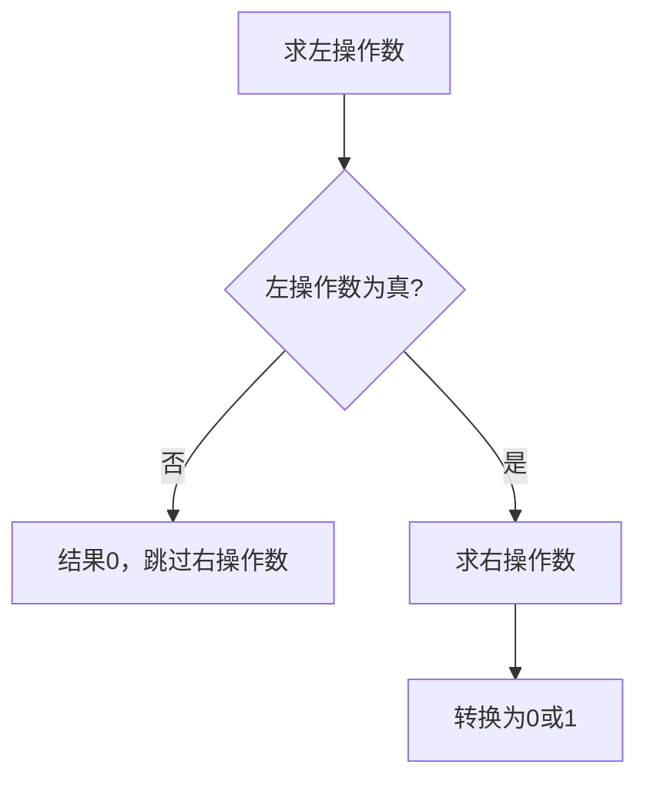

# 05 运算符与表达式

> [!abstract] 课程范围
> 吴俊军老师《第02章 C语言的基本元素》§2.5，PDF 第 33–48 页（§2.5.1–2.5.9）。参考《C Primer Plus（第6版）》第 5 章及第 7 章。
> 本篇以课程笔试为导向。涉及标准规则时以 C99–C17 为主要讨论范围，求值顺序采用 C11/C17 术语；不将其认定为老师指定的考试标准。
> 前置：[[03 基本数据类型与数据表示]]、[[04 常量、变量与初始化]]。
> 后续：[[06 位运算与位操作]]、[[07 类型转换与混合运算]]、[[09 语句、复合语句与选择结构]]。

## 1. 运算符与表达式概述（§2.5.1）

- **运算符（operator）**：表示某种运算的符号。
- **操作数（operand）**：参与运算的表达式。
- **目（arity）**：运算所需的操作数个数。例如一元 `!x`、二元 `x+y`、三元 `a?b:c`。
- **表达式（expression）**：由运算符和操作数等按照语言规则组成的计算形式；常量、变量引用、函数调用也可以构成表达式。

课件第 34 页要求掌握运算符的四项属性：功能、操作数个数及类型要求、结果类型、优先级与结合性。

一个表达式的分析应关注三个方面：

| 方面 | 含义 | `int i=3;` 后的 `i++` |
| --- | --- | --- |
| 值 | 表达式产生的结果 | 3 |
| 类型 | 表达式的结果类型 | `int` |
| 副作用 | 对程序状态的改变 | `i` 变成 4 |

有些表达式没有可用的值（如调用返回 `void` 的函数）；有些没有副作用（如 `2+3`）。

```c
int x = 3;
int y = x + 1; // x不变，y=4
x + 1;         // 结果被丢弃，x仍为3
x = x + 1;     // 值为4，副作用是x变为4
```

> [!important] 表达式与表达式语句
> `x = 3` 是表达式，`x = 3;` 是表达式语句。后者的表达式值被丢弃，但副作用仍然发生。详见 [[09 语句、复合语句与选择结构]]。

## 2. 优先级、结合性与求值顺序

### 2.1 运算符优先级表

级别越小，绑定越紧。按课件第 35 页的 15 级体系整理，并修正前置、后置自增的位置。表中的位运算、指针运算及成员运算在后续笔记展开。

| 级别 | 运算符 | 类别 | 结合性 |
| --- | --- | --- | --- |
| 1 | `()`（调用） `[]` `.` `->` `x++` `x--` | 后缀运算 | 左到右 |
| 2 | `++x` `--x` `+` `-` `!` `~` `*` `&` `(类型)` `sizeof` `_Alignof`（C11） | 一元及强制转换 | 右到左 |
| 3 | `*` `/` `%` | 乘除余 | 左到右 |
| 4 | `+` `-` | 加减 | 左到右 |
| 5 | `<<` `>>` | 移位 | 左到右 |
| 6 | `<` `<=` `>` `>=` | 大小比较 | 左到右 |
| 7 | `==` `!=` | 相等比较 | 左到右 |
| 8 | `&` | 按位与 | 左到右 |
| 9 | `^` | 按位异或 | 左到右 |
| 10 | `\|` | 按位或 | 左到右 |
| 11 | `&&` | 逻辑与 | 左到右 |
| 12 | `\|\|` | 逻辑或 | 左到右 |
| 13 | `?:` | 条件运算 | 右到左 |
| 14 | `=` `+=` `-=` `*=` `/=` `%=` `<<=` `>>=` `&=` `^=` `\|=` | 赋值 | 右到左 |
| 15 | `,` | 逗号运算 | 左到右 |

分组用的括号 `(表达式)` 不是函数调用运算符，它直接指定语法分组。C 标准通过语法文法规定这些关系，优先级表是便于使用的归纳；表不涵盖全部语法约束。

> [!warning] 课件辨析
> 第 35 页将 `++`、`--` 一并列于第 2 级，但后置形式属于第 1 级，前置形式才属于第 2 级。因此 `-a++` 是 `-(a++)`，`*p++` 是 `*(p++)`，不是 `(*p)++`。

### 2.2 如何添加括号

| 课件及补充例子 | 实际分组 |
| --- | --- |
| `x=y<100` | `x=(y<100)` |
| `3*4%2` | `(3*4)%2` |
| `a+b*c/d` | `a+((b*c)/d)` |
| `20-10-3` | `(20-10)-3` |
| `x=y=314` | `x=(y=314)` |
| `z==x>y` | `z==(x>y)` |
| `a&b==0` | `a&(b==0)` |
| `a||b&&c` | `a||(b&&c)` |
| `sizeof a+b` | `(sizeof a)+b` |

### 2.3 三个概念不能混淆

| 概念 | 回答的问题 |
| --- | --- |
| 优先级 | 不同级别运算符怎样绑定操作数？ |
| 结合性 | 同级运算符连续出现时怎样分组？ |
| 求值顺序 | 各子表达式在运行时先求哪个值、何时产生副作用？ |

例如 `f()+g()*h()` 按 `f()+(g()*h())` 分组，但没有规定 `f()`、`g()`、`h()` 的调用先后；乘积的值必须可用于最终加法。即使写成 `(f())+(g())`，括号也不会自动规定调用顺序。

> [!important] 笔试原则
> 优先级和结合性决定表达式的结构，不等于运行时各操作数的求值先后。
> 对无副作用的常规算式，可以按分组计算；遇到自增、赋值、函数调用时必须额外检查求值顺序。

## 3. 算术运算（§2.5.2）

`+`、`-` 有一元和二元形式，`*`、`/`、`%` 在本节讨论二元算术形式。`%` 两个操作数必须为整数类型；其他算术运算的类型要求依运算而定（指针加减将在指针章节讨论）。

### 3.1 整数除法和求余

C99 起，整数除法向零截断（不是向负无穷取整）。当商可表示且除数非零时：

$$a=(a/b)\times b+a\%b$$

| a | b | `a/b` | `a%b` |
| ---: | ---: | ---: | ---: |
| 22 | 7 | 3 | 1 |
| -22 | 7 | -3 | -1 |
| 22 | -7 | -3 | 1 |
| -22 | -7 | 3 | -1 |

非零余数与被除数同号，绝对值小于除数绝对值。`7%3.0` 不合法。整数除数为零是未定义行为；补码机器上 `INT_MIN / -1` 和 `INT_MIN % -1` 同样是未定义行为。浮点除零另有 IEC 60559 实现规则，不宜与整数混淆。

| 表达式 | 值 | 类型 |
| --- | --- | --- |
| `8+3` | 11 | `int` |
| `8u+3u` | 11 | `unsigned int` |
| `8.0-3.0` | 5.0 | `double` |
| `1/2` | 0 | `int` |
| `1/2.0` | 0.5 | `double` |
| `20-10-3` | 7 | `int` |
| `-22%7` | -1 | `int` |

### 3.2 先算后转换

```c
int x = 5, y = 2, z;
double d = x / y;          // 2.0，而不是2.5
z = x / y + 1.5;           // 先得2，再得3.5，赋值转换为3
```

课件第 36 页提问 `z=x/y+1.5` 的类型：`x/y` 是 `int`，加法结果为 `double`，**最外层赋值表达式**为 `int`，值为 3（在上述初值下）。

正确保留小数：`(double)x/y`。而 `(double)(x/y)` 已经太迟。详见 [[07 类型转换与混合运算]]。

### 3.3 课件例 2.10：水仙花数

三位数 $a=100x+10y+z$，若 $a=x^3+y^3+z^3$，即为水仙花数。

以下为课件单个数判断版本（恢复正常 ASCII 引号；输入假定为合法三位整数）：

```c
#include <stdio.h>
int main(void)
{
    int a,x,y,z;
    scanf("%d",&a);
    x=a/100;
    y=(a-x*100)/10;
    z=a%10;
    if(a==x*x*x+y*y*y+z*z*z)
        printf("%5d",a);
    return 0;
}
```

输入 `153`，百、十、个位分别为 1、5、3，立方和为 153。输出为宽度 5 的 `  153`，无换行。

补充简化：`y=a/10%10`。枚举 100–999 得到 153、370、371、407。

> [!warning] 课件第 37 页的循环提示
> `for(a=100;a<=999;a=a+1)` 正确。若直接采用旁注 `a=100; while(a++<=999)` 并在循环体中使用 `a`，第一次处理101，最后一次处理1000，发生偏一错误。应采用 `while(a<=999) { ...; ++a; }` 等形式。算法展开见 [[10 循环结构与转移语句]]。

`^` 是按位异或，不是乘方，所以 `x^3` 不能用于计算立方。

## 4. 关系运算（§2.5.3）

关系运算符 `< <= > >=` 与相等运算符 `== !=`，课程统称关系运算符。结果均为 `int` 类型，成立为 1，否则为 0。大小比较级别高于相等比较。

### 4.1 课件例题（第 38 页）

各表达式独立，假设 ASCII 环境：

```c
int x=4, y=3, z=2;
char c='a';
```

| 表达式 | 分组/计算 | 值 |
| --- | --- | ---: |
| `c=='A'+32` | `97==(65+32)` | 1 |
| `c+1!='b'` | `98!=98` | 0 |
| `x-y<=10` | `1<=10` | 1 |
| `z==x>y` | `2==(4>3)` → `2==1` | 0 |
| `x>y>z` | `(4>3)>2` → `1>2` | 0 |

> [!warning] 连续比较
> 数学式 $0<x<10$ 必须写成 `0<x && x<10`。`0<x<10` 实际上是 `(0<x)<10`，第一步只能得到 0 或 1，因此对所有有效的普通整数 x 都为真。
> `a==b==c` 同理不是判断三个变量相等，应写 `a==b && b==c`。

课程字符例题以 ASCII 为前提。ISO C 保证数字字符连续，但不保证英文字母采用 ASCII 值或大小写差 32。指针和复数的比较也有单独限制，不是所有基本类型都可使用全部关系运算符。

## 5. 逻辑运算（§2.5.4）

在标量条件中，零（空指针等）视为假，非零（非空指针等）视为真。`!`、`&&`、`||` 结果始终是 `int` 型 0 或 1。

| a | b | `a&&b` | `a\|\|b` | `!a` |
| --- | --- | ---: | ---: | ---: |
| 0 | 0 | 0 | 0 | 1 |
| 0 | 非0 | 0 | 1 | 1 |
| 非0 | 0 | 0 | 1 | 0 |
| 非0 | 非0 | 1 | 1 | 0 |

优先级：`!` > 关系比较 > `&&` > `||`。

### 5.1 短路求值

- `A && B`：先求 A；A 为假时跳过 B，结果 0。
- `A || B`：先求 A；A 为真时跳过 B，结果 1。
- 若 B 被求值，A 的值计算和副作用已完成。



上图为 `&&`；`||` 的短路条件相反。

| 独立表达式（每题 `int a=0,b=3;`） | 值 | 最终 a | 最终 b |
| --- | ---: | ---: | ---: |
| `a && ++b` | 0 | 0 | 3 |
| `a \|\| ++b` | 1 | 0 | 4 |
| `b \|\| a++` | 1 | 0 | 3 |
| `b && a++` | 0 | 1 | 3 |

安全判断：`b != 0 && a/b > 2`。不能交换两个条件后仍期待防止除零。

### 5.2 课件典型表达式

**奇偶性（第 39 页）：** `!(a%2)` 与 `a%2==0` 等价；判断奇数应写 `a%2!=0`，不能使用 `a%2==1`（负奇数时失败）。`!a%2` 是 `(!a)%2`。

**例 2.13：英文字母（第 40 页）**

```c
c>='a' && c<='z' || c>='A' && c<='Z'
```

ASCII 环境下成立。推荐显式括号 `(c>='a' && c<='z') || (c>='A' && c<='Z')`。可移植分类可使用 `<ctype.h>` 的 `isalpha`，注意参数需为 `EOF` 或可表示为 `unsigned char` 的值，且受 locale 影响。

**例 2.14：闰年（第 40 页）**

```c
!(year%4) && year%100 || !(year%400)
```

等价于：

```c
(year%4==0 && year%100!=0) || year%400==0
```

| year | 是否闰年 |
| ---: | --- |
| 1900 | 否 |
| 2000 | 是 |
| 2024 | 是 |
| 2100 | 否 |

第 40 页强调计算顺序：若 `year%4!=0`，跳过 `year%100`；若左侧整体为真，跳过 `year%400`。

## 6. 自增自减（§2.5.5）

### 6.1 前置和后置形式

每题独立，初始 `int x=3;`。

| 表达式 | 表达式值 | 完整表达式结束后 x |
| --- | ---: | ---: |
| `++x` | 4 | 4 |
| `x++` | 3 | 4 |
| `--x` | 2 | 2 |
| `x--` | 3 | 2 |

前置取得更新后的值，后置取得原值；两者都会修改对象。操作数必须是符合类型要求的可修改左值。如 `++3`、`(a+b)++`、`(a++)++`、`const int a=1; a++` 均违反约束。整数、实浮点数、符合条件的指针可以使用自增自减；指针步长取决于指向的类型。不是任意基本类型都可以。

`short s=1; sizeof(++s)` 的结果类型是 `size_t`，其操作数类型仍为 `short`，且自增不执行；不要与一元 `+s` 引起整型提升混淆。

### 6.2 课件例 2.17（第 42 页）

```c
int a=1,b=0;
a-- && (a+b);
```

| 步骤 | 表达式值 | a | b |
| --- | ---: | ---: | ---: |
| 初始 | — | 1 | 0 |
| 左侧 `a--` | 1 | 0（进入右侧前） | 0 |
| 右侧 `a+b` | 0 | 0 | 0 |
| 整体 `&&` | 0 | 0 | 0 |

若初始改为 `a=0,b=0`，左侧为假，右侧不求值，但 `a--` 的副作用仍发生，最终 `a=-1`。

### 6.3 序列点与副作用（核心考点）

课件用“序列点”表示此前副作用必须完成的边界。C11 引入更精确的 sequenced before / unsequenced 等术语，但保留序列点概念。

本课程最需要掌握的边界：

- `&&`、`||`、逗号运算符的左操作数之后。
- `?:` 的条件操作数之后、被选择的分支求值之前。
- 一个完整表达式结束之后、下一个开始之前，如表达式语句、控制条件、初始化的完整表达式。
- 函数的所有实参及函数指示表达式求值之后、进入被调用函数之前（**不是每个实参之间**）。

> [!warning] “后加减先取值”不是“最后才加减”
> 后置自增的取值先于自身更新，不代表更新一定发生在分号处。求值规则规定的是允许的顺序，不是编译器必须生成的机器指令时刻。

若对同一标量对象的修改与另一修改或读取其值的操作没有规定先后关系（unsequenced），行为未定义。假定下列初值与全部算术均不溢出，各题相互独立：

| 初始 `int i=1,j=2;` | 分类 | 结果或理由 |
| --- | --- | --- |
| `i++ + j++` | 明确定义 | 3；i=2，j=3 |
| `i++ + i++` | 未定义行为 | 两次修改 i 无序 |
| `i++ + i` | 未定义行为 | 修改和读取 i 无序 |
| `i = i++` | 未定义行为 | 两次修改 i 无序 |
| `i = i++ + 1` | 未定义行为 | 同上 |
| `i = i + 1` | 明确定义 | i=2 |
| `(i++, i++)` | 明确定义 | 2；i=3 |
| `i++ && i++` | 明确定义 | 1；i=3 |
| `printf("%d %d", i++, i++)` | 未定义行为 | 实参之间没有规定先后 |
| `printf("%d %d", i++, j++)` | 明确定义（就此例结果而言） | 输出 `1 2`；i=2，j=3，实参求值次序未指定 |

未指定顺序不必然是未定义行为。例如两个独立函数 `f()`、`g()` 的调用顺序未指定，但代码可以合法。未定义行为则没有 ISO C 保证的计算结果，不能按一次编译结果作为通用答案。

## 7. 赋值运算（§2.5.6）

### 7.1 简单赋值

`L = R` 将 R 的值转换为 L 所要求的类型并更新 L 所指示的对象。L 必须是可修改左值。表达式结果是赋值后的值，类型为左操作数经左值转换后的类型，结果在 C 中不是左值。

```c
int x,y;
x=y=314;
```

按 `x=(y=314)` 分组，两个变量最终均为314，外层表达式值为314、类型为 `int`。

```c
int i;
double d;
d = i = 3.9;  // i=3，d=3.0，最外层表达式类型double
```

> [!warning] `=` 与 `==`
> `if(x=0)` 先赋值并得到0，条件为假；`if(x==0)` 才是比较。
> `(a=b)=c` 不符合 C 对赋值左操作数的约束。

### 7.2 复合赋值

课件第 44 页：`L op= R` 与 `L = L op (R)` 具有相应的运算与赋值语义，但左操作数只求值一次。

| 课件原式 | 对应分组/简化展开（简单变量情形） |
| --- | --- |
| `i+=2` | `i=i+2` |
| `y/=x+y-10` | `y=y/(x+y-10)` |
| `x*=k=m+5-k` | `x=x*(k=m+5-k)` |

```c
int a[3]={10,20,30};
int i=0;
a[i++] += 5;  // a[0]=15，i=1
```

不能机械展开成 `a[i++] = a[i++] + 5;`，后者两次修改 i 无序，是未定义行为。数组详见 [[16 一维数组、二维数组与数组算法]]。

## 8. 条件运算（§2.5.7）

`condition ? E1 : E2` 先求条件，再且仅再求一个分支。条件中副作用在分支之前完成，条件运算右结合。

```c
a>b ? a : b              // 取较大者
x = n>0 ? 1 : n<0 ? -1 : 0;
// 等价于 x = (n>0 ? 1 : (n<0 ? -1 : 0));
```

课件第 46 页示例：

```c
int r=0,m=0;
r = ++m > 0 ? m-- : m++;
```

`++m` 令 m=1，比较成立，求 `m--` 得旧值1，最终 r=1、m=0；另一分支不执行。

### 8.1 结果类型的特殊性

> [!note] 课件第 45 页表述辨析
> 课件将值和类型都归为选中的分支。值来源于实际选中的分支，但结果类型由两个分支的类型共同决定（对于算术类型，进行通常算术转换），不因运行时条件而改变。

```c
1 ? 2 : 3.5   // 值2.0，类型double
0 ? 2 : 3.5   // 值3.5，类型double
```

C 中条件表达式结果不是左值，因此 `(a>b?a:b)=0` 不合法。条件运算符中间的表达式按仿佛带有括号处理，如 `c ? a=1 : (b=2)` 可以使用；第三操作数若为赋值表达式，使用括号以满足 C 文法。优先级表不是完整语法规范。

## 9. 逗号运算（§2.5.8）

`E1, E2` 先求 E1 并完成其副作用，再求 E2，值与类型来自 E2。多个逗号运算左结合。

课件第 47 页例题：

```c
int i;
float x;
i = 2, i % 3, x=3.14;
```

分组为 `((i=2),(i%3)),(x=3.14)`。最终 i=2、x 为接近3.14的 `float` 值，整个逗号表达式类型为 `float`。

课件追问 `i=(i=2,i%3,x=3.14)`：

1. i=2。
2. 计算 i%3 得2，值被丢弃。
3. x=3.14，赋值后的 `float` 值成为逗号表达式值。
4. 外层赋值转换到 int，i=3。

### 9.1 运算符与分隔符

```c
int a=1,b=2;     // 声明分隔符
f(a,b);         // 实参分隔符，不保证先求a再求b
f((a++,b));     // 一个实参，其中有逗号运算符
```

```c
int i=0,j=0;
i=1,2;          // i=1，整个表达式值是2
i=(1,2);        // i=2
```

逗号运算优先级最低，因此括号直接影响赋值的结果。

## 10. sizeof 运算（§2.5.9）

- `sizeof(类型名)`：计算类型的大小。
- `sizeof 表达式`：计算操作数类型所占的字节数。表达式也可以加括号。
- 结果类型是无符号整数类型 `size_t`，使用 `printf("%zu", sizeof x)`（C99 起）。
- `sizeof(char)` 恒为1；一个 C 字节不必等于8位（常见机器为8位）。
- 普通非 VLA 类型的表达式操作数不求值（但仍须满足语法与类型约束）。VLA 类型操作数有运行时求值规则，另见数组笔记。

### 10.1 课件例题（第 48 页）

假设 `short` 2 字节、`int` 4 字节、`double` 8 字节：

| 初始声明 | 表达式 | 值 |
| --- | --- | ---: |
| — | `sizeof(int)` | 4 |
| `double x;` | `sizeof x` | 8 |
| `int a=1,b=1;` | `sizeof(a+b)` | 4 |
| 同上 | `sizeof a+b` | 5 |
| `short rr=1;` | `sizeof(++rr)` | 2 |
| `short rr=1;` | `sizeof(+rr)` | 4 |

最后两题中的 rr 均保持1。`++rr` 的结果类型为 `short`；`+rr` 触发整型提升，在常见平台上结果类型为 `int`。

> [!warning] 不求值不是忽略语义
> `sizeof(i++)` 可以合法求得类型大小而不修改 i，但 `sizeof(1.2 % 2)` 仍违反求余操作数的类型约束。ISO C 不允许对 `void`、函数类型、不完整类型（如未完成的数组类型）或位域使用 sizeof；GNU 扩展不能视为 ISO C 规则。

补充 VLA 示例（C99 或支持 VLA 的 C11/C17）：

```c
int n=3;
int a[n];
n=5;
// sizeof a 仍是 3*sizeof(int)，数组建立后长度不随n改变
```

另如 `sizeof(int[n++])` 中，VLA 类型的长度需要求值，所以 n 会增加1（假定 n 原为有效正数）。不能笼统说 `sizeof` 永不执行操作数或类型名中的表达式。

## 11. 综合题手工求值方法

> [!tip] 五步分析法
> 1. 确定每个变量的初值和类型、是否有未初始化或越界问题。
> 2. 按优先级与结合性添加括号，明确表达式结构。
> 3. 检查运算符约束、整数提升、类型转换与潜在溢出。
> 4. 查找短路、序列点、同一变量的无序读写；有未定义行为就停止推算确定值。
> 5. 分别记录表达式值、类型以及各变量最终值。

综合例题（自拟，假设常见 int 模型）：

```c
int a=2,b=3,c=0;
c = a++ > 1 && --b ? a+b : (a=0);
```

- 分组：`c = ((a++ > 1 && --b) ? (a+b) : (a=0));`
- 左比较使用 a 的旧值2，成立；进入 `&&` 右侧之前 a=3。
- `--b` 得2，为真，b=2。`&&` 值为1。
- 选中 `a+b`，值为5；不执行 `(a=0)`。
- 最终 a=3、b=2、c=5，完整赋值表达式值为5、类型为 int。

## 12. 实践验证（补充）

以下代码只包含具有明确语义的示例（假设 `sizeof(short)==2`、`sizeof(int)==4` 的 x86-64 Linux）。不要通过实际执行 UB 代码推断标准语义。

```c
#include <stdio.h>

int main(void)
{
    int a=1, b=0;
    int r = a-- && (a+b);
    printf("r=%d a=%d b=%d\n", r,a,b);

    short rr=1;
    printf("sizeof(++rr)=%zu sizeof(+rr)=%zu rr=%d\n",
           sizeof(++rr), sizeof(+rr), (int)rr);

    int i=0, arr[]={10,20,30};
    arr[i++] += 5;
    printf("arr[0]=%d i=%d\n", arr[0],i);

    printf("conditional=%f\n", 1 ? 2 : 3.5);
    printf("division=%d remainder=%d\n", -22/7, -22%7);
    return 0;
}
```

```sh
cc -std=c11 -Wall -Wextra -Wpedantic -O0 expr.c -o expr
./expr
```

预期输出：

```text
r=0 a=0 b=0
sizeof(++rr)=2 sizeof(+rr)=4 rr=1
arr[0]=15 i=1
conditional=2.000000
division=-3 remainder=-1
```

GCC 的 `-Wsequence-point`、Clang 的 `-Wunsequenced` 可诊断部分无序副作用错误。编译器警告与 Sanitizer 都不能保证检测全部未定义行为。

## 13. 考前自测（每题独立）

除特殊说明外，假设 C11/C17，ASCII，8位字节、16位 short、32位 int、64位 double，所有变量初值有效且运算不溢出。先写出分组，再计算。

1. `20-10-3` 的值？
2. `-22/7` 与 `-22%7` 的值？
3. `3%2.0` 是否合法？
4. `double x=5/2;` 中 x 的值？
5. `int a=5,b=2,z;` 中表达式 `z=a/b+1.5` 的值与类型？
6. `int x=4,y=3,z=2;` 中 `z==x>y` 的值？
7. 同上，`x>y>z` 的值？
8. 用 C 表达式判断 `x` 位于闭区间 [0,100]。
9. 若 `a=-3`，`a%2==1` 能正确判断奇数吗？
10. `int a=0,b=3;` 中 `a && ++b` 的值与最终 b？
11. `int a=1,b=0;` 中 `a-- && (a+b)` 的值与最终 a？
12. `int i=2;` 中 `i++ + i++` 能否得到确定值？
13. `int i=2;` 中 `(i++, i++)` 的值与最终 i？
14. `int i=2;` 中 `printf("%d %d", i, i++)` 是否具有标准保证的输出？
15. `int a,b;` 中 `a=b=314` 的最终值？
16. `int a=7; double b; b=a=3.9;` 执行后 a、b？
17. `int i=0,a[]={10,20}; a[i++] += 5;` 执行后 i 和数组？
18. `int r=0,m=0; r=++m>0?m--:m++;` 执行后 r、m？
19. `1?2:3.5` 的值和类型？
20. `int i; float x; i=(i=2,i%3,x=3.14);` 最终 i？
21. `int a=1,b=1;` 中 `sizeof a+b` 和 `sizeof(a+b)` 的值？
22. `short rr=1;` 中 `sizeof(++rr)`、`sizeof(+rr)` 各自的值以及 rr 的最终值？
23. `int i=5;` 中 `sizeof(i++)` 的值与最终 i？
24. `int i=0; i=1,2;` 与 `i=(1,2);` 分别怎样修改 i？
25. `f()+g()*h()` 是否保证先调用 g、h 再调用 f？
26. `int a=0,b=0; int r=++a || ++b;` 最终 r、a、b？
27. `int a=3,b=4; int c=a++>b ? ++a : b++;` 最终 a、b、c？
28. 写出闰年表达式并判断 1900、2000、2024。

<details>
<summary>答案与解析（做完再展开）</summary>

1. 7，左结合。
2. -3、-1，商向零截断。
3. 不合法，% 要求整数类型。
4. 2.0，整数除法先得2。
5. 3，`int`；右侧中间值3.5，但最外层赋值转换为 int。
6. 0，`2==(4>3)`。
7. 0，`(4>3)>2`。
8. `x>=0 && x<=100`。
9. 不能，负奇数余数为-1，应使用 `a%2!=0`。
10. 0，b=3；短路。
11. 0，a=0；左值为旧值1，进入右侧前自减已完成。
12. 不能；未定义行为，两个无序修改。
13. 3，i=4；逗号规定顺序。
14. 不能；读取与修改 i 无序，未定义行为。
15. a=b=314，表达式值314。
16. a=3、b=3.0。
17. i=1，数组为 {15,20}；左操作数求值一次。
18. r=1、m=0。
19. 2.0、double；两分支共同决定类型。
20. i=3，最后一个子表达式所得 float 值转换到 int。
21. 5、4；前者是 `(sizeof a)+b`。
22. 2、4，rr=1；前者类型 short，后者类型 int，均不执行。
23. 4，i=5。
24. 前者 i=1（整体值2），后者 i=2。
25. 不保证；优先级不是函数调用的顺序。
26. r=1、a=1、b=0，左侧真使右侧跳过。
27. a=4、b=5、c=4；条件使用 a 的旧值3，选择右分支。
28. `(year%4==0 && year%100!=0) || year%400==0`；否、是、是。

</details>

## 14. 考点速查

- [ ] 能正确写出优先级、结合性，尤其后缀自增、`!`、关系、位运算、逻辑、赋值与逗号的相对顺序。
- [ ] 掌握带负数的整数除法、求余及整数除法精度陷阱。
- [ ] 能分辨比较表达式和数学连续比较；逻辑运算结果为 int 的0或1。
- [ ] 掌握短路求值及其副作用。
- [ ] 能区分自增自减的表达式值和变量新值，并识别未定义行为。
- [ ] 掌握多重赋值、复合赋值左操作数只求值一次。
- [ ] 掌握条件运算符只执行一个分支，但分支共同决定类型。
- [ ] 分辨逗号运算符与分隔符。
- [ ] 掌握 sizeof 的类型、括号影响、无求值规则和 VLA 例外。

## 资料索引

- 课程课件：《第02章 C语言的基本元素S.pdf》，PDF 第33–48页；第35页优先级表、第36–40页算术与逻辑、第41–42页自增及序列点、第43–48页赋值、条件、逗号和sizeof。
- 《C Primer Plus（第6版）》§5.2–5.5、§6.3、§6.6–6.7、§7.3、§7.5（辅助阅读）。
- ISO C11 草案 N1570：§6.5 表达式（尤其 6.5.2.4、6.5.3.1、6.5.3.4、6.5.5、6.5.13–17）；C17 对本篇规则基本一致。
- [cppreference: C operator precedence](https://www.cppreference.com/c/language/operator_precedence)
- [cppreference: Order of evaluation (C)](https://en.cppreference.com/c/language/eval_order)
- [cppreference: Arithmetic operators (C)](https://cppreference.com/c/language/operator_arithmetic)
- [cppreference: Other operators (C)](https://www.cppreference.com/c/language/operator_other)

返回：[[00 C语言程序设计 MOC]] ｜ 上一篇：[[04 常量、变量与初始化]] ｜ 下一篇：[[06 位运算与位操作]]
