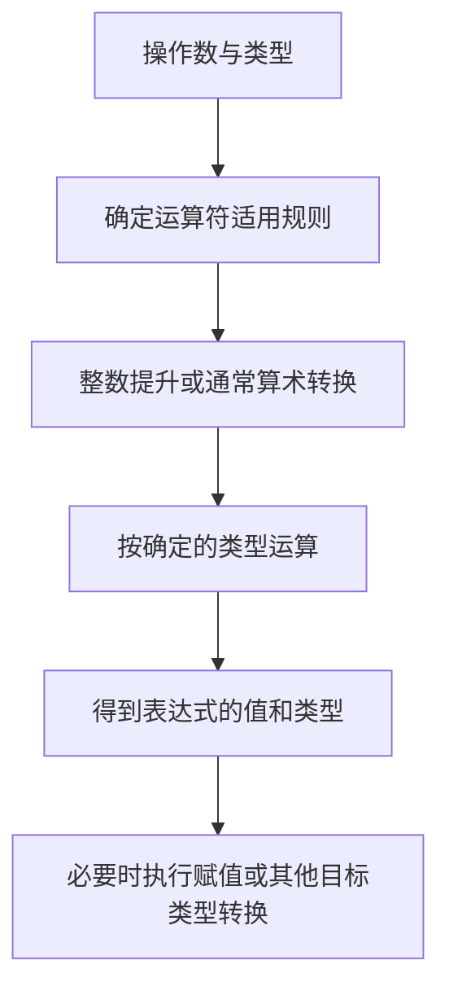
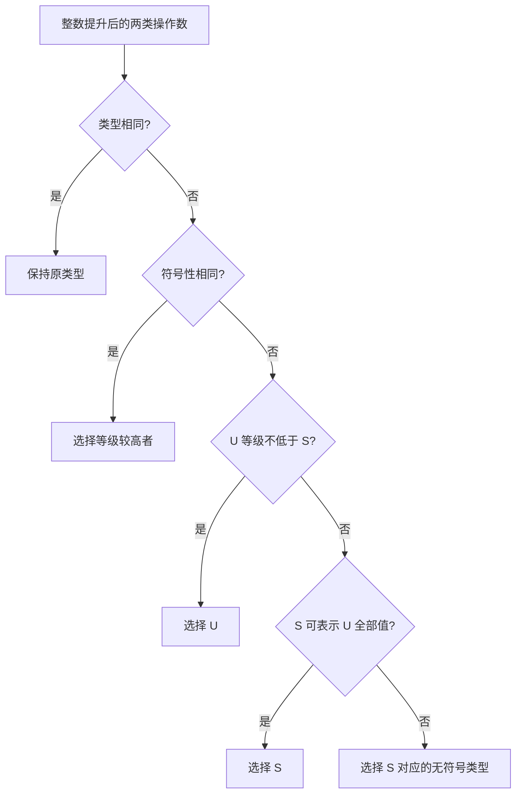

# 07 类型转换与混合运算

> [!info] 资料与范围
> 主线：吴俊军老师《第02章 C语言的基本元素》§2.7.1–2.7.2（PDF 第 57–62 页）；第 63–64 页为案例提示及本章小结。
> 辅助：《C Primer Plus（第6版）》§5.5、§5.5.1；ISO C11 草案 N1570 §6.3.1、§6.5.2.2、§6.5.4、§6.5.16、§6.7.9、§6.8.6.4。
> 本笔记按 C99–C17 的常用实数及标准整数类型规则讲解，以 C11/C17 作标准辨析；不将其认定为教师指定考试标准。除另有说明，例题假设 8 位字节、补码、16 位 short、32 位 int、LP64（64 位 long 和 long long）、IEEE 754 binary32/binary64。涉及其他实现会另行说明。

前置：[[03 基本数据类型与数据表示]]、[[04 常量、变量与初始化]]、[[05 运算符与表达式]]、[[06 位运算与位操作]]。

## 1. 类型转换的本质与分类

类型转换（conversion）是将某个类型的值转换为另一类型的值。它通常作用于表达式的值，而不是永久改变变量的声明类型。转换可能保持数值，也可能损失范围或精度。

课件第 57 页列出五种时机：

| 类型 | 触发场景 | 例子 |
| --- | --- | --- |
| 整数提升 | 特定运算中的较低等级整数 | `short s; +s` |
| 一般算术转换（通常算术转换） | 需要统一算术操作数类型的运算 | `2 + 3.0` |
| 赋值转换 | 将值存入不同类型的对象 | `int i = 2.9;` |
| 强制类型转换 | 使用 `(类型名)` 显式转换 | `(double)i` |
| 函数调用转换 | 实参传给形参或发生默认实参提升 | `f(3.9)`，若形参为 `int` |



> [!important] 核心考点
> 先确定运算发生时的类型，再确定结果存入什么类型。目标变量的类型不会反过来改变右侧子表达式的运算规则。

```c
double d = 5 / 2;          // 2.0：先整数除法，再转换
double e = (double)5 / 2; // 2.5：先转换，再浮点除法
```

## 2. 整数提升（Integer Promotions）

### 2.1 规则与适用范围

对于等级不高于 `int` 的较小整数类型（例如 `_Bool`、`char`、`signed char`、`unsigned char`、`short`、`unsigned short`，以及满足相应条件的枚举和位字段）：

- 如果 `int` 可以表示原类型的**全部值**，则提升为 `int`。
- 否则提升为 `unsigned int`。
- 提升保持原来的数值和符号。`int` / `unsigned int` 本身不需要提升。

标准整数转换等级：

```text
_Bool < char/signed char/unsigned char < short < int < long < long long
```

每种无符号整数的等级与对应有符号整数相同；等级不是字节数，也不单独决定是否有符号。

| 操作数类型 | 常见 32 位 int 环境的提升结果 |
| --- | --- |
| `_Bool`, `char`, `signed char`, `unsigned char` | `int` |
| `short`, `unsigned short` | `int` |
| `int`, `unsigned int`, `long` 等 | 不因整数提升而改变 |

> [!warning] 课件辨析（第58页）
> “任何表达式中的 char、short 都要先转换”是简化说法。只有规则要求提升时才提升，如一元 `+`、`-`、`~`、移位两操作数、需要通常算术转换的整数操作数、默认实参提升等。`sizeof(c)`、`&c`、`c++` 的结果类型不能一律按 int 处理。

### 2.2 课件例题：`-x`

```c
unsigned short x = 1;
```

分别假设 `unsigned short` 为 16 位：

| int 的位宽 | int 能否容纳 0–65535 | 提升类型 | `-x` 的类型和值 |
| --- | --- | --- | --- |
| 32 位 | 能 | int | int，-1 |
| 16 位 | 不能 | unsigned int | unsigned int，65535 |

第二种情况中，一元负号执行无符号模运算，`0 - 1 ≡ 65535 (mod 65536)`。

> [!important] 判定提升只能看原类型的完整值域，不能因为 x 当前等于 1 就断定它提升为 int。

### 2.3 课件例题：移位

```c
short x = 0x1234;
x << 8 >> 8;
```

32 位 int 环境中：

```text
0x1234 → 0x00001234 → 0x00123400 → 0x00001234
         提升 int       左移8位       右移8位
```

结果类型 `int`，值 `0x1234`，原变量 x 不变。并没有在左移时丢掉原 short 的高字节。

### 2.4 sizeof 综合

```c
short s = 1;
unsigned char c = 250;
```

| 表达式 | 类型 | 值/大小 |
| --- | --- | --- |
| `+s` | int | 1 |
| `~c` | int | -251（补码） |
| `c + 10` | int | 260 |
| `sizeof(c + 10)` | size_t | 4 |
| `sizeof(c)` | size_t | 1 |
| `sizeof(++s)` | size_t | 2，s 不变 |

## 3. 通常算术转换（Usual Arithmetic Conversions）

课件第 59 页称“算术转换”。其目的是为需要统一类型的算术操作数选择共同类型。以下讨论实数和整数，不展开复数。

### 3.1 浮点优先

若参与通常算术转换的操作数中存在实浮点类型，则选择两者中最高的浮点类型：

```text
long double > double > float
```

其余操作数转换为该类型。注意 `float + int` 的共同类型通常是 float，不会因为 int 的某些数值无法精确表示就自动变成 double。`float + float` 也不是默认转换为 double。标准允许浮点表达式以更高精度或范围求值，但不改变其表达式的类型。

### 3.2 两个整数：完整判定算法

先分别进行整数提升，然后：

1. 类型相同：无需再转换。
2. 同为有符号或同为无符号：转换为等级较高的类型。
3. 一有符号 S、一无符号 U：
   - 若 U 的等级 >= S 的等级：S 转为 U。
   - 若 S 等级更高且能容纳 U 的全部值：U 转为 S。
   - 否则：两者均转为 S 对应的无符号类型。



> [!warning] 不要把第59页的转换箭头当作普适的线性规则
> 课件也通过 32 位、64 位的不同宽度提示了 `unsigned int` 与 `long` 之间的差异。ISO C 的严格规则必须同时考虑等级、符号性和值域。应按数据模型而不是 CPU 位数判定。

### 3.3 常见组合速查

假设 int 32 位、long long 64 位：

| 操作数类型 | LP64（long 64 位） | ILP32 / LLP64（long 32 位） |
| --- | --- | --- |
| int + unsigned int | unsigned int | unsigned int |
| unsigned int + long | long | unsigned long |
| int + unsigned long | unsigned long | unsigned long |
| long + unsigned long | unsigned long | unsigned long |
| long long + unsigned long | unsigned long long | long long |
| float + long long | float | float |
| float + double | double | double |

重点：同为 64 位的 long 与 long long 等级不同；`long long` 与 `unsigned long` 混合在 LP64 下，long long 无法容纳全部 unsigned long，因此统一为 unsigned long long。

### 3.4 适用的运算符与例外

| 运算 | 转换规则（算术操作数） | 整个表达式类型 |
| --- | --- | --- |
| `+ - * / %` | 通常算术转换（% 要求整数） | 共同类型 |
| `& ^ \|` | 通常算术转换（要求整数） | 共同类型 |
| `== != < <= > >=` | 通常算术转换 | int，0 或 1 |
| `?:` 的两个结果分支 | 若均为算术类型，通常算术转换 | 共同类型 |
| `<< >>` | 两侧分别整数提升，不统一类型 | 提升后的左侧类型 |
| `&& \|\| !` | 标量按是否为零判断，不要求统一类型 | int，0 或 1 |
| `=` | 右侧向左侧类型转换 | 左侧去除顶层限定符后的类型 |
| `op=` | 按 op 规则计算，再赋值转换 | 左侧去除顶层限定符后的类型 |
| `,` | 依次求值，不统一两侧类型 | 右侧类型和值 |

以上只讨论算术类型。指针的转换和运算另见后续笔记。

### 3.5 课件例题：`c * l + d`

```c
char c = 3;
long l = 4;
double d = 0.5;
```

1. 按优先级，分析 `(c * l) + d`。
2. c 提升为 int，再转换为 long。
3. 乘法得到 long 类型的 12。
4. 12 转换为 double，与 d 相加。
5. 结果为 double，12.5。

> [!note] 乘法是 long 运算，后面的 double 加法不能挽救乘法阶段可能存在的有符号溢出。

### 3.6 课件例题：`-1 < 1U`

```text
-1           int
1U           unsigned int
共同类型     unsigned int
-1 转换后    4294967295（32位）
比较         4294967295 < 1 → 0
```

整个关系表达式类型仍然是 int，而不是 unsigned int。

进一步比较：

| 表达式 | LP64 结果 | ILP32/LLP64 结果 |
| --- | --- | --- |
| `-1 < 1U` | 0 | 0 |
| `-1L < 1U` | 1 | 0 |
| `-1LL < 1UL` | 0 | 1 |
| `-1 < 1` | 1 | 1 |

> [!tip] 对付有符号和无符号比较
> 不要直接把两个数按数学大小比较。先判共同类型，再转换数值，最后判断关系。

## 4. 赋值转换

将右侧表达式先按其自身规则求值，再把结果转换为左侧对象的类型。赋值表达式的值是赋值后的值（不是未经转换的右值）。初始化标量时也适用相应的目标类型转换规则。

```c
short s = 5;
double d = 2.9;
s = d;
d = s;
```

课件第 60 页分别标记 `s = d` 的结果为 short 2、`d = s` 的结果为 double 5.0。这适用于**每个表达式从同一组初值独立分析**。若按照上述程序顺序执行：s = 2，随后 d = 2.0。

```c
char aa = 1, bb = 2, cc = 0;
cc = aa + bb;
```

`aa + bb`：int 3；`cc = aa + bb`：char 3；`sizeof(aa + bb)`：4；`sizeof(cc)`：1。课件用 `%lu` 输出大小，Linux LP64 中通常正确；C99 起可移植写法是 `%zu`（size_t）。

### 4.1 复合赋值

```c
int n = 3;
n += 2.9; // 按 double 进行加法得到 5.9，再转换为 int 5
```

`x op= y` 与 `x = x op y` 的关键区别是左操作数只求值一次。不要把左侧类型理解为中间运算类型。

### 4.2 连续赋值与中间值

```c
int a;
double b;
b = a = 3.9;
```

右结合：`b = (a = 3.9)`。a = 3；中间赋值表达式为 int 3；b = 3.0，而非 3.9。

若 `a = b = 3.9;`，先得到 b = 3.9，再得到 a = 3。

## 5. 强制类型转换（Cast）

语法：`(类型名) 操作数`。适用的类型组合受标准约束。本篇只讨论算术类型。

课件第 61 页例题：

| 表达式 | 含义 |
| --- | --- |
| `(double)i` | 将 i 的值转换为 double，i 的声明和存储值不变 |
| `(long)('a'-32)` | 先进行括号内运算，再产生 long 值；ASCII 下为 65 |
| `(double)x = 10` | 错误，强制转换结果不是可修改左值 |
| `(double)(x = 10)` | 先赋值，再转换赋值表达式的结果为 double |

### 5.1 转换时机：考试常见对照

假设 `int a = 5, b = 2;`

| 表达式 | 类型 | 值 |
| --- | --- | --- |
| `a / b` | int | 2 |
| `(double)(a / b)` | double | 2.0 |
| `(double)a / b` | double | 2.5 |
| `a / (double)b` | double | 2.5 |
| `(int)(1.6 + 1.7)` | int | 3 |
| `(int)1.6 + (int)1.7` | int | 2 |

最后两式对应《C Primer Plus》§5.5.1 中先相加再转换与先转换再相加的例题。

### 5.2 先扩宽再运算

```c
int a = 50000, b = 50000;
long long product = (long long)a * b; // 2500000000
```

以下均不能保证正确（32位 int）：

```c
// long long product = a * b;            // int 乘法超出范围，UB
// long long product = (long long)(a*b); // 转换太迟，UB
```

> [!warning] 强制转换不是万能修复
> 它不会自动检查目标类型的值域，也不会消除转换本身可能产生的未定义行为。

## 6. 整数之间的转换

### 6.1 ISO C99–C17 规则（非 _Bool）

1. 目标类型能表示原数值：保持数值不变。
2. 目标为无符号类型且值不可表示：结果按照目标类型的模数取余（取非负余数）。
3. 目标为有符号类型且值不可表示：结果由实现定义，或产生实现定义的信号。

对拥有 n 个值位的无符号整数，第二条可写成：

$$
y = x \bmod 2^n, \qquad 0\le y<2^n
$$

> [!note] 与课件第62页的关系
> 课件的“保留低位、符号扩展、零扩展”等是典型二进制实现的位级解释，不是每一种有符号目标转换的跨平台标准保证。尤其是负值转更宽的无符号类型，要依据目标类型的模数判断。

### 6.2 常见例子

| 表达式 | 值 | 标准分类 |
| --- | --- | --- |
| `(unsigned char)300` | 44 | 保证（8位 unsigned char） |
| `(unsigned char)-1` | 255 | 保证（8位 unsigned char） |
| `(unsigned short)-1` | 65535 | 保证（16位 unsigned short） |
| `(unsigned int)-1` | 4294967295 | 保证（32位 unsigned int） |
| `(short)50000` | 常见 -15536 | 实现定义或实现定义信号 |
| `(int)0xFFFFFFFFu` | 常见 -1 | 实现定义或实现定义信号 |
| `(long)(unsigned int)4294967295u` | LP64 下 4294967295 | 可表示，保持数值 |

### 6.3 扩宽与缩窄的位模型

假设源类型宽度为 8 位，目标为 16 位：

```text
signed char -1        11111111
转换为 short     11111111 11111111  (-1，补码符号扩展)
转换为 unsigned short 11111111 11111111  (65535，按目标模数)

unsigned char 255     11111111
转换为 short     00000000 11111111  (255，零扩展)
```

对典型补码实现，缩窄往往保留低位；对于超出目标有符号范围的情况，不要把常见结果当成 C99–C17 保证。

### 6.4 区分三种看似相同的情况

```c
unsigned int u = UINT_MAX;
u += 1; // 无符号算术：模运算结果为0

short s = 20000, t = 30000;
s = s + t; // 32位 int 加法得50000，再转换到 short（实现定义）

int n = INT_MAX;
// n += 1; // 有符号算术溢出：未定义行为
```

需要 `#include <limits.h>`。

| 情形 | 规则 |
| --- | --- |
| 无符号算术超出范围 | 模运算 |
| 整数转换到不可表示的有符号类型 | 实现定义或实现定义信号 |
| 有符号算术溢出 | 未定义行为 |

扩展：C23 对一些整数转换规则有变化，本篇不以其规则替代 C11/C17。

## 7. 浮点数之间、整数与浮点数之间的转换

### 7.1 浮点类型之间

课程规则：低精度向高精度转换保持数值，高精度向低精度转换可能损失精度或超出范围。

标准细化：对于有限值，目标浮点类型若能精确表示则保持原值；若在目标范围内但不能精确表示，通常算术转换及显式转换的标准基本规则允许取相邻的较大或较小可表示值，由实现定义；超出目标可表示范围的行为在核心规则下未定义。支持 IEC 60559 的实现及附录 F 可能有更具体的保证。本篇考试基础模型通常采用 IEEE 754 最近舍入。

```c
float f = 0.1f;
double d = f;
```

提升后的 d 精确保留的是 f **已经存储的近似值**，并不能恢复数学上的精确 0.1。

### 7.2 整数 → 浮点数

若数值可精确表示，则保持不变；否则可能丢失有效数字，即使范围足够大。若在目标范围内但无法精确表示，核心标准允许实现定义的相邻可表示值；超范围时核心规则下未定义。

```c
int n = 16777217; // 2^24 + 1
float f = (float)n;
```

在 IEEE 754 binary32 最近舍入（ties-to-even）下，f = 16777216。binary32 有 24 位有效二进制精度，在这一量级不能表示每个相邻整数。

> [!warning] “范围更大”不等于“精度更高”。
> float 的指数范围远大于 int，但无法精确表示所有 32 位整数。

### 7.3 浮点数 → 整数（非 _Bool）

对有限值先向零截断小数部分：

| 表达式 | 值 |
| --- | --- |
| `(int)3.9` | 3 |
| `(int)-3.9` | -3 |
| `(int)0.9` | 0 |
| `(unsigned int)-0.5` | 0 |

若截断后的整数部分不能由目标类型表示，行为未定义（核心规则）。例如 32 位 int 情况下 `(int)2147483648.0`，以及 `(unsigned int)-1.0`。不应假定 NaN、无穷大转普通整数具有可移植结果。

> [!important] 负浮点转无符号整数，不能套用整数转无符号的模运算。
> `(unsigned int)-1` 有确定的模运算结果；`(unsigned int)-1.0` 的截断结果无法表示，属于未定义行为。

### 7.4 _Bool 转换（C99–C17）

标量值与 0 比较相等，转为 0；否则转为 1。这与普通浮点转整数不同：

```c
(_Bool)0.5  // 1
(int)0.5    // 0
(_Bool)-7   // 1
```

## 8. 函数调用转换（课件第57页提出，补充）

### 8.1 有函数原型的固定参数

```c
int f(int x) { return x; }
// f(3.9) 得到 3
```

实参按形参类型进行类似赋值的转换；return 表达式也按函数返回类型进行转换（返回非 void 值时）。详见 [[12 函数定义、声明与调用]]。

### 8.2 默认实参提升（Default Argument Promotions）

用于可变参数函数省略号对应的参数，以及 C99–C17 无原型调用的相应场合：

- 整数类型按整数提升规则处理。
- float 提升为 double。

```c
float f = 1.25f;
short s = 10;
printf("%f %d\n", f, s); // 实际传入 double 和 int（常见环境）
```

`scanf` 与 `printf` 不同：`scanf("%f", &f)` 的实参是 `float *`，不因默认实参提升变成 `double *`。详细格式规则见 [[08 字符输入输出与格式化输入输出]]。

## 9. 系统编程拓展：长度比较

下例体现了有符号错误值与无符号长度混用的风险。假设实际可用 `int` 和 `size_t` 满足常见 LP64 模型。

```c
int count = -1;
size_t limit = 16;
if (count < limit) { /* ... */ }
```

int 会转换成 size_t 的无符号类型，-1 变成很大的数，因此条件为假。反过来，如果程序错误地认为 `count > limit` 必定意味着合法的大长度，也可能误判错误状态。

改进：先检查负值，再在确认目标类型能表示该值的前提下转换。

```c
if (count >= 0 && (size_t)count < limit) {
    /* count is nonnegative and within limit */
}
```

课件第 63 页以 Ariane 5 事故提示工程严谨性。这里仅将它作为范围检查的重要性提醒，不将课件未展开的事故机理或语言细节视为课程知识。

## 10. 完整验证程序（补充实践）

C11/C17；GCC 或 Clang；常见 x86-64 Linux LP64 环境。

```c
#include <stdio.h>
#include <limits.h>

#define TYPE(x) _Generic((x), \
    char: "char", signed char: "signed char", \
    unsigned char: "unsigned char", short: "short", \
    unsigned short: "unsigned short", int: "int", \
    unsigned int: "unsigned int", long: "long", \
    unsigned long: "unsigned long", long long: "long long", \
    unsigned long long: "unsigned long long", \
    float: "float", double: "double", long double: "long double", \
    default: "other")

int main(void)
{
    _Static_assert(CHAR_BIT == 8 && sizeof(short) == 2 &&
                   sizeof(int) == 4 && sizeof(long) == 8,
                   "LP64 teaching example");
    unsigned short s = 1;
    int a = 5, b = 2;
    unsigned int u = 1;
    long l = -1;
    float f = 1.25f;
    unsigned char c = (unsigned char)300;

    printf("-s: %s %d\n", TYPE(-s), -s);
    printf("~s: %s %d\n", TYPE(~s), ~s);
    printf("a/b: %s %d\n", TYPE(a/b), a/b);
    printf("(double)a/b: %s %.1f\n", TYPE((double)a/b), (double)a/b);
    printf("u+l: %s %ld\n", TYPE(u+l), u+l);
    printf("f+u: %s %.2f\n", TYPE(f+u), (double)(f+u));
    printf("(unsigned char)300: %u\n", (unsigned int)c);
    printf("sizeof(s+1): %zu\n", sizeof(s+1));
    printf("sizeof(s): %zu\n", sizeof(s));
    return 0;
}
```

```bash
gcc -std=c17 -Wall -Wextra -Wconversion -Wsign-conversion -pedantic conversion.c -o conversion
./conversion
```

预期输出（LP64）：

```text
-s: int -1
~s: int -2
a/b: int 2
(double)a/b: double 2.5
u+l: long 0
f+u: float 2.25
(unsigned char)300: 44
sizeof(s+1): 4
sizeof(s): 2
```

`_Generic` 是 C11 引入的泛型选择，仅作实验工具，不要求现阶段掌握。编译器可能给出转换警告（如 `unsigned int` 转为 float）；警告用于提示风险，不能直接等同于未定义行为。

## 11. 笔试解题流程与易错检查

> [!tip] 五步法
> 1. 写出变量初值、原始类型和题目指定的数据模型。
> 2. 根据优先级及结合性为每个子表达式添加括号，检查短路和副作用。
> 3. 对每个运算节点按规则进行提升或通常算术转换，确定运算类型。
> 4. 按该类型计算值，检查是否超出范围或存在未定义行为。
> 5. 最后进行赋值、初始化或显式目标转换，写出表达式的值、类型和变量的最终状态。

| 错误直觉 | 正确判断 |
| --- | --- |
| unsigned short 运算始终为 unsigned | 可能提升为 int |
| 位宽更大者必然胜出 | 混合有符号、无符号时需检查等级与完整值域 |
| `double d = a/b` 一定是浮点除法 | 右侧自身类型决定除法 |
| `(double)(a/b)` 可恢复小数 | 整数除法已完成 |
| 比较表达式类型等于共同类型 | 关系与相等表达式返回 int |
| 所有转换都发生整数提升 | 只在标准指定的场景 |
| 目标无符号就必然模运算 | 仅整数到无符号适用，不包括普通浮点到无符号 |
| 强制转换总能避免溢出 | 必须在运算前转换到足够宽的类型 |
| 所有超范围转换都是 UB | 根据源和目标类型区分 |
| 32/64 位平台可以决定所有类型宽度 | 应使用 ABI 或题目给定的宽度 |

## 12. 自测题（24题）

除题中特别说明外，采用本篇开头的 LP64、补码和 IEEE 754 常用模型。各题独立。

### A. 整数提升与通常算术转换

1. `unsigned short x=1;`，`-x` 的类型和值？
2. 若 int 改为 16 位而 unsigned short 仍是 16 位，第1题答案如何变化？
3. `unsigned char c=250;`，`c+10` 的类型和值？
4. 第3题执行 `c+=10;` 后 c 的值？
5. `short s=5;`，`sizeof(~s)` 和 `sizeof(++s)` 分别为多少？最终 s？
6. `-1 < 1U` 的值和类型？
7. `-1L < 1U` 分别在 LP64、LLP64 下值为多少？
8. `-1LL < 1UL` 在 LP64 下值为多少？
9. `2.0f + 3L` 的类型和值？
10. `1 ? 2 : 3.5` 的类型和值？
11. `1u << (long long)3` 的类型和值？

> [!example]- A组答案
> 1. int，-1。
> 2. unsigned int，65535。
> 3. int，260。整数提升为 int。
> 4. 4，先得 int 260，再转为 unsigned char（模256）。
> 5. 4、2；s=5。sizeof 的非 VLA 操作数不求值。
> 6. int，0。比较前 -1 转为 UINT_MAX。
> 7. LP64 为 1；LLP64 为 0。前者 long 能容纳 unsigned int，后者共同类型为 unsigned long。
> 8. 0。统一为 unsigned long long。
> 9. float，5.0f。
> 10. double，2.0。
> 11. unsigned int，8。移位不统一操作数类型。

### B. 赋值与强制类型转换

12. `double d=7/2;`，d 为多少？
13. `(double)(7/2)` 和 `(double)7/2` 分别是多少？
14. `short s=5; double d=2.9; s=d; d=s;`，最终状态？
15. `int a; double b; b=a=3.9;`，最终状态？
16. `int m=3; m*=1.5;`，最终 m？
17. `(double)m=10` 能否作为合法赋值表达式？
18. 32位 int 环境中，`long long x = 50000 * 50000;` 能否保证正确？如何修改？

> [!example]- B组答案
> 12. 3.0，先整数除法。
> 13. 3.0、3.5。
> 14. s=2，d=2.0。
> 15. a=3，b=3.0。
> 16. 4。先得 double 4.5，再赋值转换。
> 17. 不能，强制转换结果不是可修改左值。
> 18. 不能，int 乘法溢出，UB。写为 `long long x = 50000LL * 50000;` 或 `long long x = (long long)50000 * 50000;`。

### C. 数值转换及边界情况

19. `(unsigned char)-2` 的值？
20. `(short)50000` 的常见结果及 C17 标准分类？
21. `(int)-2.9`、`(_Bool)-0.5` 分别为多少？
22. `(unsigned int)-1`、`(unsigned int)-1.0` 的行为有什么区别？
23. `int n=16777217; float f=n;` 在 binary32、最近偶数舍入下 f 为多少？为什么？
24. `printf("%f %d", 1.25f, (short)3);` 的两个可变实参经过提升后的类型？

> [!example]- C组答案
> 19. 254，-2 按模256转换。
> 20. 常见 -15536；C17 为实现定义或实现定义信号，不能仅以二进制补码作为跨平台保证。
> 21. -2、1。普通整数截断向零；_Bool 按零或非零转换。
> 22. 前者模运算得到 4294967295；后者截断后的 -1 无法由 unsigned int 表示，核心标准规则下 UB。
> 23. 16777216。binary32 的有效二进制精度为24位，无法表示 2^24+1；该值位于两个相邻可表示值的正中，最近偶数舍入向 2^24。
> 24. double、int。默认实参提升。

## 13. 本章复习定位与双链

至此完成《第02章 C语言的基本元素》的笔记整理。建议结合 [[05 运算符与表达式]] 和 [[06 位运算与位操作]] 重做混合表达式题，每次写清子表达式类型和转换过程。

- [[03 基本数据类型与数据表示]]：补码、值域、浮点精度。
- [[04 常量、变量与初始化]]：常量类型决定转换的起点。
- [[05 运算符与表达式]]：语法分组、求值顺序及赋值。
- [[06 位运算与位操作]]：整数提升、无符号掩码和移位。
- [[08 字符输入输出与格式化输入输出]]：默认实参提升与格式匹配（下一篇）。

## 14. 参考资料

- 吴俊军：《第02章 C语言的基本元素》，§2.7，PDF 第57–62页（课程主要依据）。
- Stephen Prata：《C Primer Plus（第6版）》§5.5、§5.5.1（强制转换示例；教材其他简化表述以标准为准）。
- [ISO C11 委员会草案 N1570（HTML）](https://www.sigbus.info/n1570#6.3.1)：§6.3.1.1 整数提升；§6.3.1.3 整数转换；§6.3.1.4 实浮点与整数；§6.3.1.5 实浮点之间；§6.3.1.8 通常算术转换；§6.5.2.2 函数调用；§6.5.4 强制转换；§6.5.16 赋值。
- [cppreference — C implicit conversions](https://cppreference.com/c/language/conversion)：辅助查阅，注意版本标注。
