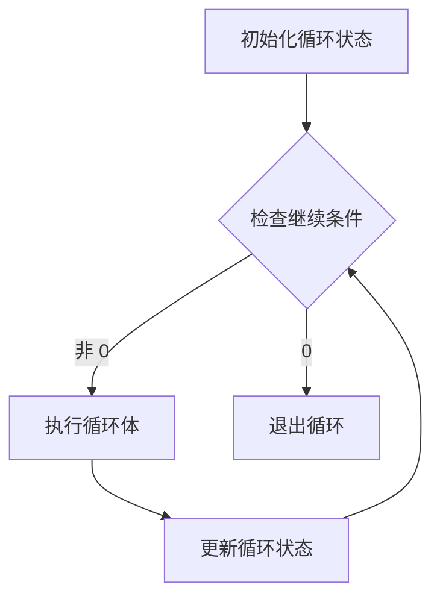
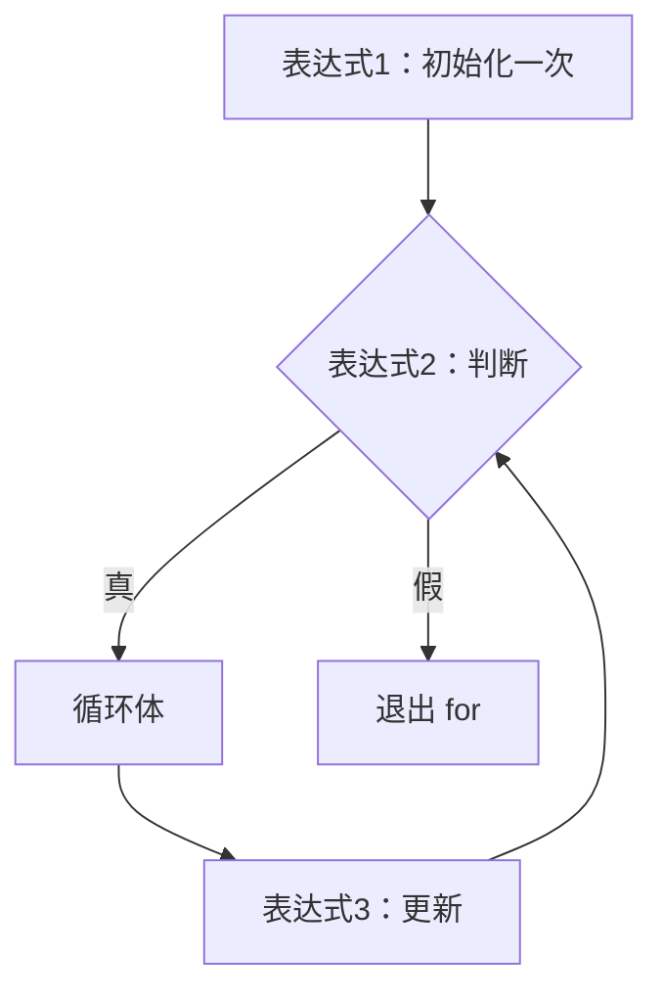

# 10 循环结构与转移语句

> [!info] 笔记定位与资料来源
> - **类型**：C 语言程序设计课程笔记（兼期末笔试复习）。
> - **主要依据**：吴俊军老师《第04章 程序的语句及流程控制》PDF，**§4.5 循环语句（课件第 20–42 页）、§4.6 转移语句（第 43–47 页）**。
> - **必要衔接**：§4.7.1 的嵌套循环（第 48–50 页）及例 4.24；§4.7.2 的枚举算法另留给第 11 篇。
> - **语言版本**：课件未指定统一考核版本；代码中的 `for (int i = …)` 使用 **C99 及以后**语法。特别标注的标准辨析以 **ISO C11/C17** 为参考，不把 GCC/Clang 的具体行为当成语言标准保证。
> - **前置笔记**：[[05 运算符与表达式]]、[[07 类型转换与混合运算]]、[[08 字符输入输出与格式化输入输出]]、[[09 语句、复合语句与选择结构]]。

## 一、考试导向与知识总览

| 复习对象 | 建议重要性 | 典型考法 |
| --- | --- | --- |
| `while`、`do-while`、`for` 的执行过程 | 极高 | 计算循环次数、判断输出、分析结束条件 |
| 循环变量的初值、更新与边界 | 极高 | `i++`、`++i`、`<=`、`<`、死循环 |
| `break` 与 `continue` 的跳转目标 | 极高 | 嵌套循环、`switch` 套循环、输出题 |
| 循环体后的意外分号 `;` | 极高 | 判断是否空循环、变量变化 |
| `return` 与函数控制流程 | 高 | 判断何时终止函数、返回值 |
| 典型算法：倒序、素数、求最值、平均分 | 高 | 阅读代码、补全程序、手写程序 |
| 嵌套循环次数 | 高 | 求输出次数、追踪内外层变量 |
| `goto` | 了解 | 基本功能与结构化程序设计原则 |

本篇的核心分析框架：**初值 → 条件 → 循环体 → 更新 → 重新判断**。每次读题都应确认：哪些操作确实被执行、哪些操作被 `break` 或 `continue` 跳过。

## 二、循环结构的基本模型

老师在 §4.5 将三种循环分为：

- **`while`**：先判断，再执行；可能 **0 次**。
- **`do-while`**：先执行，再判断；正常到达循环语句时至少 **1 次**。
- **`for`**：初始化、判断、循环体和迭代表达式集中书写；可能 **0 次**。

> [!important] 注意“至少一次”的边界
> `do-while` 的循环体第一次会开始执行，但如果其中执行 `break`、`return` 等控制转移，可能不会到达末尾的条件表达式；若异常终止程序，则也不能简单套用“必然判断一次”的说法。

**循环条件并不要求 `_Bool` 类型**：ISO C 中要求条件是**标量表达式**，计算结果为 0 时为假、非 0 时为真。实际试题中常用关系、逻辑或赋值表达式。



> [!warning] 优先级≠求值先后
> 复杂循环条件仍应先根据语法分组，再按 `&&`、`||` 等规则判断短路求值及副作用。不要仅凭运算符优先级猜测操作数的求值顺序。参见 [[05 运算符与表达式]]。

## 三、`while`：先判断后执行（课件 §4.5.1）

### 3.1 基本语法与执行过程

```c
while (表达式)
    语句;
```

如果循环体有多条语句，通常需要用 `{}` 组成复合语句。

**课件例 4.4（第 21 页，课程版本）**：

```c
#include <stdio.h>

int main(void)
{
    int i = 0;
    while (i < 5) {
        printf("i=%d\t", i);
        i++;
    }
    printf("i=%d\n", i);
    return 0;
}
```

输出：

```text
i=0    i=1    i=2    i=3    i=4    i=5
```

| 判断次数 | 判断前的 `i` | `i < 5` | 循环体打印 | 本次更新后 `i` |
| ---: | ---: | :---: | --- | ---: |
| 1 | 0 | 真 | `i=0` | 1 |
| 2 | 1 | 真 | `i=1` | 2 |
| 3 | 2 | 真 | `i=2` | 3 |
| 4 | 3 | 真 | `i=3` | 4 |
| 5 | 4 | 真 | `i=4` | 5 |
| 6 | 5 | 假 | 不执行 | 5 |

**循环体执行 5 次，条件求值 6 次**；最后一次 `printf` 在循环外，所以输出 `i=5`。

### 3.2 死循环与零次循环

**例 4.5（第 22 页）**：

```c
int i, k;
i = k = 1;
while (i < 5) {
    k = k + i;
    printf("i=%d, k=%d\n", i, k);
}
```

`i` 始终是 1，条件始终为真；`k` 不断增加。**标准辨析**：当有符号整数 `k` 继续增加而发生溢出时，出现**未定义行为**；所以从 ISO C 的严格角度，不应断言它会无限正确地输出数字。

**例 4.6（第 22 页）**：

```c
int i = 4;
while (i <= 4) {
    printf("**");
    i -= 2;
}
```

`4, 2, 0, -2, …` 逐步减小，不会因这一变化使 `i <= 4` 变假。课件借此说明**更新方向必须使终止条件有机会成立**。同样，若有符号 `i` 最终发生下溢，行为未定义。

**例 4.7（第 22 页）**：

```c
int i = 0;
while (i == 4) {
    printf("i=%d\n", i);
    i += 2;
}
```

第一次判断即为假，循环体 **0 次**。

> [!tip] 阅读 `while` 题的四项检查
> 1. 第一次条件是否为真？
> 2. 循环体里哪些变量会变？
> 3. 更新使条件趋向假，还是离假更远？
> 4. 是否存在意外分号、`break`、`continue`、溢出或 EOF？

### 3.3 EOF 控制的字符复制：例 4.8

课件第 23 页提供了逐字符复制输入的版本。它说明“**读入—判断 EOF—输出**”的结构。

**课程版本（仅突出关键语句）**：

```c
char c;
while ((c = getchar()) != EOF)
    putchar(c);
```

> [!warning] 标准辨析：`getchar` 的返回类型是 `int`
> 使用 `char` 保存返回值，可能无法正确区分有效字符与 `EOF`；标准并不保证这段代码在所有实现和输入下正确终止。**此处需要将 `char c` 改为 `int c`。** 不应把这种修正回写成“老师原始代码”。

**改进版本（C99/C11/C17）**：

```c
#include <stdio.h>

int main(void)
{
    int c;
    while ((c = getchar()) != EOF)
        putchar(c);
    return 0;
}
```

这里括号具有两层含义：

- 内层 `(c = getchar())` 先将返回值保存到 `c`；
- 外层 `!= EOF` 判断是否继续。

如果写成 `c = getchar() != EOF`，赋值给 `c` 的将是 **0 或 1**，不是原始输入字符。

输入来自终端还是文件、是否需要按 Enter 提交，都取决于具体输入环境，**不是 `getchar()` 语法规则本身**。参见 [[08 字符输入输出与格式化输入输出]]。

### 3.4 例 4.10：使用状态机去掉 `/*…*/` 注释（算法了解）

课件第 24–26 页使用 `COPY`、`START`、`COMMENT`、`END` 四种状态：

| 状态 | 含义 | 典型处理 |
| --- | --- | --- |
| `COPY` | 正常复制字符 | 遇 `/` 暂缓输出 |
| `START` | 刚读到一个 `/` | 遇 `*` 开始注释，否则补输出 `/` |
| `COMMENT` | 正在注释中 | 忽略字符，遇 `*` 进入结束候选 |
| `END` | 刚读到注释中的 `*` | 遇 `/` 结束注释 |

它体现了**一次循环处理一个输入符号，状态决定下一步动作**。后续可以扩展为 [[有限状态机]] 专题。

> [!note] 不要误作完整 C 注释剥离器
> 课件示意程序同样用 `char` 保存 `getchar()` 返回值；此外未完整处理字符串和字符字面量中的 `/*`、行注释 `//`、反斜杠换行等 C 翻译阶段细节。其课堂价值主要是**循环与状态转换**，不宜直接作为生产级 C 解析器。

## 四、`do-while`：先执行后判断（课件 §4.5.2）

### 4.1 基本语法

```c
do
    语句;
while (表达式);
```

> [!important] 记住末尾的分号
> `do { ... } while (cond);` 的末尾 `;` 是**语法必需**，与 `while (cond);` 意外形成空循环完全不同。

### 4.2 例 4.11：逆序输出整数的各位数字

**课件第 28 页的核心代码（课程版本）**：

```c
int x, digit;
scanf("%d", &x);
do {
    digit = x % 10;
    printf("%d", digit);
    x /= 10;
} while (x != 0);
printf("\n");
```

输入 `12345`：

| 迭代 | 原 `x` | `x % 10` | 累计输出 | 更新后的 `x` |
| ---: | ---: | ---: | --- | ---: |
| 1 | 12345 | 5 | `5` | 1234 |
| 2 | 1234 | 4 | `54` | 123 |
| 3 | 123 | 3 | `543` | 12 |
| 4 | 12 | 2 | `5432` | 1 |
| 5 | 1 | 1 | `54321` | 0 |

此题的关键并非把整数先逆序存储，而是**按个位依次输出**。这能够自然处理输入 `1200` → 输出 `0021`，不会丢失被打印的前导零。

> [!warning] 输入范围
> 题目限定**正整数**。如果输入负数，`%` 结果可能为负，按 `%d` 输出就不再是预期的逐位字符序列。输入检查和更多边界问题属于改进内容，而非原题要求。

### 4.3 例 4.12：牛顿迭代法（了解循环终止条件）

课件第 29–30 页求方程

$$
f(x)=3x^3-4x^2-5x+13=0
$$

的一个近似实根。迭代公式为

$$
x_{k+1}=x_k-\frac{f(x_k)}{f'(x_k)},\quad f'(x)=9x^2-8x-5.
$$

课件使用 `do-while` 保证**先进行一次迭代，再检查修正量是否足够小**：

```c
#define EPS 1e-6
/* 给定已经读取的 double x */
double d;
do {
    d = -((((3*x-4)*x)-5)*x+13);
    d = d/((9*x-8)*x-5);
    x += d;
} while (fabs(d) > EPS);
```

> [!note] 工程边界（非本讲重点）
> 导数为 0、迭代不收敛、`NaN`、无穷大、输入无效等情况都需要保护；健壮实现通常增加**最大迭代次数**，同时检查 `fabs(f(x))` 等残差指标。上述片段按老师课程展示，不能视为适用于任意初值的可靠求根器。

## 五、`for`：将循环控制集中书写（课件 §4.5.3）

### 5.1 语法与求值顺序

```c
for (表达式1; 表达式2; 表达式3)
    语句;
```

循环过程：

1. **表达式 1** 执行一次（初始化）。
2. 判断**表达式 2**。如果为 0，退出；若省略，视为真。
3. 执行循环体。
4. 执行**表达式 3**（更新）。
5. 返回步骤 2。



C99 及以后可以在初始化位置使用声明：`for (int i = 0; ...; ...)`。此处声明的循环变量具有相应的块作用域，通常不能在循环外使用。

### 5.2 例 4.14：三次循环

```c
int i;
for (i = 1; i < 4; i++)
    printf("i=%d s=%d\n", i, 2 * i);
```

输出：

```text
i=1 s=2
i=2 s=4
i=3 s=6
```

停止时 `i=4`，执行了 **3 次循环体、4 次条件判断、3 次更新**。

**例 4.15**：

```c
for (a = 10, b = 5; a <= b; a++)
    printf("a=%d，b=%d\n", a, b);
```

第一次 `a <= b` 为假，循环体执行 **0 次**。初始化仍然会执行。

### 5.3 三个表达式可以省略，但分号不可省

下列是课件第 36–37 页给出的例 4.14 等价写法：

```c
/* 形式一 */
i = 1;
for (; i < 4; i++)
    printf("i=%d s=%d\n", i, 2*i);

/* 形式二 */
for (i = 1; i < 4;) {
    printf("i=%d s=%d\n", i, 2*i);
    i++;
}

/* 形式三 */
i = 1;
for (;;) {
    printf("i=%d s=%d\n", i, 2*i);
    i++;
    if (!(i < 4)) break;
}
```

`for (;;)` 是合法的无限循环**结构**，但遇到 `break` 或 `return` 等仍可终止。

> [!warning] `continue` 会破坏某些直观的 while/for 改写
> `for` 中执行 `continue` 后**仍会执行表达式 3**；如果把更新语句简单地放到 `while` 循环体最后，而 `continue` 出现在其前，就可能跳过更新，造成逻辑错误甚至死循环。后文详述。

### 5.4 例 4.16：步长与结束条件不匹配

```c
for (int x = 1; x != 10; x += 2)
    printf("x=%d\n", x);
```

在没有溢出的数学整数模型中，`x` 一直是奇数，因此永远不会等于偶数 10。课件称其为死循环。

> [!note] C 语言标准的严格区别
> `int` 是有限范围类型；不断累加 2 最终可能发生**有符号溢出（未定义行为）**。所以不能声称 ISO C 保证该程序永远按奇数序列输出。课堂所表达的算法问题仍然正确：**选择 `!=` 作为终止条件时，需要保证更新序列能够到达目标值**。

### 5.5 避免空循环与偏一错误

```c
for (int i = 0; i < 5; i++);  /* 循环体就是这个空语句 */
{
    puts("hello");           /* 此块只执行一次 */
}
```

对比：

```c
for (int i = 0; i < 5; i++) {
    puts("hello");           /* 执行五次 */
}
```

题目中应仔细看 `for (...)`、`while (...)` 或 `if (...)` 后是否紧跟 `;`。

课件第 42 页建议循环变量一般从 0 开始：**这是适用于数组下标等场景的良好习惯，并不是 C 的语法要求**。当问题自然从 1 开始计数（例如 `1` 至 `n`）时，`for (i=1; i<=n; ++i)` 完全合理。

## 六、三种循环对比与常考次数计算

| 比较 | `while` | `do-while` | `for` |
| --- | --- | --- | --- |
| 条件首次求值 | 第一次循环体之前 | 第一次循环体之后（若能到达） | 初始化之后、第一次循环体之前 |
| 一般最少执行次数 | 0 | 1 | 0 |
| 常见用途 | 次数未知、流式读入 | 菜单、先处理后判断 | 已知计数范围 |
| `continue` 后 | 重新检查条件 | 检查尾部条件 | 先执行迭代表达式，再判断 |
| 更新位置 | 常在循环体中 | 常在循环体中 | 常在第三个子句 |

**计数题示例 1：**

```c
int i = 0, n = 0;
while (i++ < 3)
    n++;
```

| 条件判断前 `i` | 比较的是旧值 | 比较结果 | 判断后 `i` | `n` |
| ---: | ---: | --- | ---: | ---: |
| 0 | 0 < 3 | 真 | 1 | 1 |
| 1 | 1 < 3 | 真 | 2 | 2 |
| 2 | 2 < 3 | 真 | 3 | 3 |
| 3 | 3 < 3 | 假 | 4 | 3 |

结束后 **`i=4, n=3`**：失败的最后一次条件判断仍然会执行 `i++`。

**计数题示例 2：**

```c
for (int i = 0; i < 6; i += 2)
    printf("%d ", i);
```

打印 `0 2 4 `，循环体 3 次；结束条件判断时 `i=6`。

**嵌套循环**（课件 §4.7.1 先作知识衔接）：

```c
for (int i = 1; i <= 3; ++i)
    for (int j = 0; j < i; ++j)
        putchar('*');
```

外层 `i=1,2,3` 时内层分别执行 `1,2,3` 次，共 `1+2+3=6` 次。输出连续的 `******`（没有换行）。

> [!tip] 嵌套循环次数怎么算？
> 不要机械地把外层次数乘以内层上限。先判断内层次数是否随外层变量变化，再用 **逐轮统计或求和**。如 `for(j=0;j<i;j++)` 的内层次数随 `i` 变化。

### 6.1 例 4.24：嵌套循环计算 $1^1+2^2+\cdots+n^n$（第 49 页）

**课程版本（保留原例的结构）**：

```c
#include <stdio.h>
int main(void)
{
    int i, j, n;
    long sum, term;
    printf("input n:\n");
    scanf("%d", &n);
    for (sum = 0, i = 1; i <= n; ++i) {
        term = 1;
        j = 1;
        do term *= i;
        while (++j <= i);
        sum += term;
    }
    printf("sum=%ld\n", sum);
    return 0;
}
```

当输入 `n=3`：

| 外层 `i` | 内层 `term *= i` 次数 | 当次 `term` | 累积 `sum` |
| ---: | ---: | ---: | ---: |
| 1 | 1 | 1 | 1 |
| 2 | 2 | 4 | 5 |
| 3 | 3 | 27 | 32 |

所以输出 `sum=32`。**内层总执行次数**为 $1+2+\cdots+n=n(n+1)/2$（假设 `n>=1` 且程序正常计算完成）。内层使用 `do-while`，因为每次需要至少乘一次。

> [!warning] 边界与标准行为
> `long` 的宽度受实现约束；当 `term` 或 `sum` 的数学值超过 `LONG_MAX` 时会发生有符号溢出 UB。因此程序仅适用于足够小的 `n`。若 `scanf` 未成功或 `n` 未初始化，原课程程序还存在输入有效性问题；这些是改进版需要处理的内容。

## 七、`break`、`continue`、`return`、`goto`（课件 §4.6）

### 7.1 `break`：退出最近的循环或 `switch`

```c
for (int i = 1; i <= 5; ++i) {
    if (i == 3) break;
    printf("%d ", i);
}
```

输出 `1 2 `，退出循环后从循环之后的语句继续执行。

在嵌套循环中，`break` **只退出最近的一层循环**：

```c
for (int i = 0; i < 2; ++i) {
    for (int j = 0; j < 3; ++j) {
        if (j == 1) break;
        printf("%d%d ", i, j);
    }
}
```

输出 `00 10 `；外层并未终止。

如处于 `switch` 中，`break` 退出的是该 `switch`。与 [[09 语句、复合语句与选择结构]] 联动复习。

### 7.2 `continue`：结束本轮，进入下一轮

```c
for (int i = 1; i <= 5; ++i) {
    if (i == 3) continue;
    printf("%d ", i);
}
```

输出 `1 2 4 5 `。**`continue` 并不退出循环**，也不跳过 `for` 的更新表达式。

| 所处循环 | `continue` 后的下一步骤 |
| --- | --- |
| `while` | 重新计算条件 |
| `do-while` | 转到末尾条件判断 |
| `for` | 执行迭代表达式 3，再计算条件 2 |

**常考陷阱：**

```c
int i = 0;
while (i < 5) {
    if (i == 2) continue;
    ++i;
}
```

当 `i=2` 时不断跳过 `++i`，所以循环无法继续向终止条件推进。这是逻辑上的死循环（状态保持为 2，没有算术溢出问题）。

改为：

```c
for (int i = 0; i < 5; ++i) {
    if (i == 2) continue;
}
```

这里 `continue` 仍然会执行 `++i`。

### 7.3 `return`：结束当前函数

课件例 4.21（第 47 页）给出符号函数：

```c
int sign(float x)
{
    if (x < 0) return -1;
    else return ((!x) ? 0 : 1);
}
```

对于有限、非 NaN 的普通浮点数，返回 `-1`、`0` 或 `1`。执行 `return` 后，**该函数立即终止**，控制返回调用处。

> [!note] 标准与边界
> `sign(NaN)` 时，这个函数返回 `1`，不能视为“所有浮点值的数学符号分类”。`return;` 通常用于 `void` 函数；在 `int main(void)` 中 `return 0;` 表示正常终止。若非 `void` 函数执行到末尾且调用者使用其返回值，可能发生未定义行为；`main` 的正常末尾有专门规则（C99 及以后等效于 `return 0;`）。

### 7.4 `goto`：本讲提及但未系统展开

课件总览与小结将 `goto` 列为转移语句，§4.6 正文主要讲 `break`、`continue`、`return`。因此这里只保留基本概念，不将额外示例视为老师指定考点。

```c
/* 补充示例：goto 跳转到同一函数中的标签 */
goto done;
/* ... */
done:
    ;
```

`goto` 只能在**同一函数内**按规则跳转到标签；过度使用会破坏流程结构的可读性。具体约束待后续需要时再专门补充。

### 7.5 四种控制转移语句对照

| 语句 | 直接效果 | 可用位置与范围 |
| --- | --- | --- |
| `break;` | 离开最近一层循环或 `switch` | 循环、`switch` |
| `continue;` | 跳到当前最近循环的下一轮控制点 | 循环（即使嵌套在 `switch` 中也针对循环） |
| `return expr;` | 结束所在函数并返回值 | 函数内部，受返回类型约束 |
| `goto label;` | 转到指定标签 | 同一函数内 |

> [!important] `switch` 套在循环中时
> `switch` 内的 `break` 只退出 `switch`；而 `continue`（若该 `switch` 在循环内）作用于**包围它的最近一层循环**。这是将第 09、10 篇联系起来的高频程序阅读题。

## 八、课程典型算法：要会阅读、会手写

### 8.1 例 4.13：判断素数（课件第 31–33 页）

老师的做法是检查从 2 开始的候选因数，通常检查到 `sqrt(n)` 即可：如果 `n=ab` 且 `a,b>1`，那么至少有一个因数不大于 `sqrt(n)`。

**课程版本的关键循环**：

```c
r = 1;
for (i = 2, j = sqrt(n); r && i <= j; i++)
    r = n % i;
if (r)
    printf("%d is a prime\n", n);
else
    printf("%d is not a prime\n", n);
```

> [!warning] 课程版本的前提与简化
> 此代码假设已保证 `n >= 2`；`j = sqrt(n)` 中发生浮点到整数的转换；实际工程中还应检查输入成功。课件第 32 页的另一版本用 `do-while`，可结合该结构“至少先执行一次”的特点分析循环边界。

**改进版本：可直接编译的整数素数检查**（C99+；避免浮点平方根）

```c
#include <stdio.h>

int is_prime(int n)
{
    if (n < 2) return 0;
    for (int d = 2; d <= n / d; ++d) {
        if (n % d == 0) return 0;
    }
    return 1;
}

int main(void)
{
    int n;
    if (scanf("%d", &n) != 1) return 1;
    printf("%d is %sprime\n", n, is_prime(n) ? "" : "not ");
    return 0;
}
```

`d <= n/d` 在 `n >= 2` 且 `d >= 2` 时对应 `d*d <= n`，避免了 `d*d` 可能的整数溢出，也避免依赖 `sqrt`。

### 8.2 例 4.17：去掉最高、最低分求平均（第 39 页）

课程用三个变量维护“总和、最大值、最小值”：

```c
#define N 7
int x, max = 0, min = 100, sum = 0;
for (int i = 1; i <= N; i++) {
    scanf("%d", &x);
    sum += x;
    if (x > max) max = x;
    if (x < min) min = x;
}
sum -= max + min;
printf("The last score = %.1f\n", 1.0 * sum / (N - 2));
```

**必须看懂**：初始 `max=0`、`min=100` 是利用题目给出的分数范围 `[0,100]`；如果输入范围变化，这样的初始化就未必正确。乘以 `1.0` 是为了产生浮点除法，避免整数除法丢失小数。

完整程序运行时还应验证每次 `scanf` 返回值和分数范围。输入数量 `N >= 3` 是题目条件。

### 8.3 例 4.19：打印素数，每行 10 个（第 44 页）

本题用**两层循环**：外层遍历整数 `n`，内层试除因数；遇到因数用 `break` 立即结束内层。`k` 计数已输出素数，`(++k % 10) == 0` 时换行。

```c
/* 课件的关键控制片段 */
if (!(m = n % i)) break;
/* ... */
if (!(++k % 10)) printf("\n");
```

注意：`break` 退出的是**内层试除循环**，不会直接退出遍历 `n` 的外层循环。原课件写作 `n < 100` 而题目是 2～100；由于 100 不是素数，示例最终输出仍覆盖全部符合条件的素数。

### 8.4 例 4.20：统计正数个数与平均值（第 46 页）

课程代码：

```c
int s, i, k, x;
for (s = i = k = 0; i < 10; ++i) {
    scanf("%d", &x);
    if (x <= 0) continue;
    s += x;
    ++k;
}
if (k)
    printf("numbers=%d,average=%f\n", k, 1.0*s/k);
```

- `continue` 跳过非正数的累加与计数。
- 第三个子句 `++i` **照常执行**，所以最多处理 10 个输入位置。
- `if(k)` 避免在没有正数时发生除零。
- 课件没有规定 `k==0` 时的输出内容；课程代码此时不输出统计结果。

### 8.5 课件中的求最大值程序（第 38 页）的边界问题

课程关键片段：

```c
scanf("%d", &x);
for (m = x; x != 0; ) {
    scanf("%d", &x);
    if (m < x) m = x;
}
```

> [!warning] 课程示例的逻辑缺陷
> 题意是输入以 0 为结束标记的一批整数，0 **不参与**求最大值。然而这段代码在读入终止标记 0 后仍执行 `if (m < x)`：如果之前输入全是负数，最后 `m` 会被错误更新为 0。还可能在 EOF 或输入匹配失败时反复处理旧值。

**改进版本（以 0 为结束，支持全负数，不把哨兵算入数据）**：

```c
#include <stdio.h>

int main(void)
{
    int x, max, found = 0;
    while (scanf("%d", &x) == 1 && x != 0) {
        if (!found || x > max) max = x;
        found = 1;
    }

    if (found)
        printf("max=%d\n", max);
    else
        puts("no data");
    return 0;
}
```

这里将**结束标记、有效输入、是否已经获得一个数据**分别处理，比直接设 `max=0` 更稳妥。

### 8.6 课件第 40 页：计算 `n!`（了解数据范围）

```c
unsigned long f = 1;
for (int i = 1; i <= n; ++i)
    f *= i;
```

`n=0` 时，循环体 0 次，结果仍为 `0!=1`。但 `unsigned long` 的可表示范围依赖实现；发生无符号整数溢出时按模数回绕，并不能得到数学意义上的正确阶乘。因此期末计算题通常应设置较小的 `n`。

## 九、重点易错点与标准辨析汇总

| 场景 / 课程写法 | 考试应掌握的准确结论 |
| --- | --- |
| `while (cond);` | 分号是空循环体，后面的 `{}` 不是该循环体 |
| `do {...} while(cond);` | 末尾分号是必需的 |
| `for(;;)` | 条件缺省为真，但可以 `break`/`return` 离开 |
| `for(i=0; i<5; i++)` | 条件通常判断 6 次，循环体和更新通常各执行 5 次 |
| `while(i++<3)` | 最后一次判断即使为假，也执行 `i++` |
| `continue` 出现在 `for` | 会执行第三个子句，再判断第二个子句 |
| `continue` 出现在 `while` | 可能跳过体内更新，导致无法终止 |
| `break` 在嵌套循环中 | 仅退出最近的一层循环 |
| `break` 在循环内的 `switch` 中 | 退出 `switch`，不是退出外层循环 |
| `return` 在循环中 | 直接结束整个当前函数 |
| `int c = getchar()` | 正确保留 EOF 信息；不要随意换成 `char` |
| 用 0 结束的输入序列 | 0 是哨兵，不一定参加统计或求最大值 |
| `i += 2` 配合 `i != 10` | 更新序列无法到达终值，且可能触发有符号溢出 UB |
| `n!`、累加循环 | 检查类型最大值及溢出风险 |
| `scanf` 控制的循环 | 通常要检查**是否成功读到所需数量**，不能只比较 `!= EOF` |

> [!important] 三个不同的“结束”
> 1. **条件变假**：自然结束循环；
> 2. **`break`**：提前结束当前循环或 `switch`；
> 3. **`return`**：结束整个当前函数。
>
> `continue` 不属于结束循环，而是结束**本次循环体执行**。

## 十、考试解题流程

针对“求输出、求执行次数、判断是否死循环”题，可以按照以下步骤：

1. **找入口**：逐个标出循环、初始变量和控制表达式。
2. **看结构**：确认 `{}`、空语句分号和循环嵌套关系。
3. **列状态表**：每行记录判断前变量、条件真假、输出和更新。
4. **检查跳转**：在 `break`、`continue`、`return` 位置标注下一条真正会执行的语句。
5. **检查边界**：第一次能否进入？最后一次条件是否仍引起自增？有无无效输入/溢出？
6. **下结论**：区分“语法错误”“确定输出”“逻辑上的不终止”和“未定义行为”，不要混为一谈。

对于需要证明循环次数的题目，若 `for (i=a; i<b; i+=d)`，且 `d>0`、无溢出、`a<b`，循环体次数为

$$
\left\lceil\frac{b-a}{d}\right\rceil.
$$

这只是**适用于该受限形式的数学公式**，不是任意 C `for` 循环的通式。含 `break`、`continue`、副作用条件和变量步长时应手工分析。

## 十一、笔试自测（先做题，再展开答案）

约定：除单独说明外，程序符合 C11/C17，整数运算不溢出；各小题独立执行。输出题忽略终端提示文本。

### A. 概念与判断（1–8）

1. `while` 的循环体可能执行 0 次；`do-while` 的循环体正常开始执行时至少进入 1 次。（判断）
2. `for (i=0; i<5; i++)` 的第三个子句执行 5 次，条件判断 6 次。（判断）
3. `for (;;)` 是语法错误，因为缺少全部 3 个表达式。（判断）
4. `continue` 在 `for` 中会跳过第三个表达式，直接检查第二个表达式。（判断）
5. `break` 可以直接退出两层嵌套循环。（判断）
6. `switch` 置于 `for` 内部时，`switch` 的 `break` 会结束整个 `for`。（判断）
7. `do { puts("x"); } while (0);` 打印几次 `x`？
8. `while (0) puts("x");` 打印几次 `x`？

### B. 输出与状态跟踪（9–17）

9. 下列程序段结束时 `i` 和 `s` 分别为多少？

   ```c
   int i=0, s=0;
   while (i++<4) s+=i;
   ```

10. 下列程序输出什么？

    ```c
    for (int i=1; i<=5; ++i) {
        if (i==3) continue;
        printf("%d",i);
    }
    ```

11. 下列程序输出什么？

    ```c
    for (int i=1; i<=5; ++i) {
        if (i==3) break;
        printf("%d",i);
    }
    ```

12. 下列程序输出多少个 `*`？

    ```c
    for (int i=1;i<=4;++i)
        for(int j=0;j<i;++j)
            putchar('*');
    ```

13. 下列 `for` 之后的 `i` 为多少？

    ```c
    int i;
    for (i=2;i<10;i+=3) { }
    ```

14. 下面的 `n` 最终为多少？

    ```c
    int n=0;
    for (int i=0;i<3;++i);
    n++;
    ```

15. 以下代码有何控制流程问题？

    ```c
    int i=0;
    while (i<3) {
        if (i==1) continue;
        ++i;
    }
    ```

16. 下面函数返回多少？

    ```c
    int f(void) {
        for (int i=1;i<10;i++)
            if (i==4) return i;
        return 0;
    }
    ```

17. 以下语句执行后，`i` 与 `n` 为多少？

    ```c
    int i=0,n=0;
    do { ++n; } while (i++<2);
    ```

### C. 综合与改错（18–24）

18. 将 `1230` 按例 4.11 的代码倒序输出，显示什么？
19. 为什么 `while ((c=getchar())!=EOF)` 通常应使 `c` 为 `int`，不能随意设为 `char`？
20. `for (int x=1;x!=10;x+=2)` 按数学整数推演为什么无法结束？在 ISO C 中还存在什么风险？
21. 说明课件“以 0 结束的一批整数求最大值”例题在全部输入为负数时可能得到的错误结果。
22. 在外层 `for` 内部使用 `switch`，`switch` 的 `break` 与 `continue` 分别作用到哪里？
23. 已经确认 `int n=5`，求 `n!` 的循环若 `unsigned long f=1; for(i=1;i<=n;i++) f*=i;`，输出的数值是多少？
24. 给出使用 `break` 的一条正当理由，以及使用 `continue` 的一条正当理由。

> [!abstract]- 自测参考答案与解析（点击展开）
> 1. 对。前者先判断；后者先进入循环体。
> 2. 对。初值为 0，循环体处理 `i=0` 至 `4`，更新五次，最后判断 `5<5` 为假。
> 3. 错。`for (;;)` 是合法语法，条件按真处理。
> 4. 错。`continue` 会先转到表达式 3。
> 5. 错。只退出最近的一层循环；要退出两层，需要额外控制结构。
> 6. 错。该 `break` 退出的是 `switch`。
> 7. 1 次。
> 8. 0 次。
> 9. `i=5, s=10`。四次循环体分别把 `1,2,3,4` 加到 `s`，最后一次失败的判断仍把 `i` 从 4 增至 5。
> 10. `1245`。
> 11. `12`。
> 12. 10 个（`1+2+3+4`）。
> 13. `i=11`。先经过 `2,5,8`，然后加 3。
> 14. `n=1`。分号形成空循环体，后面的 `n++` 只执行一次。
> 15. `i` 到 1 后总被 `continue` 跳过更新，逻辑上无法退出。
> 16. 返回 4。`return` 结束整个函数。
> 17. `i=3,n=3`。每次先 `++n`，再进行后置自增比较，旧值依次是 0、1、2。
> 18. `0321`，因为每位数字直接输出，输入末尾 0 会首先打印。
> 19. `getchar()` 返回 `int`，既要容纳所有可读字符，又要区别于负值 `EOF`；保存到 `char` 可能失去这种区别。
> 20. 奇数序列永远到不了 10；但 C 的有符号 `int` 有限，继续自增可能触发未定义行为。
> 21. 读入终止标记 `0` 后仍进行 `if(m<x)`，可能把最大负数错误更新为 0。
> 22. `break` 离开最近的 `switch`；`continue` 针对包围该 `switch` 的最近一层循环。
> 23. `120`。
> 24. `break`：找到第一个符合条件的因数就停止试除；`continue`：跳过不符合条件的输入，继续处理下一个数据。

## 十二、可编译实践与核对方法（课外辅助）

在 Arch Linux 上可以使用 GCC/Clang 检查课堂示例。以下命令以 C11 为例，**并不代表老师指定考试采用 C11**：

```bash
gcc -std=c11 -Wall -Wextra -Wpedantic -Wconversion -o example example.c
./example
```

对于带未定义行为风险的练习，优先修改为安全版本；必要时在独立测试中使用 Sanitizer：

```bash
gcc -std=c11 -Wall -Wextra -Wpedantic \
    -fsanitize=undefined -fno-sanitize-recover=all \
    -g -O0 example.c -o example
```

> [!warning] 不要用某次运行输出替代语言规则
> 编译器未发出警告不表示代码一定符合标准；尤其不能根据某个整数溢出循环“似乎不会结束”就推断语言保证这种行为。

## 十三、本篇衔接与后续整理

- **复习前置**：[[05 运算符与表达式]]（自增自减与短路），[[08 字符输入输出与格式化输入输出]]（`getchar`/EOF、`scanf` 返回值），[[09 语句、复合语句与选择结构]]（`switch`）。
- **推荐下一篇**：[[11 结构化程序设计与典型算法]]。重点整理老师 §4.7 中的嵌套循环、枚举算法、例 4.24–4.27，以及从题意建立变量、循环与约束的方法。
- **值得独立维护的原子笔记候选**：[[循环不变式]]（结合算法学习逐渐展开）、[[有限状态机]]（若后续重复用到），暂时不必新建以免内容分散。

**复习速记：**

> [!important] 五句口诀（仅作记忆辅助）
> - `while` 先判断；`do-while` 先执行；`for` 先初始化、再判断、执行体、更新。
> - `break` 退出最近的循环或 `switch`；`continue` 跳过本轮剩余循环体。
> - `for` 的 `continue` **不跳过更新**；`while` 的 `continue` **可能跳过体内更新**。
> - 复杂循环先查 `{}` 和 `;`，再列状态表，最后看退出条件。
> - 死循环、越界、整数溢出、未定义行为是不同问题，分析时必须分别判断。

---

**课件索引：** 第 20–26 页 `while` 与状态机；第 27–33 页 `do-while`、倒序及迭代/素数；第 34–42 页 `for`、循环例题及小结；第 43–47 页 `break`、`continue`、`return`；第 48–50 页嵌套循环（本篇只作衔接）。
