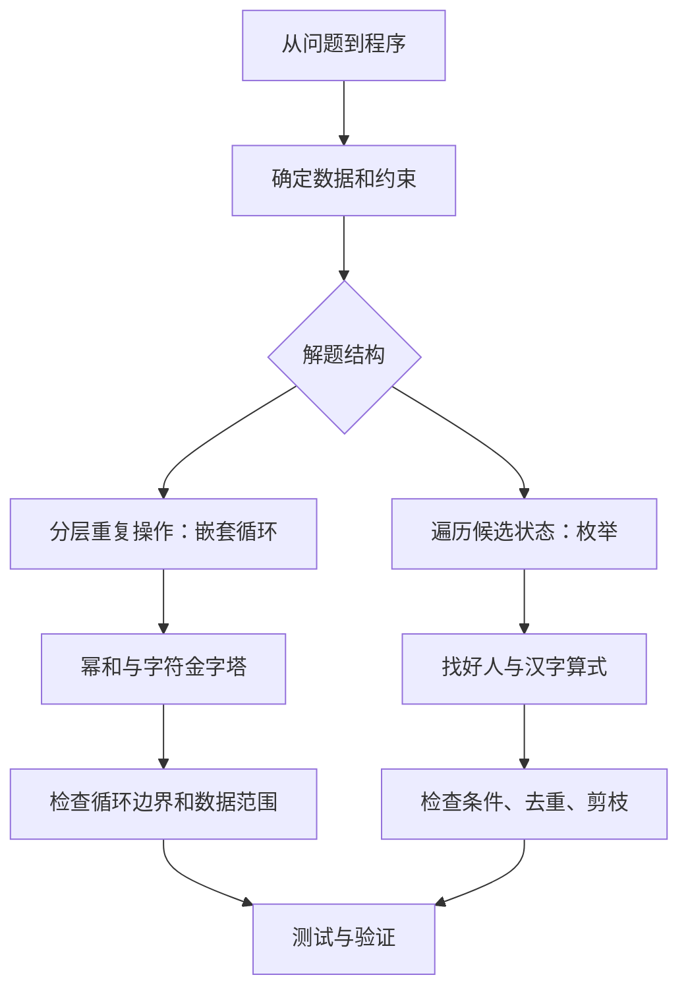
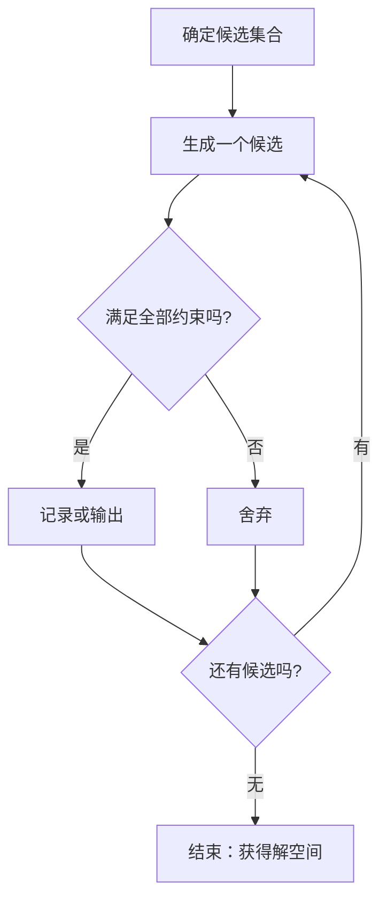
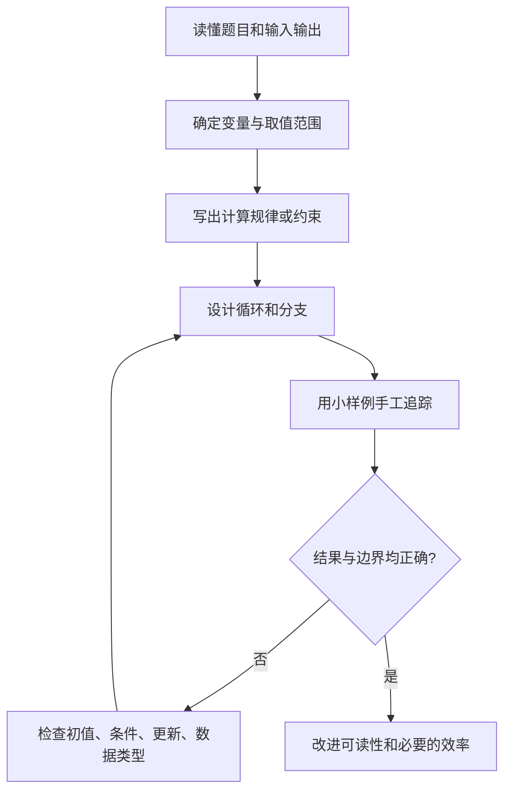

# 11 结构化程序设计与典型算法

> [!info] 笔记定位与资料来源
> - **类型**：C 语言程序设计课程笔记，兼期末书面考试复习。
> - **主要依据**：吴俊军老师《第04章 程序的语句及流程控制》PDF，**§4.7 程序设计实例（课件 PDF 第 48–54 页）**，并参考本章小结与程序设计步骤（第 55–57 页）。
> - **课件原题**：例 4.24（幂和）、例 4.25（字母金字塔）、例 4.26（找好人）、例 4.27（汉字乘法算式）。
> - **辅修说明**：结合 [[10 循环结构与转移语句]]、[[05 运算符与表达式]]、[[07 类型转换与混合运算]] 的知识解释执行过程。标准辨析以 **C99–C17** 为主；本课程实际考试采用哪一版 ISO C **待核实**。
> - **内容边界**：本篇以课件四道例题为核心；算法复杂度、输入校验及安全改进属于**辅助理解**，不直接等同于老师指定考点。

## 一、考点与知识结构

老师在第 55 页小结中明确提出：**要求熟练掌握嵌套循环和枚举方法**。这一表述是确定本篇复习重点的直接依据。

| 知识主题 | 建议复习级别 | 典型书面题型 |
| --- | --- | --- |
| 内外层循环的职责与嵌套结构 | **极高** | 填写循环、计算执行次数、程序跟踪 |
| 例 4.24：嵌套循环求幂和 | **极高** | 求输出、补全程序、判断初值与次数 |
| 例 4.25：字符金字塔 | **高** | 设计输出规律、确定循环上下界 |
| 枚举的状态空间、约束条件、解空间 | **极高** | 概念题、算法步骤设计 |
| 例 4.26：找好人 | **极高** | 建立逻辑表达式、分析真值 |
| 例 4.27：汉字乘法算式 | **极高** | 五重循环、互异约束、剪枝 |
| 数据范围、输入校验、数值溢出 | **高** | 改错题、程序边界分析 |



**核心思想**：把较大的任务拆成**可重复的单步操作**，再选择循环和条件语句组织这些操作。计算正确不仅取决于公式，还取决于数据表示、循环边界和约束是否完整。

## 二、结构化程序设计与嵌套循环（§4.7.1，第 48 页）

### 2.1 何为嵌套循环

**课件定义**：循环语句中又包含循环语句，称为嵌套循环（多重循环）。包含其他循环的为**外层循环**，被包含的为**内层循环**。课件重点讲解二重循环。

```c
for (int i = 1; i <= 3; ++i) {       // 外层：决定“做几轮”
    for (int j = 1; j <= 2; ++j) {   // 内层：每轮重复的操作
        printf("(%d,%d) ", i, j);
    }
}
```

输出：

```text
(1,1) (1,2) (2,1) (2,2) (3,1) (3,2)
```

> [!important] 外层循环每进行一轮，内层循环会重新从其初始化部分开始
> 以上例子中，每次外层 `i` 改变，内层 `j` 都重新从 1 开始，而不是继承上一轮的 `j`。

### 2.2 两种必须区分的循环次数

**情况 A：内层次数固定**

```c
for (int i = 0; i < n; ++i)
    for (int j = 0; j < m; ++j)
        ++count;
```

当 `n,m` 都是非负整数，且 `count` 不溢出时，循环体总执行次数为

$$
T(n,m)=nm.
$$

**情况 B：内层次数依赖于外层**

```c
for (int i = 1; i <= n; ++i)
    for (int j = 1; j <= i; ++j)
        ++count;
```

当 `n≥1` 时，内层执行次数依次为 `1,2,…,n`，所以

$$
T(n)=1+2+\cdots+n=\frac{n(n+1)}{2}.
$$

| 外层 `i` | 内层 `j` 取值 | 内层执行次数 | 累计执行次数 |
| ---: | --- | ---: | ---: |
| 1 | 1 | 1 | 1 |
| 2 | 1、2 | 2 | 3 |
| 3 | 1、2、3 | 3 | 6 |
| 4 | 1、2、3、4 | 4 | 10 |

> [!warning] 不可看到“两重循环”就直接认定执行 `n²` 次
> 必须先检查**内层上下界是否依赖外层循环变量**；还要检查内层 `break`、`continue`、`return` 等是否改变执行次数。循环次数与语句整体的时间复杂度也不是完全相同的概念。

### 2.3 嵌套循环中的 `break` 与 `continue`（联系前篇）

- `break` 退出**最近的一层**循环，不自动退出所有外层循环。
- `continue` 跳过**当前层循环本轮剩余语句**，然后执行该层循环应进行的更新或条件检查。
- 在 `for` 中，`continue` 后仍先执行第三个表达式，再判断第二个表达式。

详见 [[10 循环结构与转移语句]]。本篇不再重复三种循环的全部控制流程。

## 三、例 4.24：计算 $1^1+2^2+\cdots+n^n$（第 49 页）

### 3.1 题目与分层思路

输入正整数 `n`，求

$$
S(n)=\sum_{i=1}^{n}i^i.
$$

题目需要完成两个重复任务：

1. **内层**：固定当前 `i`，通过连续乘法计算 `i^i`；
2. **外层**：依次取 `i=1,2,…,n`，把各项 `i^i` 累加到 `sum`。

例如 `n=4`：

$$
S(4)=1^1+2^2+3^3+4^4=1+4+27+256=288.
$$

### 3.2 课程版本（保留老师的 `do-while` 写法）

```c
#include <stdio.h>

int main(void)
{
    int i, j, n;
    long sum, term;
    printf("input n:\n");
    scanf("%d", &n);
    for (sum = 0, i = 1; i <= n; ++i) {
        term = 1;
        j = 1;
        do term *= i;
        while (++j <= i);
        sum += term;
    }
    printf("sum=%ld\n", sum);
    return 0;
}
```

**课件位置**：第 49 页。为便于阅读，仅调整了缩进与空格，保留算法和控制结构。

### 3.3 逐轮追踪

内层代码为：

```c
term = 1;
j = 1;
do term *= i;
while (++j <= i);
```

这里 `++j` 是**先将 `j` 加 1，再判断是否继续**。例如 `i=3`：

| 内层迭代 | 执行前 `term` | `term *= 3` 后 | `++j` 后 | `j <= 3` |
| ---: | ---: | ---: | ---: | :---: |
| 1 | 1 | 3 | 2 | 真 |
| 2 | 3 | 9 | 3 | 真 |
| 3 | 9 | 27 | 4 | 假 |

因此乘法执行了**恰好 3 次**。

完整外层追踪（`n=4`）：

| `i` | 内层乘法次数 | `term=i^i` | 累加后 `sum` |
| ---: | ---: | ---: | ---: |
| 1 | 1 | 1 | 1 |
| 2 | 2 | 4 | 5 |
| 3 | 3 | 27 | 32 |
| 4 | 4 | 256 | 288 |

外层执行 **4 次**，内层共执行 **1+2+3+4=10 次**。

> [!tip] 考试中如何分析这一例题
> 先盯住 `i` 和 `j`：外层的 `i` 从 1 到 `n`，每次内层把 `j` 重新置 1；`do-while` 在 `i≥1` 时恰好乘 `i` 次。不要将 `term` 错误地保留为上一轮的值。`sum=0` 和 `term=1` 的初始化都不可遗漏。

### 3.4 边界、溢出与性能

**课程版本的适用前提**：输入能正确读入，`n` 处于合理范围，并且 `term` 与 `sum` 均不超出 `long` 的表示范围。

| `long` 类型 | 可安全计算到的最大 `n`（按本题公式） | 下一项问题 |
| --- | ---: | --- |
| 常见 32 位 `long` | 9 | `10^10` 超过 `LONG_MAX` |
| 常见 64 位 `long` | 15 | `16^16` 超过 `LONG_MAX` |

以上是常见 32/64 位有符号 `long` 的数值边界，**不是 ISO C 统一规定的 `long` 位宽**。发生有符号溢出时程序具有**未定义行为**，不能简单假设自动回绕。

如果 `n=0`，课程代码的外层循环一次也不执行，结果为 `0`；但原题按 `1^1` 开始的定义通常假定 `n≥1`，考试时以题目约束为准。

**改进版本（C99–C17，检查输入与溢出）**：

```c
#include <limits.h>
#include <stdio.h>

int main(void)
{
    int n;
    long sum = 0;

    if (scanf("%d", &n) != 1 || n < 1) {
        fputs("invalid n\n", stderr);
        return 1;
    }

    for (int i = 1; i <= n; ++i) {
        long term = 1;
        for (int j = 0; j < i; ++j) {
            if (term > LONG_MAX / i) {
                fputs("term overflow\n", stderr);
                return 1;
            }
            term *= i;
        }
        if (sum > LONG_MAX - term) {
            fputs("sum overflow\n", stderr);
            return 1;
        }
        sum += term;
    }
    printf("sum=%ld\n", sum);
    return 0;
}
```

> [!note] 课程版本与改进版本的区别
> 改进版用计数更直观的 `for` 计算幂，并在乘法和加法前检查界限；这属于**工程安全性补充**。考试如果要求分析课件程序，仍应按照老师的 `do-while` 版本作答。

辅助理解：内层乘法总次数为 `n(n+1)/2`，随着 `n` 增大近似按 `n²` 增长。但比运行耗时更早遇到的实际限制，通常是整数范围。

## 四、例 4.25：打印字母金字塔（第 50 页）

### 4.1 题目与观察规律

输入一个英文字母，按照字母大小写输出对应的金字塔。以小写 `d` 为例，忽略居中空格后的可见内容为：

```text
   a
  aba
 abcba
abcdcba
```

若输入大写 `D`，按相同规律输出大写字母。

观察第 `r` 行（`r` 从 1 开始）：

| 行号 `r` | 升序部分 | 降序部分 | 有效字符数量 |
| ---: | --- | --- | ---: |
| 1 | `a` | 空 | 1 |
| 2 | `ab` | `a` | 3 |
| 3 | `abc` | `ba` | 5 |
| 4 | `abcd` | `cba` | 7 |

第 `r` 行包含 `2r-1` 个有效字母。输出可拆为：

1. 根据 `r` 输出适量**前导空格**；
2. 从起始字母向上输出到当前行对应的字母；
3. 再从当前字母前一个字母逐个向下输出。

**外层循环决定行数，内层循环决定每行内容。** 课件实际使用三个内层循环：前导空格、升序字母、降序字母。

### 4.2 课程版本（按第 50 页保留核心代码）

```c
#include <stdio.h>
#include <ctype.h>

int main(void)
{
    char c, c1, c2, top;
    int i;
    printf("input a character:\n");
    top = isupper(c = getchar()) ? 'A' : (islower(c) ? 'a' : '\0');
    if (top) {
        for (c1 = top; c1 <= c; ++c1) {
            for (i = 1; i <= 40 - 2 * (c1 - top); ++i)
                putchar(' ');
            for (c2 = top; c2 <= c1; ++c2)
                printf("%2c", c2);
            for (c2 = c1 - 1; c2 >= top; --c2)
                printf("%2c", c2);
            printf("\n");
        }
    }
    return 0;
}
```

> [!warning] `%2c` 会额外产生填充空格
> 课件为了处理 80 列屏幕的视觉布局，使用 `%2c` 输出每个字符。`%2c` 输出的是**最少占两列**的字符字段，因此上面这份课程代码的实际输出**不是**前面忽略空格后的紧密字母序列；阅读输出题时一定要把格式宽度算进去。课件的居中位置也略偏右一列。

> [!warning] `ctype.h` 与 EOF
> `isupper`、`islower` 的实参必须是 `EOF` 或可表示为 `unsigned char` 的值。这里用 `char c` 接收 `getchar()` 返回的 `int`，在遇到 EOF 或某些非 ASCII 字节时并不稳妥。为不改变课程示例，本节保留原写法，在改进版中单独修正。

### 4.3 适合笔试手写的推导方法

采用从 0 开始的行号 `row`：

- 总行数 `height = input - base + 1`（在 ASCII 等连续英文编码环境中）；
- 第 `row` 行的**有效字符数**为 `2*row+1`；
- 升序输出 `base,base+1,…,base+row`；
- 降序输出 `base+row-1,…,base`；
- 对宽度 `W`、每个字母占一列的输出，前导空格可设为 `floor((W-(2*row+1))/2)`。

**改进版本：精确控制单字符宽度，按 80×24 的假设输出（C99–C17、ASCII 环境）**：

```c
#include <stdio.h>

int main(void)
{
    int ch = getchar();
    int base;
    int height;

    if (ch >= 'a' && ch <= 'z')
        base = 'a';
    else if (ch >= 'A' && ch <= 'Z')
        base = 'A';
    else {
        fputs("expected an ASCII letter\n", stderr);
        return 1;
    }

    height = ch - base + 1;
    if (height > 24) {
        fputs("pyramid exceeds 24 rows\n", stderr);
        return 1;
    }

    for (int row = 0; row < height; ++row) {
        int letters = 2 * row + 1;
        int spaces = (80 - letters) / 2;

        for (int j = 0; j < spaces; ++j)
            putchar(' ');
        for (int j = 0; j <= row; ++j)
            putchar(base + j);
        for (int j = row - 1; j >= 0; --j)
            putchar(base + j);
        putchar('\n');
    }
    return 0;
}
```

> [!note] 标准与题目边界
> - 连续的 ASCII 英文字母编码是上述计算方案的**平台前提**；ISO C 只保证数字字符的编码连续，不要求英文字母在所有执行字符集中连续。
> - “屏幕 80×24”是课件的显示模型，不是 `printf` 对真实终端尺寸的保证。输入 `y`、`z` 时高度可超过 24 行；改进版明确拒绝这种情况。
> - 这份代码删除了课程版本额外的提示文字，适合仅要求输出图案的自动评测场景；不要将它当作老师原代码。

### 4.4 相关考试易错点

- 是否遗漏了中间最大字母？降序必须**从当前行最大字母的前一个字母**开始，否则会重复中间字母。
- 行号从 0 还是 1 开始？对应 `2*row+1` 与 `2r-1`，不要混淆。
- `printf("%2c", x)` 与 `putchar(x)` 的输出宽度是否相同？**不相同**。
- 循环变量类型是否足以表示超出范围的字符？若对整个 `char` 值域递增，需考虑溢出；此题仅按输入英文字母限定范围。

## 五、枚举算法的基本思想（§4.7.2，第 51 页）

### 5.1 概念：状态空间、约束和解空间

**课件描述**：对于状态空间较大、具有有限约束条件、需要寻找一组或全部满足条件的结果的问题，可使用搜索技术。**枚举**是最简单、最基本的搜索方法之一：依次尝试可能状态，判断是否满足约束，保留符合条件的解。

| 术语 | 本课程中的含义 | 例子 |
| --- | --- | --- |
| **问题状态空间** | 所有可能候选状态的集合 | 好人可能是 `A/B/C/D` |
| **约束条件** | 合法解必须满足的规则 | 恰有三位学生说真话 |
| **解空间** | 满足所有约束的候选状态集合 | `{C}` |
| **枚举** | 依次生成和检查候选状态 | 让 `goodman` 从 `A` 到 `D` |
| **剪枝**（延伸） | 尽早跳过已知不可能满足约束的分支 | 数字相同时直接 `continue` |



> [!important] 枚举题的关键并非循环层数越多越好
> 更重要的是把自然语言规则转成**可执行的逻辑表达式**，并明确是否要求输出“一个解”还是“所有解”。约束漏写，枚举遍历再完整也不能保证结果正确。

### 5.2 标准答题步骤

1. 用变量描述**一个候选状态**；
2. 明确每个变量的取值范围、是否允许重复；
3. 把语言描述转换为**约束表达式**；
4. 用循环生成候选，对违反约束者跳过；
5. 输出符合条件的候选；
6. 核实是否枚举了所有可能候选，避免漏解或重复解。

## 六、例 4.26：四位学生中的“好人”（第 52 页）

### 6.1 将自然语言翻译成条件

四位学生 `A/B/C/D` 中一人做好事，四人的说法：

| 学生 | 原话 | 当 `goodman` 为真凶（做好事者）时的真假表达式 |
| --- | --- | --- |
| A | 不是我 | `goodman != 'A'` |
| B | 是 C | `goodman == 'C'` |
| C | 是 D | `goodman == 'D'` |
| D | C 胡说 | `goodman != 'D'` |

题目给定：**恰有三人说真话**。因为 C 的断言是“是 D”，所以 D 的说法正好是 C 的否定。

在 C 中，关系运算结果必定是整数 `0` 或 `1`，可直接用**四个真值相加**得到说真话的人数。

### 6.2 课程版本

```c
#include <stdio.h>

int main(void)
{
    char goodman;
    for (goodman = 'A'; goodman <= 'D'; goodman++) {
        if ((goodman != 'A') +
            (goodman == 'C') +
            (goodman == 'D') +
            (goodman != 'D') == 3)
            printf("The goodman is %c.\n", goodman);
    }
    return 0;
}
```

**课程预期输出**：

```text
The goodman is C.
```

### 6.3 真值表推导

| 假设做好事者 | A 的话 | B 的话 | C 的话 | D 的话 | 真话数 | 合法解？ |
| --- | ---: | ---: | ---: | ---: | ---: | :---: |
| A | 0 | 0 | 0 | 1 | 1 | 否 |
| B | 1 | 0 | 0 | 1 | 2 | 否 |
| **C** | **1** | **1** | **0** | **1** | **3** | **是** |
| D | 1 | 0 | 1 | 0 | 2 | 否 |

**结论**：C 做了好事。

> [!warning] 常见误区
> - `goodman != 'D'` 表达的是 **D 的发言是否为真**，不是“D 没做好事”这一句来自 D 的原话；推导必须从 C 的发言“是 D”取否得到。
> - 关系表达式真值可相加，是因为在 C 中其值就是 `0` 或 `1`。若把真值直接写成其他非零整数，计数方法就不再等价。
> - `if (a+b+c+d == 3)` 中外层括号不是必须，但有助于强调先计算真话数再比较。

**适度拓展**：如果候选不是按 ASCII 连续字符表示，更稳妥的实现可用 `"ABCD"` 字符串逐个遍历；课程版本直接按 `'A'` 到 `'D'` 递增，符合其通常使用的字符编码环境。

## 七、例 4.27：汉字乘法算式的枚举（第 53–54 页）

### 7.1 变量建模

题目（汉字表示互不相同的 0–9 数字）：

```text
  赛软件
×   比赛
--------
 软件比拼
```

设

| 汉字 | 赛 | 软 | 件 | 比 | 拼 |
| --- | --- | --- | --- | --- | --- |
| 变量 | `a` | `b` | `c` | `d` | `e` |

课件将问题转换为方程：

$$
(100a+10b+c)(10d+a)=1000b+100c+10d+e.
$$

约束：

- `a,b,c,d,e` 均在 `0~9` 范围内；
- 任意两个不同汉字对应不同数字，即 **五个数两两互异**；
- 因为分别构成三位数、两位数和四位数，所以**首位不可为 0**：`a != 0`、`d != 0`、`b != 0`。这一条在课件代码中**未显式约束**，应当在理解题意时补全。

### 7.2 状态空间的大小

如果只要求选五个**互不相同**的 0–9 数字，候选数量为

$$
A_{10}^{5}=10\times9\times8\times7\times6=30240.
$$

这是课件第 53 页所给的**互异数字的候选总数**。而如果五个循环完全不剪枝，所有五元组有 `10^5=100000` 个。两者不能混为一谈；加入首位非零约束后，候选还会减少。

### 7.3 课程版本（五重枚举与互异约束）

```c
#include <stdio.h>

int main(void)
{
    int a, b, c, d, e;
    for (a = 0; a < 10; a++)
        for (b = 0; b < 10; b++) {
            if (b - a == 0) continue;
            for (c = 0; c < 10; c++) {
                if ((c - b) * (c - a) == 0) continue;
                for (d = 0; d < 10; d++) {
                    if ((d - c) * (d - b) * (d - a) == 0) continue;
                    for (e = 0; e < 10; e++) {
                        if ((e - d) * (e - c) * (e - b) * (e - a) == 0) continue;
                        if ((a * 100 + b * 10 + c) * (d * 10 + a) ==
                            b * 1000 + c * 100 + d * 10 + e)
                            printf("%d%d%d * %d%d = %d%d%d%d\n",
                                   a, b, c, d, a, b, c, d, e);
                    }
                }
            }
        }
    return 0;
}
```

预期输出：

```text
465 * 14 = 6510
```

课件将“相等检测”写成若干差值的乘积是否为 0，例如：

```c
(c - b) * (c - a) == 0
```

它等价于：

```c
(c == b) || (c == a)
```

因为只要有一个差值为 0，乘积就为 0。**在本题数字均为 0–9 的前提下**，乘积不可能溢出 `int`。一般情况下，并不推荐用乘积代替若干相等比较：乘积可能溢出，含义也较不直观。

### 7.4 为什么要在循环中用 `continue`

假设 `a=4`，当试到 `b=4` 时，违反“赛”和“软”是不同数字的约束。此时所有以 `a=4,b=4` 开头的后续组合都不合法，**无须再枚举 `c,d,e`**，应当立刻进入下一个 `b`。

这就是**尽早排除不合法候选**的思想。它虽然仍属于穷举，却已经具备简单的剪枝特征。

### 7.5 从算式挖掘更强的约束

由个位相乘可知，结果的个位 `e` 必须满足

$$
e=(a\times c)\bmod10.
$$

因此 `e` **不必再使用独立循环枚举**，可以由已选的 `a,c` 直接算出，然后检查它是否与 `a,b,c,d` 重复。

**改进版本（C99–C17，四重循环 + 首位约束 + 个位推导）**：

```c
#include <stdio.h>

int main(void)
{
    for (int a = 1; a <= 9; ++a) {
        for (int b = 1; b <= 9; ++b) {
            if (b == a) continue;

            for (int c = 0; c <= 9; ++c) {
                if (c == a || c == b) continue;

                for (int d = 1; d <= 9; ++d) {
                    if (d == a || d == b || d == c) continue;

                    int e = (a * c) % 10;
                    if (e == a || e == b || e == c || e == d)
                        continue;

                    int lhs = (100 * a + 10 * b + c) * (10 * d + a);
                    int rhs = 1000 * b + 100 * c + 10 * d + e;

                    if (lhs == rhs)
                        printf("%d%d%d * %d%d = %d%d%d%d\n",
                               a, b, c, d, a, b, c, d, e);
                }
            }
        }
    }
    return 0;
}
```

实际解为：

$$
(a,b,c,d,e)=(4,6,5,1,0),\qquad465\times14=6510.
$$

手工核验：`4×5=20`，个位 `e=0`；算式两边均为 `6510`；五个数字 `4,6,5,1,0` 两两不同，且 `a,b,d` 不为零。

> [!note] 优化的边界
> 课程版本已经能找到唯一解，改进版本不是为了纠正最终结果，而是为了**显式表达位数约束、减少不必要的候选枚举，以及简化重复性判断**。优化版的“使用公式确定 `e`”是建立在普通十进制乘法个位规律上的。

### 7.6 这一题如何手写出思路

考试如果要求写算法，可以按以下顺序构思：

1. 给每个汉字指定一个变量；
2. 写出乘法等式；
3. 确定 `0~9`、互异、首位不能为零；
4. 用循环枚举尚未确定的变量；
5. 一旦发现相等数字，立即 `continue`；
6. 检查等式，输出全部符合要求的组合。

如果题目只要求“分析”而不要求完整程序，**公式 + 变量范围 + 约束 + 搜索步骤**通常比凭直觉写五重循环更稳妥。

## 八、四道例题的统一解题框架

| 例题 | 状态／变量 | 外层循环含义 | 内层循环含义 | 约束／终止条件 |
| --- | --- | --- | --- | --- |
| 4.24 幂和 | `i,j,term,sum` | 遍历 `i=1..n` | 乘 `i` 次计算 `i^i` | 不超过 `n`；检查溢出 |
| 4.25 金字塔 | `c,c1,c2,i` | 遍历每一行 | 前导空格、升序、降序字符 | 达到指定字母和宽度 |
| 4.26 找好人 | `goodman` | 遍历四位候选 | 无需内层循环 | 真假条件相加为 3 |
| 4.27 汉字算式 | `a,b,c,d,e` | 枚举数字组合 | 逐层枚举未确定数字 | 数字互异、等式成立 |

**共同过程**：



## 九、课件第 55–57 页：结构化程序设计的总结与写程序步骤

### 9.1 三种基本结构

老师在第 55 页归纳：程序流程可用**顺序、分支和循环**组织。

| 结构 | 常用 C 语句 |
| --- | --- |
| 顺序结构 | 表达式语句、复合语句等顺序执行 |
| 分支结构 | `if`、`switch` |
| 循环结构 | `while`、`do-while`、`for` |
| 控制转移 | `goto`、`break`、`continue`、`return` |

课件提示：滥用转移语句会降低可读性；把一切算法过度机械地转换成层层嵌套结构，也可能降低效率或可维护性。考试核心仍是**清楚表达算法流程**。

### 9.2 从题目到程序的六个步骤（第 57 页）

课程课件强调的顺序可整理为：

1. **读懂题目**：明确要做什么、输入输出、约束和特殊情况；
2. **构思步骤**：使用自然语言、流程图或伪代码列出算法；
3. **确定数据表示**：选择变量、常量及其类型；
4. **设计程序流程**：重复任务用循环，分类任务用分支；
5. **编码并验证**：先得到可运行的最小版本，用样例和边界数据测试；
6. **优化并再次验证**：减少无谓重复、完善变量命名与必要注释。

> [!important] 考前写程序题的简明口诀
> **输入输出 → 数据表示 → 循环层次 → 分支约束 → 边界验证**。尤其不要写完循环后才发现少了初始化、结束条件或重要约束。

## 十、四类经典错误与标准辨析

| 问题 | 课程版本 / 易错写法 | 正确理解与处理 |
| --- | --- | --- |
| `do-while` 次数 | 误认为例 4.24 的 `j=1` 导致乘 `i-1` 次 | `do` 先执行，`++j` 后判断，恰好执行 `i` 次（`i≥1`） |
| 幂和计算溢出 | `long` 必能保存任意 `n^n` | 不能；`long` 宽度依平台，溢出为 UB |
| 字符金字塔输出 | 忽略 `%2c` 的域宽 | 每个字符至少占两列，空格也属于输出 |
| 字符输入 | 将 `getchar()` 的返回值保存为 `char` 后直接传给 `isupper` | 应考虑 `int`、EOF 及 `ctype.h` 的参数约束 |
| 连续英文字母 | 所有 C 平台均保证 `'a'+1=='b'` | ISO C **不保证字母编码连续**；课件默认常见编码环境 |
| 枚举结果数量 | 五层循环意味着 `10^5` 个合法候选 | 未剪枝是十万五元组；互异后仅 `10P5=30240` 种 |
| 忽视首位零 | 字母算式允许 `a,b,d=0` | 作为三位数、四位数和两位数的首位时不能为零 |
| 判断互异 | 以 `(c-a)*(c-b)==0` 代替比较在所有情形都安全 | 本题差值范围小可用；一般更推荐显式 `==` 或 `!=` 比较 |
| 忽视 `continue` 范围 | 以为它跳到最外层循环 | 仅对**所在的最近一层循环**生效 |
| 输出一个解 | 发现一个候选后立刻 `return` | 题目若要求全部解，必须遍历完候选状态 |

> [!note] C 标准与课程实验约定
> 本篇改进程序使用 `for (int i=...)` 等 **C99 及以后**语法，可用 `-std=c11` 编译。课程代码总体沿用了老师课件，可能存在对字符编码和终端显示方式的默认假设。正式考试优先遵循题目明确给出的条件；超出条件的实现相关行为应标注，而不是猜测唯一输出。

## 十一、典型笔试题：逐步求解

### 题 1：求内层执行次数

```c
int count = 0;
for (int i = 1; i <= 4; ++i)
    for (int j = 1; j <= i; ++j)
        ++count;
```

> [!success]- 答案
> `count = 10`。次数分别为 `1,2,3,4`，总计 10 次。

### 题 2：`do-while` 的循环终止状态

```c
int j = 1, term = 1;
do term *= 3;
while (++j <= 3);
```

> [!success]- 答案
> `term = 27, j = 4`。内层循环执行 3 次，最后一次条件判断时 `j` 先加到 4，故退出。

### 题 3：幂和数值

`n=4` 时，例 4.24 输出的 `sum` 是多少？

> [!success]- 答案
> `288`，因为 `1+4+27+256=288`。

### 题 4：真话约束

如果 `goodman='D'`，例 4.26 四个人中有几人说真话？

> [!success]- 答案
> 2 人：A 与 C 说真话；B 与 D 说假话。

### 题 5：枚举中的差值乘积

在 0–9 范围内，表达式 `(c-b)*(c-a)==0` 的作用是什么？

> [!success]- 答案
> 判断 `c` 是否与 `a` 或 `b` 相同，即 `(c==a)||(c==b)`。若为真，就应当跳过不合法组合。

### 题 6：个位约束

在例 4.27 中，若 `a=4,c=5`，从个位相乘可直接得到 `e` 等于多少？

> [!success]- 答案
> `e=(a*c)%10=(4*5)%10=0`。

## 十二、专项自测题（24 题）

> [!question] A. 基本概念与循环推导（1–8）
> 1. 两层循环中，外层执行 5 次、内层每次执行 3 次，最内层语句共执行多少次？
> 2. 内层上界为外层变量 `i`，且 `i` 从 1 到 `n`，最内层语句执行次数的公式是什么？
> 3. 对 `i=1`，例 4.24 中的 `do term*=i; while(++j<=i);` 执行几次？
> 4. 例 4.24 为什么每次外层迭代都要把 `term` 重新设为 1？
> 5. 若 `n=3`，`1^1+2^2+3^3` 的值是多少？
> 6. `break` 与 `continue` 在嵌套循环中作用于哪一层？
> 7. 金字塔第 `r` 行的有效字母个数是多少？
> 8. 金字塔输出中，降序部分应该从当前行最大字母开始，还是从前一个字母开始？

> [!success]- A 组答案与解析
> 1. `15`，即 `5×3`。
> 2. `n(n+1)/2`（`n≥1`）。
> 3. 一次；`do-while` 先执行一次再判断。
> 4. 每个 `i^i` 必须从乘法单位元 1 开始计算，否则会把上一项的乘积带入下一项。
> 5. `32`。
> 6. `break` 退出最近一层循环；`continue` 跳过最近一层循环的本轮剩余语句。
> 7. `2r-1`。
> 8. 从**前一个字母**开始；否则中心字母重复。

> [!question] B. 枚举、约束与逻辑（9–16）
> 9. 枚举算法中“状态空间”与“解空间”是什么关系？
> 10. 例 4.26 四名学生分别说话时，如何用一个整数表达式统计真话人数？
> 11. 例 4.26 的唯一解是什么？
> 12. 例 4.27 中 `a,b,c,d,e` 分别代表哪五个汉字？
> 13. 只考虑 0–9 中五个互不相同数字，总状态数是多少？
> 14. 为什么不能把 `a=0`、`b=0`、`d=0` 看成合法的首位？
> 15. 例 4.27 的最终等式解是什么？
> 16. 为什么把 `e=(a*c)%10` 提前计算能减少搜索量？

> [!success]- B 组答案与解析
> 9. 解空间是状态空间中**满足全部约束**的候选子集。
> 10. `(goodman!='A')+(goodman=='C')+(goodman=='D')+(goodman!='D')`。
> 11. `C`，真话人数恰为 3。
> 12. `a=赛，b=软，c=件，d=比，e=拼`。
> 13. `10×9×8×7×6=30240`。
> 14. 它们分别是三位数、四位数和两位数的最高位，不能为零。
> 15. `465×14=6510`，对应 `(4,6,5,1,0)`。
> 16. 个位已由 `a,c` 唯一决定，无须再将 `e` 从 0–9 全部枚举一遍。

> [!question] C. 程序阅读与改错（17–21）
> 17. 为什么 `long sum,term;` 不能保证任意大的 `n` 都算出正确结果？
> 18. `if ((c-a)*(c-b)==0) continue;` 是否意味着“c 与 a、b 均相等”才跳过？
> 19. `printf("%2c",'a');` 是输出一个还是两个字符位置？
> 20. 题目要求输出全部解，循环内找到一个解后直接 `return 0;` 有什么问题？
> 21. 课程金字塔代码把 `getchar()` 结果放入 `char c` 再传给 `isupper`，存在哪类边界风险？

> [!success]- C 组答案与解析
> 17. `long` 的值域有限，有符号乘法或累加溢出会导致未定义行为。
> 18. **不是**。乘积等于 0 表示**至少一个因子等于 0**，即 `c==a` **或** `c==b`。
> 19. 两列：通常为空格加 `a`（默认右对齐）；不是两个字母。
> 20. 会过早结束程序，漏掉后面的合法解。
> 21. `getchar` 返回 `int`，`char` 可能丢失 EOF 信息，或产生不满足 `ctype.h` 函数实参约束的负值。

> [!question] D. 小型书面编程题（22–24）
> 22. 用两重 `for` 循环计算 `1^1+2^2+3^3`，不得使用 `pow()`。
> 23. 设计一个表达式：假设好人是 `x`，判断“不是 A”“是 C”“是 D”“C 说谎”四句话中是否恰有三句为真。
> 24. 不使用第五重 `e` 循环，在汉字乘法问题里给出 `e` 的计算式和检查其不与其余四位重复的条件。

> [!success]- D 组参考答案
> **22：**
> ```c
> int sum = 0;
> for (int i = 1; i <= 3; ++i) {
>     int term = 1;
>     for (int j = 0; j < i; ++j)
>         term *= i;
>     sum += term;
> }
> /* sum == 32 */
> ```
> **23：**
> ```c
> ((x != 'A') + (x == 'C') + (x == 'D') + (x != 'D')) == 3
> ```
> **24：**
> ```c
> int e = (a * c) % 10;
> if (e != a && e != b && e != c && e != d) {
>     /* 此时可以进一步检查完整算式 */
> }
> ```

## 十三、复习清单与后续关联

- [ ] 能解释内层循环如何随外层循环**重新初始化**。
- [ ] 能计算固定次数与三角形次数的嵌套循环。
- [ ] 能手工追踪例 4.24 的 `i,j,term,sum`。
- [ ] 能指出例 4.24 中 `long` 的溢出风险。
- [ ] 能推导金字塔每一行的空格、升序、降序规则。
- [ ] 能根据自然语言建立候选状态与约束。
- [ ] 能手工列出例 4.26 的四行真假表。
- [ ] 能写出例 4.27 的乘法等式与数字互异条件。
- [ ] 能区分枚举的**总候选数、合法候选数和最终解数**。
- [ ] 能说明“提前 `continue`”及“个位确定 `e`”为何可减少搜索。
- [ ] 能按课件第 57 页的步骤，从题目要求构思可执行程序。

**建议链接**：[[05 运算符与表达式]]、[[07 类型转换与混合运算]]、[[08 字符输入输出与格式化输入输出]]、[[09 语句、复合语句与选择结构]]、[[10 循环结构与转移语句]]、[[12 函数定义、声明与调用]]。

**后续衔接**：第 5 章将用函数把重复算法封装为独立模块，使程序从“写对循环和分支”过渡到“组织可复用的程序结构”。

## 资料依据与待核实事项

- **课程课件**：吴俊军，《第04章 程序的语句及流程控制》PDF：第 48 页（嵌套循环）；第 49 页（例 4.24）；第 50 页（例 4.25）；第 51–54 页（枚举与例 4.26–4.27）；第 55、57 页（课程小结和程序设计步骤）。
- **主要教材补充**：本篇不额外引用未核实的主教材页码；溢出、字符编码和 `ctype.h` 调用约束属于标准层面的补充说明。
- **待核实**：本课程期末是否要求手写完整的例 4.25、4.27；是否将算法复杂度作为正式考点；最终采用的 C 标准版本。课件没有明确说明，不据此推断考试命题。
