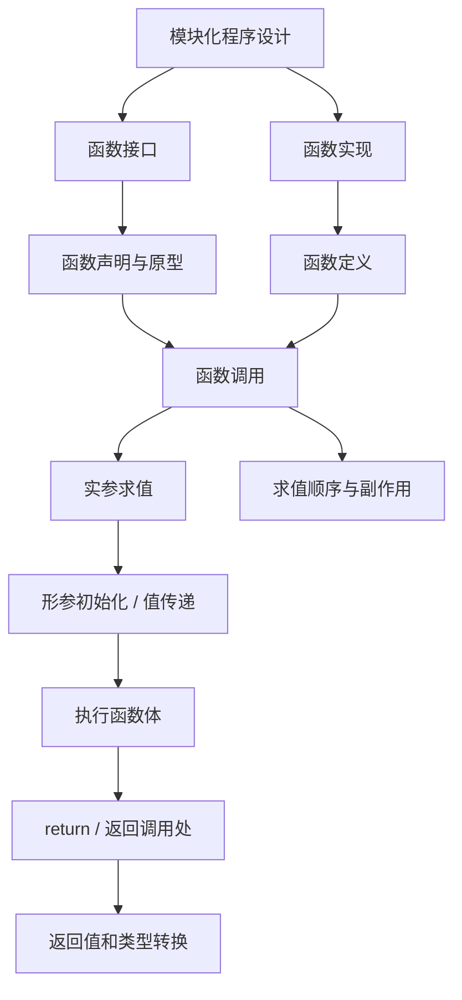
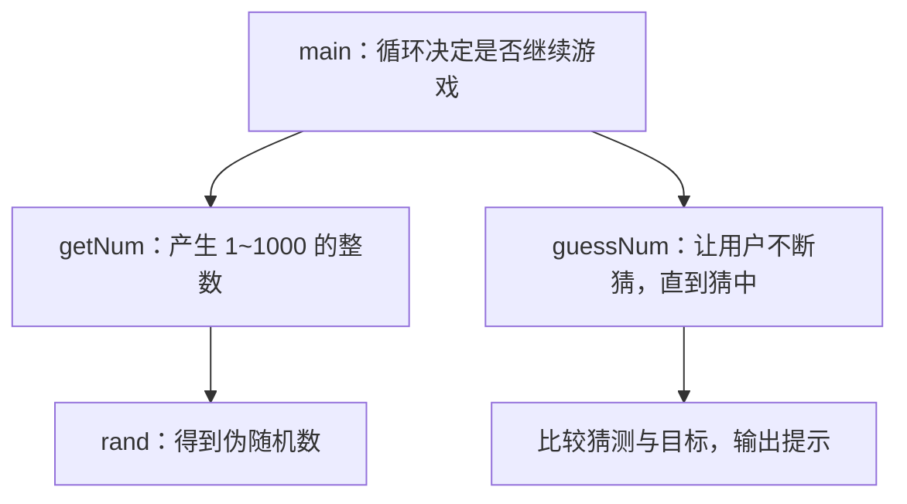
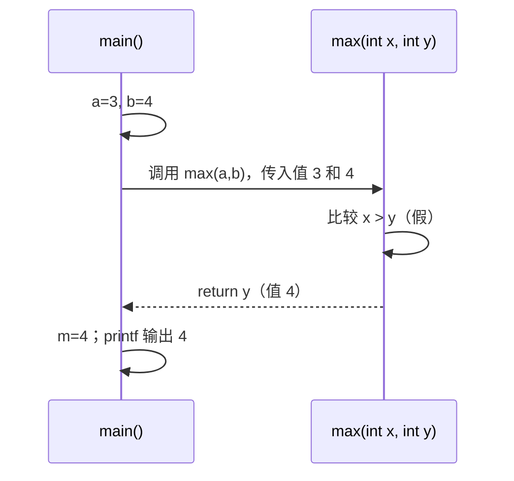

# 12 函数定义、声明与调用

> [!info] 笔记定位
> - **类型**：C 语言程序设计 · 课堂笔记（第 12 篇 / 17 篇）
> - **课程范围**：吴俊军老师《第 5 章 函数》，§5.1–5.2，课件第 4–25 页
> - **复习优先级**：极高（根据笔记规划评估，非教师公布的分值）
> - **主要标准语境**：以 C99/C11/C17 为主要讲解背景；涉及 C23 差异时单独指出；课程考试具体标准版本**待核实**
> - **前置笔记**：[[05 运算符与表达式]]、[[07 类型转换与混合运算]]、[[09 语句、复合语句与选择结构]]、[[10 循环结构与转移语句]]、[[11 结构化程序设计与典型算法]]
> - **后续笔记**：[[13 作用域、存储期与变量存储类型]]、[[14 递归函数]]、[[15 编译预处理与多文件程序]]

## 一、知识结构与学习目标

本篇要回答四个问题：**函数是什么、如何声明和定义、调用时究竟发生了什么、怎样让函数与调用者交换数据**。



**学习目标**：能够写出函数定义和函数原型、辨认形参与实参、判断参数传递是否改变调用者变量、分析嵌套调用和返回值、识别函数调用中的未定义行为，并能将课程算法拆分为可复用的函数。

---

## 二、§5.1 模块化程序设计

### 2.1 什么是模块化程序设计

课件第 4 页：将较大的程序按照功能划分为若干相对独立的模块，通过模块之间必要的数据联系协作完成任务；使用**自顶向下、逐步细化**的方法组织程序。

C 语言主要依靠**函数机制**实现功能模块。模块之间可能通过以下途径交换信息：

1. **参数**：调用者向被调用函数提供输入。
2. **返回值**：被调用函数向调用者交回计算结果。
3. **作用域可见的对象**：例如文件作用域变量；这是另一种共享数据的方式，其适用范围与风险在第 13 篇详细讲解。

> [!important] 核心考点
> **定义功能、设计接口、编写实现、组合调用**是模块化设计的基本过程。函数提高代码复用性、可读性、可维护性、可扩展性，也便于分别测试。

### 2.2 从完整程序提取函数：课件例 5.1（水仙花数）

水仙花数指满足下式的三位整数：

$$n=100a+10b+c,\qquad n=a^3+b^3+c^3.$$

**课程版本：未封装前（课件第 5 页）**

```c
#include <stdio.h>

int main(void)
{
    int x, i, j, k;
    for (x = 100; x <= 999; x = x + 1) {
        i = x / 100;
        j = (x - i * 100) / 10;
        k = x % 10;
        if (x == i*i*i + j*j*j + k*k*k)
            printf("%5d", x);
    }
    return 0;
}
```

**课程版本：提取函数后（课件第 6 页）**

```c
#include <stdio.h>

int isNarcissus(int x);  /* 函数原型 */

int main(void)
{
    int x;
    for (x = 100; x <= 999; x = x + 1) {
        if (isNarcissus(x))
            printf("%5d", x);
    }
    return 0;
}

int isNarcissus(int x)
{
    int i, j, k;
    i = x / 100;
    j = (x - i * 100) / 10;
    k = x % 10;
    return (x == i*i*i + j*j*j + k*k*k) ? 1 : 0;
}
```

**输出（`%5d` 按最小域宽 5 输出，以下空格用 `·` 表示）：**

```text
··153··370··371··407
```

> [!tip] 课堂分析
> - `main` 负责**遍历**，`isNarcissus` 负责**判定**：各司其职。
> - `isNarcissus` 的返回类型是 `int`，以 `1` 代表真、`0` 代表假。
> - `isNarcissus(x)` 用作 `if` 条件表达式；`if` 判断的是返回值是否为零。
> - 函数头的 `int x` 与调用处的 `int x` **不是同一个对象**，尽管名字相同。

> [!note] 范围限定
> 课程算法假定输入是三位整数，因此其函数接口并不负责检查任意整数是否在 `[100,999]` 内；若要写成通用判定函数，应增加范围检查。这属于改进而不是更改课程原题。

### 2.3 课件的幂和分解：计算 $1^1+2^2+\cdots+n^n$

第 7–9 页通过将“计算每一项 $i^i$”独立为 `term(i)`，说明函数对嵌套循环的简化作用。

**课程版本（整合第 9 页左右代码，补入必需的声明和头文件）：**

```c
#include <stdio.h>

long term(int i);

int main(void)
{
    int i, n;
    long s = 0;
    printf("input n:");
    scanf("%d", &n);
    for (i = 1; i <= n; ++i)
        s += term(i);
    printf("s=%ld\n", s);
    return 0;
}

long term(int i)
{
    long term = 1;
    int j = 1;
    do term *= i;
    while (++j <= i);
    return term;
}
```

当输入为 `4` 时，依次计算：`1、4、27、256`，因此输出 `s=288`。

| 调用 | 实参 `i` | `term(i)` | 累加后的 `s` |
|---|---:|---:|---:|
| `term(1)` | 1 | 1 | 1 |
| `term(2)` | 2 | 4 | 5 |
| `term(3)` | 3 | 27 | 32 |
| `term(4)` | 4 | 256 | 288 |

> [!warning] 课程代码的边界
> 1. `term(0)` 返回 `1`（循环执行一次，乘以零），并非通常定义的 $0^0$；`term(i)` 的实际设计前提是 `i >= 1`。
> 2. `term` 使用 `long` 累乘，较大 `i` 可能发生**有符号整数溢出（未定义行为）**。
> 3. 函数 `term` 与其局部变量 `term` 同名在 C 中可以成立：局部对象在函数体内遮蔽同名函数标识符，但这种命名不利于理解与递归调用。见 [[13 作用域、存储期与变量存储类型]]。
> 4. 课件第 9 页是结构示意图，左右两段需要组合，并确保调用前可见 `term` 的声明，才能成为可独立编译的完整程序。

### 2.4 课件例 5.2：猜数游戏的模块分解

课件第 10–13 页提出三层任务：



其中展示的函数接口：

```c
int getNum(void);
void guessNum(int x);
```

**课程版本（按课件第 12–13 页组合为完整程序，保留输入与随机数处理方式）：**

```c
#include <stdio.h>
#include <stdlib.h>
#include <time.h>

#define MAX_NUMBER 1000

int getNum(void);
void guessNum(int x);

int main(void)
{
    char command;
    printf("This is a guessing game\n\n");
    srand(time(NULL));
    do {
        guessNum(getNum());
        printf("Play again? (Y/N) ");
        scanf("%c", &command);
    } while (command == 'y' || command == 'Y');
    return 0;
}

int getNum(void)
{
    return rand() % MAX_NUMBER + 1;
}

void guessNum(int x)
{
    int guess;
    for (;;) {
        printf("guess it: ");
        scanf("%d%*c", &guess);
        if (guess == x) {
            printf("Right!\n");
            return;
        } else if (guess < x) {
            printf("Too low. Try again.\n");
        } else {
            printf("Too high. Try again.\n");
        }
    }
}
```

- `getNum(void)`：不接受实参、返回一个整型目标数。
- `guessNum(int x)`：接受目标数并负责交互，使用 `return;` 退出整个函数。
- `guessNum(getNum())`：内层调用的返回值成为外层调用的实参。
- `rand()`、`srand()` 在 `<stdlib.h>` 声明，`time()` 在 `<time.h>` 声明。

> [!warning] 教学简化与实际应用的区别
> - `rand()` 是**伪随机数**发生器，不适合生成密码学密钥、验证码等安全敏感随机数。课件第 10 页提到这些安全应用，是在介绍随机性的用途，并不意味着 `rand()` 可胜任密码学用途。
> - `rand() % 1000 + 1` 在 ISO C 保证的 `RAND_MAX >= 32767` 下能覆盖 1–1000，但一般仍可能产生**取模偏差**，不能保证每个数完全等概率出现。
> - `scanf("%d%*c", &guess)` 假设输入有效，并额外读取一个字符；遇到 EOF、非法整数或不符合预期的行格式时，原代码没有充分处理错误。
> - 课件第 13 页的 `srand(time(NULL))` 演示种子初始化；在严格接口上，`srand` 需要 `unsigned int`，`time` 返回 `time_t`，这里发生类型转换。
>
> **笔试重点**仍是模块职责、`void` 返回类型、函数嵌套调用和伪随机数种子机制；输入健壮性与安全随机数属于补充辨析。

### 2.5 C 程序的一般结构（课件第 15–17 页）

在常规的**宿主式 C 程序**中，程序通常有一个程序入口 `main`，其调用其他函数执行任务。较大的项目可以拆分为不同的 `.c` 源文件，各自编译为目标文件，再由链接器组合成可执行程序。

```text
main.c  ----编译----> main.o  --┐
util.c  ----编译----> util.o  --┼--链接--> 程序
                             库--┘
```

在一个正常的程序中不能重复定义多个 `main` 函数。课件第 16 页中各个文件出现 `main定义部分` 的结构是程序模块结构的示意，不能据此理解为同一程序应有多个 `main` 定义。

> [!note] 标准边界
> 对宿主式实现的标准程序，`main` 是规定的程序启动函数；嵌入式等**独立式（freestanding）实现**的程序入口由具体实现决定。编译与链接的具体文件组织还涉及工具链和操作系统，不等同于 ISO C 语法规则。多文件编程留待 [[15 编译预处理与多文件程序]]。

---

## 三、§5.2.1 函数的定义

### 3.1 定义的基本形式

课件第 18 页：

```c
返回类型 函数名(形参声明列表)
{
    /* 声明与语句构成函数体 */
}
```

例如：

```c
int max(int a, int b)
{
    if (a > b)
        return a;
    else
        return b;
}
```

| 部分 | 例子 | 作用 |
|---|---|---|
| 返回类型 | `int` | 说明调用表达式产生何种类型的结果 |
| 函数名 | `max` | 标识函数，须符合标识符规则 |
| 形参列表 | `int a, int b` | 指定两个形参各自的类型与名称 |
| 函数体 | `{ ... }` | 实现该函数的具体功能 |
| `return` | `return a;` | 结束本次执行并将表达式结果返回调用处 |

函数定义不仅给出接口，而且**提供函数体**；一个函数可以被多次声明，但在同一正常链接的程序中，同一个具有外部链接的函数不能被重复定义。

> [!important] 各个形参要分别说明类型
> `int max(int a, int b)` 正确；`int max(int a, b)` **错误**。C 语言形参列表不能像 `int a, b;` 变量声明那样省略后一个参数的类型。

### 3.2 无参数函数和无返回值函数

```c
int get_answer(void)
{
    return 42;
}

void print_ok(void)
{
    puts("OK");
    return;                 /* 也可省略最后这条 return */
}
```

- `get_answer(void)`：不接受实参，返回一个 `int`。
- `print_ok(void)`：不接受实参，返回类型 `void`，调用它不产生可用的返回值。
- `return;` 用于返回类型为 `void` 的函数；`return 表达式;` 用于有返回值的普通函数。

> [!note] 关于 `()` 与 `(void)` 的版本差异
> **C17 及更早版本：**在函数的**非定义声明**里，`int f();` 不构成提供参数类型信息的函数原型，不能表达“明确无参数”；`int f(void);` 才明确无参数。在带有函数体的定义 `int f() { ... }` 中，空括号表示无形参，但其历史语法与原型不同。**C23 起**，`()` 在函数声明中也表示无参数。为兼顾课堂和旧编译器，建议始终使用 `f(void)` 表示无参数。

### 3.3 函数名、形参名及局部对象的作用域

```c
int square(int x)
{
    int result = x * x;
    return result;
}
```

- 在定义中，`x` 是 `square` 的形参，在函数调用时获得相应实参的值。
- `result` 是函数体内的局部对象；其作用域与存储期问题留待下一篇。
- 调用 `square(5)` 后，并不意味着调用者中出现名为 `x` 或 `result` 的变量。
- 同名局部变量与函数形参、外部对象之间的关系，不能仅凭名字判断是否共享内存。

---

## 四、§5.2.2 函数声明与函数原型

### 4.1 声明与定义的区别

```c
int max(int, int);             /* 声明：函数原型 */

int max(int a, int b)          /* 定义：有函数体 */
{
    return a > b ? a : b;
}
```

> [!important] 声明不一定是定义
> - **声明**：使编译器知道标识符及其类型信息。
> - **定义**：为函数提供函数体，使其具有可执行的实现。
> - 含有参数类型信息的**函数原型**是函数声明的一种形式。
> - 一个函数的定义本身也可以在其后续的代码中充当可见的声明。

课件第 20 页强调函数要“**先声明，后使用**”，实际写法有两种：**先定义后调用**，或者**先声明、后定义**。

**方式 A：定义在调用之前**

```c
int twice(int x) { return 2 * x; }
int main(void) { return twice(3) == 6 ? 0 : 1; }
```

**方式 B：先写函数原型**

```c
int twice(int);                    /* 原型 */
int main(void) { return twice(3) == 6 ? 0 : 1; }
int twice(int x) { return 2 * x; } /* 定义 */
```

两种写法都有效。多人协作和多文件项目中更常使用函数原型（通常放在头文件里）。

### 4.2 原型的参数名称可以省略

```c
long term(int i);
long term(int);                  /* 与上面的函数类型相容 */

int max(int a, int b);
int max(int, int);               /* 两种声明都表示两个 int 参数 */
```

原型中的参数名可作为文档信息保留，不参与函数类型是否相容的判断；但**定义中的形参名**需要被函数体使用，因此通常必须命名。

> [!note] 术语辨析
> 课件第 21 页把“函数原型中给出的参数”也称作形参。对笔试而言可遵循这一课堂用语；严格来说，仅含原型的声明可以没有形参名称，也不会在运行时据此创建可供函数体使用的对象。**形参对象属于函数的具体调用过程**。

### 4.3 原型到底检查什么

以 `double average(int a, int b);` 为例，编译器已知：

- **名称**：`average`。
- **返回类型**：`double`。
- **形参个数**：2。
- **形参类型和顺序**：先 `int`，后 `int`。

调用 `average(2, 3)` 时，实参根据原型要求进行相应转换。没有符合条件的原型、声明与定义冲突，可能导致诊断或未定义行为；不要假定调用时会由编译器自动“找对”函数定义。

**兼容声明示例：**

```c
int sum(int, int);
int sum(int a, int b) { return a + b; }  /* 正确 */
```

**冲突示例：**

```c
int sum(int, int);
double sum(int a, int b) { return a + b; } /* 返回类型冲突 */
```

C 语言**不支持仅根据参数类型或参数个数对函数名进行重载**，这与 C++ 不同。

---

## 五、§5.2.3 函数调用

### 5.1 函数调用的形式

课件第 22 页：

```c
函数名(实参表达式列表)
```

函数调用属于表达式，可以出现在多种上下文中：

```c
putchar('A');            /* 独立的表达式语句 */
s += term(i);           /* 用作加法操作数 */
s += term(term(2));     /* 嵌套调用，先求得内层结果 */
```

其中 `term(term(2))` 在前文课程函数中是 `term(4)`，得到 `256`。但 `term(term(3))` 将产生 `term(27)`，在常见实现上会造成 `long` 溢出，不能不加条件地套用该嵌套形式。

> [!warning] 实参不必与形参拼写完全相同
> `max(3, 4)`、`max(a, b)` 和 `max(a + 1, 2 * b)` 都是合法的调用形式（前提是表达式的类型满足调用约束）。在有原型时，**可转换为形参类型**通常比“字面类型完全一致”更准确。

### 5.2 课件第 23 页：`max` 的调用流程

```c
#include <stdio.h>

int max(int, int);

int main(void)
{
    int m, a = 3, b = 4;
    m = max(a, b);
    printf("%d", m);
    return 0;
}

int max(int x, int y)
{
    if (x > y)
        return x;
    else
        return y;
}
```

| 阶段 | `main` 的 `a` | `main` 的 `b` | `max` 的 `x` | `max` 的 `y` | `main` 的 `m` |
|---|---:|---:|---:|---:|---:|
| 进入调用前 | 3 | 4 | — | — | 未初始化 |
| 实参求值并传参 | 3 | 4 | 3 | 4 | 未初始化 |
| `x > y` 为假 | 3 | 4 | 3 | 4 | 未初始化 |
| `return y` | 3 | 4 | 调用即将结束 | 调用即将结束 | 待赋值 |
| 返回并赋值 | 3 | 4 | — | — | **4** |

**输出：**`4`。



> [!tip] 程序阅读题分析步骤
> 1. 找到原型：确定返回类型、参数类型与个数。
> 2. 标出调用时各实参表达式的值。
> 3. 将这些值分别赋给被调用函数的形参，**不要将两组变量合并**。
> 4. 进入函数体，沿分支、循环追踪执行。
> 5. 遇到 `return` 后，回到调用表达式继续计算。

### 5.3 `return` 与返回类型

课件第 19 页：

```c
return 表达式;     /* 返回一个值 */
return;            /* 没有返回值，立即结束本次调用 */
```

**`return` 的作用：**

1. 结束当前函数调用。
2. 有表达式时，计算并将结果按返回类型转换（前提是转换合法）。
3. 将控制流返回调用处；调用表达式取得相应的结果。
4. 返回表达式周围是否加括号通常不影响其含义：`return x;` 与 `return (x);` 等价。

```c
double half(int x)
{
    return x / 2;   /* 先做整数除法，后转换成 double */
}
```

调用 `half(5)` 得到 `2.0`，不是 `2.5`。**返回类型不能改变 `return` 表达式内部已经执行的运算规则**。如果需要实数除法，应写：

```c
double half(int x)
{
    return x / 2.0;
}
```

### 5.4 非 `void` 函数没有正确返回值

**课件第 7 章开头延续的提醒**：非 `void` 函数若控制流到达函数体末尾，且调用者使用这次调用的返回值，则发生**未定义行为**（`main` 具有特殊规则）。

```c
int positive(int n)
{
    if (n > 0)
        return 1;
    /* n <= 0 时没有 return */
}
```

**改进版：**

```c
int positive(int n)
{
    return n > 0;
}
```

> [!note] 课程中常见的不严谨表述
> 不能简单说“所有非 `void` 函数执行到末尾都必然是未定义行为”。准确表述是：**当控制流到达非 `void` 函数末尾，而其本次调用的返回值被调用者使用时，行为未定义**。但教学和代码审查中应坚持所有可能路径都明确返回值。

---

## 六、函数参数：形参、实参与值传递

### 6.1 形参与实参

课件第 25 页：**C 的函数参数采用值传递（pass by value）**。调用时对每个实参求值，并以相应的值初始化形参。

```c
void change(int x)    /* x：形参 */
{
    x = 100;
}

int main(void)
{
    int n = 4;        /* n：调用者对象 */
    change(n);        /* n：实参表达式 */
    printf("%d\n", n);
    return 0;
}
```

调用后 `n` 仍为 `4`。形参 `x` 是独立对象，函数体修改 `x` 不会直接修改调用者的 `n`。

**内存关系示意（概念模型，不对应特定 ABI 栈布局）：**

```text
调用者对象 n = 4       被调用函数形参 x = 4
   ┌──────────┐   值传递   ┌──────────┐
   │    4     │ ────────> │    4     │
   └──────────┘           └──────────┘
   （独立对象）            （独立对象）
                                |
                              x=100
                                |
                         只修改形参 x
```

> [!important] C 不存在 C++ 式引用形参
> **传地址也是传值**：调用 `f(&n)` 时，实参是地址值，该地址值被复制到指针形参；通过指针间接访问，仍然可能修改 `n`。不要将“可以修改实参所指向的对象”误认为“参数本身按引用传递”。见 [[20 指针与函数]]。

### 6.2 课件第 25 页：阶乘函数中的形参变化

```c
#include <stdio.h>

long fac(int n)
{
    long f = 1;
    for (; n > 0; --n)
        f *= n;
    printf("%d\n", n);
    return f;
}

int main(void)
{
    int n = 4;
    printf("%d\n", n);
    printf("%ld\n", fac(n));
    printf("%d\n", n);
    return 0;
}
```

**输出：**

```text
4
0
24
4
```

| 时机 | `main` 的 `n` | `fac` 的 `n` | `fac` 的 `f` |
|---|---:|---:|---:|
| 调用前 | 4 | — | — |
| 刚进入 `fac` | 4 | 4 | 1 |
| 循环结束 | 4 | 0 | 24 |
| 返回后 | 4 | — | — |

> [!warning] 参数副本不是万能保护
> 普通整型形参的赋值不会直接改变调用者整数对象；如果传的是指针（包括数组参数转换得到的指针），通过指针访问的对象可能被修改。还应注意这里 `fac` 对负数返回 `1`，对较大的正数可能发生 `long` 溢出。该例着重演示值传递，并非完整的阶乘接口设计。

### 6.3 参数传递、返回值、共享对象的区别

| 数据联系 | 方向 | 典型写法 | 特点 |
|---|---|---|---|
| 实参 → 形参 | 调用者到被调用者 | `max(a,b)` | 传递表达式值；形参独立 |
| `return` | 被调用者到调用者 | `m = max(a,b);` | 一次返回一个表达式值 |
| 传地址的值 | 指针传入，再间接操作 | `scanf("%d", &n)` | 仍是值传递，但可修改指向的对象 |
| 可见的共享对象 | 多处直接访问 | 文件作用域对象 | 有耦合及状态管理问题 |

---

## 七、函数实参的求值顺序与未定义行为

### 7.1 未指定的求值顺序

对于普通函数调用 `f(a(), b())`：**C 通常不规定先求值哪个实参**，但两个实参的求值都须在进入 `f` 函数体前完成。

```c
int f(int x, int y) { return x - y; }
/* f(g(), h())：无法单凭语法保证先调用 g 还是 h */
```

**运算符优先级与实参求值顺序不是一回事。** 如 `f(a + 1, b * 2)`，加法和乘法怎样分组是语法问题，哪个实参表达式先求值则是顺序问题。参考 [[05 运算符与表达式]]。

### 7.2 课件第 24 页：三个 `x++` 的严格辨析

**课程原例：**

```c
char x = 'A';
printf("%c %c %c\n", x++, x++, x++);
```

课件展示了“从左到右可能得到 `A B C`，从右到左可能得到 `C B A`”的分析方式。

> [!danger] 必须区分：未指定顺序 ≠ 未定义行为
> 在同一完整表达式中，多个实参对同一个标量对象 `x` 执行 `x++`，这些修改彼此**无先后顺序保证（unsequenced）**，违反语言规则，属于**未定义行为（UB）**。因此，不能把 `A B C` 和 `C B A` 当成该 C 程序的全部合法输出，也不能依据某次编译器运行结果来证明其中一种顺序是“标准规定”的。

**改进版本：拆分副作用**

```c
char x = 'A';
char a = x++;
char b = x++;
char c = x++;
printf("%c %c %c\n", a, b, c);  /* A B C，假定执行字符集顺序含 A B C */
```

> [!note] 层次区分
> - `f(g(),h())`：`g` 和 `h` 谁先求值，通常**未指定**；若两者不产生相互冲突的副作用，可以正常使用。
> - `printf("%d %d", i++, i++)`：同一个 `i` 在未排序的实参之间被修改两次，属于**未定义行为**。
> - `f(i++, j++)`：若 `i`、`j` 是不同对象且无其他冲突访问，这两次修改本身不会因为顺序未指定而导致 UB。

### 7.3 原型对实参类型转换的影响

```c
double average(double a, double b);

double x = average(1, 3);   /* 有原型：int 实参转换为 double */
```

这与 [[07 类型转换与混合运算]] 中介绍的函数调用转换相联系：

- 在有原型的调用中，实参按相应形参类型转换（满足约束时）。
- 对无原型的旧式调用或 `...` 可变参数部分，存在**默认实参提升**：例如 `float` 提升为 `double`，小整数类型进行整数提升。
- 默认实参提升**不是**“任何参数都会自动变成 `int`”或“函数会无限制地自动纠错”。

> [!warning] 不要混淆 `printf` 格式串与函数原型
> `printf` 有可变参数：格式串之后的参数无法仅由普通原型逐项进行类型检查，必须遵循格式说明符要求；传错类型可能产生未定义行为。相关规则见 [[08 字符输入输出与格式化输入输出]]。

---

## 八、课件例 5.3：判断素数的函数

### 8.1 课程版本（课件第 19 页）

```c
int is_prime(int n)
{
    int k, limit;
    if (n == 2) return 1;
    if (!(n % 2)) return 0;
    limit = n / 2;
    for (k = 3; k <= limit; k += 2)
        if (!(n % k)) return 0;
    return 1;
}
```

该函数使用多个 `return` 提前结束判断，反映了条件分支与循环的结合。

| 输入 | 课程版本结果 | 实际素数性 | 说明 |
|---:|---:|---|---|
| `2` | 1 | 是 | 特判 2 |
| `9` | 0 | 否 | 可被 3 整除 |
| `17` | 1 | 是 | 不存在所检查的因子 |
| `1` | **1** | **否** | **错误：遗漏 n < 2** |
| `-3` | **1** | **否** | **错误：遗漏 n < 2** |
| `0` | 0 | 否 | 偶数分支返回 0 |

> [!warning] 课程代码存在边界错误
> 当 `n < 2` 时，部分值被错误判定为素数。该问题与多个 `return` 本身无关，而是缺少输入范围判断。也不能把“多个 return”直接等同于“违反结构化程序设计”；其是否符合具体课堂讲授的结构化规则，需要结合老师的要求理解。课件提出了此思考题，但没有给出统一答案。

### 8.2 改进版本（C99 及以上）

```c
int is_prime(int n)
{
    if (n < 2)
        return 0;
    if (n == 2)
        return 1;
    if (n % 2 == 0)
        return 0;

    for (int k = 3; k <= n / k; k += 2) {
        if (n % k == 0)
            return 0;
    }
    return 1;
}
```

**改进理由：**

1. `n < 2` 立即返回 0，修正边界错误。
2. 只需检查不超过 $\sqrt n$ 的可能因子。
3. 用 `k <= n / k` 表示检查范围，避免直接计算 `k * k` 可能引起的整型溢出。
4. 先排除偶数，之后只枚举奇数候选。

这是一个值得用于**代码改错、函数接口设计和边界判断**的综合题。

---

## 九、易错概念对照表

| 常见错误说法 | 正确理解 |
|---|---|
| 函数声明就是函数定义 | 函数声明可以没有函数体；定义提供函数体 |
| 原型里每个参数必须有名称 | 只需写出类型，名字可以省略 |
| `int f();` 在任何 C 版本都明确表示无参数 | C17 及以前的普通声明中不是；推荐 `int f(void);` |
| `int max(int a,b)` 是合法的两个整型形参定义 | 必须分别写类型：`int max(int a,int b)` |
| 函数调用时实参必须与形参名称一样 | 实参是表达式，与形参名称无关 |
| 实参类型必须在拼写上完全相同 | 有可见原型时可以按形参类型进行合法的转换 |
| 改写整型形参会改变调用者同名变量 | 整型形参独立，C 为值传递 |
| 传指针就是 C++ 式引用传递 | 指针值仍被复制，但通过指针可能修改所指对象 |
| `return` 的类型决定表达式内部如何运算 | 先计算表达式，再按返回类型进行转换 |
| `return (x);` 和 `return x;` 必定不同 | 对简单变量表达式没有差别 |
| 非 `void` 函数任何路径缺少 `return` 都立即 UB | 当控制流到达末尾且调用者使用返回值时 UB；应避免遗漏 |
| 函数实参从右向左求值 | C 不普遍规定实参的求值顺序 |
| 多次 `x++` 只是输出顺序不确定 | 同次调用中未排序地修改同一个 `x` 可导致 UB |
| `rand` 可直接产生安全随机数 | `rand` 不适用于密码学用途 |
| C 支持 `int f(int)`、`int f(double)` 同名重载 | C 不支持这种函数重载 |

---

## 十、笔试解题方法与考点总结

> [!important] 必背要点
> 1. **函数三件事**：定义、函数原型、函数调用。
> 2. **函数头**：返回类型、函数名、形参列表；各参数独立声明类型。
> 3. **原型的作用**：告知编译器调用接口、检查参数数量与类型、进行必要转换。
> 4. **形参与实参**：前者在被调用函数，后者是调用处的表达式。
> 5. **值传递**：调用者对象与被调用者普通形参通常互不影响。
> 6. **调用过程**：计算实参→形参取得值→执行函数体→返回调用处。
> 7. **返回值**：`return` 结束函数；返回表达式遵循先求值、再转换的规则。
> 8. **求值顺序**：函数实参未指定先后；多次无序修改同一标量可导致 UB。

**三类最可能出现的书面题型**（此处是根据知识特点的复习建议，并非教师考试范围承诺）：

- **概念/改错**：函数定义、原型声明、`void`、返回类型、参数声明缺失、同名函数冲突。
- **程序阅读**：调用栈层次、嵌套调用、形参变量变化、返回值赋值、函数内 `return` 导致的提前退出。
- **综合编程**：设计 `max`、`is_prime`、水仙花数、幂和的函数接口；比较模块化前后的程序结构。

> [!tip] 处理复杂函数题的通用模板
> 先给每次函数调用建立单独的一组形参状态，再逐步追踪执行，最后把返回值带回原调用表达式；**不要**因为变量同名就混合状态。对 `++`、赋值、I/O 等带副作用的实参，必须先检查是否出现未排序的相互冲突操作。

---

## 十一、书面自测题（24 题）

### A. 基础概念与判断（1–8）

1. 判断：`int add(int,int);` 是完整的函数定义。
2. 判断：在函数原型中，形参名称可以省略。
3. 判断：函数定义 `int f(int a,b)` 是合法的。
4. 判断：C 语言所有参数的传递方式都是值传递。
5. 判断：C11 下 `int f();` 与 `int f(void);` 作为不带函数体的声明完全等价。
6. 填空：函数接口的三个核心信息是函数名、________、________。
7. 判断：`void print(void)` 可以使用 `return;` 直接结束执行。
8. 判断：`int add(int,int);` 和 `double add(int,int);` 可作为两个重载函数并存于同一 C 程序。

> [!success]- A 组答案与解析
> 1. **错**：它只是函数原型声明，没有函数体。  
> 2. **对**：例如 `int max(int,int);`。  
> 3. **错**：第二个形参必须写 `int b`。  
> 4. **对**：包括传递指针值的情况。  
> 5. **错**：C11 中前者不提供参数类型信息，后者明确无参数。  
> 6. **返回类型、形参类型列表**。  
> 7. **对**：`return;` 可以提前离开 `void` 函数。  
> 8. **错**：C 不支持这种同名重载，且两个声明类型不相容。

### B. 程序阅读与输出（9–16）

9. 判断下面代码输出什么：

    ```c
    int f(int x) { x += 5; return x; }
    int main(void) {
        int x = 3;
        f(x);
        printf("%d\n", x);
        return 0;
    }
    ```

    （假定已包含 `<stdio.h>`。）

10. 下面调用 `max(3,4)` 后的值是多少？

    ```c
    int max(int a, int b) { return a > b ? a : b; }
    ```

11. 根据课程的 `term` 函数，求 `term(term(2))` 的值。
12. 已知 `double half(int n) { return n / 2; }`，`half(5)` 的返回值是什么？
13. 根据课件 `fac(4)` 的版本，函数返回后 `main` 中原变量 `n=4` 会变成几？
14. 写出运行结果（假定已包含 `<stdio.h>`）：

    ```c
    int f(int a) { return a * 2; }
    int g(int b) { return f(b + 1); }
    int main(void) { printf("%d\n", g(3)); return 0; }
    ```

15. 下面是否能保证按 `A B` 的顺序输出？为什么？

    ```c
    int a(void) { puts("A"); return 1; }
    int b(void) { puts("B"); return 2; }
    int f(int x, int y) { return x + y; }
    int main(void) { return f(a(), b()) != 3; }
    ```

16. 下面能否把结果限定为 `0 1` 或 `1 0` 两种输出？为什么？

    ```c
    int i = 0;
    printf("%d %d\n", i++, i++);
    ```

> [!success]- B 组答案与解析
> 9. **3**。`f` 修改的是形参 `x`，调用者的 `x` 不变。  
> 10. **4**。  
> 11. **256**。`term(2)=4`，`term(4)=256`。  
> 12. **2.0**。先计算 `int` 除法 `5/2=2`，再转换为 `double`。  
> 13. **4**。变化的是 `fac` 中的形参。  
> 14. **8**。`g(3) → f(4) → 8`。  
> 15. **不能保证**。`a()` 与 `b()` 的求值先后通常未指定；它们不因这种顺序问题而直接构成 UB。  
> 16. **不能**。对同一个 `i` 在未排序的实参求值中修改两次，属于 UB，不能枚举合法输出。

### C. 综合辨析与代码改错（17–24）

17. 写出一个函数原型：函数名 `area`，接受两个 `double` 参数，返回 `double`。
18. 写出一个函数 `square`：接受一个 `int` 参数，返回其平方（仅考虑不溢出的输入）。
19. 修正以下代码，使任意 `int n` 都能正确判断 `n` 是否为素数：

    ```c
    int is_prime(int n) {
        if (n == 2) return 1;
        if (!(n % 2)) return 0;
        for (int k = 3; k <= n/2; k += 2)
            if (n % k == 0) return 0;
        return 1;
    }
    ```

20. 指出错误：`void f(void) { return 10; }`。
21. 判断是否有问题：

    ```c
    int f(int x) { if (x > 0) return x; }
    int main(void) { int y = f(-1); return 0; }
    ```

22. 已知 `void inc(int *p) { ++*p; }`，调用 `inc(&x)` 可以改变 `x` 吗？这是否说明 C 存在按引用传参？
23. 已知 `double div2(int n) { return n / 2.0; }`，`div2(5)` 的返回值是什么？与题 12 比较。
24. 判断：调用 `f(i++, j++)`，只要 `i`、`j` 是两个独立的整型对象且两个自增都不会溢出，就必然因为实参顺序未指定而发生 UB。

> [!success]- C 组答案与解析
> 17. `double area(double, double);` 或 `double area(double a, double b);`。  
> 18. `int square(int x) { return x * x; }`，须满足结果可以由 `int` 表示。  
> 19. 首先增加 `if (n < 2) return 0;`；其余逻辑在正整数范围内仍然可用。更推荐改为 `k <= n/k`（参见第八节）。  
> 20. `void` 函数不能返回整型表达式值，应改 `return;` 或修改函数返回类型。  
> 21. 有问题。`f(-1)` 到达函数末尾而没有返回有效值，且初始化 `y` 使用了该返回值：UB。  
> 22. **可以改变**，但**仍是值传递**：传递的是 `&x` 的地址值，函数通过指针间接访问 `x`。须确保 `p` 是有效指针。  
> 23. **2.5**；题 12 是 **2.0**。  
> 24. **错**。对两个不冲突对象的修改本身不会产生该类 UB；只是不保证两个实参谁先计算。

---

## 十二、实践与验证（可选）

> [!example] 标准及编译选项
> 本篇主要教学示例使用 **C11** 语法编写；可在 Arch Linux 上通过 GCC 或 Clang 编译。`-Wall -Wextra -Wpedantic` 用于辅助发现常见问题，不能保证识别全部未定义行为。

把某个完整代码示例保存为 `main.c`：

```bash
gcc -std=c11 -Wall -Wextra -Wpedantic -O0 -g main.c -o main
./main
```

检查可能发生的运行时错误：

```bash
clang -std=c11 -Wall -Wextra -Wpedantic -O1 -g \
  -fsanitize=address,undefined -fno-omit-frame-pointer \
  main.c -o main-san
./main-san
```

特别提醒：编译器警告和 Sanitizer 都不是 ISO C 语义的最终判据。对于含有未定义行为的代码，**不能**用“一次运行输出了什么”来验证某种输出是标准允许的。

---

## 十三、考前速记与资料索引

### 13.1 一页速记

```text
函数定义： 返回类型 函数名(形参声明) { 函数体 }
函数原型： 返回类型 函数名(形参类型列表);
函数调用： 函数名(实参表达式列表)

先声明、后调用；定义本身也可充当先前声明。
形参独立，实参按值传递；指针也是传值。
return 表达式：先求值，合法转换成返回类型，再返回。
return;：提前离开 void 函数。

函数实参求值先后一般未指定。
同一次调用多个未排序的 x++：未定义行为。
C17 及以前：int f();（非定义声明）不等于 int f(void);
```

### 13.2 笔记之间的衔接

- 函数调用中实参类型转换：[[07 类型转换与混合运算]]
- `return`、表达式求值与副作用：[[05 运算符与表达式]]
- `return` 与循环控制流程：[[10 循环结构与转移语句]]
- 局部变量、同名隐藏、变量存储期：[[13 作用域、存储期与变量存储类型]]
- 函数自己调用自己：[[14 递归函数]]
- 声明放头文件、函数定义放源文件：[[15 编译预处理与多文件程序]]
- 地址和指针形参：[[20 指针与函数]]

### 13.3 来源说明

**课程主线（优先）：**

- 吴俊军《第 5 章 函数》：第 4–9 页 §5.1 模块化编程、水仙花数与幂和；第 10–14 页猜数游戏和随机数；第 15–17 页 C 程序结构；第 18–25 页 §5.2 自定义函数、函数声明、调用、参数求值顺序和值传递。
- 吴俊军《第 7 章 数组》开头课件第 4 页：非 `void` 函数返回值路径的补充提醒（此部分跨章补充，不属于 §5.1–5.2 主线）。

**辅助参考（不等同于课程指定教材）：**

- 谭浩强《C 语言程序设计（第 4 版）》：仅作为补充教材，未将本篇未核实的具体页码作为引用依据。
- Stephen Prata《C Primer Plus（第 6 版）》：第 9 章 §9.1–9.2（函数、函数原型、形参和实参），§9.3–9.7 属于本篇后续拓展范畴。
- [cppreference：C 函数声明](https://en.cppreference.com/w/c/language/function_declaration)
- [cppreference：C 函数定义](https://en.cppreference.com/w/c/language/function_definition)
- [cppreference：C 表达式求值顺序](https://en.cppreference.com/w/c/language/eval_order)
- [cppreference：rand](https://en.cppreference.com/w/c/numeric/random/rand)

> [!note] 课程资料边界
> 课程第 1 章课件指定的教材是卢萍、李开等《C 语言程序设计》（清华大学出版社，2021），并非当前上传的谭浩强教材。考试具体采用哪一版 C 标准，以及是否要求统一的“结构化程序单入口/单出口”写法，仍以老师后续明确要求为准，当前标记为**待核实**。

### 13.4 下一篇

**[[13 作用域、存储期与变量存储类型]]**：在理解了形参与局部对象之后，继续区分块作用域、文件作用域、自动存储期、静态存储期，以及 `auto`、`register`、`static`、`extern` 在课程中的用法。
