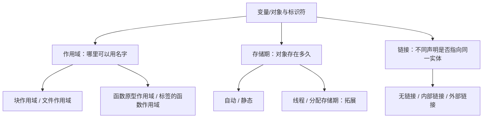

# 13 作用域、存储期与变量存储类型

> [!info] 课程定位与资料说明
> - **课程范围**：吴俊军《C语言程序设计》第 5 章，重点 §5.3（课件 PDF 第 26～38 页），兼顾 §5.1.3（第 15～17 页）和 §5.5（第 48 页）。
> - **主要依据**：教师课件的术语、顺序与例题；《C Primer Plus（第 6 版）》第 12 章用于核对作用域、链接和存储期。
> - **标准基准**：主要按 **ISO C11/C17** 解释；C23 差异另外说明。课程尚未明确指定考试使用的 C 标准版本。
> - **复习优先级**：极高（依据原笔记规划，不代表教师公布的考试权重）。
> - **相关笔记**：[[04 常量、变量与初始化]]、[[09 语句、复合语句与选择结构]]、[[12 函数定义、声明与调用]]、[[14 递归函数]]、[[15 编译预处理与多文件程序]]。

## 一、知识框架：从变量的“可见性”到对象的“生存期”

教师课件 §5.3 首先区分变量的**数据类型**和**存储类型**：数据类型规定数值表示和运算；存储类型涉及作用域、存储分配、生存期及初始化。此处保留课程的分类方式，但在严格 C 术语中，最好进一步分成三个彼此不同的维度。

| 概念 | 描述的对象 | 核心问题 | 示例 |
| --- | --- | --- | --- |
| **作用域**（scope） | 标识符 | 在源代码的哪些位置，名称 `x` 可以指向该对象？ | 内层块遮蔽外层同名变量 |
| **存储期**（storage duration） | 对象 | 对象在程序执行的哪些时间段存在？ | 自动局部对象随块执行而创建和结束；静态对象持续存在 |
| **链接属性**（linkage） | 标识符 | 位于不同作用域的同名声明，能否指向同一个对象或函数？ | 不同 `.c` 中使用 `extern` 共享一个变量 |

> [!important] 必须记牢
> **作用域属于源代码的空间问题，存储期属于运行时的时间问题，链接属性属于名称所指实体的一致性问题。**
>
> 三者并非同义词：`static` 局部变量**作用域很小，却能存活整个程序执行期**；文件作用域的 `static` 变量**存活整个程序执行期，但不能跨翻译单元链接**。



**思考顺序**：看见声明 → 确定声明的位置 → 确定是否有 `static`、`extern`、`register` → 分别判断**作用域、链接、存储期、初始化**。不应仅凭“局部/全局”四个字推断全部性质。

## 二、作用域（Scope）

### 2.1 块作用域

函数体和复合语句 `{}` 会形成块。块内声明的普通局部变量，其**标识符的作用域通常从声明符完成处开始，到所属块结束**。函数形参通常也具有块作用域；C99 起 `for` 初始化部分声明的变量的作用域限于相应循环结构。

```c
#include <stdio.h>

int main(void)
{
    int x = 10;
    {
        int y = 20;
        printf("%d %d\n", x, y); // 10 20
    }
    // printf("%d", y);          // 错误：y 已经超出作用域
    printf("%d\n", x);          // 10
    return 0;
}
```

### 2.2 同名变量的遮蔽（shadowing）

内层块可以重新声明与外层同名的标识符。进入新声明的作用域后，**同名的外层标识符暂时被遮蔽，而非外层对象被销毁**。离开内层块之后，原有名称重新可见，外层对象保留此前的值。

> [!example] 课程例 5.5：多重嵌套代码块（课件 PDF 第 30 页）
> 以下保留课件的变量设置和执行逻辑。

```c
#include <stdio.h>

int main(void)
{
    int a = 2, b = 4;
    printf("a=%d,b=%d\n", a, b);
    {
        int a;               // 遮蔽外层 a，但没有遮蔽 b
        a = 3;
        b = 5;               // 修改的是外层 b
        printf("a=%d,b=%d\n", a, b);
    }
    printf("a=%d,b=%d\n", a, b);
    return 0;
}
```

**标准 C11/C17 的确定输出：**

```text
a=2,b=4
a=3,b=5
a=2,b=5
```

| 阶段 | 可见的 `a` | 外层 `a` | 外层 `b` | 内层 `a` |
| --- | --- | ---: | ---: | ---: |
| 进入 `main` 后 | 外层 | 2 | 4 | 尚不存在 |
| 执行内层 `int a;` 后 | 内层 | 2（被遮蔽） | 4 | 未初始化 |
| 完成内层赋值后 | 内层 | 2（被遮蔽） | 5 | 3 |
| 退出内层块后 | 外层 | 2 | 5 | 生存期结束 |

> [!warning] 考试陷阱
> 作用域结束，不等于“被遮蔽的外层对象刚刚恢复内存”。外层 `a` 在内层块执行期间也一直存在；变化的只是同名标识符的查找结果。

### 2.3 文件作用域

写在所有函数之外的普通对象声明，其标识符具有**文件作用域**，通常从该声明处到所在翻译单元末尾。在这种意义上，课程把它叫做全局变量。

```c
int before = 1;  // 下方函数可以按名称使用

int get_before(void) { return before; }

int after = 2;   // 此处以后才可直接按名称使用 after
```

**翻译单元（translation unit）**不完全等于磁盘上的单个 `.c` 文件：预处理执行 `#include` 后，源文件连同包含的头文件构成一个翻译单元。文件作用域并不会由于存在其他 `.c` 就自动扩展过去；跨翻译单元访问需要合适的**外部链接**和声明。

### 2.4 补充：函数原型作用域与函数作用域

这两类在《C Primer Plus》第 12 章中有明确区分，课程 §5.3 仅作了概括，作为辨析知识了解即可。

- **函数原型作用域**：函数原型中出现的形参名称，例如 `int f(int count);` 中 `count`，仅用于该原型（其名称通常可省略）。
- **函数作用域**：专指 `goto` 所用的**标签名称**，从标签出现至所属函数的整个范围均可使用，并非指“函数内所有变量”。

```c
int add(int left, int right); // left、right 是原型中的形参名称
// int f(void) { goto done; done: return 0; } // done 为标签
```

## 三、存储期（Storage Duration）

### 3.1 自动存储期

一般的非 `static` 块作用域变量、非 `static` 函数形参，具有**自动存储期**：相关块的执行建立其对象，离开块时对象的生存期终止。每次独立调用函数，都有各自的自动对象实例；递归调用尤其如此。

```c
void f(void)
{
    int count = 0;  // 每次进入函数，此对象重新获得初始值 0
    ++count;
}
```

严格规则还包含可变长度数组（VLA）等例外：VLA 的自动存储期从声明执行时开始，直到离开相关作用域。因此，“进入块即为全部变量分配内存”是方便教学的近似说法。

### 3.2 静态存储期

具有静态存储期的对象在程序**整个执行期间存在**，其值不会因某个函数返回而自动丢失。包括：

- 文件作用域的变量，不论有没有写 `static`；
- 块作用域中显式声明的 `static` 变量。

静态存储期**不等于只读、不能修改，更不等于一定有外部链接**。

### 3.3 其他存储期（了解即可）

- **线程存储期**：C11 提供 `_Thread_local`，每个线程各有对象实例；C23 也有 `thread_local` 写法。该内容未在课程 §5.3 中展开。
- **分配存储期**：经 `malloc` / `calloc` 等动态分配形成的对象，直到 `free` 或相关重新分配操作使其生存期结束。动态对象通常通过指针访问，不能简单归为 `auto` 或 `static` 变量。

```c
#include <stdlib.h>

void demo(void)
{
    int *p = malloc(sizeof *p); // 指针 p 本身：自动存储期
    if (p != NULL) {
        *p = 42;                // *p 指向的对象：分配存储期
        free(p);                // 被分配对象的生存期结束
    }
}                             // 指针 p 的生存期结束
```

> [!note] “栈、堆、静态数据区”与语言标准的关系
> 课件第 28 页的常量区、代码区、静态数据区、动态数据区（栈）和堆区，是**典型实现的内存布局模型**，不是 ISO C 对对象必须放在何种物理存储区域的规定。
>
> 在 Linux ELF 程序中，初值非零的静态对象常见于 `.data`，零初始化对象常见于 `.bss`；但实际布局由编译器、链接器和运行时决定，甚至可能被优化。不要用“局部变量一定在栈上”“`register` 一定在寄存器”代替标准规则。

## 四、链接属性（Linkage）

| 链接属性 | 含义 | 典型例子 |
| --- | --- | --- |
| **无链接（none）** | 每个声明所指实体不通过链接跨作用域共享 | 普通局部变量、形参、块作用域 `static` 变量 |
| **内部链接（internal）** | 同一翻译单元内相关声明可以指向同一实体 | 文件作用域 `static int seed;`、`static` 函数 |
| **外部链接（external）** | 不同翻译单元的相关声明可以指向同一实体 | 普通文件作用域 `int count;`、普通函数 |

注意：**外部链接并不是整个程序中任意源文件都能不经声明就直接使用这个名称。** 另一翻译单元仍需先见到对应声明，且链接阶段必须能找到相应定义。

## 五、四种存储类别说明符：对照总表

课程以 `auto`、`extern`、`static`、`register` 为四种存储类型；严格而言，其行为还取决于**声明的位置**。

| 声明形式 | 标识符作用域 | 链接 | 对象存储期 | 未显式初始化 |
| --- | --- | --- | --- | --- |
| 块中 `int x;` / `auto int x;` | 块 | 无 | 自动 | 不确定的值，不可当作 0 |
| 块中 `register int x;` | 块 | 无 | 自动 | 不确定的值，不可当作 0 |
| 块中 `static int x;` | 块 | 无 | 静态 | 初始化为 0 |
| 文件中 `int x;` | 文件 | 外部 | 静态 | 初始化为 0 |
| 文件中 `static int x;` | 文件 | 内部 | 静态 | 初始化为 0 |
| 文件中 `extern int x;`（无初始化） | 文件 | 通常为外部 | 声明所引用的对象通常为静态 | **一般仅是声明，不能据此推断新建对象** |
| 块中 `extern int x;` | 块 | 外部或继承可见的内部链接 | 引用的对象具有静态存储期 | **仅为引用声明，不会产生局部自动对象** |

> [!important] 一眼判断题
> `static` 出现在**块内**：主要改变存储期；出现在**文件作用域**：主要改变链接属性（内部链接）。
>
> `extern` 通常用于声明一个在别处定义的实体，但它不总是“只声明不定义”：**文件作用域的 `extern int x = 3;` 是定义**。此外，前面已有可见的内部链接声明时，后续 `extern` 声明可以继承其内部链接。

## 六、`auto`：自动变量

### 6.1 定义、作用域和初始化

课件 §5.3.2：一般局部变量缺省为自动变量。`auto` 用来显式指出这一存储类别，在常规程序中通常可以省略。

```c
void example(void)
{
    auto int a = 1;
    int b = 2;        // 同样具有自动存储期
    int c;            // 未初始化，不可假定 c == 0
    (void)a;
    (void)b;
    (void)&c;        // 仅使用对象地址，不读取 c 的未初始化数值
}
```

- 自动变量如果有初始化表达式，执行到该声明时会进行初始化；每次相关执行重新进行。
- 初始化表达式允许依赖运行时数据，例如 `int y = x + 1;`。
- 不应读取未初始化对象的不确定值；某些情况下会产生**未定义行为**，更不能据此预测“垃圾值”的具体数字。

### 6.2 与函数调用的关系

```c
#include <stdio.h>

void test(void)
{
    int x = 1;
    printf("%d ", x++);
}

int main(void)
{
    test(); test(); test();
    return 0;
}
```

输出 `1 1 1 `。每次调用 `test`，相应的自动变量都是一次新的对象实例。

## 七、`extern`：外部变量及引用声明

### 7.1 课程中的全局变量例题（课件 PDF 第 32 页）

```c
#include <stdio.h>

int n;               // 文件作用域：暂定定义；最终得到初值 0

int f1(void)
{
    ++n;
    return n;
}

void f2(int x)
{
    n += x;
}

int main(void)
{
    int i;
    printf("global n is %d on entering main\n", n);
    f2(10);
    for (i = 0; i < 3; ++i)
        printf("%4d", f1());
    printf("\nglobal n is %d on exiting main\n", n);
    return 0;
}
```

```text
global n is 0 on entering main
  11  12  13
global n is 13 on exiting main
```

执行步骤：进入 `main` 时 `n=0`；`f2(10)` 后 `n=10`；`f1()` 被调用三次，分别先增至 11、12、13，再返回新值。`n` 不因 `f1` 或 `f2` 返回而消失。

### 7.2 定义、声明和暂定定义

```c
int total = 5;          // 定义：提供对象及初始化
int count;              // 文件作用域暂定定义（tentative definition）
extern int total;       // 引用性声明，仍指向上面的 total
extern int missing;     // 仅声明：必须有相容的定义可供实际引用
extern int other = 3;   // 文件作用域：虽然有 extern，仍然是定义
```

> [!warning] 不要机械记忆“有 extern 的都是声明”
> `extern int x;`（没有初始化）通常是引用性声明；但**文件作用域**写 `extern int x = 1;` 时，它就是定义。**块作用域**的 `extern` 声明不能带初始化器。

同一翻译单元中多个相容的暂定定义（如重复 `int x;`）可以合并为一个定义；**不同翻译单元各写一个 `int x;` 则不能作为共享变量的规范做法**。GCC 10 起默认 `-fno-common`，这类代码通常产生重复定义的链接错误。

### 7.3 课件双文件例题（PDF 第 33 页）

课程设计是：`file1.c` 定义 `n` 并调用 `f1`、`f2`；`file2.c` 用 `extern int n;` 引用这个外部对象。为便于在标准 C 下编译，此处把原例中的非标准 `void main(void)` 改写为 `int main(void)`，并补上 `return 0;`；其余结构和逻辑不变。

**file1.c**

```c
#include <stdio.h>

int n;                  // 唯一的外部定义
int f1(void);
void f2(int);

int main(void)
{
    int i;
    printf("global n is %d on entering main\n", n);
    f2(10);
    for (i = 0; i < 3; ++i)
        printf("%6d", f1());
    printf("\nglobal n is %d on exiting main\n", n);
    return 0;
}
```

**file2.c**

```c
extern int n;           // 引用其他翻译单元中定义的 n

int f1(void)
{
    return ++n;
}

void f2(int x)
{
    n += x;
}
```

编译、链接：

```bash
gcc -std=c11 -Wall -Wextra -Wpedantic -c file1.c -o file1.o
gcc -std=c11 -Wall -Wextra -Wpedantic -c file2.c -o file2.o
gcc file1.o file2.o -o program
./program
```

> [!note] 两个文件中为什么是同一个 `n`？
> `file1.c` 的定义 `int n;` 产生一个具有外部链接的对象；`file2.c` 的 `extern int n;` 告诉编译器，对 `n` 的引用在链接时由其他翻译单元的定义提供。
>
> 这并不是“扩大了定义本身的源代码作用域”，而是靠**外部链接把不同翻译单元的声明关联到同一个实体**。

## 八、`static`：同一个关键字的两种核心用法

### 8.1 块作用域的 `static`：局部静态变量

```c
#include <stdio.h>

void count_calls(void)
{
    int a = 0;
    static int s = 0;
    ++a;
    ++s;
    printf("a=%d,s=%d\n", a, s);
}

int main(void)
{
    count_calls();
    count_calls();
    count_calls();
    return 0;
}
```

```text
a=1,s=1
a=1,s=2
a=1,s=3
```

| 特性 | `a` | `s` |
| --- | --- | --- |
| 作用域 | `count_calls` 的函数体块 | 相同 |
| 链接 | 无 | 无 |
| 存储期 | 自动 | 静态 |
| 初始化 | 每次执行声明时进行 | 程序启动前完成初始化语义；不是每次调用都进行 |
| 函数返回 | 对象生存期结束 | 对象保持存在、保留修改后的值 |

> [!warning] 课件表述与标准的关键区别
> §5.3.4 把静态局部变量的初始化简化成“第一次执行函数、遇到定义时初始化一次”。对于讲解输出，可以借助“只初始化一次”记忆；但按 **ISO C11/C17**，静态存储期对象的初始化不是函数首次执行到该语句时才运行的动态初始化，初始化器受到常量表达式等限制。
>
> **C++ 的函数内 `static` 可以采用首次执行时的动态初始化语义，不能直接套用到 C 语言。**

```c
int get_value(void);

void f(int n)
{
    int a = n + 1;         // 合法：自动变量允许运行时初始化
    // static int b = n;   // C11/C17：错误，n 不是常量表达式
    // static int c = get_value(); // C11/C17：错误
    static int d = 42;     // 合法：静态存储期对象使用常量初始化器
    (void)a;
    (void)d;
}
```

### 8.2 课程例 5.8：使用静态局部变量计算阶乘和

课件 PDF 第 35 页的截图中，辅助函数保存前一次阶乘值，主函数按 `1,2,...,n` 的顺序调用，避免重复求乘积。下面**保留课程算法和函数语义**，并整理为可编译文本。

**课程版本：**

```c
#include <stdio.h>

long fac(int n)
{
    static long f = 1;
    f *= n;
    return f;
}

int main(void)
{
    int i, n;
    long sum = 0;
    printf("input n(n>0):\n");
    scanf("%d", &n);
    for (i = 1; i <= n; ++i)
        sum += fac(i);
    printf("1!+2!+...+%d!=%ld\n", n, sum);
    return 0;
}
```

输入 `5`，输出：

```text
input n(n>0):
1!+2!+...+5!=153
```

| 调用 | 进入前 `f` | 执行 `f *= n` 后 | 返回值 | 累加和 |
| --- | ---: | ---: | ---: | ---: |
| `fac(1)` | 1 | 1 | 1 | 1 |
| `fac(2)` | 1 | 2 | 2 | 3 |
| `fac(3)` | 2 | 6 | 6 | 9 |
| `fac(4)` | 6 | 24 | 24 | 33 |
| `fac(5)` | 24 | 120 | 120 | 153 |

它本质上以 `f_i=f_{i-1}\times i` 递推计算阶乘；对顺序的 `n` 次调用，仅执行 `n` 次乘法，而每次都重新计算 `i!` 会重复执行许多乘法。

> [!warning] 例 5.8 的隐藏前提
> **这个 `fac` 不是通用的“计算 n 阶乘”函数！** 它只适用于从 1 开始、按照连续递增顺序调用的状态式算法。例如程序开始后直接调用 `fac(5)` 得到的是 `5`，而不是 `120`；重复调用 `fac(2)` 也不会得到一个独立的 `2!`。
>
> 此外，`scanf` 返回值未经检查、`n<=0` 未处理，以及 `long` 可能溢出，都是课程版本的边界问题。

**改进版本：无需隐藏状态，语义更明确**

```c
#include <stdio.h>
#include <limits.h>

int main(void)
{
    int n;
    long fac = 1, sum = 0;
    if (scanf("%d", &n) != 1 || n < 1)
        return 1;
    for (int i = 1; i <= n; ++i) {
        if (fac > LONG_MAX / i)
            return 1;                 // 阶乘乘法将溢出
        fac *= i;
        if (sum > LONG_MAX - fac)
            return 1;                 // 累加也将溢出
        sum += fac;
    }
    printf("%ld\n", sum);
    return 0;
}
```

改进版将递推状态留在循环内部，保留原题的线性乘法次数，且不会把跨调用的状态藏在函数内。

### 8.3 文件作用域的 `static`：静态外部变量

```c
static int seed = 17;
```

这不是“只有某个函数能使用的局部变量”。它的**作用域是该声明所在翻译单元从声明处到末尾的文件作用域**，存储期为静态，链接属性为**内部链接**。同一翻译单元中的其他函数可以访问它；另一翻译单元不能仅通过 `extern int seed;` 访问它。

> [!tip] 对比记忆
> - `static int s;` 写在函数内：**块作用域 + 无链接 + 静态存储期**。
> - `static int s;` 写在函数外：**文件作用域 + 内部链接 + 静态存储期**。
> - `int s;` 写在函数外：**文件作用域 + 外部链接 + 静态存储期**。
>
> 三者不能只凭是否“在静态区”来区分。

### 8.4 课程例 5.9：使用 `static` 隐藏伪随机数发生器的状态

课件 PDF 第 36 页用线性同余生成器（LCG）和“抛硬币”模拟说明模块封装。数学关系为：

$$
X_0=\mathrm{seed},\qquad X_n=(A X_{n-1}+C)\bmod M\quad(n\ge1).
$$

**课程版本：`file1.c`**

```c
#define INITIAL_SEED 17
#define MULTIPLIER 25173
#define INCREMENT 13849
#define MODULUS 32767

static unsigned seed = INITIAL_SEED;

unsigned myrand(void)
{
    seed = (MULTIPLIER * seed + INCREMENT) % (MODULUS + 1);
    return seed;
}

void mysrand(unsigned x)
{
    seed = x;
}
```

**课程版本：`file2.c`**

```c
#include <stdio.h>
#include <time.h>

#define N 100

void mysrand(unsigned);
unsigned myrand(void);

int main(void)
{
    int i, head = 0, reverse = 0;
    mysrand(time(NULL));
    for (i = 0; i < N; ++i) {
        if (myrand() % 2)
            ++head;
        else
            ++reverse;
    }
    printf("\n%d %d\n", head, reverse);
    return 0;
}
```

```bash
gcc -std=c11 -Wall -Wextra -Wpedantic file1.c file2.c -o coin
./coin
```

**封装关系**：`file1.c` 中的 `seed` 只有内部链接；`file2.c` 看不到也不应访问其名字，只通过具有外部链接的 `mysrand`、`myrand` 操作生成器状态。这是“隐藏实现细节，对外提供函数接口”的基本思路。

> [!warning] 补充验证：模拟抛硬币有明显的统计缺陷
> 这里 `MULTIPLIER=25173` 和 `INCREMENT=13849` **都是奇数**，模数 `MODULUS+1=32768` **是偶数**。因此对于每次生成的最低位：
>
> $$X_n\bmod2=(X_{n-1}+1)\bmod2.$$
>
> 也就是说，`myrand()%2` 的结果**每调用一次必然在 0 与 1 之间交替**。执行 100 次时，无论初始种子为何，结果都固定为 `50 50`（只要每次调用按该表达式正常执行）。这正说明：**使用 `static` 封装状态，只解决访问控制，不保证随机性。** LCG 也不适合密码学用途。该统计问题是对课程算法的额外分析，并非课件公布的“抛硬币必然平均”的要求。

## 九、`register`：寄存器变量

### 9.1 课程定义与语义

课件 §5.3.5 将 `register` 解释为建议编译器把频繁使用的变量放入 CPU 寄存器，以提高速度；编译器可以忽略这个建议。在标准 C11/C17 中，其变量仍具有**块作用域、无链接、自动存储期**。

```c
void work(void)
{
    register int i;
    for (i = 0; i < 10; ++i) {
        // ...
    }
}
```

> [!important] 考点：取地址限制不随优化决定
> 对 `register` 变量不能使用 `&` 取得地址。**即使编译器没有实际将它放入硬件寄存器，这条语言规则仍然成立。**

```c
void example(void)
{
    register int x = 10;
    // int *p = &x; // 违反 C 的约束：不能对 register 对象取地址
    (void)x;
}
```

`register` 也是一种偏历史性的优化建议；现代编译器通常依赖优化器进行寄存器分配，不能把 `register` 当作可靠的性能优化方法。

## 十、函数声明中的 `static` 与 `extern`（§5.5）

函数也具有**链接属性**。课件第 48 页将其概括为“函数的存储类型”，但严格来说，对于函数主要讨论的是名称链接，而不是像数据对象那样讨论自动/静态对象存储期。

```c
static int helper(int x)  // 内部链接：此翻译单元私有
{
    return x * 2;
}

int api(int x)            // 默认外部链接：可供其他翻译单元引用
{
    return helper(x);
}

extern int api(int x);    // 可作同一函数的重复原型声明
```

| 写法 | 对函数名称的影响 |
| --- | --- |
| `int f(void);`（通常） | 默认具有外部链接；可以跨翻译单元引用 |
| `extern int f(void);` | 一般显式声明外部链接；不等于创建新函数 |
| `static int f(void);`（文件作用域） | 内部链接；函数仅在本翻译单元内按此名称链接 |

课程强调多文件分工、分别编译与最终链接；这一部分仅连接存储类型与多文件编程的概念，`#include`、头文件保护宏及完整工程组织留给 [[15 编译预处理与多文件程序]]。

## 十一、标准辨析与常见错误

### 11.1 逐条辨析

| 说法 | 判断与正确解释 |
| --- | --- |
| “局部变量一定是自动变量” | **错**。局部 `static` 具有静态存储期。 |
| “全局变量一定可以被别的文件引用” | **错**。文件作用域 `static` 变量具有内部链接。 |
| “静态变量不允许修改” | **错**。`static` 与 `const` 不是一回事。 |
| “自动变量没有初始化就默认为 0” | **错**。自动对象未初始化时不能假定有确定初值。 |
| “静态变量未显式初始化时默认为 0” | **通常作为考试简写正确**。严格说初始化是按类型进行：算术类型为 0，指针为空指针，聚合对象递归初始化等。 |
| “`register` 变量一定存于 CPU 寄存器” | **错**。仅是提示，但取地址限制仍有效。 |
| “`extern` 只能用于函数外” | **错**。可以在块中作引用声明。 |
| “`extern` 一定只是声明，绝不会定义” | **错**。文件作用域 `extern int x = 1;` 是定义。 |
| “`static` 局部变量首次调用函数时才初始化” | **不能作为 ISO C11/C17 的严谨规则**。静态对象具有一次性、受常量表达式约束的初始化。 |
| “`static` 变量必定在 `.data` 段” | **错**。例如零初始化对象可能在 `.bss`；段布局不是 ISO C 保证。 |
| “两个不同 `.c` 都写 `int x;` 就能共享一个 `x`” | **错**。应只有一个定义，其余使用合适声明。 |
| “文件范围的 `const int x` 在 C 中自动具有内部链接” | **错**。这是容易从 C++ 迁移来的误解；普通 C 文件作用域 `const` 对象仍通常具有外部链接。 |

### 11.2 悬空指针：作用域和对象存储期的交叉考点

```c
int *bad(void)
{
    int x = 42;
    return &x;               // 返回指向自动对象的地址
}

int *good(void)
{
    static int x = 42;
    return &x;               // 返回地址仍指向有效的静态对象
}
```

`bad()` 返回后，`x` 的生存期结束，返回的地址不能再用于访问这个原对象；以它解引用读取 `42` 不是合法做法。`good()` 返回的地址保持有效，但每次调用得到的是同一个共享状态对象，而不是互相独立的结果。

### 11.3 C23 的标准差异（拓展）

- C11 增加 `_Thread_local` 相关存储期概念；C23 还提供 `thread_local` 写法。
- C23 允许在部分声明中借助 `auto` 进行类型推断。**不能把 C++ 的 `auto` 语义倒推到 C11/C17。**
- C23 的 `constexpr` 也在语法上属于存储类别说明符；它不代表第四种对象生存期。

本文主体例题均按 C11/C17 编写；C23 扩展不列为已知的课程必考内容。

## 十二、面向笔试的程序分析方法

> [!tip] 五步判题法
> 1. **标出每个声明位置**：函数外？函数体内？内层块？是否在其他 `.c`？
> 2. **列出作用域**：内层重名有没有遮蔽？某个标识符是否已经超出作用域？
> 3. **确定存储期**：普通自动变量是否每次调用重新创建？`static` 状态是否保留？
> 4. **检查初始化**：显式初始化/零初始化/不确定值；静态初始化器是否符合标准？
> 5. **逐次模拟调用与赋值**：把具有静态存储期的对象单独放在表中，不随函数返回清零。

### 12.1 状态追踪示例

```c
#include <stdio.h>

int x = 5;

void f(void)
{
    static int x = 0;
    int y = 2;
    ++x;
    y += x;
    printf("%d %d\n", x, y);
}

int main(void)
{
    f();
    f();
    printf("%d\n", x);
    return 0;
}
```

| 步骤 | 文件作用域 `x` | `f` 的静态 `x` | 本轮 `y` | 输出 |
| --- | ---: | ---: | ---: | --- |
| 调用前 | 5 | 0 | — | — |
| 第一次 `f()` | 5 | 1 | 3 | `1 3` |
| 第二次 `f()` | 5 | 2 | 4 | `2 4` |
| 回到 `main` | 5 | 2 | 不存在 | `5` |

**注意**：`f` 内的 `x` 遮蔽文件作用域的 `x`；`main` 看到的仍然是全局 `x=5`。

## 十三、考前自测（24 题）

### A. 概念判断（1～10）

1. 局部变量的生存期一定短于整个程序执行期。（判断）
2. 文件作用域中 `static int n;` 的 `n` 具有内部链接。（判断）
3. 块作用域中 `static int n;` 的 `n` 具有内部链接。（判断）
4. 一般的文件作用域 `int n;` 在没有显式初始化时，初值为 0。（判断）
5. 块作用域 `int n;` 在没有显式初始化时，初值为 0。（判断）
6. 编译器忽略 `register` 优化建议后，`&n` 就可以用于原本声明为 `register int n;` 的对象。（判断）
7. 文件作用域的 `extern int x = 3;` 是定义。（判断）
8. 使用 `static` 修饰文件作用域函数会限制其链接属性。（判断）
9. 外层变量被内层同名变量遮蔽，就意味着外层对象在内层块执行时被释放。（判断）
10. C11 中可以写 `static int x = some_function();`，使 x 首次进入函数时才被初始化。（判断）

> [!example]- A 组答案及解析
> 1. **错**：局部静态变量拥有静态存储期。
> 2. **对**：文件作用域的 `static` 赋予内部链接。
> 3. **错**：块作用域的 `static` 变量**无链接**。
> 4. **对**：暂定定义最终获得零初始化。
> 5. **错**：普通自动局部变量无默认零初始化。
> 6. **错**：`register` 的取地址限制与编译器是否真的分配寄存器无关。
> 7. **对**：文件作用域有初始化器的 `extern` 声明也是定义。
> 8. **对**：函数名称具有内部链接。
> 9. **错**：外层对象仍然存在，只是同名标识符暂时不可见。
> 10. **错**：标准 C11 中静态存储期对象的初始化不能使用一般函数调用作为运行时初始化器。

### B. 程序输出与类型判断（11～18）

11. 写出课程例 5.5 中三行 `a`、`b` 的输出。
12. `void f(void) { int i=1; printf("%d",i++); }` 连续调用三次，输出什么？
13. 将上一题中的 `int i=1` 改为 `static int i=1`，输出什么？
14. `int x=10; void f(void){ static int x=2; ++x; printf("%d ",x); }`：两次调用 `f` 后，在另一个函数中输出文件作用域 `x`，数值依次是什么？
15. `static int x;` 写在块内时，它的作用域、链接、存储期分别是什么？
16. `static int x;` 写在文件作用域时，上述三个属性分别是什么？
17. 课程例 5.8 按 `fac(1)`、`fac(2)`、`fac(3)` 调用时返回值各是什么？**如果程序刚启动直接调用 `fac(3)` 呢？**
18. 课程例 5.9 中，对 `myrand()%2` 连续求值 100 次，`head`、`reverse` 各是多少？

> [!example]- B 组答案及解析
> 11. `a=2,b=4`；`a=3,b=5`；`a=2,b=5`。
> 12. `111`：自动变量每次重新初始化。
> 13. `123`：静态局部变量在调用之间保留值。
> 14. `3 4 10`：`f` 内静态 `x` 遮蔽文件作用域 `x`，后者未被修改。
> 15. **块作用域、无链接、静态存储期**。
> 16. **文件作用域、内部链接、静态存储期**。
> 17. 依次 `1、2、6`；刚启动直接调用 `fac(3)` 则返回 `3`，因为其隐藏状态初始为 `1`。
> 18. `50、50`。两个系数都为奇数，模数为偶数，最低位每次翻转。严格输出格式是开头一个换行，随后 `50 50` 和换行。

### C. 改错与综合应用（19～24）

19. `int *f(void){ int x=5; return &x; }` 的问题是什么？如何使用 `static` 保留对象的生存期？
20. `register int i=0; printf("%p", (void *)&i);` 在 C11 中是否合法？原因是什么？
21. `file1.c` 写 `int total=1;`，`file2.c` 写 `int total;` 并引用它。指出风险及正确修改方法。
22. `static int seed=17;` 写在 `file1.c`，`file2.c` 仅写 `extern int seed;`。是否能据此引用同一个对象？
23. 比较：`int n;`、`extern int n;`、`static int n;` 三行**分别单独**写在文件作用域时的链接属性。
24. 设计一个函数 `unsigned next_id(void)`，连续调用返回 `1、2、3、...`，且不暴露内部计数器名称。写出函数体。

> [!example]- C 组答案及解析
> 19. 自动对象 `x` 离开函数后生存期结束，返回的指针不能用于访问它。可改为 `static int x=5; return &x;`，但调用者将共享同一个对象。
> 20. **不合法**。`register` 对象不能显式取地址，即使先转换为 `void *` 也无法绕过该限制。
> 21. 两个翻译单元各有定义，会造成重复定义等问题。`file2.c` 应改为 `extern int total;`，只在 `file1.c` 保留唯一外部定义。
> 22. **不能**。`seed` 有内部链接，其他翻译单元无法通过该名称链接到它。应提供对外函数接口或取消 `static`（不推荐为了方便而暴露实现细节）。
> 23. `int n;`：外部链接；`extern int n;`：无先前可见声明时通常为外部链接；`static int n;`：内部链接。这里没有考虑同一翻译单元中此前声明引起的继承规则。
> 24. 一种实现：
>
> ```c
> unsigned next_id(void)
> {
>     static unsigned id = 0;
>     return ++id;
> }
> ```
>
> **边界**：`unsigned` 达到最大值后按模回绕，不能永久保证每次编号唯一。

## 十四、Linux 验证与拓展（选做）

建议使用 **GCC/Clang + C11** 验证程序行为，而不是以单个编译器、单个优化级别的观察结果替代语言规则。

```bash
# 编译标准 C 示例
gcc -std=c11 -Wall -Wextra -Wpedantic -O0 demo.c -o demo
clang -std=c11 -Wall -Wextra -Wpedantic -O0 demo.c -o demo-clang

# 多文件编译后的符号检查：以 file1.o、file2.o 为例
nm -C file1.o
nm -C file2.o
```

在常见 ELF/GNU `nm` 输出中，`B/D` 等大写符号通常代表可供外部链接的全局数据符号，`b/d` 等小写符号通常代表局部数据符号；函数常见 `T/t`。这些是工具链约定，**不是 C 标准保证的源代码语义**。编译器优化、链接方式与符号剥离都可能改变实际输出。

可以再尝试把 `file2.c` 的 `extern int n;` 错改为 `int n;`，观察现代 GCC 的多重定义错误，并对照 GCC 10 开始默认采用的 `-fno-common` 行为。

## 十五、期末速记与笔记维护

> [!important] 考前 60 秒速记
> 1. **块内 `int` / `auto int`**：块作用域、无链接、自动存储期、默认不初始化。
> 2. **块内 `static int`**：块作用域、无链接、静态存储期、默认零初始化、保留值。
> 3. **函数外 `int`**：文件作用域、外部链接、静态存储期、默认零初始化。
> 4. **函数外 `static int`**：文件作用域、内部链接、静态存储期、默认零初始化。
> 5. **块内 `register int`**：自动存储期、无链接，不能取地址。
> 6. **`extern`**：常用来引用已有定义；是否构成定义、获得何种链接属性，需要看位置、初始化器和此前的声明。
> 7. **`static` 函数**：内部链接；普通函数通常为外部链接。
> 8. **遮蔽不等于销毁**；作用域、链接、存储期分别判断。

### Obsidian 维护建议

- **类型**：课堂主题笔记。无需为 `auto`、`extern`、`static`、`register` 分别创建四个相近的原子笔记。
- **建议路径**：`C语言程序设计/13 作用域、存储期与变量存储类型.md`。
- **MOC**：在 [[00 C语言程序设计 MOC]] 的“函数与程序结构”条目下加入本笔记，位于 [[12 函数定义、声明与调用]] 之后、[[14 递归函数]] 之前。
- **可选原子笔记**：若后续学习 ELF/链接器时内容扩大，再考虑 `专题/符号链接属性与多文件链接.md`；目前没有必要单独建立。

### 资料核对索引

1. **吴俊军，第 5 章《函数》课件**：§5.1.3（PDF 第 15～17 页）；§5.3.1～5.3.5（PDF 第 26～38 页）；例 5.5（第 30 页）、例 5.8（第 35 页）、例 5.9（第 36 页）；§5.5（第 48 页）。
2. **《C Primer Plus（第 6 版）》第 12 章**：§12.1.1～12.1.10，重点是块与文件作用域、无/内/外链接、自动与静态存储期、静态块变量、寄存器变量、多文件对象定义。
3. **cppreference：C storage-class specifiers / storage duration**：https://en.cppreference.com/c/language/storage_duration
4. **cppreference：external and tentative definitions**：https://en.cppreference.com/c/language/extern
5. **cppreference：initialization**：https://en.cppreference.com/c/language/initialization
6. **GCC 官方：Porting to GCC 10（`-fno-common`）**：https://gcc.gnu.org/gcc-10/porting_to.html
7. **标准版本提醒**：C23 有 `auto` 类型推断等新增规则，参见 WG14 C23 草案 N3088：https://www.open-std.org/jtc1/sc22/wg14/www/docs/n3088.pdf

**下一篇：** [[14 递归函数]]。重点利用本篇的自动存储期和独立函数调用实例理解递归栈帧，以及递归函数中 `static` 变量与普通局部变量的区别。

> [!note] 例题验证记录
> 本篇 8 个主要单文件完整例题均在 **GCC、Clang 的 `-std=c11 -Wall -Wextra -Wpedantic -O0` 模式下通过编译并核对输出**；跨文件 `extern` 示例和线性同余发生器示例另通过 GCC C11 模式编译与执行。课程例 5.9 的输出实测为 `50 50`。这属于选取的例题验证，不代表对所有独立代码片段和任意平台做了穷尽测试。
