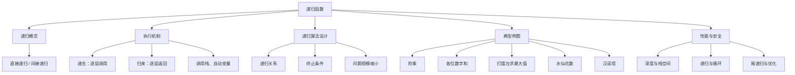

# 14 递归函数

> [!info] 课程定位与资料说明
> - **类型**：课堂笔记；**对应课件**：吴俊军《C语言程序设计》第5章 §5.4「递归」，PDF 第39—47页（幻灯片印刷编号40—48）。
> - **规划复习优先级**：高（系本项目根据内容和题型确定，非教师公布的分值预测）。
> - **前置知识**：[[12 函数定义、声明与调用]]、[[13 作用域、存储期与变量存储类型]]、[[10 循环结构与转移语句]]。
> - **补充参考**：《C Primer Plus（第6版）》§9.3「递归」；谭浩强《C语言程序设计（第4版）》为本项目辅助教材，未将其中未经核对的例题当作本课授课内容。
> - **标准基线**：语义解释主要按 ISO C11/C17；课程**未明确指定**期末考试采用的 C 标准版本。除特别注明外，示例在 C11 下可用。

> [!abstract] 本篇学习目标
> 1. 能区分**直接递归**和**间接递归**，写出递归的**基本情况（终止条件）**与**递归关系**。
> 2. 通过“**递去、归来**”准确追踪调用次序、输出顺序、返回值及每层局部变量。
> 3. 能手写阶乘、整数各位数字和、序列最大值及汉诺塔的递归程序。
> 4. 能指出无终止条件、错误输入、整数溢出、栈空间耗尽及不必要递归等问题。

## 一、知识结构



**总原则：** 递归不是一种新的 C 语法，而是**利用普通函数调用来描述重复分解问题的程序设计方法**。一个函数调用自身，仍遵守普通函数的实参与形参、作用域、返回值等规则。

---

## 二、5.4.1 递归概述

### 2.1 定义、分类与必要条件

**递归（recursion）**：函数在执行过程中**直接或间接调用自身**。

```c
/* 直接递归：f 调用 f */
void f(int n)
{
    if (n > 0)
        f(n - 1);
}

/* 间接递归：f 和 g 相互调用 */
void g(int n);
void f2(int n)
{
    if (n > 0)
        g(n - 1);
}
void g(int n)
{
    if (n > 0)
        f2(n - 1);
}
```

两个片段仅示意递归调用关系，实际不应依靠空函数体完成有意义计算。**直接递归与间接递归都是普通函数调用**。

> [!important] 设计递归的三个条件
> 1. **递归关系**：把原问题转化成一个或多个同类型的较小问题。
> 2. **终止条件**：出现某个可以不再递归、直接处理的基本情况。
> 3. **趋向终止**：递归参数或问题状态应逐步接近基本情况；单有 `if` 不代表一定能终止。
>
> 课件把第1项和第2项作为递归函数设计的两个要点。第3项是帮助判断算法是否真正终止的进一步说明。

### 2.2 课程演示：`demoRecur(1234)`

**【课程版本，课件 §5.4.1，印刷第40—41页】**

```c
#include <stdio.h>

void demoRecur(unsigned int x)
{
    putchar(x % 10 + '0');
    if (x > 9)
        demoRecur(x / 10);
    putchar(x % 10 + '0');
}

int main(void)
{
    demoRecur(1234);
    return 0;
}
```

**输出**（无换行）：

```text
43211234
```

- 每次先输出当前整数的**个位数字**。
- 当 `x > 9` 时，把整数去掉个位（`x / 10`），递归处理剩余部分。
- 等最深层函数执行完毕，再从内到外执行各层的第二条 `putchar`。

| 调用层次 | 本层 `x` | 进入本层后立即输出 | 是否调用下一层 | 本层返回前输出 |
|---:|---:|:---:|:---:|:---:|
| 1 | 1234 | `4` | 是，调用 `demoRecur(123)` | `4` |
| 2 | 123 | `3` | 是，调用 `demoRecur(12)` | `3` |
| 3 | 12 | `2` | 是，调用 `demoRecur(1)` | `2` |
| 4 | 1 | `1` | 否 | `1` |

```text
递去（进入下一层）        归来（执行调用之后的语句）
1234: 输出 4  ──────┐     ┌────── 输出 4
 123: 输出 3  ─────┐│     │┌───── 输出 3
  12: 输出 2  ────┐││     ││┌──── 输出 2
   1: 输出 1  ───┐│││     │││┌─── 输出 1
                 └┴┴┴─────┴┴┴┘
时间顺序：        4 3 2 1 1 2 3 4
```

> [!tip] 笔试分析法：先拆分“递去”和“归来”
> 将递归调用**之前**与**之后**的语句标出来：调用之前的语句一般按层数递增顺序执行；调用之后的语句，在逐层返回时以**反向**顺序执行。不要误以为遇到递归调用就立刻执行其后的语句。

> [!note] 字符输出为何使用 `+'0'`？
> `x % 10` 得到 0—9 之间的**整数**。`putchar` 接受字符编码值，所以要写 `x % 10 + '0'`，而不是直接 `putchar(x % 10)`。对标准 C 的十进制数字字符 `'0'`—`'9'`，其编码值按顺序连续排列。

---

## 三、递归的运行机制：调用栈与独立局部变量

### 3.1 每次调用都有自己的执行上下文

虽然调用的是同一个函数，但每次调用都需要保存不同的信息：

- 本次调用的**形参值**（如 `x=1234`、`x=123` 等）和自动存储期局部对象。
- 调用结束后应返回的**执行位置**。
- 为恢复调用者运行状态所需的其他信息。

课件采用**栈帧（stack frame）**解释这一过程；在常见 Linux/GCC ABI 中，函数调用通常借助运行时栈保存必要的状态，但**ISO C 标准并不规定一定要使用物理栈、固定栈帧布局或 `call`/`ret` 指令**。

在上述演示的递归最深处，可把尚未返回的调用理解为：

```text
          ┌──────────────────────────┐
栈顶 →    │ demoRecur(1)    x = 1    │  ← 最先返回
          ├──────────────────────────┤
          │ demoRecur(12)   x = 12   │
          ├──────────────────────────┤
          │ demoRecur(123)  x = 123  │
          ├──────────────────────────┤
          │ demoRecur(1234) x = 1234 │
          ├──────────────────────────┤
          │ main()                   │
          └──────────────────────────┘
```

此图是**逻辑调用栈**示意；内存地址高低方向、实际栈帧数量及优化结果不是标准保证。

### 3.2 与上一讲存储类型的联系

```c
#include <stdio.h>

void test(int n)
{
    int local = n;         /* 每次调用都有自己的 local */
    static int count = 0;  /* 所有调用共享同一个 count */

    ++count;
    printf("%d %d\n", local, count);

    if (n > 1)
        test(n - 1);
}

int main(void)
{
    test(3);
    return 0;
}
```

输出：

```text
3 1
2 2
1 3
```

| 对象 | 存储期 | 不同递归层之间的关系 |
|---|---|---|
| 形参 `n` | 自动存储期 | 各层独立 |
| 局部变量 `local` | 自动存储期 | 各层独立 |
| `static int count` | 静态存储期 | 全部递归层共享同一对象 |

> [!warning] `static` 不等于“每次调用都创建一个变量”
> `static` 局部对象在程序执行期间持续存在，不会因递归次数增加而分别创建。课程汉诺塔例题使用 `static int i=1` 统计移动序号，正是利用这个特征；但它也会使多次独立调用共享计数状态。

进一步联系：[[13 作用域、存储期与变量存储类型]]、[[对象生命周期]]（待后续按需要建立）。

---

## 四、5.4.2 递归算法分析：阶乘

### 4.1 数学上的递归定义

对于**非负整数** `n`：

$$
n!=\begin{cases}
1,&n=0\text{ 或 }n=1,\\
n\cdot(n-1)!,&n>1.
\end{cases}
$$

定义分为两部分：

- **基本情况**：`0! = 1`，`1! = 1`，不再递归。
- **递归关系**：`n! = n × (n-1)!`，将问题规模从 `n` 减少为 `n-1`。

### 4.2 课程代码

**【课程版本，课件 §5.4.2，印刷第42页】**

```c
long factorial(int n)
{
    long ans;

    if (n == 0 || n == 1)
        ans = 1;
    else
        ans = n * factorial(n - 1);

    return ans;
}
```

调用 `factorial(4)`：

```text
递去：
factorial(4) = 4 * factorial(3)
                   3 * factorial(2)
                       2 * factorial(1)
                           1  ← 递归结束

归来：
factorial(1) = 1
factorial(2) = 2 * 1 = 2
factorial(3) = 3 * 2 = 6
factorial(4) = 4 * 6 = 24
```

| 层次 | `n` | 本层要等待的结果 | 本层最终返回 |
|---:|---:|---|---:|
| 1 | 4 | `factorial(3)` | 24 |
| 2 | 3 | `factorial(2)` | 6 |
| 3 | 2 | `factorial(1)` | 2 |
| 4 | 1 | 无 | 1 |

**关键：** `n * factorial(n-1)` 并不是在递归调用前就完成乘法。必须先取得下一层返回值，才能执行本层乘法。

### 4.3 阶乘的边界与整数溢出

> [!warning] 课程代码的前提条件
> 1. 数学上负整数没有阶乘；课程函数对 `n < 0` **没有有效终止路径**，不能直接传入负数。
> 2. `long` 的表示范围有限；当结果超出 `LONG_MAX`，有符号整数乘法**溢出属于未定义行为（UB）**。
> 3. 递归层数通常随 `n` 线性增长（而非随 `n!` 增长）。

在常见实现中：

| `long` 位宽 | 最大能用 `long` 表示的阶乘 | 下一项 |
|---|---|---|
| 32 位 | `12! = 479001600` | `13!` 超出范围 |
| 64 位 | `20! = 2432902008176640000` | `21!` 超出范围 |

这些数值基于常见的 32/64 位有符号 `long`；实际类型宽度应以 `LONG_MAX` 或 `sizeof(long)` 判断，而非仅凭 CPU 是 64 位。

### 4.4 改进版本：明确前提并检查溢出

下例与课程代码**分开**列出，演示更稳妥的接口。`1` 表示成功，`0` 表示输入或结果越界。

```c
#include <limits.h>
#include <stdio.h>

int factorial_checked(int n, long *out)
{
    if (n < 0 || out == NULL)
        return 0;

    if (n <= 1) {
        *out = 1;
        return 1;
    }

    long prev;
    if (!factorial_checked(n - 1, &prev))
        return 0;

    if (prev > LONG_MAX / n)
        return 0;

    *out = prev * n;
    return 1;
}

int main(void)
{
    long result;
    if (factorial_checked(5, &result))
        printf("5! = %ld\n", result);
    else
        puts("invalid input or overflow");
    return 0;
}
```

**输出**：`5! = 120`。此处 `long *out` 属于后续[[20 指针与函数]]的扩展内容；书面复习只需理解它使函数能同时提供计算结果与错误状态。

---

## 五、5.4.3 递归函数设计的一般方法

课件强调：**递归关系**和**结束条件**是设计递归函数的两个关键。

| 步骤 | 需要回答的问题 | 阶乘例子 |
|---|---|---|
| 1. 确定函数含义 | `f(n)` 应返回什么？ | `n!` |
| 2. 找出基本情况 | 最简单的输入是什么？ | `n=0` 或 `n=1` |
| 3. 写出递归关系 | 能否由较小问题求出原问题？ | `f(n)=n*f(n-1)` |
| 4. 检查规模变化 | 每次调用是否趋近基本情况？ | `n` 每次减 1 |
| 5. 检查边界 | 非法输入、溢出、深度如何处理？ | `n<0`、`LONG_MAX`、栈空间 |

> [!tip] 递归程序阅读四步法
> 先写出各层**实参**，接着标明**何时停止递归**，再自底向上计算各层**返回值**，最后检查**调用前后输出**、局部变量和 `static` 状态。对于汉诺塔等多分支递归，按源代码顺序逐个分析子调用。

### 5.1 递归与循环的关系

以计算 `1+2+...+n` 为例（`n >= 0` 且结果可由 `int` 表示）：

```c
int sum_recursive(int n)
{
    if (n == 0)
        return 0;
    return n + sum_recursive(n - 1);
}

int sum_loop(int n)
{
    int sum = 0;
    for (int i = 1; i <= n; ++i)
        sum += i;
    return sum;
}
```

| 比较方面 | 递归版本 | 循环版本 |
|---|---|---|
| 解题思路 | 与数学递归定义接近 | 显式维护循环变量与累加器 |
| 最坏时间复杂度 | `O(n)` | `O(n)` |
| 典型额外空间 | `O(n)` 个待返回调用 | `O(1)` |
| 适用情况 | 问题天然分层、分治、树状结构 | 简单线性重复，通常更省资源 |

复杂度是对**算法结构**的分析，不代表不同优化级别编译后的指令数量固定。

---

## 六、课程例 5.11：整数各位数字之和 `addDigit`

**【课程版本，课件印刷第43页】**

题目：写出递归函数 `addDigit(n)`，返回**非负整数** `n` 的各位数字之和。例如 `addDigit(1729)` 返回 `19`。

```c
int addDigit(int n)
{
    if (n < 10)
        return n;
    else
        return n % 10 + addDigit(n / 10);
}
```

数学递归关系：

$$
S(n)=\begin{cases}
n,&0\le n<10,\\
(n\bmod10)+S(\lfloor n/10\rfloor),&n\ge10.
\end{cases}
$$

追踪 `addDigit(1729)`：

```text
addDigit(1729)
= 9 + addDigit(172)
= 9 + 2 + addDigit(17)
= 9 + 2 + 7 + addDigit(1)
= 9 + 2 + 7 + 1
= 19
```

- `n % 10` 取当前个位数字。
- `n / 10` 去掉个位，逐步缩小问题规模。
- `n < 10` 是最简单、可直接返回的情况。
- `n=0` 时正确返回 `0`；负数**不属于题目定义域**，不能将该函数对负数的返回值当作各位数字和。

对具有 `d` 位的正整数，递归深度为 `d`，时间和额外空间复杂度通常为 `O(d)`。因输入类型是 `int`，`d` 有由实现限制的上界。

> [!example] 自行对照：输出数字与计算数字之和
> `demoRecur` 在递归**前后**各输出一次个位；`addDigit` 在递归**返回后**才把个位加到结果中。相同的 `n/10` 递归分解，根据语句位置不同，就能得到不同的行为。

---

## 七、课程例题：递归求一组整数的最大值

**【课程版本，课件印刷第44页】**

题目：读入一系列整数，以 `0` 结束，求序列最大值。课件采用“**打擂台**”思想：参数 `n` 保存目前最大值，再读入一个数 `m`，取两者较大值递归处理。

```c
#include <stdio.h>

int max(int n)
{
    int m;
    scanf("%d", &m);
    if (m == 0)
        return m > n ? m : n;
    else
        return m > n ? max(m) : max(n);
}

int main(void)
{
    printf("The max number is : %d.\n", max(0));
    return 0;
}
```

示例输入：

```text
34 78 21 12 98 -128 0
```

示例输出：

```text
The max number is : 98.
```

| 当前输入 `m` | 传入下一层的最大值 `n` |
|---:|---:|
| 初始 | 0 |
| 34 | 34 |
| 78 | 78 |
| 21 | 78 |
| 12 | 78 |
| 98 | 98 |
| -128 | 98 |
| 0 | 结束，返回 98 |

> [!warning] 课程版本的两个边界问题
> 1. `max(0)` **预设了最大值至少是 0**。若输入 `-5 -8 0`，实际返回 `0`，但输入数据最大值是 `-5`。终止标记 `0` 不属于数据序列。
> 2. `scanf("%d", &m)` 未检查返回值；若输入在遇到 `0` 前结束或转换失败，`m` 未被正确写入，后续读取其不确定值可能造成**未定义行为**。

**【改进版本：从第一个有效数据初始化最大值】**

```c
#include <stdio.h>

int max_recursive(int current)
{
    int m;
    if (scanf("%d", &m) != 1 || m == 0)
        return current;

    if (m > current)
        current = m;

    return max_recursive(current);
}

int main(void)
{
    int first;
    if (scanf("%d", &first) != 1 || first == 0) {
        puts("No data");
        return 0;
    }

    printf("The max number is : %d.\n", max_recursive(first));
    return 0;
}
```

输入 `-5 -8 0` 时输出 `The max number is : -5.`；首个输入为 `0` 时输出 `No data`。这个递归算法仍是**线性深度**，输入数据很长时，简单循环通常更合适。改进版将 EOF 或无效输入视为终止；如需区分正常终止与输入错误，应进一步设计返回状态。

---

## 八、课程例 5.1 修改版：递归枚举水仙花数

**【课程版本，课件印刷第45页】**

利用第 12 篇已有的 `isNarcissus(x)` 判断函数，将原来的 `for` 枚举改写成递归：

```c
#include <stdio.h>

int isNarcissus(int x)
{
    int i, j, k;
    i = x / 100;
    j = (x - i * 100) / 10;
    k = x % 10;
    return (x == i*i*i + j*j*j + k*k*k) ? 1 : 0;
}

void getNarcissus(int n)
{
    if (n > 999)
        return;

    if (isNarcissus(n))
        printf("%5d", n);

    getNarcissus(++n);
}

int main(void)
{
    getNarcissus(100);
    return 0;
}
```

输出（前面空格是 `%5d` 所产生）：

```text
  153  370  371  407
```

**递归关系**：处理完当前的整数 `n`，再处理 `n+1`；**终止条件**：`n > 999`。

> [!note] 课件“栈帧最多 1000 个”的数字需要修正
> 从 `getNarcissus(100)` 开始，依次调用到 `getNarcissus(1000)`（该层只检测终止条件），总计 **`1000-100+1=901` 次函数调用**；不是 1000 次。在一种每次递归创建调用帧、尚未进行尾调用优化的实现中，`getNarcissus` 同时活跃的调用数最多为 **901**（不含 `main`）。
>
> `++n` 在此只有一次修改且无冲突求值，**不是未定义行为**。不过使用 `getNarcissus(n + 1)` 更容易阅读。优化器可能将这种尾递归变成循环，实际栈帧数可能与源码层数不同。

**为什么这种递归并不划算？** 这里只是在按固定顺序枚举 `100…999`，没有利用递归分解带来的结构优势：迭代版本更直观、典型额外空间为 `O(1)`，递归版本若不优化则为 `O(900)` 量级。

---

## 九、5.4.6 经典问题：汉诺塔（例 5.13）

### 9.1 问题与递归分解

有三根柱子 `A、B、C`，`A` 上从小到大叠放 `n` 个圆盘（大的在下）。每次只能移动一盘，且不能将大盘放在小盘之上。目标是借助 `B` 将全部圆盘从 `A` 移到 `C`。

**要移动 `n` 个盘子（`n>1`），分为三步：**

1. 把最上面的 `n-1` 个盘子，从 `A` **借助 `C`** 移到 `B`。
2. 把 `A` 剩下的最大盘移到 `C`。
3. 把 `B` 上的 `n-1` 个盘子，**借助 `A`** 移到 `C`。

最简单的基本情况是 `n=1`：直接把唯一的盘子从源柱移动到目标柱。

### 9.2 课程代码

**【课程版本，课件印刷第48页】**

```c
#include <stdio.h>

void move(int n, int a, int b, int c)
{
    static int i = 1;

    if (n == 1)
        printf("step %d: %c-->%c\n", i++, a, c);
    else {
        move(n - 1, a, c, b);
        printf("step %d: %c-->%c\n", i++, a, c);
        move(n - 1, b, a, c);
    }
}

int main(void)
{
    move(3, 'A', 'B', 'C');
    return 0;
}
```

其中 `main` 是为使课件中展示的 `move` 函数可独立编译而**补充的测试入口**；不应将其当作课件原文。

**对 `n=3` 的输出：**

```text
step 1: A-->C
step 2: A-->B
step 3: C-->B
step 4: A-->C
step 5: B-->A
step 6: B-->C
step 7: A-->C
```

### 9.3 为什么参数顺序容易写错？

约定 `move(n, a, b, c)` 的含义是：**将 `n` 个盘子从 `a` 借助 `b` 移到 `c`**，因此递归时位置含义始终不变，只是不同柱子承担不同角色。

| 代码 | 目标 | 对应分解步骤 |
|---|---|---|
| `move(n-1, a, c, b)` | `a → b`，借助 `c` | 第一步 |
| `printf(..., a, c)` | 最大盘 `a → c` | 第二步 |
| `move(n-1, b, a, c)` | `b → c`，借助 `a` | 第三步 |

> [!important] 汉诺塔考试关键
> - 基本情况：`n==1`，直接输出一步移动。
> - 两个递归调用的**实参顺序不同**，不能写成相同的柱子排列。
> - 最中间的 `printf` 对应移动当前层最大的盘子。
> - `n=0` 没有被课程代码处理；不能对该函数传入非正盘数。

### 9.4 移动次数与复杂度

令 `T(n)` 为移动 `n` 个盘子所需的最少步数：

$$
T(1)=1,\qquad T(n)=2T(n-1)+1\quad(n>1).
$$

由递推可得：

$$
\boxed{T(n)=2^n-1}
$$

| 盘子数 `n` | 最少移动次数 |
|---:|---:|
| 1 | 1 |
| 2 | 3 |
| 3 | 7 |
| 4 | 15 |
| 5 | 31 |
| 10 | 1023 |
| 64 | 18446744073709551615 |

对于课程代码所表达的算法：**时间复杂度为 `O(2^n)`，最大递归深度为 `O(n)`，不计输出缓冲时典型辅助空间为 `O(n)`**。注意不能因为总调用次数指数增长，就认为同一时刻需要指数多个栈帧；两支递归是**先完成左支，再执行右支**。

> [!warning] `static int i` 的长期状态与溢出
> `i` 是整个递归过程共享的静态对象，能让一次 `move(3,...)` 从 1 数到 7。但如果随后再次调用 `move`，计数不会自动归 1。大量盘子时，`i++` 还会超出 `int` 范围，发生有符号整数溢出。64 个盘子属于数学思想背景，不代表这个 `int` 计数实现能够正确执行全部步骤。

**【改进思路】** 若希望重复调用时从第 1 步开始，可在外层包装函数中初始化计数器，并通过形参指针向递归函数传递计数器地址；具体实现留到[[20 指针与函数]]，本篇优先掌握课程版本。

---

## 十、补充原理：尾递归（Tail Recursion）与尾调用优化

### 10.1 什么是尾递归

若一个递归调用的结果**直接成为当前函数的结果**，当前函数在该调用返回后不必进行进一步计算，这才构成典型的**尾递归**。

```c
/* 不是尾递归：调用返回后仍要做乘法 */
long factorial(int n)
{
    if (n <= 1)
        return 1;
    return n * factorial(n - 1);
}

/* 尾递归：把部分结果通过累加器传下去 */
long factorial_tail(int n, long acc)
{
    if (n <= 1)
        return acc;
    return factorial_tail(n - 1, n * acc);
}
```

以上两个版本均以前提 `n>=0`、计算过程不溢出为条件；第二个版本的入口可以是 `factorial_tail(n,1)`。

| 表达式 | 是否尾调用 | 解释 |
|---|---|---|
| `return f(n-1);` | 是 | 返回递归调用的结果，没有额外计算 |
| `return n * f(n-1);` | **否** | 等到 `f` 返回后还要执行乘法 |
| `f(n-1); return;`（`void` 函数） | 是 | 递归调用后无其他有意义操作 |
| `f(n-1); printf("end");` | 否 | 递归返回后还要输出 |

> [!note] 与《C Primer Plus》§9.3.3 的表述辨析
> 《C Primer Plus》第6版中文版在阶乘例题后，将 `n * rfact(n-1)` 描述为“尾递归”。按严格的尾位置定义，这**不是尾递归**：乘法必须等内层调用返回后才能进行。不要将“递归调用位于源代码最后一条赋值语句内”与“尾调用”混为一谈。

### 10.2 尾递归不保证占用常数栈空间

GCC 存在 `-foptimize-sibling-calls` 等尾调用/尾递归优化能力，但启用优化选项**不保证每一种递归都一定被消除**。是否真正将递归转换为循环，取决于编译器、目标平台 ABI、代码结构及优化设置。

- **语言保证**：C 允许递归调用；每次调用按函数语义执行。
- **实现与优化**：可采用栈帧，可能对尾调用进行优化；这些都不是 ISO C 必须采用的唯一机制。
- **考试建议**：除题目明确提出编译器优化，否则应**按照源码函数调用关系**分析执行结果。

参考：GCC 官方 `-foptimize-sibling-calls` 说明：https://gcc.gnu.org/onlinedocs/gcc/Optimize-Options.html 。

---

## 十一、补充原理：递归复杂度与“多分支递归”

### 11.1 深度、调用总次数、额外空间是三个不同概念

| 示例 | 总调用次数（数量级） | 最大深度 | 未优化时典型额外空间 |
|---|---|---|---|
| `factorial(n)` | `O(n)` | `O(n)` | `O(n)` |
| `addDigit(n)` | `O(d)`（`d` 为位数） | `O(d)` | `O(d)` |
| 水仙花数枚举 | `O(900)` | `O(900)` | `O(900)` |
| 汉诺塔 `move(n)` | `O(2^n)` | `O(n)` | `O(n)` |
| 朴素斐波那契 `fib(n)` | `O(\varphi^n)` | `O(n)` | `O(n)` |

其中 `\varphi=(1+\sqrt5)/2`；若只需判断“是否指数增长”，写 `O(2^n)` 作为较宽松的上界也可。**总调用次数多，不等于各调用同时活跃。**

### 11.2 斐波那契：重复子问题的典型反例

**【辅助教材拓展，《C Primer Plus》§9.3.5；非本课课件指定例题】**

```c
unsigned long fib(unsigned int n)
{
    if (n <= 2)
        return 1;
    return fib(n - 1) + fib(n - 2);
}
```

约定 `n>=1` 且结果可表示。求 `fib(5)` 的调用树中，`fib(3)` 和 `fib(2)` 会被重复计算；随着 `n` 增长，朴素实现的调用总次数呈指数增长。

> [!note] 注意辅助教材的空间复杂度表述
> 《C Primer Plus》在讨论双递归时强调变量数量快速增长。更严格地说，**累计函数调用次数**可以指数增长，而对于这种深度优先执行的递归实现，**同时活跃的递归层数至多为 `O(n)`**，并不是指数级栈深度。真正需要警惕的是大量重复计算以及有限栈空间。

对于简单斐波那契计算，循环或记忆化方法通常更高效；不作为本课程当前的核心考点。

---

## 十二、C 标准、编译器与执行环境辨析

| 问题 | 应当如何判断 |
|---|---|
| C 是否允许函数直接或间接调用自身？ | **允许**。递归是正常函数调用，不是编译器扩展。 |
| 是否每次调用都得到独立形参、自动局部对象？ | 对各次调用中具有自动存储期的对象，**是**。 |
| 是否每次都生成独立的一份函数机器码？ | **否**。函数代码不需要因递归次数而复制。 |
| 是否必须使用物理栈和固定栈帧？ | **不保证**；课件的栈帧是常见实现的合理模型。 |
| `static` 局部对象是否每层独立？ | **否**；所有递归层共享同一静态对象。 |
| 没有终止条件是否“一定死循环”？ | 不能笼统说；可能不断递归直至耗尽资源，也可能在此之前发生溢出等未定义行为。 |
| `long` 乘法结果超范围？ | 有符号整数溢出：**未定义行为**。 |
| 递归最大深度有没有 ISO C 固定值？ | **没有统一常数**；受实现和执行环境资源限制。 |
| 尾调用是否必然节省栈空间？ | **不保证**，取决于编译器实现和优化。 |
| 汉诺塔打印步骤中的 `static i` 是否会重置？ | 不会因再次调用函数自动重置。 |

> [!tip] 如何区分“结果错误”和“未定义行为”
> - `max(0)` 计算全负序列得 0：在输入有效的前提下，代码正常执行，但**算法结果错误**。
> - `scanf` 失败后直接读未初始化的自动局部变量：可能触发**未定义行为**。
> - `factorial` 计算结果超出有符号 `long`：**未定义行为**。
> - 不同优化级别递归使用多少物理栈帧：属于**实现/优化问题**，不能据此推断源代码语义不同。

---

## 十三、笔试高频考点与易错点速查

| 考查点 | 标准解题要点 |
|---|---|
| 递归定义 | 函数直接或间接调用自己 |
| 必须具备什么？ | 基本情况、递归关系、趋向终止 |
| `demoRecur(1234)` | `43211234`，先递去后归来 |
| `factorial(4)` | `24`，自底向上完成乘法 |
| `factorial(0)` | `1` |
| `addDigit(1729)` | `19` |
| `max(0)` 读入 `34 78 21 12 98 -128 0` | `98` |
| `max(0)` 读入 `-5 -8 0` | **代码返回 0（逻辑错误）** |
| 水仙花数 | `153 370 371 407` |
| 从 `100` 递归到 `1000` | 901 次调用（含终止层） |
| 汉诺塔 `n=3` | 7 步，顺序要逐步模拟 |
| 汉诺塔移动次数 | `2^n-1` |
| 汉诺塔 `move` 的 `static i` | 所有层共享，后续顶层调用不自动重置 |
| 尾递归 | `return f(...);` 可能是，`return n*f(...);` 不是 |
| 递归空间复杂度 | 关注**最大活跃深度**，不能直接套用总调用次数 |

> [!warning] 容易扣分的五种说法
> - “有 `if` 就一定能终止递归。”——错误，需要判断参数是否接近基本情况。
> - “递归调用结束时直接回到 `main`。”——错误，返回到直接调用者的下一执行位置。
> - “所有层的局部变量都是同一个对象。”——错误，自动局部变量每层独立；静态对象例外。
> - “递归总调用数是指数级，所以同时需要指数个栈帧。”——错误，汉诺塔最大深度仍是线性的。
> - “`return n * factorial(n-1)` 是尾递归。”——错误，调用返回后还需相乘。

---

## 十四、24 道自测题（书面考试导向）

### A. 概念与判断（1—8）

1. 判断：递归必须是函数在代码中**直接**调用自己，间接调用不算递归。
2. 填空：递归算法设计的两个核心是 ______ 和 ______。
3. 判断：所有递归函数只要写了终止条件，程序就一定会终止。
4. 判断：执行递归时，每层的自动局部变量通常是独立对象，`static` 局部变量则被共享。
5. 判断：C 标准规定递归调用必须采用向低地址增长的运行时栈。
6. 判断：`return n * f(n-1);` 中的递归调用必定属于尾调用。
7. 判断：从函数 `f` 递归调用 `f`，最深层结束后必须直接返回最外层 `main`。
8. 填空：对 `n` 个盘子的汉诺塔问题，最少移动 ______ 次。

### B. 程序阅读与计算（9—18）

9. 课件 `demoRecur(1234)` 的完整输出是什么？
10. 在 `demoRecur(1234)` 中，`demoRecur` 被调用多少次？最后输出的字符是什么？
11. `factorial(0)`、`factorial(1)`、`factorial(5)` 的结果分别是什么？（输入在定义域内且结果可表示。）
12. `addDigit(1729)`、`addDigit(1005)`、`addDigit(0)` 分别返回什么？
13. 依照课程 `max(0)` 函数，输入 `-3 -7 -1 0` 时返回多少？这一返回值是否等于有效数据的最大值？
14. 课件水仙花数例题，从 `getNarcissus(100)` 开始，到基本情况结束，递归函数一共执行多少层（包含 `n=1000`）？
15. `move(2,'A','B','C')` 的移动顺序是什么？
16. 汉诺塔 `n=4` 最少需要移动多少次？最大递归深度为多少层 `move` 调用？
17. 以下程序输出什么？

    ```c
    void f(int n)
    {
        if (n == 0) return;
        printf("%d", n);
        f(n - 1);
        printf("%d", n);
    }
    /* 调用 f(3)，已包含 stdio.h */
    ```

18. 以下程序输出什么？

    ```c
    int f(int n)
    {
        if (n <= 1) return 1;
        return f(n - 1) + 2;
    }
    /* 打印 f(4) 的返回值 */
    ```

### C. 代码改错与设计（19—24）

19. 对 `factorial(-2)`，课件代码存在什么问题？应先检查什么输入条件？
20. 对 `long factorial(int n)`，即使递归会终止，为什么输入足够大的正整数仍可能出现未定义行为？
21. 给出 `n>=0` 时递归计算 `1+2+...+n` 的**递归关系和基本情况**，无需写整个程序。
22. 如果把汉诺塔的第一个递归调用写成 `move(n-1,a,b,c)`，违反了原题中的哪一项分解安排？
23. 课件汉诺塔函数使用 `static int i=1`；如果连续两次独立执行 `move(1,'A','B','C')`，两行输出的 `step` 编号分别是什么？
24. 设计一个递归函数 `countDigits(unsigned int n)`，返回十进制数字位数；要求 `n=0` 时返回 1，并写出终止条件。

> [!example]- 自测题参考答案与解析（点击展开）
> **1. 错。** 通过另一函数最终调用自身的间接递归也是递归。
>
> **2. 递归关系、递归终止条件。** 还需保证逐步接近终止情况。
>
> **3. 错。** 如果每次参数不改变或远离终止条件，测试可能永远不成立。
>
> **4. 对。** 自动存储期对象属于各次调用，`static` 对象共享。
>
> **5. 错。** ISO C 未规定栈的方向或物理实现。
>
> **6. 错。** 调用返回后仍需乘以 `n`，不属于尾调用。
>
> **7. 错。** 调用按层返回给直接调用者。
>
> **8. `2^n-1`。** 来自 `T(n)=2T(n-1)+1`。
>
> **9. `43211234`。** 调用前输出 `4321`，返回过程输出 `1234`。
>
> **10. 4 次；最后输出 `4`。** 依次进入 `1234、123、12、1` 四层。
>
> **11. `1、1、120`。** `5!=5×4×3×2×1`。
>
> **12. `19、6、0`。** `1+7+2+9=19`；`1+0+0+5=6`。
>
> **13. 返回 `0`，不是最大值。** 有效输入最大值为 `-1`。课程函数错误地用 0 初始化当前最大值。
>
> **14. 901 层。** 从 100 到 1000 两端都计入。
>
> **15. `A-->B`，`A-->C`，`B-->C`。** 先把小盘移至 B，再移大盘，最后移小盘。
>
> **16. 15 步，最大深度 4 层。** `2^4-1=15`；每支递归使 `n` 减一。
>
> **17. `321123`。** 递去输出 `321`，归来输出 `123`。
>
> **18. `7`。** `f(1)=1，f(2)=3，f(3)=5，f(4)=7`。
>
> **19.** 负数不在阶乘定义域内。当前代码会继续以 `n-1` 递归，不能保证终止，并可能发生整数下溢等未定义行为；应先检查 `n>=0`。
>
> **20.** `long` 不能表示任意大的阶乘，带符号乘法溢出属于未定义行为。
>
> **21.** `S(0)=0`；当 `n>0`，`S(n)=n+S(n-1)`。
>
> **22.** 首次应把 `n-1` 个盘子从 `a` 借助 `c` 移到 **`b`**，应写 `move(n-1,a,c,b)`，不能把目标写成 `c`。
>
> **23. `step 1` 与 `step 2`。** 静态对象没有在顶层函数结束后销毁并重新初始化。
>
> **24.** 一种写法：
>
> ```c
> unsigned int countDigits(unsigned int n)
> {
>     if (n < 10)
>         return 1;
>     return 1 + countDigits(n / 10);
> }
> ```
>
> 每次除以 10，`n<10` 时返回 1，包含 `n=0` 情况。

---

## 十五、课程复习清单

- [ ] 能解释**直接递归、间接递归、递归关系、基本情况**。
- [ ] 能完整写出 `demoRecur(1234)` 的输出并解释递去和归来。
- [ ] 能在递归调用树/调用栈中标出每层形参及返回位置。
- [ ] 能写出 `factorial` 的递归关系，处理 `0!`，认识负数与溢出风险。
- [ ] 能手写 `addDigit` 并算出 `1729` 的各位数字和。
- [ ] 能分析课件 `max(0)` 的输入流程及全负数的错误。
- [ ] 能用递归枚举三位水仙花数并算对 `901` 次调用。
- [ ] 能写出汉诺塔三步分解、`move` 参数顺序及 `2^n-1` 公式。
- [ ] 能解释 `static int i` 在递归中的共享状态。
- [ ] 能区分**总调用次数、最大递归深度与额外空间**。
- [ ] 能辨析尾递归，理解编译器优化不是语言标准的硬性保证。

## 十六、Obsidian 关联与资料索引

### 16.1 双链与后续篇章

- **前置**：[[12 函数定义、声明与调用]]（函数形参、实参、返回值）；[[13 作用域、存储期与变量存储类型]]（自动变量与 `static`）。
- **平行关联**：[[10 循环结构与转移语句]]（循环和递归的转换）；[[11 结构化程序设计与典型算法]]（枚举与结构化算法）。
- **后续**：[[15 编译预处理与多文件程序]]（函数声明和源文件组织）、[[20 指针与函数]]（输出参数与递归数据结构）。
- **MOC**：在 [[00 C语言程序设计 MOC]] 的「第5章 函数」下面增加 `[[14 递归函数]]`。
- **原子笔记候选**：若以后研究调用约定与栈回溯，可以单独建立 `[[函数调用栈]]`；本阶段**不建议**为每个递归例题建立独立原子笔记。

### 16.2 来源与说明

1. **课堂首要来源**：吴俊军《第05章 函数与程序结构S》，§5.4，PDF 页39—47（印刷编号40—48）。本笔记保留 `demoRecur`、`factorial`、`addDigit`、递归求最大值、`getNarcissus` 与 `move` 等课程例题；对课件的栈帧计数、异常输入等处另设辨析。
2. **辅助教材**：Stephen Prata《C Primer Plus（第6版）中文版》，§9.3「递归」（讲解递归各层私有变量、尾递归、倒序输出、斐波那契）。尾递归和空间复杂度问题已与严格定义核对。
3. **项目辅助教材**：谭浩强《C语言程序设计（第4版）》，用于整体课程知识补充；本笔记未引用无法核对的具体页码或示例。
4. **技术核对**：Microsoft Learn, [Recursive Functions](https://learn.microsoft.com/en-us/cpp/c-language/recursive-functions?view=msvc-170)；GCC, [Optimize Options](https://gcc.gnu.org/onlinedocs/gcc/Optimize-Options.html)（`-foptimize-sibling-calls`）；Tufts University, [Recursion / Tail Calls](https://www.eecs.tufts.edu/~msheldon/cs15_2021s_summary/reference/recursion.shtml)。
5. **版本说明**：书面课程未明确指定 C 标准版次；笔记不把 Linux、glibc、特定 ABI 或 GCC 优化当作 ISO C 的强制规则。

### 16.3 Arch Linux 下的可选验证

把上方完整示例分别保存为如 `recursive_demo.c`、`hanoi.c` 后，可在终端执行：

```bash
# 按 C11 检查并保留便于观察的调试信息
gcc -std=c11 -O0 -g -Wall -Wextra -Wpedantic recursive_demo.c -o recursive_demo
./recursive_demo

# 针对整数溢出等问题的可选诊断（不能保证捕捉所有资源耗尽）
gcc -std=c11 -O1 -g -fsanitize=undefined -fno-omit-frame-pointer hanoi.c -o hanoi
./hanoi
```

如果使用 GDB，可以在递归函数中设置断点，使用 `bt` 查看当前调用链，再用 `up`、`down` 切换不同层的执行上下文。这是理解递归栈帧最直接的实验，但不是书面考试必须掌握的操作。

> [!summary] 一句话回顾
> **递归 = 找到基本情况 + 按递归关系缩小问题 + 利用普通函数调用逐层执行并逐层返回。** 解题时必须同时考虑结果正确性、边界条件、调用深度与存储期。
