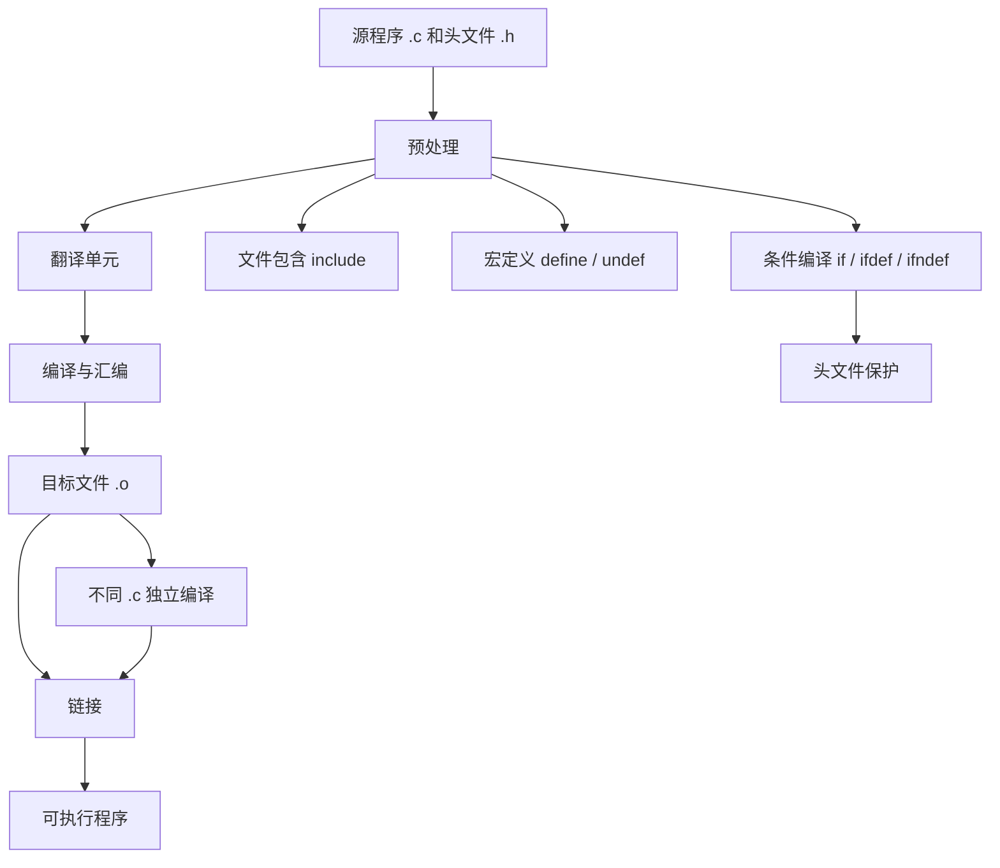
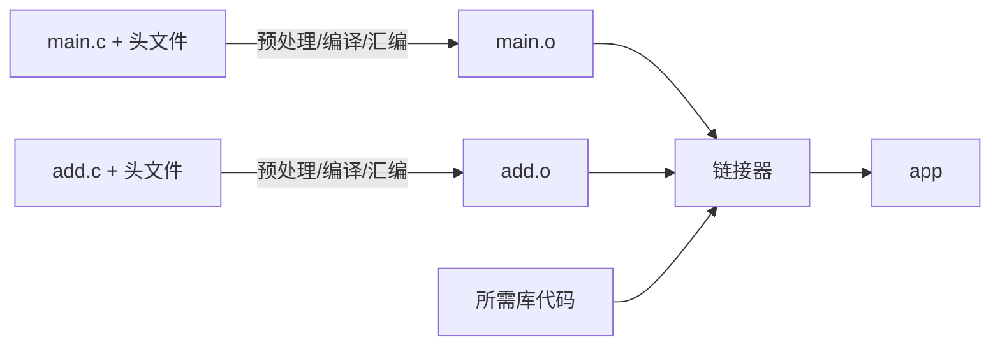

# 15 编译预处理与多文件程序

> [!abstract] 本篇定位
> - **课程范围**：吴俊军老师第 6 章《编译预处理》（§6.1–6.4，PDF 第 4–24 页），结合第 5 章 §5.1.3、§5.5《多文件的 C 程序》。
> - **知识主线**：编译过程 → `#include` → `#define`（无参、带参）→ `#undef` → `#if`/`#ifdef`/`#ifndef` → `defined` → `assert` → 多文件编译和链接。
> - **复习优先级**：高。重点是**手工宏展开、条件编译分支判定、头文件保护、声明与定义、多文件链接错误**。
> - **约定**：课程原有示例按课件保留并注明来源；额外示例以 ISO C11/C17 的共同规则为主，Linux 编译示范使用 GCC 或 Clang 的 `-std=c11`。**课程考试采用何种 C 标准，尚待核实**。

## 一、知识结构与学习目标



学习完成后应能：

1. 说明预处理与编译、链接的区别，识别主要预处理指令。
2. 手工展开有参宏，识别**运算优先级**与**副作用重复求值**陷阱。
3. 根据宏的定义状态和数值确定条件编译留下哪些代码。
4. 解释头文件中的声明为什么通常与 `.c` 文件中的定义分开。
5. 根据编译/链接错误判断是头文件、符号声明、缺少目标文件还是重复定义问题。

前置知识：[[02 字符集、词法元素与标识符]]、[[05 运算符与表达式]]、[[12 函数定义、声明与调用]]、[[13 作用域、存储期与变量存储类型]]。

## 二、编译预处理的性质与位置

### 2.1 什么是预处理指令

课件第 4 页介绍：C 源程序中可以包含以 `#` 开始的预处理指令，预处理阶段先处理这些指令，再将结果交给后续编译步骤。

常见指令：

| 指令 | 主要功能 | 课程位置 |
|---|---|---|
| `#include` | 包含其他源文件的内容，通常是头文件 | §6.1 |
| `#define` | 定义对象式宏或函数式宏 | §6.2 |
| `#undef` | 取消宏定义 | §6.2（课件第 14 页） |
| `#if` / `#elif` / `#else` / `#endif` | 按预处理表达式选择代码 | §6.3 |
| `#ifdef` / `#ifndef` | 检查宏是否定义 | §6.3 |
| `#error`、`#line`、`#pragma` | 其他预处理功能；本讲非重点 | 补充 |

> [!important] 书面题的三个区别
> - **预处理**：处理包含、宏展开、条件编译等；并不是运行 C 程序。
> - **编译**：对预处理后的翻译单元进行语义分析和代码生成。
> - **链接**：组合不同目标文件、解析跨文件符号引用并形成可执行文件。

### 2.2 预处理并不等于“随意的字符串替换”

课程中常使用“字符替换”的直观说法；严格来说，宏替换以**预处理记号（preprocessing tokens）**为基础。字符串字面量内部不会因出现宏名而自动替换；注释也不是宏展开对象。

```c
#define N 10
int x = N;             // N 展开为 10
printf("N = %d", N);  // 引号内的 N 不展开，实参 N 展开
```

逻辑上的翻译过程还包括注释处理、物理行拼接等阶段。预处理指令从 `#` 开始，到**逻辑行**结束；可以通过行末反斜杠续行：

```c
#define AREA(r) \
    (3.14159 * (r) * (r))
```

> [!note] 语言标准与工具区别
> ISO C 规定了翻译阶段的语义，但 `gcc -E`、`.i` 文件、`.o` 文件和 GCC/Clang 的具体选项属于编译工具链的接口，不是 C 语言语法的一部分。

## 三、§6.1 文件包含：`#include`

### 3.1 基本语法和作用

```c
#include <stdio.h>
#include "myheader.h"
```

`#include` 的效果可理解为：在指定位置引入被包含文件的内容，使它参与当前翻译单元的后续处理。**包含头文件不等于把某个 `.c` 中的函数实现自动链接进来。**

| 形式 | 通常用途 | GCC 的默认查找行为（简化） |
|---|---|---|
| `#include <name.h>` | 标准库或系统提供的头文件 | 在实现配置的包含路径中查找 |
| `#include "name.h"` | 项目自有头文件 | 先查找**当前执行包含指令的文件所在目录**，再查找相应的包含路径 |

> [!note] 课件表述与实现细节
> 课件第 6 页把双引号形式概括成“先在用户当前目录查找”。这适合入门理解，但对 GCC 不能简单等同于**执行命令时的 shell 工作目录**。GCC 通常先查找包含该 `#include` 指令的文件所在目录，之后考虑 `-iquote`、`-I` 等路径与系统路径。具体路径查找顺序属于实现和构建系统行为。不要仅根据 shell 当前目录推断头文件一定能找到。

例如：

```bash
cc -std=c11 -Wall -Wextra -Iinclude -c src/main.c -o main.o
```

`-Iinclude` 将项目的 `include/` 目录加入头文件搜索路径。

### 3.2 头文件适合放什么

课件第 7 页将以下内容集中在头文件中，供不同源文件使用：

- 宏定义、符号常量、类型声明；
- `extern` 对象声明、函数原型声明；
- 必要的公共接口，而不是任意实现细节。

课程的 `graph.h`、`dot.c`、`line.c`、`circle.c`、`rectangle.c` 示意图体现了“**公共接口 + 分别实现**”的结构。注意该页仅展示部分示意代码，不能直接视为可编译的完整工程。

> [!warning] 头文件不是共享变量的“定义仓库”
> 在多个 `.c` 都包含的头文件中直接写 `int count = 0;`，会使各翻译单元各有一个具有外部链接的定义，常导致链接阶段的重复定义错误。应在头文件写 `extern int count;`，只在**一个** `.c` 中写 `int count = 0;`。详见后面的多文件案例。

## 四、§6.2.1 无参宏（对象式宏）

### 4.1 定义与展开

一般形式：

```c
#define 宏名 替换列表
```

例如：

```c
#define LEN 9
#define PI 3.14159
#define M (y*y + 3*y)
```

宏从定义处开始生效，直到被 `#undef` 取消或当前翻译单元结束。**宏没有 C 对象的类型和存储空间，也不具有普通变量的块作用域**。不要把宏的有效范围与变量作用域混为一谈。

#### 课程例题：输入 `y` 计算表达式（课件第 8 页）

```c
#include <stdio.h>
#define M (y*y+3*y)

int main(void)
{
    int s, y;
    printf("Input a number: ");
    scanf("%d", &y);
    s = 3*M + 4*M + y*M;
    printf("s=%d\n", s);
    return 0;
}
```

这里已将课件 PDF 中的弯引号改为 ASCII 双引号，计算公式、宏及程序结构均予保留。若输入 `2`，宏 `M` 对应 `(2*2+3*2)=10`，于是 `s=3*10+4*10+2*10=90`；前提是输入有效且算术未溢出。

```text
Input a number: 2
s=90
```

### 4.2 无参宏同样可能发生优先级错误

课程第 10 页：

```c
#define R 11
#define r R-2

int x = 17;
int a = x % r;
```

实际经过宏替换后相当于：

```c
int a = 17 % 11 - 2;   // 结果 4
```

而**本意如果是对 9 取余**，应写为：

```c
#define r (R-2)
int a = 17 % r;        // 结果 8
```

> [!important] 核心考点
> 宏替换本身并不会自动添加括号，也不会自动先计算替换列表中的运算。写复杂表达式宏时，优先让替换列表自成完整表达式。

### 4.3 宏名出现在字符串字面量中不会替换

课件第 9 页的对比：

```c
#define EQUATION "a + b = %d\n"
int a = 9, b = 8;
printf(EQUATION, a + b); // 输出 a + b = 17
```

但如果是 `printf("EQUATION\n");`，输出的就是 `EQUATION`，而不是 `a + b = ...`。

### 4.4 `#define`、`const` 与 `enum` 的差别

```c
#define SIZE 10
const int size = 10;
enum { MAX_SIZE = 10 };
```

| 特征 | `SIZE` | `size` | `MAX_SIZE` |
|---|---|---|---|
| 本质 | 宏替换 | `const int` 对象 | 枚举常量 |
| 有自己的对象和地址 | 否 | 是 | 否 |
| 类型检查 | 由展开后的表达式决定 | 有 `int` 类型 | 在 C11/C17 中为 `int` |
| C11 文件作用域数组长度常量表达式 | 可用（展开为整数常量） | 不可以单凭其值使用 | 可用 |

此处与 [[04 常量、变量与初始化]] 衔接；注意 `const` 在 C 中并不自动意味着“整数常量表达式”。

## 五、§6.2.2 带参宏（函数式宏）

### 5.1 一般形式与基本展开

```c
#define SQUARE(x) ((x) * (x))
```

例如：

```text
SQUARE(a+1)
→ ((a+1) * (a+1))

SQUARE(SQUARE(a))
→ ((SQUARE(a)) * (SQUARE(a)))
→ ((((a) * (a))) * (((a) * (a))))
```

最重要的规则：**定义函数式宏时，宏名与紧随的左括号之间不能有空白字符**。

**写法 A（函数式宏）：**

```c
#define SQUARE(x) ((x)*(x))
```

**写法 B（对象式宏，作为对照，不与 A 同时定义）：**

```c
#define SQUARE (x) ((x)*(x))
```

写法 B 的 `(x) ((x)*(x))` 只是对象式宏的替换列表，不会建立形参 `x`。

### 5.2 为什么要给参数和整个结果都加括号

课程第 12 页设置了两种典型陷阱。

**陷阱 A：参数不加括号**

```c
#define SQUARE(x) x*x
int a = 2, b = 3;
int c = SQUARE(a+b);
```

展开为 `a+b*a+b`，结果为 `2+3*2+3=11`，**不是** `(2+3)^2=25`。

**陷阱 B：只给参数加括号，不给整体加括号**

```c
#define SQUARE(x) (x)*(x)
int c = 27 / SQUARE(3);
```

展开为 `27/(3)*(3)`，整数运算先得到 `9`，再乘 `3`，结果为 `27`，而不是 `27/9=3`。

正确版本：

```c
#define SQUARE(x) ((x)*(x))
```

> [!tip] 书面计算题步骤
> 先用宏替换列表替换宏名与形参，再**按照展开后的 C 语法重新确定运算符优先级和结合性**，最后才计算数值。不要在脑中把宏当作函数直接求值。

### 5.3 仅加括号不能消除宏的副作用问题

```c
#define SQUARE(x) ((x)*(x))
int i = 3;
int z = SQUARE(i++);  // 展开为 ((i++)*(i++))
```

> [!danger] 未定义行为（UB）
> 在 C11/C17 中，同一完整表达式内两次对 `i` 的无先后次序保证的修改构成未定义行为。不能说“最终 i 一定为 5”或“计算结果固定”。**不要通过编译运行结果反推标准结论**。`SQUARE(++i)` 也有相同问题。

即使没有未定义行为，宏仍可能**重复求值**：

```c
#define MAX(a,b) ((a) > (b) ? (a) : (b))
```

被选中的参数可能在比较和条件分支中被求值两次，因此不适宜直接传入带副作用的表达式。相比之下，普通函数的形参在进入函数时已获得实参计算的结果；但实参**彼此之间**的求值顺序仍可能未指定。参阅 [[12 函数定义、声明与调用]]。

### 5.4 带参宏与函数的比较

| 对比 | 函数式宏 | 普通函数 / `inline` 函数 |
|---|---|---|
| 处理阶段 | 预处理阶段替换记号 | 编译阶段进行语义分析和代码生成 |
| 类型检查 | 无独立形参类型；按展开代码检查 | 根据函数声明检查参数与返回类型 |
| 参数求值 | 同一实参可能在展开后出现多次 | 每个实参表达式在一次调用中求值一次 |
| 调用开销 | 不发生宏本身的函数调用 | 编译器可能内联，也可能生成调用 |
| 主要风险 | 优先级、重复求值、名称冲突 | 参数类型不匹配、函数接口等 |

> [!note] 不要把“宏一定比函数快”当成标准事实
> 课件第 13 页从减少调用开销介绍宏的优势，适用于理解其设计动机；但现代优化编译器可内联小函数，宏重复展开也可能增大代码体积，实际性能需要结合优化选项与生成代码判断。`inline` 为 C99 引入的语言机制，其链接语义需单独学习。

### 5.5 课程例 6.1：输出数组式数列的宏

课件第 13 页原示例（主体写法保留，调整排版）：

```c
#include <stdio.h>
#define PRINT_ARR(array,start,end) for(int i=start;i<=end;i++) printf("%d ", array*i);

int main(void)
{
    int a = 5;
    PRINT_ARR(a,0,4);
    return 0;
}
```

结果：

```text
0 5 10 15 20 
```

这实际上**不是数组遍历**：参数 `array` 在课件代码中被当作一个整数表达式 `a` 使用，再乘以循环变量 `i`。

> [!warning] 课程版本需要留意
> 该宏展开为 `for` 语句，变量名 `i` 固定，宏体包含分号；放进复杂的 `if/else` 或已有 `i` 的作用域可能导致语义问题或名称冲突。对于多语句宏，改进写法通常用 `do { ... } while (0)` 包住代码并且定义时不带最后的调用分号：
>
> ```c
> #define PRINT_ARR(value, start, end) do {       \
>     for (int j = (start); j <= (end); ++j) {    \
>         printf("%d ", (value) * j);             \
>     }                                          \
> } while (0)
> ```
>
> 仍应避免向此宏传入有副作用的参数。课程考试首先识别课件原写法；改进版本只作为工程参考。

## 六、§6.2 `#undef`：取消宏定义

```c
#define SIZE 100
/* 此处 SIZE 会展开成 100 */
#undef SIZE
/* 此处 SIZE 不再是当前宏定义 */
#define SIZE 50
```

`#undef` 取消宏名的定义；对尚未定义的宏名使用 `#undef` 也是允许的。它常用于重新配置宏、避免宏名冲突，或取消标准库可能提供的函数式宏（具体是否提供宏实现依库而定）。

> [!note] 宏的有效范围不是跨所有 `.c` 的全局作用域
> 每个 `.c` 连同它包含的文件独立形成一个翻译单元。某一翻译单元中的 `#define SIZE 100` 不会自动影响未包含相同定义的另一个翻译单元。

## 七、§6.3 条件编译

### 7.1 `#if` / `#elif` / `#else` / `#endif`

```c
#if 整数预处理表达式
    /* 分支 A */
#elif 其他整数预处理表达式
    /* 分支 B */
#else
    /* 分支 C */
#endif
```

预处理表达式为非零则选择相应分支，为零则跳过。**只保留第一个满足条件的分支**；不满足的代码不参与后续常规 C 语法编译（但条件指令、注释和词法结构仍须满足预处理要求）。

#### 课程例 6.2：圆或正方形面积（第 16 页）

课件通过 `#define R 1` 选取圆面积分支；另一个分支计算正方形面积。课件被跳过分支里有一处 `squre` 拼写，与变量 `square` 不一致。它在 `R=1` 时不会引发该分支的编译错误；若修改为 `R=0`，则会暴露。

**课程核心写法（保留条件结构，并补全声明与字符串格式）**：

```c
#include <stdio.h>
#define R 1

int main(void)
{
    float c, round, square;
    printf("input a number:");
    scanf("%f", &c);
#if R
    round = 3.14159f * c * c;
    printf("%f\n", round);
#else
    square = c * c;
    printf("%f\n", squre);  /* 课件拼写错误：squre */
#endif
    return 0;
}
```

**改进版的相关代码**：将 `squre` 更正为 `square`，并检查 `scanf` 返回值。示例讲解的重点是：`R=1` 时，预处理后不会保留 `#else` 分支；`R=0` 时会保留相反分支。

> [!warning] `#if` 与运行时 `if` 的不同
> - `#if R` 在**翻译前**选择代码；不需要在可执行程序运行时判断 `R`。
> - `if (R)` 是 **C 语句**；无论条件恒真还是恒假，未经特殊扩展时，两支代码原则上都必须满足 C 的语法和约束，优化器之后可以删除死代码。
> - `#if` 使用的是预处理整数表达式，不能用普通运行时变量控制。

### 7.2 应用：多语言、多配置与临时屏蔽代码

课件第 17 页通过 `ACTIVE_COUNTRY` 与 `US`、`ENGLAND`、`FRANCE` 等宏，使用 `#if`/`#elif` 选取货币名称。这属于**编译期配置**，不会根据用户运行时切换语言。

课件第 18 页：

```c
#if 0
    /* 临时排除的代码 */
#endif
```

这是常见做法，但**不保证可以包含任意损坏的文本**：不匹配的条件预处理指令、未结束的注释等仍可能影响预处理。课件该页示意代码中 `printf` 后缺少分号；如改成 `#if 1`，编译器会报告错误。

### 7.3 `#ifdef` 与 `#ifndef` 只检查“有没有定义”

```c
#define DEBUG 0

#ifdef DEBUG
    puts("A");  // 会被保留！DEBUG 虽然值为 0，仍然已经定义
#endif

#if DEBUG
    puts("B");  // 不会被保留，因为 DEBUG 展开为 0
#endif
```

| 条件 | `DEBUG` 未定义 | `#define DEBUG 0` | `#define DEBUG 1` |
|---|---:|---:|---:|
| `#ifdef DEBUG` | 假 | 真 | 真 |
| `#ifndef DEBUG` | 真 | 假 | 假 |
| `#if DEBUG` | 假（未定义标识符在此处按 0 处理） | 假 | 真 |

课件例 6.3（第 19 页）使用空替换列表的 `#define DEBUG`，因此采用 `#ifdef DEBUG` 选择是否输出函数进入与退出的调试信息：

```c
#define DEBUG
/* ... */
#ifdef DEBUG
    printf("on entering f, n=%d\n", n);
#endif
```

这里不应误改为 `#if DEBUG`：`DEBUG` 没有可用于求值的整数替换内容，不适合直接作为该表达式。

### 7.4 `defined` 预处理运算符

```c
#if defined(MACRO_1) && defined(MACRO_2)
    /* 两个宏都已定义时保留 */
#endif
```

两种合法写法：`defined(MACRO)` 和 `defined MACRO`。`#ifdef R` 可以改写为 `#if defined(R)`；逻辑组合必须在 `#if`/`#elif` 等表达式中使用。

## 八、§6.3.3 头文件重复包含与包含保护

### 8.1 问题来源

```c
/* main.c */
#include "config.h"
#include "config.h"
```

如果 `config.h` 中有完整的结构体定义等，重复包含可能造成重定义错误。**头文件保护（include guard）**让同一翻译单元中后续的包含跳过头文件主体。

```c
/* config.h */
#ifndef MYPROJECT_CONFIG_H
#define MYPROJECT_CONFIG_H

struct Config {
    int width;
    int height;
};

#endif /* MYPROJECT_CONFIG_H */
```

处理过程：第一次包含时 `MYPROJECT_CONFIG_H` 尚未定义，整个头文件主体被保留并定义该宏；第二次包含时宏已定义，内容被跳过。

### 8.2 头文件保护的边界

> [!important] 最容易混淆的一点
> **头文件保护只针对同一翻译单元里的重复展开**，不是“整个项目只编译一次头文件”，也不能防止不同 `.c` 中各自形成同名外部定义。因此仍要避免在公共头文件里直接定义普通全局对象或非 `static` 函数。

课件第 7、20 页使用了 `__GRAPH_H__`、`_STDIO_H_`、`_NAME_H` 等保护宏。**课件版本有教学意义，但工程中不建议模仿这些名称**：双下划线、下划线后紧跟大写字母的标识符保留给实现使用。采用 `MYPROJECT_GRAPH_H` 之类不会触发该保留规则的名称。参阅 [[02 字符集、词法元素与标识符]]。

`#pragma once` 是常见的编译器支持形式，但它不是本讲所依据的 ISO C11/C17 标准的头文件保护语法；笔试优先掌握 `#ifndef` / `#define` / `#endif`。

## 九、§6.4 `assert` 运行时断言

### 9.1 用法与语义

课件第 22–23 页介绍了 `<assert.h>`：

```c
#include <assert.h>
assert(condition);
```

如果断言启用，`condition` 比较不等于零则继续执行；若为零则打印诊断信息，并以异常方式终止（调用 `abort()`）。诊断的具体文字样式由实现决定，不能要求所有平台必须与课件截图完全一致。

#### 课程示例：幂函数 `term(int i)` 的前置条件

```c
#include <assert.h>

long term(int i)
{
    assert(i > 0);
    long term = 1;
    int j = 1;
    do
        term *= i;
    while (++j <= i);
    return term;
}
```

断言表达的是“此函数应当只接受正整数”这一程序员假设。但 **`assert(i > 0)` 不保证幂的结果不会使 `long` 溢出**。课程代码使用了 `do-while`，若 `i > 0` 才符合原算法的预期。

### 9.2 `NDEBUG` 与断言禁用

```c
#define NDEBUG
#include <assert.h>  // 此处读取 NDEBUG 的定义状态
```

或命令行：

```bash
cc -std=c11 -DNDEBUG test.c -o test-release
```

> [!warning] 关键规则
> `NDEBUG` 应在 `<assert.h>` 被包含时就已定义；不能把 `#define NDEBUG` 随便放在程序末尾并认为之前创建的 `assert` 必然失效。**断言禁用后，表达式可能完全不被求值**，因此断言内部不应有不可忽略的副作用。

```c
int x = 0;
assert(++x == 1);    // 启用时 x 变成 1；禁用时 x 仍为 0
```

另外，`assert` 是调试程序内部不变量的机制，**不是替代用户输入检查的办法**；生产环境可能通过 `NDEBUG` 禁用它。

## 十、§5.1.3 与 §5.5 多文件 C 程序

### 10.1 为什么要拆分源文件

课件第 5 章第 15–16 页指出，把所有代码集中在一个文件中会增加维护难度，局部修改时也可能被迫重新编译全部内容；按模块拆分则便于协作和增量构建。



一份 `.c` 经过预处理，连同展开的头文件内容构成一个**翻译单元（translation unit）**。不同翻译单元分别编译。链接步骤把外部符号的引用与相应定义对应起来。

### 10.2 课程示例：`add` 与 `LEN`（第 6 章第 5 页）

本例在原有 `main.h`、`add.h`、`main.c`、`add.c` 关系上补全成可直接编译的目录结构；保留课件给定的数组与加法函数的主要内容：

```text
example/
├── main.c
├── add.c
├── main.h
└── add.h
```

**`main.h`**

```c
#ifndef COURSE_MAIN_H
#define COURSE_MAIN_H
#define LEN 9
#endif
```

**`add.h`**

```c
#ifndef COURSE_ADD_H
#define COURSE_ADD_H
extern int add(int, int);
#endif
```

**`add.c`**

```c
#include "add.h"

int add(int a, int b)
{
    return a + b;
}
```

**`main.c`**

```c
#include <stdio.h>
#include "main.h"
#include "add.h"

int b[LEN] = {1,2,3,4,5,6,7,8,9};

int main(void)
{
    int a[LEN + 1] = {0,1,2,3,4,5,6,7,8,9};
    for (int i = 0; i < LEN; ++i) {
        printf("%d ", a[i]);
        printf("%d ", b[i]);
        printf("%d\n", add(a[i], b[i]));
    }
    printf("%d\n", a[LEN]);
    return 0;
}
```

编译、链接与运行：

```bash
cc -std=c11 -Wall -Wextra -Wpedantic -c main.c -o main.o
cc -std=c11 -Wall -Wextra -Wpedantic -c add.c  -o add.o
cc main.o add.o -o example
./example
```

标准输出：

```text
0 1 1
1 2 3
2 3 5
3 4 7
4 5 9
5 6 11
6 7 13
7 8 15
8 9 17
9
```

这里 `#include "add.h"` 只提供 `add` 函数的**声明**；`add.c` 提供其**定义**。如果只链接 `main.o` 而不链接 `add.o`，就会出现 `add` 的未定义引用（在采用常见 ELF 工具链的情况下）。

### 10.3 跨文件对象的声明和定义

假设两个 `.c` 都需要操作一个计数器。

**正确组织：**

```c
/* counter.h */
#ifndef COURSE_COUNTER_H
#define COURSE_COUNTER_H
extern int counter;       // 声明（不在这里分配对象定义）
void increment(void);     // 函数声明
#endif
```

```c
/* counter.c */
#include "counter.h"
int counter = 0;          // 唯一的外部定义
void increment(void) { ++counter; }
```

```c
/* main.c */
#include <stdio.h>
#include "counter.h"
int main(void) {
    increment();
    printf("%d\n", counter);
    return 0;
}
```

运行输出 `1`。注意 `extern int counter;` 与 `int counter = 0;` 在此分别是声明和定义。

### 10.4 `static` 函数与 `extern` 函数的真正区别

```c
/* math_impl.c */
static int twice(int x) { return 2 * x; } // 内部链接，只供本翻译单元使用
int quadruple(int x) { return twice(twice(x)); }
```

```c
/* math_impl.h */
#ifndef COURSE_MATH_IMPL_H
#define COURSE_MATH_IMPL_H
int quadruple(int x);  // 默认外部链接；extern 可省略
#endif
```

> [!note] 课件术语校正
> §5.5.1 课件称 `extern` 和 `static` 决定函数的“作用域”；严格讲，**文件作用域和链接属性是不同维度**：文件作用域标识符可以具有内部链接或外部链接。文件作用域的 `static` 函数声明赋予其内部链接，函数名不可供其他翻译单元按同一外部符号访问；一般非 `static` 函数具有外部链接。详见 [[13 作用域、存储期与变量存储类型]]。

## 十一、编译、汇编与链接：Linux 实践

### 11.1 常用 GCC/Clang 命令

| 命令 | 结果 | 阶段 |
|---|---|---|
| `cc -E main.c -o main.i` | 预处理输出 `main.i` | 仅预处理 |
| `cc -S main.c -o main.s` | 汇编文本 `main.s` | 编译至汇编 |
| `cc -c main.c -o main.o` | 目标文件 `main.o` | 编译并汇编，不链接 |
| `cc main.o add.o -o app` | 可执行文件 `app` | 链接 |
| `cc main.c add.c -o app` | 直接完成多文件编译与链接 | 简化命令 |
| `cc -DDEBUG=1 main.c -o app` | 命令行定义 `DEBUG` 宏 | 预处理配置 |
| `cc -Iinclude ...` | 添加头文件查找路径 | 查找选项 |

预处理输出中可能包含大量系统头文件内容。要单独观察一个小宏，可以新建 `macro_demo.c`：

```c
#define SQUARE(x) ((x)*(x))
int n = SQUARE(2 + 3);
```

然后执行：

```bash
cc -std=c11 -E -P macro_demo.c
```

预处理结果的关键部分：

```c
int n = ((2 + 3)*(2 + 3));
```

`-P` 是 GCC/Clang 选项，用于省略预处理输出中的行标记；它不属于 ISO C。

### 11.2 一个简洁的 Makefile（扩展实践，非老师考核要求）

```make
CC := cc
CFLAGS := -std=c11 -Wall -Wextra -Wpedantic -O0 -g
OBJ := main.o add.o
DEP := $(OBJ:.o=.d)

example: $(OBJ)
	$(CC) $(OBJ) -o $@

%.o: %.c
	$(CC) $(CFLAGS) -MMD -MP -c $< -o $@

-include $(DEP)

.PHONY: clean
clean:
	rm -f example $(OBJ) $(DEP)
```

这里 `-MMD -MP` 自动生成项目头文件依赖，以避免修改 `.h` 后没有重编译依赖它的 `.o`；`-g` 生成调试信息；`-O0` 便于学习调试。**Makefile 配方行开头必须是真正的 Tab**。构建命令为 `make`，清理命令为 `make clean`。

### 11.3 常见错误对应哪个阶段

| 现象 | 通常发生的阶段 | 典型原因 | 检查方法 |
|---|---|---|---|
| `fatal error: xxx.h: No such file` | 预处理 | 搜索路径缺失或文件名错误 | `#include`、`-I`、目录结构 |
| `implicit declaration of function ...`（C11） | 编译 | 缺少函数声明 | 是否包含正确头文件 |
| `conflicting types for ...` | 编译 | 原型与定义不匹配 | 核对参数与返回类型 |
| `redefinition of ...` | 编译 | 同一翻译单元重复定义 | 头文件保护、代码定义位置 |
| `undefined reference to add` | 链接 | 未链接实现所在目标文件 | 检查 `add.o` 是否参与链接 |
| `multiple definition of counter` | 链接 | 多个翻译单元定义同一外部对象 | 检查头文件是否错误定义变量 |
| `undefined reference to main` | 链接 | 构建普通可执行程序时缺少程序入口 | 编译目标是否为程序而不是库 |

> [!tip] 排错顺序
> **先读第一条真正的错误，再判断属于预处理、编译还是链接。** 单纯添加 `#include` 无法修复“缺少目标文件”的链接错误；单纯添加 `.o` 也不能修复函数原型不匹配。

## 十二、易错点与标准辨析汇总

| 常见错误认识 | 更准确的结论 |
|---|---|
| 宏就是常量或函数 | 宏是预处理替换机制，可能展开成表达式或语句 |
| `#define S(x) (x)*(x)` 已绝对安全 | 整体仍需括号；重复副作用仍可能导致 UB |
| `#ifdef X` 要求 X 的值非零 | 只要求 X 已经被定义，定义为 `0` 也是真 |
| `#if` 可以直接使用局部变量 | `#if` 仅处理预处理表达式，不读取运行时对象 |
| 双引号 `#include` 总是在 shell 当前目录找 | GCC 首先相对包含指令所在文件的目录查找 |
| 头文件保护可以杜绝跨文件重复定义 | 只能防止同一翻译单元重复展开相同头文件主体 |
| `static` 函数“只具有块作用域” | 文件作用域的 `static` 函数具有内部链接 |
| 声明和定义完全相同 | 声明说明标识符；定义提供函数体或对象的定义 |
| `#define NDEBUG` 放在任何位置都有效 | 要注意 `<assert.h>` 包含时的宏定义状态 |
| `assert` 是运行时输入合法性检查的可靠替代 | 禁用断言后不执行检查，不可依赖其做必需的校验 |
| `#if 0` 中可以写任意文本 | 被排除段仍受预处理指令与基本词法结构约束 |
| GCC 产生 `.o` 是 ISO C 保证的文件格式 | `.o`、ELF、命令行选项是工具链/平台层面的概念 |

课程课件中需区分的几处细节：

1. 第 6 章第 7、20 页的双下划线/下划线加大写保护宏名：**工程中改用非保留名称**。
2. 第 6 章第 16 页的 `squre`：课件示例拼写错误，`R=0` 时会显现。
3. 第 6 章第 23 页在函数代码之后给出 `#define NDEBUG`：应补充“需要在包含 `<assert.h>` 时已定义”的先决条件。
4. 第 5 章 §5.5.1 把 `static`/`extern` 的区别称为“作用域”：考试可理解其外部可见性，但应从**链接属性**解释准确规则。
5. 第 6 章第 13 页提到宏替换能提升运行速度：属于常见设计动机，不能推断所有宏都比函数快。

## 十三、笔试题型与解题模板

**A. 宏展开计算题**

1. 写出宏的替换列表。
2. 将每处形参替换成传入的实参记号。
3. 继续必要的宏展开，保留原有括号。
4. 重新应用 C 运算符优先级、结合性和整数类型规则。
5. 检查是否存在副作用重复求值、整数溢出或其他未定义行为；有 UB 则**不输出固定结果**。

**B. 条件编译阅读题**

1. 列出每个宏是“已定义 / 未定义”。
2. 再记录其展开值（若有）。
3. 明确 `#ifdef` 与 `#if` 分别测试存在性还是数值。
4. 从上到下选择对应分支，写出预处理后实际留下的代码。
5. 最后分析留下来的 C 代码能否编译、运行结果如何。

**C. 多文件链接题**

1. 确认 `.h` 中是**声明**还是**定义**。
2. 确认函数或变量是外部链接还是内部链接。
3. 列出每个 `.c` 编译出的 `.o`。
4. 检查链接命令是否包含被引用函数定义所在目标文件。
5. 如出现重复定义，检查是否在公共头文件里错误地提供了外部定义。

## 十四、自测题（24 题，附答案）

### A. 概念辨析（1–8）

1. 预处理、编译、链接分别负责什么工作？
2. `#include "x.h"` 是否在所有实现中都固定先搜索 shell 当前目录？
3. `#define K 10` 中的 `K` 有独立对象、类型和地址吗？
4. 宏名出现在字符串字面量中，是否展开？
5. `#define DEBUG 0` 后，`#ifdef DEBUG` 条件为真还是假？
6. 同样条件下，`#if DEBUG` 为真还是假？
7. `#undef A` 在 `A` 本来未定义时是否合法？
8. 头文件保护能否防止两个不同 `.c` 文件中都定义 `int x = 1;` 引发的重复定义？

> [!success]- A 组答案
> 1. 预处理处理宏、包含和条件选择；编译生成机器代码相关内容；链接合并目标文件并解析跨文件符号。
> 2. 不保证。GCC 的双引号形式通常先相对包含指令所在文件的目录搜索。
> 3. 没有。宏只是替换机制。
> 4. 不展开。
> 5. 真；已定义即可。
> 6. 假；宏的值是 0。
> 7. 合法。
> 8. 不能。保护宏只针对各翻译单元中的重复包含。

### B. 宏展开、输出与条件编译（9–18）

9. `#define M 2+3`，表达式 `4*M` 的值是多少？
10. 改成 `#define M (2+3)`，`4*M` 的值是多少？
11. `#define S(x) x*x`，`S(1+2)` 的值是多少？
12. `#define S(x) (x)*(x)`，`18/S(3)` 的值是多少？
13. `#define S(x) ((x)*(x))`，`18/S(3)` 的值是多少？
14. `#define S (x) ((x)*(x))`，它是无参宏还是有参宏？
15. `#define S(x) ((x)*(x))`，`S(i++)` 可以认为有固定输出吗？
16. `#define A 1` 且未定义 `B`，`#if defined(A) && defined(B)` 分支是否保留？
17. `#if 0` 中有一个错误的 C 变量声明，一定会触发通常的编译语法错误吗？
18. `#define R 11`、`#define r R-2`，表达式 `17 % r` 的值是多少？改为 `#define r (R-2)` 又是多少？

> [!success]- B 组答案
> 9. `4*2+3 = 11`。
> 10. `4*(2+3) = 20`。
> 11. `1+2*1+2 = 5`。
> 12. `18/(3)*(3) = 18`。
> 13. `18/((3)*(3)) = 2`。
> 14. 无参（对象式）宏，因为宏名与左括号之间有空格。
> 15. 不可以。展开为 `((i++)*(i++))`，有未定义行为。
> 16. 不保留；`defined(B)` 为 0。
> 17. 不一定。被排除分支通常不进行普通 C 语法分析，但仍需满足预处理层面的要求。
> 18. 依次为 `17%11-2 = 4`、`17%(11-2) = 8`。

### C. 多文件与 `assert`（19–24）

19. 在 `a.h` 中写 `int total = 0;` 并让 `a.c`、`main.c` 均包含它，典型会出现什么问题？怎样改正？
20. `a.h` 只有 `int add(int,int);`，`main.c` 调用了 `add`，但链接时只使用 `main.o`。更可能是编译错误还是链接错误？
21. 文件作用域的 `static int helper(void)` 能否直接作为其他翻译单元共享的外部函数符号？
22. `-E` 与 `-c` 的作用有什么不同？
23. 以下代码分别在启用断言和定义 `NDEBUG` 后，`x` 可能是多少？（假设先包含 `<assert.h>`，且 `NDEBUG` 在包含时已处于相应状态。）

    ```c
    int x = 0;
    assert(++x == 1);
    ```

24. 能否仅凭 `#include "add.h"` 就确保 `add.c` 中函数定义被加入可执行文件？

> [!success]- C 组答案
> 19. 可能链接时出现 `multiple definition of total`。在头文件改为 `extern int total;`，并在唯一的 `.c` 中定义 `int total = 0;`。
> 20. 链接错误，通常为 `undefined reference to add`；声明并不能提供实现。
> 21. 不能。该函数具有内部链接。
> 22. `-E` 只做预处理并输出结果；`-c` 编译并汇编生成目标文件，不执行链接。
> 23. 启用断言后 `x=1`，禁用断言后 `x=0`。因此不能在 `assert` 内放置程序依赖的副作用。
> 24. 不能。仍需把包含定义的 `.o` 或适当的库加入链接步骤。

## 十五、考前速记、交叉链接与后续规划

> [!important] 考前一分钟速记
> - `#include` 是**内容包含**，不是对象文件链接。
> - `#define` 是**记号替换**，不会自动加括号或避免副作用。
> - 函数式宏：**宏名与 `(` 不留空格**；表达式宏写 `((参数)*(参数))` 这类完整括号。
> - `#ifdef` 检查**存在性**，`#if` 检查**数值表达式**；`defined(X)` 检查宏定义状态。
> - 头文件用保护宏，头文件一般放**声明**，唯一的外部定义放在某个 `.c`。
> - `static` 文件作用域函数具有**内部链接**，普通函数通常具有**外部链接**。
> - `assert` 被 `NDEBUG` 禁用后，条件表达式不保证执行。
> - 分清**预处理错误、编译错误和链接错误**。

**建议继续关联笔记：** [[00 C语言程序设计 MOC]]、[[04 常量、变量与初始化]]、[[05 运算符与表达式]]、[[12 函数定义、声明与调用]]、[[13 作用域、存储期与变量存储类型]]、[[14 递归函数]]、[[16 一维数组、二维数组与数组算法]]。

**可选专题笔记（暂不拆分）**：`C预处理器宏展开与副作用`、`C语言多文件编译与链接`。建议先完成 17 篇主线笔记，若复习时这些内容频繁跨篇引用，再独立整理。

### 参考来源与范围声明

1. **课程主依据**：吴俊军，《C 语言程序设计》第 6 章《编译预处理》，第 4–24 页。`#include`、宏定义、例 6.1–6.3、条件编译、`assert` 等均据此组织。
2. **课程多文件部分**：吴俊军，第 5 章 §5.1.3（PDF 第 15–16 页），§5.5（课件末尾）。
3. **补充教材**：Stephen Prata，《C Primer Plus（第 6 版）中文版》，第 16 章《C 预处理器和 C 库》，用于核对预处理记号、宏展开、宏陷阱和断言。
4. **语言规则与工具文档**：ISO C11/C17 相关语义；GCC *The C Preprocessor*：<https://gcc.gnu.org/onlinedocs/cpp/>、[Search Path](https://gcc.gnu.org/onlinedocs/cpp/Search-Path.html)、[Macro Pitfalls](https://gcc.gnu.org/onlinedocs/cpp/Macro-Pitfalls.html)；cppreference：[assert](https://en.cppreference.com/w/c/error/assert)、[External and tentative definitions](https://en.cppreference.com/w/c/language/extern)。
5. **教材定位**：老师第 1 章课件指定卢萍、李开等《C 语言程序设计》（清华大学出版社，2021 年）；项目中另上传的谭浩强《C 语言程序设计（第 4 版）》为辅助参考，并不等同于老师指定教材。本篇未凭未核实的教材章节编造页码或原文。

> [!note] 待核实
> - 课程期末书面考试对 C89/C99/C11/C17 等**采用哪个标准版本**，尚未见明确要求。
> - `#error`、`#pragma`、宏高级运算符 `#`/`##`、可变参数宏、Makefile 等属于**扩展学习**，不能因为这里提到就认定是老师规定的重点。
