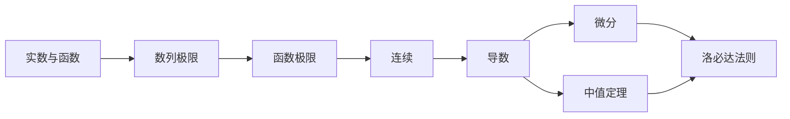

# 微积分期中复习：从极限到洛必达

> [!abstract] 这份笔记怎么用
> - **范围**：实数与函数 → 数列极限 → 函数极限 → 连续 → 导数与微分 → 微分中值定理 → 洛必达法则（含）。
> - **标记**：`S` = 必考级，必须动手算；`A` = 常考级，要会写过程；`B` = 低频/理论，记住陈述即可。时间不够时，按 S → A → B 砍。
> - **用法**：先看第 9 节的时间表，按表跳到对应章节；每块结束必须有一份"输出"（默写/做题/讲出来），只看不写等于没复习。
> - 所有知识点都来自本库笔记，文末附了对应链接；笔记里有几处笔误，已在正文用"⚠️ 校勘"标出。

---

## 0. 考试范围与优先级

| 模块 | 核心内容 | 优先级 | 建议时间占比 | 主要题型 |
|---|---|---|---|---|
| 极限 | ε-N/ε-δ、性质、夹逼、单调有界、柯西、两个重要极限、等价无穷小 | **S** | 30% | 计算 + 定义证明 |
| 连续 | 连续定义、间断点分类、闭区间五定理、一致连续 | **A** | 15% | 分类、证明根、判断 |
| 导数与微分 | 定义、求导法则、隐函数/参数/高阶、微分与线性近似 | **S** | 25% | 计算 + 分段点可导 |
| 中值定理 | 费马、罗尔、拉格朗日、柯西、达布、辅助函数 | **S** | 20% | 证明题 |
| 洛必达 | 0/0、∞/∞、七种未定式、适用条件与陷阱 | **S** | 10% | 计算 |

> [!warning] 三个"性价比最高"的得分点
> 1. **极限计算**（等价无穷小 + 重要极限 + 洛必达）：题量最大，套路最固定。
> 2. **导数计算**（复合、隐函数、参数方程、高阶）：只要公式熟，几乎不丢分。
> 3. **中值定理证明**：记住 4 类辅助函数，证明题从"不会"变成"能写一半以上"。

---

## 1. 知识地图（先默写，再看）

一句话串起来：**极限是工具，连续是桥梁，导数是变化率，微分是线性近似，中值定理把整体变化和某点导数连起来，洛必达则用导数之比去算未定式。**

---

## 2. 极限：一切的地基

> 对应笔记：[[数列极限的概念]]、[[数列极限的性质]]、[[实数完备性与数列收敛]]、[[数列柯西准则]]、[[函数极限的概念]]、[[函数极限的性质和海涅定理]]、[[函数极限的柯西准则]]、[[无穷小与无穷大]]

### 2.1 数列极限的 ε-N 定义（S）

$$a_n\to a \iff \forall \varepsilon>0,\ \exists N\in\mathbb N,\ \forall n>N:\ \lvert a_n-a\rvert<\varepsilon.$$

- $N$ 只依赖 $\varepsilon$，可以取大；前有限项不影响极限。
- 不收敛于 $a$：$\exists\varepsilon_0>0,\ \forall N,\ \exists n>N:\ \lvert a_n-a\rvert\ge\varepsilon_0$。
- 证明模板：**写差 → 放大 → 解出 $n>\varphi(\varepsilon)$ → 取 $N=[\varphi(\varepsilon)]+1$**。
  - 常用放大：$n\ge1$ 时舍去负项、分母取小、$\lvert\sin k\rvert\le1$、二项式展开。

例：证明 $\dfrac{3n^2}{n^2-3}\to3$。

$$\left\lvert\frac{3n^2}{n^2-3}-3\right\rvert=\frac{9}{n^2-3}<\frac{18}{n^2}\quad(n\ge3),$$

取 $N=\max\{3,\lceil\sqrt{18/\varepsilon}\rceil\}$ 即可。

### 2.2 收敛数列的性质（A）

| 性质 | 内容 | 注意 |
|---|---|---|
| 唯一性 | 极限唯一 | — |
| 有界性 | 收敛 ⇒ 有界 | 反之不成立：$(-1)^n$ |
| 保号性 | 极限 $a>0$ ⇒ 充分大时 $a_n>0$ | 只能“充分大” |
| 比较性 | 充分大时 $a_n\le b_n$ ⇒ $a\le b$ | 严格化不成立 |
| 四则运算 | 和差积商（分母极限 $\ne0$） | 先确认两个极限都存在 |
| 子列 | $a_n\to a$ ⇔ 任意子列 $\to a$ | "任意"不能弱化为"存在" |
| 迫敛性 | $a_n\le c_n\le b_n$，两端同极限 | 常用于 $n$ 项和 |
| 单调有界 | 递增有上界 ⇒ 收敛于上确界 | 由确界原理证明 |

> [!warning] 常见误区
> 有界 ⇏ 收敛；$a_n<b_n$ ⇏ $a<b$；$a_n+b_n$ 收敛 ⇏ 各自收敛。性质是**必要条件**，不能拿来判收敛。

### 2.3 判断收敛的六件工具（S/A）

| 工具 | 适用信号 | 一句话做法 |
|---|---|---|
| 迫敛（夹逼） | $n$ 项和、振荡因子乘无穷小 | 找最大/最小项，或 $\lvert\cdot\rvert\le$ 有界 × 无穷小 |
| 单调有界 | 递推数列 $a_{n+1}=f(a_n)$ | 归纳有界 + 证单调 + 两边取极限解方程 |
| 柯西准则 | 不需要预知极限值 | 证 $\lvert a_{n+p}-a_n\rvert<\varepsilon$，常配合裂项/放缩 |
| 致密性定理 | 要取收敛子列 | 有界数列必有收敛子列 |
| 海涅定理 | 函数极限化归数列 | 找两列 $x_n\to x_0$ 但 $f(x_n)$ 极限不同 ⇒ 不存在 |
| Stolz 定理 | 离散的 ∞/∞ | $y_n\uparrow+\infty$ 时 $\lim x_n/y_n=\lim \Delta x_n/\Delta y_n$ |

- 柯西准则：$a_n$ 收敛 ⇔ $\forall\varepsilon>0,\exists N,\forall m,n>N:\lvert a_m-a_n\rvert<\varepsilon$。否定形式是"存在 $\varepsilon_0$，任意 $N$ 都能找到 $n,p$ 使差 $\ge\varepsilon_0$"。
- Stolz 两个条件缺一不可：$y_n$ 严格递增趋于 $+\infty$；差商极限存在（有限或 $\pm\infty$）。
- 常用结论：$\dfrac1{n^\alpha}\to0\ (\alpha>0)$，$\sqrt[n]a\to1\ (a>0)$，$\sqrt[n]n\to1$，$\dfrac{\ln n}{n}\to0$。

### 2.4 函数极限的六种过程（A）

| 过程 | 语言 | 要点 |
|---|---|---|
| $x\to x_0$ | $\forall\varepsilon>0,\exists\delta>0,\ 0<\lvert x-x_0\rvert<\delta\Rightarrow\lvert f-A\rvert<\varepsilon$ | 去心邻域，$f(x_0)$ 可有可无 |
| $x\to x_0^\pm$ | 同上，改为单侧 | 左右极限都存在且相等 ⇔ 双侧极限存在 |
| $x\to+\infty$ | $\forall\varepsilon>0,\exists M,\ x>M\Rightarrow\lvert f-A\rvert<\varepsilon$ | $M$ 不必是整数 |
| $x\to-\infty$ | $x<-M$ | — |
| $x\to\infty$ | $\lvert x\rvert>M$ | 必须两侧都存在且相等 |

- **海涅定理**：$\lim_{x\to x_0}f=A$ ⇔ 对任意 $x_n\ne x_0,\ x_n\to x_0$，都有 $f(x_n)\to A$。判不存在：取两列极限不同，如 $\sin\frac1x$ 在 $0$ 处取 $x_n=\frac1{2n\pi}$ 与 $\frac1{2n\pi+\pi/2}$。
- **函数柯西准则**：极限存在 ⇔ $\forall\varepsilon>0,\exists\delta>0,\forall x_1,x_2\in U^\circ(x_0,\delta):\lvert f(x_1)-f(x_2)\rvert<\varepsilon$。
- **局部性质**：局部有界、局部保号、四则运算、复合运算。复合极限要小心：$\lim g=b$、$\lim_{u\to b}f=A$ 时，还需 $g(x)\ne b$（或 $f$ 在 $b$ 连续），否则可能出错。

### 2.5 两个重要极限（S，必须默写）

$$\lim_{x\to0}\frac{\sin x}{x}=1,\qquad \lim_{x\to0}(1+x)^{1/x}=e,\qquad \lim_{x\to\infty}\left(1+\frac1x\right)^x=e.$$

**$1^\infty$ 型统一处理**：若 $f(x)\to0$，$g(x)\to\infty$，且 $f(x)g(x)\to k$，则

$$(1+f(x))^{g(x)}\to e^{k}.$$

例：$\lim_{x\to\infty}\left(1+\frac3x\right)^{2x}=e^{6}$；$\lim_{x\to0}(\cos x)^{1/x^2}=e^{-1/2}$（指数部分用洛必达或等价无穷小）。

> [!note] 幂指型三步法
> 1. 写成 $e^{g(x)\ln(\text{底})}$；
> 2. 单独算指数部分的极限（通常是 $0/0$ 或 $\infty/\infty$）；
> 3. 结果放回 $e$ 的指数上。不要直接写 $1^\infty=1$。

### 2.6 等价无穷小（S，必须条件反射）

以下均在 $x\to0$ 时成立：

| 等价式 | 备注 |
|---|---|
| $\sin x\sim x$，$\tan x\sim x$ | 角度用弧度 |
| $\arcsin x\sim x$，$\arctan x\sim x$ | — |
| $1-\cos x\sim\dfrac{x^2}{2}$ | 高频 |
| $\ln(1+x)\sim x$ | — |
| $e^x-1\sim x$ | — |
| $a^x-1\sim x\ln a$ | $a>0,a\ne1$ |
| $(1+x)^\alpha-1\sim\alpha x$ | $\alpha\ne0$，可换 $x$ 为 $u(x)\to0$ |
| $\log_a(1+x)\sim\dfrac{x}{\ln a}$ | — |

补充（学有余力，用泰勒一眼可得）：$x-\sin x\sim\dfrac{x^3}{6}$，$\tan x-x\sim\dfrac{x^3}{3}$，$x-\ln(1+x)\sim\dfrac{x^2}{2}$。

**替换规则**：等价替换只对**乘除因子**成立。加减结构必须先合并、通分、因式分解或有理化，再替换。

> [!danger] 经典反例
> $\lim_{x\to0}\dfrac{\tan x-\sin x}{\sin^3x}$。若把 $\tan x,\sin x$ 都换成 $x$，得 $0$，**错**。
> 正确：$\tan x-\sin x=\dfrac{\sin x(1-\cos x)}{\cos x}\sim\dfrac{x\cdot x^2/2}{1}=\dfrac{x^3}{2}$，故极限为 $\dfrac12$。

### 2.7 极限计算决策树（S）

1. **先代入**：不是未定式就直接算，别急着求导。
2. **看结构**：有根式→有理化；有分式→通分；有公因子→约分。
3. **乘除因子**→等价无穷小替换。
4. **幂指型**（$1^\infty,0^0,\infty^0$）→取对数。
5. **$0/0$ 或 $\infty/\infty$**→洛必达（先化简再导，能替换的先替换）。
6. **振荡**（$\sin\frac1x$ 型）→夹逼或海涅定理。
7. **递推数列**→单调有界。

---

## 3. 连续

> 对应笔记：[[函数的连续性]]、[[连续函数的整体性质]]、[[一致连续与实数完备性]]

### 3.1 连续的三种等价说法（A）

$f$ 在 $x_0$ 连续 ⇔

$$\lim_{x\to x_0}f(x)=f(x_0)\iff \lim_{\Delta x\to0}\Delta y=0\iff \forall\varepsilon>0,\exists\delta>0,\ \lvert x-x_0\rvert<\delta\Rightarrow\lvert f(x)-f(x_0)\rvert<\varepsilon.$$

注意与极限定义的区别：连续要求**含心**邻域，且 $f(x_0)$ 必须有定义、等于极限值。

- 左连续 + 右连续 ⇔ 连续；区间端点按单侧连续。
- 初等函数在其定义区间内连续。
- 连续函数四则运算、复合仍连续（分母不为零）。

### 3.2 间断点分类（A，选择题高频）

先求 $x_0$ 处的左右极限，再看 $f(x_0)$：

| 类型 | 特征 | 例子 |
|---|---|---|
| 第一类·可去 | 左右极限存在且相等，但不等于 $f(x_0)$ 或无定义 | $\dfrac{\sin x}{x}$ 在 $0$；$\dfrac{x^2-1}{x-1}$ 在 $1$ |
| 第一类·跳跃 | 左右极限都存在但不等 | $\operatorname{sgn}x$ 在 $0$；$\dfrac{\lvert x\rvert}{x}$ 在 $0$ |
| 第二类·无穷 | 至少一侧极限为 $\infty$ | $\dfrac1x$、$\dfrac1{x^2}$ 在 $0$ |
| 第二类·振荡 | 至少一侧极限不存在且振荡 | $\sin\dfrac1x$ 在 $0$ |

### 3.3 闭区间上连续函数的五条整体性质（A）

设 $f\in C[a,b]$（闭区间、连续，两个条件缺一不可）：

| 定理 | 结论 |
|---|---|
| 有界性 | $f$ 在 $[a,b]$ 上有界 |
| 最值定理 | $f$ 在 $[a,b]$ 上取到最大值与最小值 |
| 零点定理 | $f(a)f(b)\le0$ ⇒ 存在 $\xi\in[a,b]$，$f(\xi)=0$（若 $<0$，则 $\xi\in(a,b)$） |
| 介值定理 | 对任意介于 $f(a),f(b)$ 之间的 $r$，存在 $\xi$，$f(\xi)=r$ |
| 康托尔定理 | $f$ 在 $[a,b]$ 上一致连续 |

常用推论：
- 一维不动点：$f:[a,b]\to[a,b]$ 连续 ⇒ 存在 $\xi$，$f(\xi)=\xi$（令 $F=f-x$）。
- 奇次实系数多项式至少有一个实根。
- 证明方程有根：移项构造 $F$，找异号端点，用零点定理。

> [!warning] 条件不能省
> $\dfrac1x$ 在 $(0,1]$ 连续但无界、无最大值；$x$ 在 $(0,1)$ 连续但无最值。开区间不保证。

### 3.4 一致连续（B，记定义 + 会判断）

**定义**：$\forall\varepsilon>0,\ \exists\delta>0,\ \forall x_1,x_2\in I$，$\lvert x_1-x_2\rvert<\delta\Rightarrow\lvert f(x_1)-f(x_2)\rvert<\varepsilon$。关键：$\delta$ 只依赖 $\varepsilon$，与点的位置无关。

- 一致连续 ⇒ 连续；反之不成立。
- **数列判别**：$f$ 在 $I$ 上不一致连续 ⇔ 存在 $\varepsilon_0>0$ 与 $x_n,y_n\in I$，$x_n-y_n\to0$，但 $\lvert f(x_n)-f(y_n)\rvert\ge\varepsilon_0$。
  - 例：$x^2$ 在 $(0,+\infty)$ 上非一致连续，取 $x_n=\sqrt n,\ y_n=\sqrt{n-1}$，差为 $1$。
  - 例：$\dfrac1x$ 在 $(0,1]$ 上非一致连续；$\sin x$ 在 $\mathbb R$ 上一致连续（$\lvert\sin x-\sin y\rvert\le\lvert x-y\rvert$）。
- **康托尔定理**：闭区间上连续 ⇒ 一致连续。判断"闭区间 + 连续"是最快路径。

### 3.5 实数完备性（B，只记结论与关系）

六条等价定理：**确界原理、单调有界原理、柯西准则、闭区间套定理、聚点定理、有限覆盖定理**。

- 确界原理：非空有上界（下界）的实数集必有上（下）确界。
- 区间套：闭区间逐层包含且长度 $\to0$ ⇒ 存在唯一公共点。
- 聚点：有界无限集必有聚点（聚点可以不在集合内）。
- 有限覆盖：闭区间的任一开覆盖有有限子覆盖。
- 考试若考证明，多数是"用致密性定理证有界/最值/康托尔"或"用区间套证零点定理"；时间不够时，**优先背陈述和证明思路**，不要死磕细节。

---

## 4. 导数与微分

> 对应笔记：[[导数的概念和基本性质]]、[[一元函数求导的进阶方法与高阶导数]]、[[一元函数的高阶导数、微分与微分中值定理]]

### 4.1 导数定义与可导性（S）

$$f'(x_0)=\lim_{x\to x_0}\frac{f(x)-f(x_0)}{x-x_0}=\lim_{\Delta x\to0}\frac{f(x_0+\Delta x)-f(x_0)}{\Delta x}.$$

- 左导数 $f'_-(x_0)$、右导数 $f'_+(x_0)$：把 $\Delta x\to0$ 换成单侧。
- **可导 ⇔ 左右导数都存在且相等**。
- **可导 ⇒ 连续**；反之不成立：$\lvert x\rvert$ 在 $0$ 连续不可导；$x\sin\dfrac1x$（$f(0)=0$）在 $0$ 连续但导数不存在。
- 分段函数在分界点：**必须用定义**求左右导数，不能直接套求导公式。
- 经典结论：$f(x)=x^m\sin\dfrac1x\ (x\ne0),\ f(0)=0$：连续 ⇔ $m>0$；可导 ⇔ $m>1$（且 $f'(0)=0$）；$f'$ 在 $0$ 连续 ⇔ $m>2$。

### 4.2 求导公式表（S，必须默写）

| 函数 | 导数 | 函数 | 导数 |
|---|---|---|---|
| $c$ | $0$ | $x^\alpha$ | $\alpha x^{\alpha-1}$ |
| $a^x$ | $a^x\ln a$ | $e^x$ | $e^x$ |
| $\log_a x$ | $\dfrac1{x\ln a}$ | $\ln x$ | $\dfrac1x$ |
| $\sin x$ | $\cos x$ | $\cos x$ | $-\sin x$ |
| $\tan x$ | $\sec^2x$ | $\cot x$ | $-\csc^2x$ |
| $\sec x$ | $\sec x\tan x$ | $\csc x$ | $-\csc x\cot x$ |
| $\arcsin x$ | $\dfrac1{\sqrt{1-x^2}}$ | $\arccos x$ | $-\dfrac1{\sqrt{1-x^2}}$ |
| $\arctan x$ | $\dfrac1{1+x^2}$ | $\operatorname{arccot}x$ | $-\dfrac1{1+x^2}$ |

法则：$(f\pm g)'=f'\pm g'$，$(fg)'=f'g+fg'$，$\left(\dfrac fg\right)'=\dfrac{f'g-fg'}{g^2}$，$[f(g(x))]'=f'(g(x))g'(x)$。

### 4.3 进阶求导（五类）（S）

**（1）反函数**：$y=f(x)$ 严格单调、可导、$f'(x)\ne0$，则

$$(f^{-1})'(y)=\frac1{f'(x)},\qquad x=f^{-1}(y).$$

注意变量对应：原函数在 $x$ 处求导，反函数在 $y=f(x)$ 处取值。

**（2）参数方程**：$x=\varphi(t),\ y=\psi(t)$，

$$\frac{dy}{dx}=\frac{\psi'(t)}{\varphi'(t)},\qquad \frac{d^2y}{dx^2}=\frac1{\varphi'(t)}\frac{d}{dt}\left(\frac{\psi'}{\varphi'}\right)=\frac{\psi''\varphi'-\psi'\varphi''}{(\varphi')^3}.$$

> [!danger] 最高频错误
> 二阶导不是 $\dfrac{\psi''}{\varphi''}$，也不是把 $\dfrac{\psi'}{\varphi'}$ 直接再对 $t$ 求导就完事——**还要除以 $x'(t)$**。

例：$x=a\cos\theta,\ y=b\sin\theta$：$y'=-\dfrac ba\cot\theta$，$y''=-\dfrac{b}{a^2\sin^3\theta}$。

**（3）隐函数**：$F(x,y)=0$，则

$$y'=-\frac{F_x}{F_y}\quad(F_y\ne0),\qquad y''=-\frac{F_{xx}+2F_{xy}y'+F_{yy}(y')^2}{F_y}.$$

做法：两边对 $x$ 求导，遇到 $y$ 就乘 $y'$；求二阶导时把 $y'$ 代入，$y$ 仍视为 $x$ 的函数。例 $x^2+y^2=1$：$y'=-\dfrac xy$，$y''=-\dfrac1{y^3}$。

**（4）对数求导 / 幂指函数**：$y=u(x)^{v(x)}$ 或多因子乘除，先取对数：

$$y'=y\cdot(\ln y)'=y\left(v'\ln u+v\frac{u'}{u}\right).$$

**（5）极坐标**：$x=\rho\cos\theta,\ y=\rho\sin\theta$，

$$\frac{dy}{dx}=\frac{\rho'\sin\theta+\rho\cos\theta}{\rho'\cos\theta-\rho\sin\theta}.$$

分母为 $0$ 时是竖直切线，需单独判断。

### 4.4 高阶导数与莱布尼茨（S）

| 函数 | $n$ 阶导数 |
|---|---|
| $e^{ax}$ | $a^ne^{ax}$ |
| $\sin x$ | $\sin\left(x+\dfrac{n\pi}{2}\right)$ |
| $\cos x$ | $\cos\left(x+\dfrac{n\pi}{2}\right)$ |
| $\dfrac1{ax+b}$ | $\dfrac{(-1)^nn!a^n}{(ax+b)^{n+1}}$ |
| $x^\alpha$ | $\alpha(\alpha-1)\cdots(\alpha-n+1)x^{\alpha-n}$ |
| $\ln x$ | $\dfrac{(-1)^{n-1}(n-1)!}{x^n}$ |

**莱布尼茨公式**：

$$(uv)^{(n)}=\sum_{k=0}^{n}\binom nk u^{(k)}v^{(n-k)}.$$

技巧：把多项式选作 $u$，它的高阶导很快变成 $0$，只留前几项。

例：$(x^2e^{2x})^{(20)}=2^{20}e^{2x}(x^2+20x+95)$。

### 4.5 微分与线性近似（A）

**定义**：若 $\Delta y=A\Delta x+o(\Delta x)$（$A$ 与 $\Delta x$ 无关），则 $f$ 在 $x_0$ 可微，$\mathrm{d}y=A\Delta x$。

- 一元函数：**可微 ⇔ 可导**，且 $A=f'(x_0)$，$\mathrm{d}y=f'(x)\mathrm{d}x$。
- 一阶微分形式不变性：$y=f(u)$ 时 $\mathrm{d}y=f'(u)\mathrm{d}u$，无论 $u$ 是自变量还是中间变量。
- 高阶微分：$x$ 为自变量时 $\mathrm{d}^2y=f''(x)(\mathrm{d}x)^2$（$\mathrm{d}x$ 视为常数）。
- 线性近似：

$$f(x_0+\Delta x)\approx f(x_0)+f'(x_0)\Delta x.$$

例：$\sin33^\circ\approx\dfrac12+\dfrac{\sqrt3}{2}\cdot\dfrac{\pi}{60}\approx0.5453$；$\sqrt[5]{245}\approx3+\dfrac2{405}\approx3.00494$。

> [!warning] 近似题三件事
> 角度必须用弧度；$x_0$ 选附近好算的点（完全平方/立方/五次方）；$\Delta x$ 要小，否则误差大。

---

## 5. 微分中值定理

> 对应笔记：[[微分中值定理]]、[[一元函数的高阶导数、微分与微分中值定理]]

### 5.1 一张表记住中值定理家族（S）

| 定理 | 条件 | 结论 | 几何 |
|---|---|---|---|
| 费马引理 | $x_0$ 是**内部**极值点，$f$ 在 $x_0$ 可导 | $f'(x_0)=0$ | 峰谷处切线水平 |
| 罗尔 | $f\in C[a,b]$，在 $(a,b)$ 可导，$f(a)=f(b)$ | $\exists\xi\in(a,b),\ f'(\xi)=0$ | 两端同高，中间有水平切线 |
| 拉格朗日 | $f\in C[a,b]$，在 $(a,b)$ 可导 | $\exists\xi\in(a,b),\ f(b)-f(a)=f'(\xi)(b-a)$ | 切线平行于割线 |
| 柯西 | $f,g\in C[a,b]$，在 $(a,b)$ 可导，$g'\ne0$ | $\exists\xi,\ \dfrac{f(b)-f(a)}{g(b)-g(a)}=\dfrac{f'(\xi)}{g'(\xi)}$ | 参数曲线切线平行于割线 |
| 达布 | $f$ 在区间上可导 | $f'$ 具有介值性 | 导函数无第一类间断点 |

> [!important] 条件默念口诀
> **闭区间连续、开区间可导**；罗尔多一句"两端相等"；柯西多一句"$g'\ne0$"；费马多一句"内部极值"。

- 拉格朗日变形：$f(a+h)-f(a)=f'(a+\theta h)h$，$\theta\in(0,1)$，且 $\theta$ 通常依赖 $h$。
- 推论：区间上 $f'\equiv0$ ⇒ $f\equiv C$；$f'=g'$ ⇒ $f=g+C$。
- 达布定理：$f$ 可导 ⇒ $f'$ 取遍介于 $f'(x_1),f'(x_2)$ 之间的一切值；因此 $f'$ 不可能有第一类间断点（跳跃或可去）。

### 5.2 证明链（A，简答题可能考）

$$\text{费马引理}\Longrightarrow\text{罗尔定理}\Longrightarrow\text{拉格朗日}\Longrightarrow\text{柯西}$$

- 罗尔：闭区间连续 ⇒ 取到最值；$f(a)=f(b)$ ⇒ 至少一个最值在内部；费马引理给出导数为 $0$。
- 拉格朗日：构造"原函数 − 割线" $F(x)=f(x)-f(a)-\dfrac{f(b)-f(a)}{b-a}(x-a)$，则 $F(a)=F(b)=0$，用罗尔。
- 柯西：令 $k=\dfrac{f(b)-f(a)}{g(b)-g(a)}$，构造 $F=f-f(a)-k[g-g(a)]$，用罗尔。
- 洛必达：对 $\dfrac{f(x)}{g(x)}$ 在 $[x_0,x]$ 上用柯西中值定理，再令 $x\to x_0$。

### 5.3 辅助函数构造表（S，证明题的核心）

把要证的结论整理成"某个 $F'(\xi)=0$"，再对 $F$ 用罗尔定理。

| 结论长相 | 构造 $F(x)$ | 备注 |
|---|---|---|
| $f'(\xi)+\lambda f(\xi)=0$ | $e^{\lambda x}f(x)$ | 最常用；$\lambda=1$ 即 $e^xf$ |
| $f'(\xi)-\lambda f(\xi)=0$ | $e^{-\lambda x}f(x)$ | 如证 $f'(\xi)=f(\xi)$ |
| $f'(\xi)g(\xi)-f(\xi)g'(\xi)=0$ | $\dfrac{f(x)}{g(x)}$ | 分式结构 |
| $f'(\xi)+f(\xi)g'(\xi)=0$ | $f(x)e^{g(x)}$ | 指数乘子推广 |
| $f'(\xi)=k$（常数） | $f(x)-kx$ | 证导数等于定值 |
| 出现 $f(b)-f(a)$ 与 $b-a$ | 直接用拉格朗日 | 不必构造 |
| 出现两个函数的增量比 | 直接用柯西 | $g$ 常取 $x,\ln x,x^2$ |

例（必会）：$f\in C[a,b]$，在 $(a,b)$ 可导，$f(a)=f(b)=0$，证明存在 $\xi$ 使 $f'(\xi)=f(\xi)$。

令 $F(x)=e^{-x}f(x)$，则 $F(a)=F(b)=0$，罗尔得 $F'(\xi)=e^{-\xi}(f'(\xi)-f(\xi))=0$，故 $f'(\xi)=f(\xi)$。

### 5.4 中值定理的常见用途（A）

1. **证不等式**：把 $f(b)-f(a)$ 用 $f'(\xi)(b-a)$ 放大/缩小。例：$e^x\ge1+x$。
2. **证恒等式**：先证两边导数相等，再代一个点定常数。例：$\arcsin x+\arccos x=\dfrac\pi2$。
3. **证根的唯一性**：存在性用零点定理，唯一性用"$f'\ne0$"或单调性。
4. **证有界/Lipschitz**：$\lvert f'(x)\rvert\le M$ ⇒ $\lvert f(x)-f(y)\rvert\le M\lvert x-y\rvert$。

---

## 6. 洛必达法则

> 对应笔记：[[洛必达法则]]

### 6.1 两个定理（S，条件必须背）

**$\dfrac00$ 型**：设

1. $\lim\limits_{x\to x_0}f(x)=\lim\limits_{x\to x_0}g(x)=0$；
2. $f,g$ 在 $x_0$ 的某去心邻域内可导，且 $g'(x)\ne0$；
3. $\lim\limits_{x\to x_0}\dfrac{f'(x)}{g'(x)}=A$（$A$ 为有限数或 $\pm\infty$）；

则

$$\lim_{x\to x_0}\frac{f(x)}{g(x)}=\lim_{x\to x_0}\frac{f'(x)}{g'(x)}=A.$$

**$\dfrac{\infty}{\infty}$ 型**：把条件 1 换成 $\lim\limits_{x\to x_0}g(x)=\infty$ 即可，**不要求分子趋于无穷**。

> [!warning] ⚠️ 校勘
> 原笔记 [[洛必达法则]] 的定理结论处把 $\lim\dfrac fg=A$ 误写成了 $\lim\dfrac{f'}{g'}=A$（两处），且 $0/0$ 型条件 1 只写了分母趋于 $0$。以上面为准：**分子、分母都要趋于 $0$**，结论是**原极限**等于导数之比的极限。

极限过程可换成 $x\to x_0^\pm$、$x\to\pm\infty$、$x\to\infty$，条件作相应调整。

### 6.2 七种未定式与转化（S）

| 类型 | 转化方法 | 典型例子 |
|---|---|---|
| $\dfrac00$ | 直接洛必达（先化简/等价替换） | $\lim\limits_{x\to0}\dfrac{e^x-1-x}{x^2}=\dfrac12$ |
| $\dfrac{\infty}{\infty}$ | 直接洛必达 | $\lim\limits_{x\to+\infty}\dfrac{\ln x}{x^n}=0$ |
| $0\cdot\infty$ | 把其中一个因子移到分母，变成 $\dfrac00$ 或 $\dfrac{\infty}{\infty}$ | $\lim\limits_{x\to0^+}x\ln x=0$ |
| $1^\infty$ | 取对数：$e^{g\ln(1+f)}$，算 $fg$ | $\lim\limits_{x\to0}(\cos x)^{1/x^2}=e^{-1/2}$ |
| $0^0$ | 取对数 | $\lim\limits_{x\to0^+}x^x=1$ |
| $\infty^0$ | 取对数 | $\lim\limits_{x\to+\infty}(x+\sqrt{1+x^2})^{1/\ln x}=e$ |
| $\infty-\infty$ | 通分、有理化、提公因式 | $\lim\limits_{x\to1}\left(\dfrac1{x-1}-\dfrac1{\ln x}\right)=-\dfrac12$ |

> [!tip] 选谁进分母？
> $0\cdot\infty$ 型优先把"求导后会变简单"的因子放进分母：$x\ln x$ 选 $\dfrac{\ln x}{1/x}$（求导后相除化简为 $-x$，越导越简单）。

### 6.3 五个必做例题（S）

1. $\lim\limits_{x\to\pi}\dfrac{1+\cos x}{\tan^2x}=\dfrac12$（$0/0$，求导后化 $\cos^3x$）。
2. $\lim\limits_{x\to0}\dfrac{e^x-\sqrt{1+2x}}{\ln(1+x^2)}=1$（先换分母 $\sim x^2$，再两次洛必达）。
3. $\lim\limits_{x\to0^+}\dfrac{\sqrt x}{1-e^{\sqrt x}}=-1$（令 $y=\sqrt x$ 换元）。
4. $\lim\limits_{x\to+\infty}\dfrac{e^x}{x^3}=+\infty$（连续三次洛必达）。
5. $\lim\limits_{x\to1}\left(\dfrac1{x-1}-\dfrac1{\ln x}\right)=-\dfrac12$（通分 + $\ln x\sim x-1$）。

### 6.4 四个陷阱（S）

**陷阱 1：不是未定式不能用。** $\lim\limits_{x\to0}\dfrac{x+1}{x+2}=\dfrac12$，若洛必达得 $1$，错。

**陷阱 2：求导后极限不存在 ≠ 原极限不存在。**

$$\lim_{x\to+\infty}\frac{x+\sin x}{x}=1,\qquad\text{但}\quad \frac{1+\cos x}{1}\ \text{的极限不存在}.$$

同理 $\lim\limits_{x\to0}\dfrac{x^2\sin(1/x)}{x}=0$，但导数之比 $\dfrac{2x\sin(1/x)-\cos(1/x)}{1}$ 无极限。**洛必达是充分条件，不是必要条件。**

**陷阱 3：循环或越导越复杂时，停下来用代数变形。** 如 $\lim\limits_{x\to+\infty}\dfrac{x}{\sqrt{1+x^2}}$，洛必达后来回循环；直接除以 $x$ 得 $1$。

**陷阱 4：每一步都要重新验证条件和 $g'(x)\ne0$。** 不能因为第一步是 $0/0$，就一路求导到底；求导后可能已不是未定式。

### 6.5 使用前检查清单

- [ ] 现在是七种未定式中的哪一种？写下来。
- [ ] 是 $\dfrac00$ 或 $\dfrac{\infty}{\infty}$ 吗？分子、分母的条件都满足吗？
- [ ] 去心邻域内 $g'(x)\ne0$ 吗？
- [ ] 能不能先等价替换/约分/换元，让求导更简单？
- [ ] 求导后是什么型？还要继续吗？
- [ ] 结果是否与函数增长阶的直觉一致？（$\ln x\ll x^\alpha\ll e^x$）

---

## 7. 高频题型 14 个模板

| # | 题型 | 识别信号 | 步骤 |
|---|---|---|---|
| 1 | ε-N 证明 | "用定义证明 $\lim a_n=a$" | 写差 → 放大 → 解 $n>\varphi(\varepsilon)$ → 取 $N$ |
| 2 | ε-δ 证明 | "用定义证明 $\lim f=A$" | 写 $\lvert f-A\rvert$ → 放大成 $k\lvert x-x_0\rvert$ → 取 $\delta=\varepsilon/k$ |
| 3 | 夹逼 | $n$ 项和、振荡×无穷小 | 找最大/最小项；或 $\lvert\cdot\rvert\le$ 有界×无穷小 |
| 4 | 单调有界 | 递推 $a_{n+1}=f(a_n)$ | 归纳有界 → 证单调 → 设极限 $A$ 解 $A=f(A)$ |
| 5 | $1^\infty$ | 底 $\to1$，指数 $\to\infty$ | 写成 $e^{g\ln(1+f)}$ → 算 $fg$ → $e^k$ |
| 6 | 等价无穷小 | 乘除结构，$x\to0$ | 整体替换；加减先变形 |
| 7 | 洛必达 | $0/0$ 或 $\infty/\infty$ | 验条件 → 求导 → 看型 → 必要时再导 |
| 8 | 间断点分类 | 分段函数、绝对值、$e^{1/x}$ | 求左右极限 → 对比 $f(x_0)$ → 定类 |
| 9 | 零点/介值 | "证明方程有根" | 构造 $F$ → 找异号端点 → 用定理 |
| 10 | 分段点可导 | 含 $\lvert x\rvert$、$x^m\sin\frac1x$ | 先判连续 → 用定义算左右导数 |
| 11 | 参数/隐函数二阶导 | $x=x(t),y=y(t)$；$F(x,y)=0$ | 一阶 → 再对 $t$（或 $x$）求导 → 代回 |
| 12 | 高阶导 | $x^m e^{ax}$、有理函数 | 莱布尼茨，多项式作 $u$；或先拆项 |
| 13 | 中值定理证明 | "存在 $\xi$ 使……" | 结论整理成 $F'(\xi)=0$ → 构造 $F$ → 验罗尔三条件 |
| 14 | 线性近似 | "求近似值" | 选 $x_0$ → 算 $f,f'$ → 代入 $f(x_0)+f'(x_0)\Delta x$ |

---

## 8. 易错点清单（考前扫一遍）

### 极限

- [x] 加减项逐项等价替换（$\tan x-\sin x$ 换成 $x-x$）。
- [x] 把 $1^\infty$ 直接写成 $1$。
- [x] 只算单侧极限就下结论；$x\to\infty$ 忘记两侧。
- [x] 用四则运算时没确认两个极限都存在。
- [x] 认为"有界 ⇒ 收敛"。
- [x] 柯西准则否定式的量词顺序写反。
- [x] 复合极限忽略 $g(x)\ne b$。

### 连续

- [x] 把"极限存在"当成"连续"（还要 $f(x_0)$ 有定义且相等）。
- [x] 间断点不先看左右极限是否存在，直接下分类。
- [x] 忘记闭区间条件（开区间没有最值定理）。
- [x] 一致连续：误以为 $\delta$ 可以随点变化（$\delta$ 必须只依赖 $\varepsilon$）；$\frac1x$ 在 $(0,1]$ 上非一致连续。

### 导数与微分

- [x] 认为"连续 ⇒ 可导"。
- [x] 分段点直接套公式，不用定义。
- [x] 参数方程二阶导写成 $\frac{\psi''}{\varphi''}$。
- [x] 隐函数求导忘记 $y$ 是 $x$ 的函数，漏乘 $y'$。
- [x] $(fg)'=f'g'$。
- [x] 反函数求导变量对应错：$(f^{-1})'(y)=1/f'(x)$。
- [x] 莱布尼茨漏掉 $\binom nk$。
- [x] 把 $\mathrm{d}^2y=f''(x)\mathrm{d}x^2$ 用在 $x$ 不是自变量的情形。

### 中值定理

- [x] 条件写错：闭区间连续、开区间可导；罗尔要 $f(a)=f(b)$；柯西要 $g'\ne0$。
- [x] 认为 $f'(x_0)=0$ ⇒ 极值点（$x^3$ 是反例）。
- [x] 认为极值点一定可导（$\lvert x\rvert$ 是反例）。
- [x] 忘记 $\xi$ 依赖区间、$\theta$ 依赖 $h$。
- [x] 构造了辅助函数却不验证罗尔三条件。

### 洛必达

- [x] 非未定式直接用。
- [x] 把洛必达当成对商整体求导（应分子、分母分别求导）。
- [x] 求导后极限不存在，就断言原极限不存在。
- [x] 每一步不检查 $g'(x)\ne0$。
- [x] 以为 $\infty/\infty$ 型要求分子也趋于 $\infty$。

---

## 9. 一晚上复习计划

> 以 **18:30 开始、22:50 结束** 为例，共约 4 小时 20 分，其中纯学习约 3 小时 50 分。晚开始就整体顺延；时间不够直接看 9.4 的急救版。

### 9.1 时间表

| 时间 | 模块 | 具体动作 | 完成标志 |
|---|---|---|---|
| 18:30–18:40 | 启动 | 空白纸默写第 1 节知识地图；写下最怕的 3 个点 | 能不看笔记画出主线 |
| 18:40–19:40 | 极限 + 连续 | ① 默写等价无穷小 8 条 + 两个重要极限（10'）② 做 6 道计算：等价替换 2、$1^\infty$ 2、夹逼 1、单调有界 1（25'）③ 间断点分类表 + 3 个例子（10'）④ 闭区间五定理"条件→结论"复述（15'） | 等价无穷小表全对；6 题至少对 4 题 |
| 19:40–19:50 | 休息 | 离开桌子、喝水、不刷手机 | — |
| 19:50–20:40 | 导数与微分 | ① 遮住右列默写求导公式表（10'）② 隐函数 1 题 + 参数方程 1 题（一阶+二阶）（15'）③ 莱布尼茨 1 题 + 高阶导公式（10'）④ 线性近似 1 题（10'）⑤ 分段点可导套路（5'） | 参数二阶导不写错；莱布尼茨独立完成 |
| 20:40–20:50 | 休息 | 站起来走动 | — |
| 20:50–21:35 | 中值定理 | ① 四个定理条件对比表默写（10'）② 辅助函数 4 类各记 1 个模板（10'）③ 做 3 道证明：$f'=f$、$f'+\lambda f=0$、拉格朗日证不等式（25'） | 能独立写出 $e^{\lambda x}f$、$f/g$、$f-kx$ 三类构造 |
| 21:35–21:45 | 休息 | — | — |
| 21:45–22:30 | 洛必达 | ① 背两个定理的条件 + 七种未定式表（10'）② 限时 6 题，每题 3 分钟：$0/0$、$\infty/\infty$、$0\cdot\infty$、$1^\infty$、$0^0$、$\infty-\infty$ 各 1（20'）③ 看 4 个陷阱 + 检查清单（10'） | 每题先写"型"；6 题至少对 4 题 |
| 22:30–22:50 | 自测 + 收尾 | ① 做第 10 节自测 5、7、8 题（12'）② 把今天错的题浓缩成 3 句话（5'）③ 默写"考前 30 分钟"公式（3'） | 错题清单不超过 10 条，每条一句话 |

### 9.2 每个模块的"输出标准"

- **极限**：给你一道题，先说出"什么型、用什么工具"，再动笔。
- **连续**：五定理能按"条件 → 结论"完整复述；间断点能先算左右极限。
- **导数**：公式表 30 秒内默写完；参数/隐函数二阶导一次写对。
- **中值定理**：看到结论能反应出辅助函数；写证明时先写"由罗尔定理，需验证……"。
- **洛必达**：每道题第一行写"型：$0/0$"，最后一行检查是否用了等价替换简化。

### 9.3 执行规则

1. **手机放另一个房间**，或开专注模式；每块 45–50 分钟，休息 10 分钟。
2. **卡住 5 分钟就跳过**，标记后继续；对答案时再回来。不要在一道题上耗 30 分钟。
3. **只做"会考"的题**：计算题为主，证明题每个类型 1–2 道，不做偏题怪题。
4. **错题只记三栏**：题目关键词 / 错因一句话 / 正确触发点。不要抄整道题。
5. **每个模块结束用 1 分钟自言自语讲一遍**（费曼技巧），讲不顺的就是没懂。
6. **22:50 必须停**。睡眠对第二天做证明题的作用，大于多刷 30 分钟题。

### 9.4 弹性方案

**如果 20:00 才开始（只剩约 2.5 小时）：**

- 40'：极限计算（等价无穷小 + $1^\infty$ + 4 道题）
- 30'：导数公式 + 参数/隐函数 + 高阶导
- 35'：中值定理条件 + $e^{\lambda x}f$ 构造 + 2 道证明
- 35'：洛必达七型 + 4 道题 + 陷阱
- 10'：错题清单 + 公式默写

**如果只剩 2 小时（急救版，只保 S）：**

1. 30'：极限计算——等价无穷小表 + 两个重要极限 + 6 道混合题。
2. 25'：导数——公式表 + 参数二阶导 + 隐函数 + 莱布尼茨各 1 题。
3. 25'：中值定理——四定理条件 + 3 类辅助函数 + 2 道证明。
4. 30'：洛必达——条件 + 七型 + 5 道题。
5. 10'：只看错题清单和"考前 30 分钟"。

**如果只剩 1 小时：** 洛必达 20' + 极限计算 15' + 中值定理 15' + 公式速览 10'。其余放弃，不内疚。

**如果现在很焦虑、坐不住：** 先做 5 道最简单的求导/极限题（比如 $\lim\frac{\sin3x}{x}$、$(\sin x^2)'$），用手感把注意力拉回来，再按表执行。计划是给你托底的，不是用来责备你的；完成 60% 也比空转一晚上强。

### 9.5 睡前 10 分钟 + 明早 15 分钟

**睡前**（不学新东西）：

- 默写：等价无穷小 8 条、导数公式表（挑 10 个最易错的）、洛必达两条件。
- 心里过一遍：罗尔 → 拉格朗日 → 柯西 的条件差异。
- 定闹钟，把错题清单放在桌上。

**明早**：

- 5'：看错题清单的"错因"一栏。
- 5'：默写七种未定式的转化方法。
- 5'：看一遍"洛必达检查清单"，进考场。

### 9.6 今晚的错题记录表（直接在这张表里填）

| 题号/关键词 | 错因（一句话） | 正确触发点 |
|---|---|---|
|  |  |  |
|  |  |  |
|  |  |  |
|  |  |  |
|  |  |  |
|  |  |  |

> [!tip] 填法
> "错因"写**动作**，不写"粗心"：例如"把参数方程二阶导写成 $\psi''/\varphi''$""加减项先替换了""忘记验证 $g'\ne0$"。
> "正确触发点"写**下次看到什么就做什么**：例如"看到参数方程求二阶导 → 先对 $t$ 求导再除以 $\varphi'$"。

---

## 10. 自测 8 题（先做，再展开答案）

1. $\lim\limits_{x\to0}\dfrac{\tan x-\sin x}{x^3}$
2. $\lim\limits_{x\to0}(1+2x)^{1/x}$
3. $\lim\limits_{x\to0^+}x^x$
4. $\lim\limits_{x\to+\infty}\dfrac{x+\sin x}{x}$
5. 设 $f(x)=x^2\sin\dfrac1x\ (x\ne0)$，$f(0)=0$。讨论 $f$ 在 $0$ 处的连续性与可导性，并求 $f'(0)$；$f'$ 在 $0$ 处连续吗？
6. 证明 $x^3-4x^2+1=0$ 在 $(0,1)$ 内至少有一个根。
7. 设 $f\in C[0,1]$，在 $(0,1)$ 可导，$f(0)=f(1)=0$。证明存在 $\xi\in(0,1)$，使 $f'(\xi)=f(\xi)$。
8. $\lim\limits_{x\to0}\dfrac{e^x-1-x}{x^2}$

> [!success]- 答案与提示（点开）
> 1. $\dfrac12$。先变形：$\tan x-\sin x=\dfrac{\sin x(1-\cos x)}{\cos x}\sim\dfrac{x^3}{2}$。
> 2. $e^2$。$(1+2x)^{1/x}=\left[(1+2x)^{1/(2x)}\right]^2\to e^2$。
> 3. $1$。$x^x=e^{x\ln x}$，$x\ln x\to0$。
> 4. $1$。拆成 $1+\dfrac{\sin x}{x}$，$\dfrac{\sin x}{x}\to0$。**洛必达失效**：$\dfrac{1+\cos x}{1}$ 无极限。
> 5. 连续：$\lvert f(x)\rvert\le x^2\to0=f(0)$。可导：$f'(0)=\lim\limits_{x\to0}\dfrac{x^2\sin(1/x)}{x}=\lim x\sin\dfrac1x=0$。但 $x\ne0$ 时 $f'(x)=2x\sin\dfrac1x-\cos\dfrac1x$，$\cos\dfrac1x$ 在 $0$ 处无极限，故 $f'$ 在 $0$ 处不连续。
> 6. 令 $F(x)=x^3-4x^2+1$，$F(0)=1>0$，$F(1)=-2<0$，零点定理。
> 7. 令 $F(x)=e^{-x}f(x)$，$F(0)=F(1)=0$，罗尔得 $F'(\xi)=e^{-\xi}(f'(\xi)-f(\xi))=0$。
> 8. $\dfrac12$。两次洛必达：$\dfrac{e^x-1}{2x}\to\dfrac{e^x}{2}\to\dfrac12$；或泰勒 $e^x=1+x+\dfrac{x^2}{2}+o(x^2)$。

---

## 11. 考前 30 分钟速览

| 主题 | 必须想起来的内容 |
|---|---|
| 等价无穷小 | $\sin x,\tan x,\arcsin x,\arctan x\sim x$；$1-\cos x\sim\frac{x^2}{2}$；$\ln(1+x)\sim x$；$e^x-1\sim x$；$(1+x)^\alpha-1\sim\alpha x$ |
| 重要极限 | $\frac{\sin x}{x}\to1$；$(1+x)^{1/x}\to e$；$1^\infty$：$(1+f)^g\to e^{\lim fg}$ |
| 求导 | 16 个基本公式；链式；$(f^{-1})'=1/f'$；$\left(\frac fg\right)'=\frac{f'g-fg'}{g^2}$ |
| 参数/隐函数 | $\frac{dy}{dx}=\frac{\psi'}{\varphi'}$；$\frac{d^2y}{dx^2}=\frac{\psi''\varphi'-\psi'\varphi''}{(\varphi')^3}$；$y'=-\frac{F_x}{F_y}$ |
| 高阶导 | $(e^{ax})^{(n)}=a^ne^{ax}$；$(\sin x)^{(n)}=\sin(x+\frac{n\pi}{2})$；莱布尼茨 |
| 微分 | $\mathrm{d}y=f'(x)\mathrm{d}x$；$f(x_0+\Delta x)\approx f(x_0)+f'(x_0)\Delta x$ |
| 中值定理 | 闭连续、开可导；罗尔 + $f(a)=f(b)$；柯西 + $g'\ne0$ |
| 辅助函数 | $f'+\lambda f\Rightarrow e^{\lambda x}f$；$f'g-fg'\Rightarrow f/g$；$f'-k\Rightarrow f-kx$ |
| 洛必达 | 只处理 $\frac00,\frac{\infty}{\infty}$；分子分母分别求导；每步验条件；求导后不存在 ≠ 原极限不存在 |
| 七种未定式 | $\frac00,\frac{\infty}{\infty}$ 直接；$0\cdot\infty$ 移项；幂指三种取对数；$\infty-\infty$ 通分 |

---

## 12. 对应笔记索引

- 实数与函数：[[微积分概述]]、[[确界原理]]、[[复合函数与反函数]]
- 数列极限：[[数列极限的概念]]、[[数列极限的性质]]、[[实数完备性与数列收敛]]、[[数列柯西准则]]
- 函数极限：[[函数极限的概念]]、[[函数极限的性质和海涅定理]]、[[函数极限的柯西准则]]、[[无穷小与无穷大]]
- 连续：[[函数的连续性]]、[[连续函数的整体性质]]、[[一致连续与实数完备性]]
- 导数与微分：[[导数的概念和基本性质]]、[[一元函数求导的进阶方法与高阶导数]]、[[一元函数的高阶导数、微分与微分中值定理]]
- 中值定理：[[微分中值定理]]
- 洛必达：[[洛必达法则]]

> [!note] 笔记校勘汇总
> - [[洛必达法则]]：$0/0$ 与 $\infty/\infty$ 定理的结论把原极限误写成导数之比；$0/0$ 条件 1 漏了分子趋于 $0$。
> - [[一元函数的高阶导数、微分与微分中值定理]]：费马引理"直观理解"中极大值点左侧应为"函数值不大于 $f(x_0)$"；$\mathrm{d}^2y=f''(x)\mathrm{d}x^2$ 需注明 $x$ 为自变量。
> - [[一致连续与实数完备性]]：frontmatter 标题误作"一直连续"。
> - [[函数极限的柯西准则]]：§4.1 关于"分子趋于 $0$ 比分母慢"的表述与 $\frac{\sin x}{x}\to1$ 矛盾，正确说法是"分母高阶则比值 $\to\infty$，同阶则趋于非零常数"。
